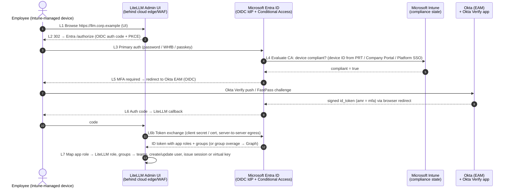
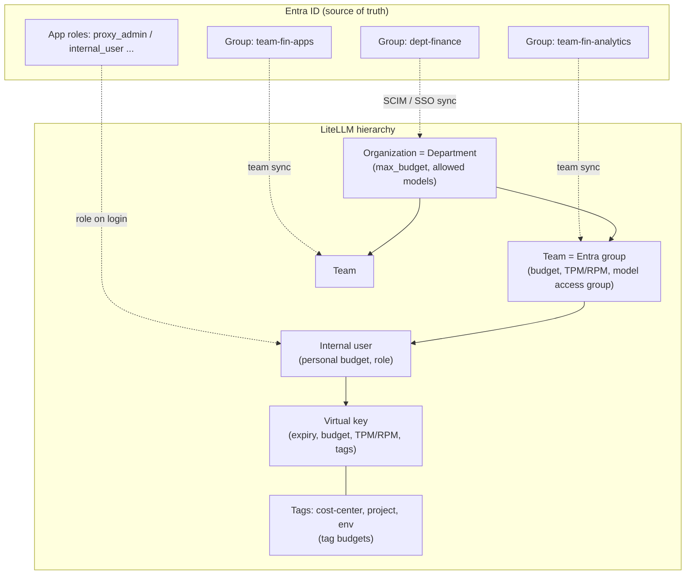

# 2. Common design (shared by all three clouds)

## 2.1 Okta Verify + Entra ID: integration patterns

There are three ways to combine Okta MFA with an Entra ID–centric estate:

| Pattern | How it works | Pros | Cons |
|---|---|---|---|
| **2.1.1 Entra ID External Authentication Methods (EAM): ✅ assumed** | Entra ID remains the IdP. Okta is registered in Entra as an *external authentication method*. When a Conditional Access policy requires MFA, Entra redirects the user to Okta through an OIDC exchange. Okta performs the **Okta Verify** challenge and returns a signed id_token, which Entra accepts as satisfying MFA. | One policy engine (Entra Conditional Access) evaluates MFA, **Intune compliance**, location, and risk together. Apps (LiteLLM, AWS, GCP) trust only Entra. | Users must be enrolled in Okta Verify beforehand, because EAM does not support inline enrollment. Users must be mapped between the two directories (Entra object ID ↔ Okta user). Check whether EAM is GA in your tenant cloud. |
| 2.1.2 Federation to Okta + `federatedIdpMfaBehavior` | The M365 domain is federated to Okta (WS-Fed/SAML). Okta performs primary authentication plus Okta Verify, then sends an MFA claim. Entra is configured to accept it (`acceptIfMfaDoneByFederatedIdp` / `enforceMfaByFederatedIdp`). | Works if Okta is already the M365 IdP. | Splits policy across two engines. Intune compliance is still evaluated only by Entra Conditional Access. Domain federation is a larger blast radius to change. |
| 2.1.3 Conditional Access "custom controls" | Legacy mechanism for third-party MFA. | None for a new design. | Microsoft positions EAM as the replacement. Do not use. |

**Assumed pattern: EAM (2.1.1), per [A-2].** Okta's guide is [Configure Okta as an external authentication method for Microsoft Entra ID](https://help.okta.com/oie/en-us/content/topics/apps/configure-okta-as-microsoft-entra-id-eam.htm). Microsoft's guide is [Manage an external authentication method in Microsoft Entra ID](https://learn.microsoft.com/entra/identity/authentication/how-to-authentication-external-method-manage). For the federation alternative, see [federatedIdpMfaBehavior (internalDomainFederation)](https://learn.microsoft.com/graph/api/resources/internaldomainfederation) and [Satisfy Entra MFA with MFA claims from a federated IdP](https://learn.microsoft.com/entra/identity/authentication/how-to-mfa-expected-inbound-assertions). Okta documents known EAM failure modes, including the `eam_amr_unsatisfiable` and `AADSTS50012620` errors: see [Okta EAM integration failures](https://support.okta.com/help/s/article/entra-id-external-authentication-method-eam-integration-failures-with-okta).

**Conditional Access policy set for the gateway** (one Entra app registration per gateway environment, for example `litellm-prod`):

| CA policy | Target | Grant controls |
|---|---|---|
| CA-GW-01 | All users → `litellm-prod` (web/UI + API audience) | Require MFA, satisfied by Okta EAM, **and** require a device marked compliant ([Intune compliance in CA](https://learn.microsoft.com/entra/identity/conditional-access/policy-all-users-device-compliance)) |
| CA-GW-02 | Admin role holders (`proxy_admin`) | Require MFA plus a compliant device, sign-in frequency of 4–8 h, phishing-resistant MFA where available (Okta FastPass, or Windows Hello for Business as an Entra method) |
| CA-GW-03 | Workload identities (service principals that call the gateway) | Restrict to named locations (cloud egress IPs, on-premises NAT) using Conditional Access for workload identities (requires the Workload ID premium license) |
| CA-GW-04 | Block legacy authentication and device-code flow for `litellm-prod` | Block |

## 2.2 Common login flow (sequence)

All three cloud diagrams reference this sequence as **steps L1–L7**.

Notes:

- Steps L3–L6 happen **between the user's device and SaaS endpoints** (`login.microsoftonline.com`, `*.okta.com`), never through the gateway network. This is important for Step 4: private circuits do not carry this traffic unless you deliberately route it that way.
- Only L1, L2, L6, and L6b touch the gateway. L6b, the back-channel token exchange, and the Graph calls for team sync are outbound internet calls from the gateway subnet, so they must be on the egress allowlist.
- LiteLLM supports Entra SSO through its Microsoft SSO integration, generic OIDC, and SAML 2.0. See [Admin UI SSO](https://docs.litellm.ai/docs/proxy/admin_ui_sso), [Microsoft SSO and team sync tutorial](https://docs.litellm.ai/docs/tutorials/msft_sso), and [SAML SSO](https://docs.litellm.ai/docs/proxy/saml_sso).

## 2.3 Authentication modes for LiteLLM API traffic

| Client type | Auth to LiteLLM | How device trust is enforced | Notes |
|---|---|---|---|
| Admin UI (browser) | Entra OIDC SSO (L1–L7) | Conditional Access CA-GW-01/02 at sign-in | Roles come from Entra **app roles** (`proxy_admin`, `proxy_admin_viewer`, `internal_user`, `internal_user_viewer`). See the [MSFT SSO tutorial](https://docs.litellm.ai/docs/tutorials/msft_sso) and [Entra app roles](https://learn.microsoft.com/entra/identity-platform/howto-add-app-roles-in-apps). |
| Developer / IDE / chat front-end (for example Open WebUI) | **Preferred:** Entra access token (JWT), validated by LiteLLM [OIDC/JWT auth](https://docs.litellm.ai/docs/proxy/token_auth) (team from the `groups` claim via `team_ids_jwt_field` / alias mapping). **Fallback:** personal virtual key with a 30–90 day expiry. | CA at token issuance, with a short token lifetime (≈60–90 min). For virtual keys, use **mTLS with an Intune-issued device certificate** at the edge, or the private path only (Step 4). | JWTs can be mapped to virtual-key-equivalent controls (budgets, TPM/RPM). See [JWT → key mapping](https://docs.litellm.ai/docs/proxy/jwt_key_mapping). |
| Internal app / AI agent (workload) | Option 1: Entra **workload identity**. The client-credentials JWT, or a federated credential from AWS/GCP/K8s, is validated by LiteLLM JWT auth. Option 2: a team-scoped **service-account virtual key** stored in the caller's secret store and rotated. | Network scoping (private path, security groups, source IP allowlist) plus mTLS workload certificates | Prefer Option 1, because it removes long-lived secrets. |
| CI/automation (key management API) | Admin virtual key held only in a secrets manager, or JWT with an admin scope | Private path only | Use the LiteLLM management APIs (`/key/generate`, `/team/new`) through IaC and pipelines. Do not use ad-hoc UI changes in production. |

**Intune device certificates for mTLS.** Intune can deploy SCEP/PKCS client certificates to managed devices ([Intune certificate profiles](https://learn.microsoft.com/intune/fundamentals/certificates/overview)). The cloud edge (AWS ALB, Azure Application Gateway, Google Cloud Load Balancing) is configured with a trust store that contains the issuing CA. The edge then accepts only connections from managed devices, which binds *device identity* to API calls that use virtual keys. When a device falls out of compliance, revoke its certificate, or set short certificate validity and have Intune reissue only to compliant devices.

## 2.4 LiteLLM tenancy model (same on all clouds)

| Need | LiteLLM feature (docs) |
|---|---|
| Onboarding / offboarding | SSO auto-provisioning on first login, plus **SCIM** from Entra for deprovisioning ([SCIM](https://docs.litellm.ai/docs/tutorials/scim_litellm)). Verify in your LiteLLM version that a deprovisioned user's keys are blocked or deleted, and add an offboarding job if they are not. |
| Roles | Entra app roles → LiteLLM roles, with highest role winning ([MSFT SSO](https://docs.litellm.ai/docs/tutorials/msft_sso)) |
| Virtual API keys | [Virtual keys](https://docs.litellm.ai/docs/proxy/virtual_keys): per-key `max_budget`, `budget_duration`, `tpm_limit`, `rpm_limit`, `models`, `expires`, `metadata.tags` |
| Team budgets / quotas | [Team budgets](https://docs.litellm.ai/docs/proxy/team_budgets), [user/team rate limits & budgets](https://docs.litellm.ai/docs/proxy/users) |
| Department / project chargeback | Orgs or tags with [tag budgets](https://docs.litellm.ai/docs/proxy/tag_budgets) and [spend tracking](https://docs.litellm.ai/docs/proxy/cost_tracking) (spend per key, user, team, tag, and model) |
| Model access policies | [Model access groups](https://docs.litellm.ai/docs/proxy/model_access): for example, `tier-standard` (small models) and `tier-premium` (frontier models) granted per team |
| Metrics | [Prometheus metrics](https://docs.litellm.ai/docs/proxy/prometheus): spend, tokens, remaining budget, latency, and failures by team and key |
| Guardrails | Pre/post-call guardrails: [Bedrock Guardrails](https://docs.litellm.ai/docs/proxy/guardrails/bedrock), [Azure Content Safety / Prompt Shields](https://docs.litellm.ai/docs/proxy/guardrails/azure_content_guardrail), [Google Model Armor](https://docs.litellm.ai/docs/proxy/guardrails/model_armor), [Presidio PII masking](https://docs.litellm.ai/docs/proxy/guardrails/pii_masking_v2) |
| Production hardening | [LiteLLM production best practices](https://docs.litellm.ai/docs/proxy/prod): Redis for cross-instance rate limits and budgets, separate DB for spend logs at scale, worker count |

**Two important behaviours to design around:**

1. **LiteLLM spend is an *estimate*.** LiteLLM computes cost from its model price map, or from custom per-model pricing that we configure. It can differ from the cloud invoice: enterprise discounts, provisioned throughput (PTU) and committed-use pricing, cached-token pricing, and taxes all cause drift. The designs therefore treat **LiteLLM as the allocation key** (who used what), and **cloud billing as the cost truth** (what we paid), and reconcile the two monthly ([§4.5](03-aws.md#45-cost-allocation--token-controls-aws), [§5.5](04-azure.md#55-cost-allocation--token-controls-azure), [§6.5](05-gcp.md#65-cost-allocation--token-controls-gcp)).
2. **Budgets and rate limits are enforced from Redis and Postgres state.** If Redis is unavailable, LiteLLM's multi-instance limits degrade. Each design uses a zone-redundant managed Redis and alerts on Redis errors.

---

[← Previous: Overview & assumptions](00-overview.md) · [Index](../../README.md) · [Next →: Step 1: Reference architectures](02-reference-architectures.md)
