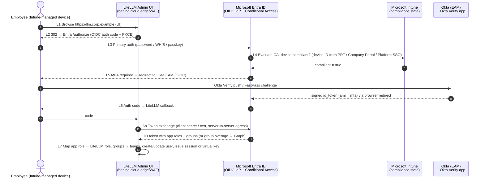
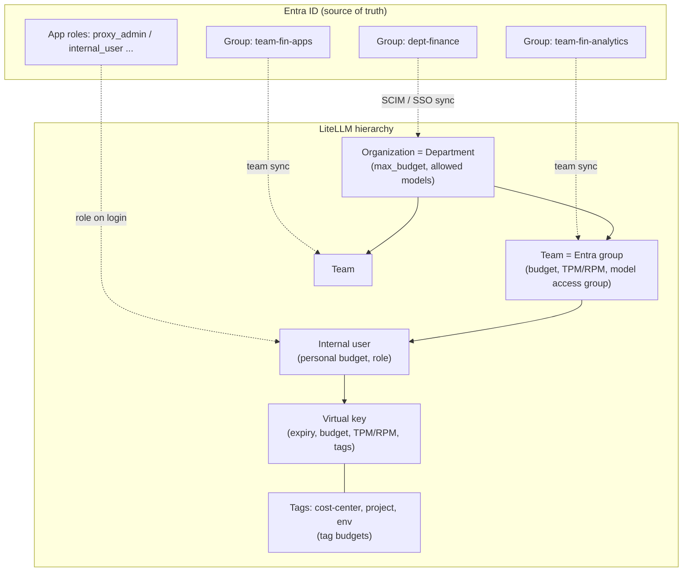

# 2. Common design (shared by all three clouds)

## 2.1 Okta Verify + Entra ID: integration patterns

There are three ways to combine Okta MFA with an Entra ID–centric estate:

| Pattern | How it works | Pros | Cons |
|---|---|---|---|
| **2.1.1 Entra ID External Authentication Methods (EAM): ✅ assumed** | Entra ID remains the IdP. Okta is registered in Entra as an *external authentication method*. When a Conditional Access policy requires MFA, Entra redirects the user to Okta through an OIDC exchange. Okta performs the **Okta Verify** challenge and returns a signed id_token, which Entra accepts as satisfying MFA. | One policy engine (Entra Conditional Access) evaluates MFA, **Intune compliance**, location, and risk together. Apps (LiteLLM, AWS, GCP) trust only Entra. | Users must be enrolled in Okta Verify beforehand, because EAM does not support inline enrollment. Users must be mapped between the two directories (Entra object ID ↔ Okta user). Check whether EAM is GA in your tenant cloud. |
| 2.1.2 Federation to Okta + `federatedIdpMfaBehavior` | The M365 domain is federated to Okta (WS-Fed/SAML). Okta performs primary authentication plus Okta Verify, then sends an MFA claim. Entra is configured to accept it (`acceptIfMfaDoneByFederatedIdp` / `enforceMfaByFederatedIdp`). | Works if Okta is already the M365 IdP. | Splits policy across two engines. Intune compliance is still evaluated only by Entra Conditional Access. Domain federation is a larger blast radius to change. |
| 2.1.3 Conditional Access "custom controls" | Legacy mechanism for third-party MFA. | None for a new design. | Microsoft positions EAM as the replacement. Do not use. |

**Assumed pattern: EAM (2.1.1), per [A-2].** Okta's guide is [Configure Okta as an external authentication method for Microsoft Entra ID](https://help.okta.com/oie/en-us/content/topics/apps/configure-okta-as-microsoft-entra-id-eam.htm). Microsoft's guide is [Manage an external authentication method in Microsoft Entra ID](https://learn.microsoft.com/entra/identity/authentication/how-to-authentication-external-method-manage). For the federation alternative, see [federatedIdpMfaBehavior (internalDomainFederation)](https://learn.microsoft.com/graph/api/resources/internaldomainfederation) and [Satisfy Entra MFA with MFA claims from a federated IdP](https://learn.microsoft.com/entra/identity/authentication/how-to-mfa-expected-inbound-assertions). Okta documents known EAM failure modes, including the `eam_amr_unsatisfiable` and `AADSTS50012620` errors: see [Okta EAM integration failures](https://support.okta.com/help/s/article/entra-id-external-authentication-method-eam-integration-failures-with-okta).

**Conditional Access policy set for the gateway** (one Entra app registration per gateway environment, for example `litellm-prod`):

| CA policy | Target | Grant controls |
|---|---|---|
| CA-GW-01 | All users → `litellm-prod` (web/UI + API audience) | Require MFA, satisfied by Okta EAM, **and** require a device marked compliant ([Intune compliance in CA](https://learn.microsoft.com/entra/identity/conditional-access/policy-all-users-device-compliance)) |
| CA-GW-02 | Admin role holders (`proxy_admin`) | Require MFA plus a compliant device, sign-in frequency of 4–8 h, phishing-resistant MFA where available (Okta FastPass, or Windows Hello for Business as an Entra method) |
| CA-GW-03 | Workload identities (service principals that call the gateway) | Restrict to named locations (cloud egress IPs, on-premises NAT) using Conditional Access for workload identities (requires the Workload ID premium license) |
| CA-GW-04 | Block legacy authentication and device-code flow for `litellm-prod` | Block |
| CA-GW-05 | Cloud control-plane apps for operators (the IAM Identity Center enterprise app, Azure management, Google Workforce Identity Federation) | Phishing-resistant MFA, a compliant device, **named locations limited to office and DC egress IPs**, and a sign-in frequency of 4–8 h. CA-GW-04 covers only `litellm-prod`, so block device-code flow here as well. ([§2.9](#29-access-scenarios-and-checkpoints), scenarios A2–A3) |

## 2.2 Common login flow (sequence)

All three cloud diagrams reference this sequence as **steps L1–L7**.

Notes:

- Steps L3–L6 happen **between the user's device and SaaS endpoints** (`login.microsoftonline.com`, `*.okta.com`), never through the gateway network. This is important for Step 4: private circuits do not carry this traffic unless you deliberately route it that way.
- Only L1, L2, L6, and L6b touch the gateway. L6b, the back-channel token exchange, and the Graph calls for team sync are outbound internet calls from the gateway subnet, so they must be on the egress allowlist.
- LiteLLM supports Entra SSO through its Microsoft SSO integration, generic OIDC, and SAML 2.0. See [Admin UI SSO](https://docs.litellm.ai/docs/proxy/admin_ui_sso), [Microsoft SSO and team sync tutorial](https://docs.litellm.ai/docs/tutorials/msft_sso), and [SAML SSO](https://docs.litellm.ai/docs/proxy/saml_sso).

## 2.3 Authentication modes for LiteLLM API traffic

| Client type | Auth to LiteLLM | How device trust is enforced | Notes |
|---|---|---|---|
| Admin UI (browser) | Entra OIDC SSO (L1–L7) | Conditional Access CA-GW-01/02 at sign-in | Roles come from Entra **app roles** (`proxy_admin`, `proxy_admin_viewer`, `internal_user`, `internal_user_viewer`). See the [MSFT SSO tutorial](https://docs.litellm.ai/docs/tutorials/msft_sso) and [Entra app roles](https://learn.microsoft.com/entra/identity-platform/howto-add-app-roles-in-apps). |
| CLI coding agents (Claude Code, Codex CLI), SDKs, chat front-ends (for example Open WebUI) | **Default:** Entra access token (JWT), fetched by a helper command and validated by LiteLLM [OIDC/JWT auth](https://docs.litellm.ai/docs/proxy/token_auth) (team from the `groups` claim via `team_ids_jwt_field` / alias mapping). Scenario U2 in [§2.9](#29-access-scenarios-and-checkpoints). | CA re-checks the device **every time the token is issued or refreshed** (≈60–90 min lifetime). On every request: the office/DC IP allowlist (Route B) or the private path (Route A), plus the Intune certificate (mTLS) if adopted ([§2.3.2](#232-what-mtls-checks-at-the-load-balancer)). | Helper setup per tool: [§2.3.4](#234-coding-agent-clients). JWTs can be mapped to virtual-key-equivalent controls (budgets, TPM/RPM). See [JWT → key mapping](https://docs.litellm.ai/docs/proxy/jwt_key_mapping). |
| IDE plugins and tools that accept only a pasted key | **Fallback:** personal virtual key with a 30–90 day expiry. Scenario U3 in [§2.9](#29-access-scenarios-and-checkpoints). | CA only when the key is created; **nothing re-checks the device when the key is used.** On every request: the IP allowlist, plus mTLS if adopted. mTLS is the only control that stops a copied key from working on an unmanaged device inside the office ([A-16]). | Keep this group small; move a tool to the default row as soon as it can run a token command. |
| Internal app / AI agent (workload) | Option 1: Entra **workload identity**. The client-credentials JWT, or a federated credential from AWS/GCP/K8s, is validated by LiteLLM JWT auth. Option 2: a team-scoped **service-account virtual key** stored in the caller's secret store and rotated. | Network scoping (DC or cloud egress IPs on the allowlist, or the private path), plus mTLS workload certificates if mTLS is adopted | Prefer Option 1, because it removes long-lived secrets. |
| CI/automation (key management API) | Admin virtual key held only in a secrets manager, or JWT with an admin scope | Fixed CI egress IPs on the allowlist, plus a workload certificate if mTLS is adopted; stricter WAF rules on admin paths | Use the LiteLLM management APIs (`/key/generate`, `/team/new`) through IaC and pipelines. Do not use ad-hoc UI changes in production. |

### 2.3.1 Who verifies what on each request

The cloud providers' own services do not identify the end user. The WAF checks the network origin, the load balancer checks the Intune device certificate if mTLS is adopted, and **LiteLLM** checks the user against Entra. The model service (Bedrock, Azure OpenAI, Vertex AI) sees only the gateway's own workload identity, so per-user attribution comes from LiteLLM spend logs.

| Step | Component | What it checks | Knows the user? |
|---|---|---|---|
| 0 | Entra ID, at sign-in and at every token refresh (SaaS, outside the cloud) | Primary authentication, Okta Verify MFA through EAM, and Intune compliance through CA-GW-01. Then it issues an access token for `api://litellm-prod`, valid for about 60–90 min ([access token claims](https://learn.microsoft.com/entra/identity-platform/access-token-claims-reference)). | Yes (it issues the token) |
| 1 | WAF and load-balancer allowlist | The source IP is one of our office or DC egress IPs [A-14] | No |
| 2 | Load balancer (mTLS), **recommended option** | Certificate chain to the Intune CA, proof of the private key, validity dates, revocation ([§2.3.2](#232-what-mtls-checks-at-the-load-balancer)) | No. It proves a managed device, not a user. |
| 3 | LiteLLM | The Entra token: signature against Entra's published keys (JWKS), issuer = our tenant, audience = `api://litellm-prod`, expiry. Or the virtual key: exists, not expired, not blocked. Then app role or group → team, model access, budget, and TPM/RPM. | **Yes. The user is verified here.** |
| 4 | Cloud IAM → model | The gateway's workload identity (task role, managed identity, or service account) may call only Japan-processed models | No |

LiteLLM's JWT auth is an Enterprise feature [A-6]. Without the license, every client uses virtual keys (scenario U3 in [§2.9](#29-access-scenarios-and-checkpoints)), and steps 1 and 2 carry the network and device checks on their own. mTLS then stops being optional.

### 2.3.2 What mTLS checks at the load balancer

**Status: recommended option.** Entra checks the device only when it issues a token. A LiteLLM virtual key is never seen by Entra after it is created, so the IP allowlist is the only other check on it, and the allowlist proves only the network, not the device. mTLS with Intune-issued certificates is the one control that stops a copied key from working on an unmanaged device that shares our egress IP. The user does nothing to set it up: Intune deploys the certificate, and an unmanaged device fails the TLS handshake because it never received one.

Adopt it as **required** when any of these is true:

- [A-16] does not hold: an unmanaged device (guest or BYOD Wi-Fi, an unauthenticated LAN port) can leave through the office or DC egress IPs, or nobody can confirm that it can't.
- Remote access is added [A-13], which removes the IP allowlist.
- We run without the LiteLLM Enterprise license [A-6], so every client uses virtual keys.

Otherwise it is still worth building, and the cost is mainly on the client side: the TLS-inspection exemption [A-15] and the CLI certificate handling in [§2.3.4](#234-coding-agent-clients).

During the TLS handshake, before any HTTP request exists, the load balancer asks the client for a certificate and checks four things:

1. **Chain:** the certificate was issued by a CA in the load balancer's trust store. That is the CA that Intune deploys from (Microsoft Cloud PKI, or AD CS through the Intune Certificate Connector), plus the workload CA. Self-made certificates fail.
2. **Possession:** the client signs the handshake with the certificate's private key (the TLS `CertificateVerify` message). A copied public certificate without the key is useless.
3. **Validity dates:** the certificate has not expired.
4. **Revocation:** the certificate is not on the revocation list. AWS ALB reads a CRL that we upload to S3. App Gateway and Google Cloud Load Balancing differ; see [§5.8](04-azure.md#58-security-controls-azure) and [§6.8](05-gcp.md#68-security-controls-gcp).

If any check fails, the connection is refused and LiteLLM never sees the request. If all pass, the load balancer can forward the certificate details in headers. On AWS these are `X-Amzn-Mtls-Clientcert-Subject`, `-Issuer`, `-Serial-Number`, `-Validity`, and `-Leaf` (the full certificate) ([ALB mTLS](https://docs.aws.amazon.com/elasticloadbalancing/latest/application/mutual-authentication.html)). LiteLLM does not make any decision on them ([§2.3.3](#233-certificateuser-binding-not-adopted)), but log the certificate serial with each request for investigations. The backend must accept those headers only from the load balancer.

**What mTLS does not check:**

- **Compliance at this moment.** A certificate stays valid until it expires or is revoked. Compliance is enforced when Entra issues the token, which is why the design needs both.
- **Revocation by itself.** Intune revokes certificates when a device is retired or wiped, or when the profile is removed (depending on the CA). It does not revoke them when a device merely falls out of compliance. Publish the CRL to the load balancer on a schedule, and keep certificate validity short (30–90 days, auto-renewed).

**Key protection: the condition that makes mTLS work.** Set the **Intune certificate profile** to put the private key in the TPM (Windows) or the keychain / Secure Enclave (macOS) and to make it **non-exportable** ([Intune certificate profiles](https://learn.microsoft.com/intune/fundamentals/certificates/overview)). This is the certificate's private key, not a LiteLLM key. A non-exportable key cannot be copied to another machine, so a valid signature means "this managed laptop". If the key is exportable, a user can copy the certificate and key to a personal PC together with a virtual key, and mTLS passes there too.

### 2.3.3 Certificate/user binding: not adopted

Conditional Access "require compliant device" checks that the device is registered in our tenant and compliant. It does **not** check that the person signing in is the device's enrolled user, and mTLS proves only a managed device. So a user who is given a colleague's virtual key can use it from their own managed laptop.

We considered closing this with a custom LiteLLM pre-call check that compares the UPN in an Intune user certificate with the token's user or the key's owner. **We do not adopt it.** It catches only one case, an employee using a colleague's key from their own managed laptop. The harm in that case is wrong cost attribution, not data loss, because the colleague could get their own key. Against that, it needs a custom hook maintained across LiteLLM upgrades, safeguards against spoofed certificate headers, and it fails when a second user signs in to Windows on the same laptop. It also cannot stop a user who relays requests for someone else from their own laptop.

Instead:

- Issue keys through SSO only, so every key has an owner, and keep the 30–90 day expiry.
- Prefer Entra tokens (scenario U2), which belong to the person who signed in and last about an hour.
- Use phishing-resistant MFA (Okta FastPass or Windows Hello for Business), which stops a colleague from completing someone else's sign-in by having them approve a push.
- Watch per-user spend and request-source anomalies in the SIEM.

Revisit the decision if key sharing becomes common or a team with sensitive data needs per-request proof of the user.

### 2.3.4 Coding agent clients

The official CLIs we support, **Claude Code** and **Codex CLI**, both run a command to get their credential and re-run it before it expires. That is exactly what Entra tokens need, so both use scenario U2 by default.

| | Claude Code | Codex CLI |
|---|---|---|
| Endpoint | `ANTHROPIC_BASE_URL=https://llm.corp.example` → LiteLLM's Anthropic-compatible `/v1/messages` | A custom provider in `~/.codex/config.toml`: `[model_providers.litellm]` with `base_url = "https://llm.corp.example/v1"` |
| Token command | [`apiKeyHelper`](https://code.claude.com/docs/en/authentication.md#credential-management): a script whose output is the credential, documented for "short-lived tokens" | [`model_providers.<id>.auth.command`](https://learn.chatgpt.com/docs/config-file/config-reference): prints a bearer token; `auth.refresh_interval_ms` sets the refresh (default 5 min) |
| How it is deployed | Managed settings (`managed-settings.json`) pushed by Intune | User-level `config.toml` pushed by Intune. Project-level `.codex/config.toml` cannot set providers. |
| Client certificate, if mTLS is adopted | `CLAUDE_CODE_CLIENT_CERT` / `CLAUDE_CODE_CLIENT_KEY`, **files only** | No client-certificate option for model providers in the current config reference (verify before rollout) |

- **The token command.** Both tools can share one small command (for example `litellm-token`) that uses MSAL to print an Entra access token for `api://litellm-prod/.default`. It must use the **OS sign-in broker**: WAM on Windows, the Enterprise SSO plug-in or Platform SSO on macOS. Without the broker the token request carries no device identity, so CA-GW-01's compliant-device check fails or cannot run. Device-code flow is blocked by CA-GW-04, so the sign-in always happens on the same machine. Users normally see no prompt, because the broker reuses their Windows or Mac sign-in.
- **Headers.** LiteLLM's JWT auth reads `Authorization: Bearer`. The EKS sample ([§3.1](02-reference-architectures.md#31-aws)) documents that LiteLLM's virtual-key check reads `x-api-key`, so a static `ANTHROPIC_AUTH_TOKEN` alone is not enough for keys; Claude Code's `apiKeyHelper` sends the credential on both headers.
- **Tools that need a static key (scenario U3).** Many IDE plugins accept only a pasted key and cannot run a command. Give those users a personal virtual key with a 30–90 day expiry. The IP allowlist, and mTLS if adopted, limit where it works.
- **Client certificates (the main practical risk if mTLS is adopted).** Browsers use the OS certificate store, but these CLIs do not. Claude Code reads the certificate and key only as files, and a non-exportable TPM key cannot become a file; Codex CLI shows no certificate option at all. Test every supported tool early, then choose per tool: a small local forward proxy that performs the mTLS handshake with the TPM key (the tool points `base_url` at `localhost`), or an exportable key for that tool only, which weakens mTLS to "a copy of the certificate exists" (see Key protection in [§2.3.2](#232-what-mtls-checks-at-the-load-balancer)).

## 2.4 LiteLLM tenancy model (same on all clouds)

| Need | LiteLLM feature (docs) |
|---|---|
| Onboarding / offboarding | SSO auto-provisioning on first login, plus **SCIM** from Entra for deprovisioning ([SCIM](https://docs.litellm.ai/docs/tutorials/scim_litellm)). Verify in your LiteLLM version that a deprovisioned user's keys are blocked or deleted, and add an offboarding job if they are not. |
| Roles | Entra app roles → LiteLLM roles, with highest role winning ([MSFT SSO](https://docs.litellm.ai/docs/tutorials/msft_sso)) |
| Virtual API keys | [Virtual keys](https://docs.litellm.ai/docs/proxy/virtual_keys): per-key `max_budget`, `budget_duration`, `tpm_limit`, `rpm_limit`, `models`, `expires`, `metadata.tags` |
| Team budgets / quotas | [Team budgets](https://docs.litellm.ai/docs/proxy/team_budgets), [user/team rate limits & budgets](https://docs.litellm.ai/docs/proxy/users) |
| Department / project chargeback | Orgs or tags with [tag budgets](https://docs.litellm.ai/docs/proxy/tag_budgets) and [spend tracking](https://docs.litellm.ai/docs/proxy/cost_tracking) (spend per key, user, team, tag, and model) |
| Model access policies | [Model access groups](https://docs.litellm.ai/docs/proxy/model_access): for example, `tier-standard` (small models) and `tier-premium` (frontier models) granted per team |
| Metrics | [Prometheus metrics](https://docs.litellm.ai/docs/proxy/prometheus): spend, tokens, remaining budget, latency, and failures by team and key |
| Guardrails | Pre/post-call guardrails: [Bedrock Guardrails](https://docs.litellm.ai/docs/proxy/guardrails/bedrock), [Azure Content Safety / Prompt Shields](https://docs.litellm.ai/docs/proxy/guardrails/azure_content_guardrail), [Google Model Armor](https://docs.litellm.ai/docs/proxy/guardrails/model_armor), [Presidio PII masking](https://docs.litellm.ai/docs/proxy/guardrails/pii_masking_v2) |
| Production hardening | [LiteLLM production best practices](https://docs.litellm.ai/docs/proxy/prod): Redis for cross-instance rate limits and budgets, separate DB for spend logs at scale, worker count |

**Two important behaviours to design around:**

1. **LiteLLM spend is an *estimate*.** LiteLLM computes cost from its model price map, or from custom per-model pricing that we configure. It can differ from the cloud invoice: enterprise discounts, provisioned throughput (PTU) and committed-use pricing, cached-token pricing, and taxes all cause drift. The designs therefore treat **LiteLLM as the allocation key** (who used what), and **cloud billing as the cost truth** (what we paid), and reconcile the two monthly ([§4.5](03-aws.md#45-cost-allocation--token-controls-aws), [§5.5](04-azure.md#55-cost-allocation--token-controls-azure), [§6.5](05-gcp.md#65-cost-allocation--token-controls-gcp)).
2. **Budgets and rate limits are enforced from Redis and Postgres state.** If Redis is unavailable, LiteLLM's multi-instance limits degrade. Each design uses a zone-redundant managed Redis and alerts on Redis errors.

## 2.5 Japan data residency (applies to every design)

**Requirement [A-5, A-11]:** inference, LLM processing (including guardrail checks), logs, and data pipelines stay in Japan. In practice that means four rules:

1. **Regions:** only Tokyo (primary) and Osaka (DR) are used for gateway compute, databases, caches, secrets, log stores, backups, billing exports, and analytics.
2. **Models:** LiteLLM is configured only with deployments whose *processing* is in Japan. A Japanese *endpoint* is not enough, because global and multi-country routing options still process prompts outside Japan.
3. **Pipelines:** spend exports, billing exports, SIEM copies, and dashboards are built in the same Japanese regions. No copy goes to a global or US/EU analytics location.
4. **Enforcement:** cloud policy (SCP, Azure Policy, GCP organization policy) denies anything outside Japan. Documentation and convention alone are not enough.

**Where each cloud processes inference in Japan:**

| | AWS (Bedrock) | Azure (Azure OpenAI / Foundry Models) | GCP (Vertex AI) |
|---|---|---|---|
| **Allowed option** | **In-Region** model IDs in Tokyo/Osaka, and **`jp.` geographic cross-Region inference profiles**, which route only between Tokyo and Osaka. AWS says geographic profiles keep requests inside the geography, and that abuse-detection storage, where a model needs it, happens in the destination Region ([geographic CRIS](https://docs.aws.amazon.com/bedrock/latest/userguide/geographic-cross-region-inference.html), [abuse detection](https://docs.aws.amazon.com/bedrock/latest/userguide/abuse-detection.html)). | **Standard** (`Standard`) and **Regional Provisioned** (`ProvisionedManaged`) deployments in Japan East. Prompts and responses are processed in the customer-specified Azure geography (Japan East + Japan West) ([deployment types](https://learn.microsoft.com/azure/foundry/foundry-models/concepts/deployment-types)). | **Regional endpoint `asia-northeast1`** for models that Google lists with in-region ML processing in Japan ([data residency](https://docs.cloud.google.com/vertex-ai/generative-ai/docs/learn/data-residency)). |
| **Blocked option** | `global.` profiles (any commercial Region) and `apac.` profiles (Seoul, Singapore, Sydney, Mumbai, and others) | `GlobalStandard`, `GlobalProvisionedManaged`, `GlobalBatch` (any Azure region), and `DataZone*` (the APAC data zone spans several countries), plus `DeveloperTier`. Batch is a Global type, so it is blocked too. | The `global` endpoint ("may be processed in any Google Cloud location"), and models that have no Japan entry in the residency table |
| **Guardrails in Japan** | ⚠️ **Gap.** Bedrock Guardrails **Standard** tier, the tier with Japanese language support, requires cross-Region inference. From Tokyo it uses `apac.guardrail.v1:0`, whose destinations include Regions outside Japan, and there is no `jp.` guardrail profile. **Classic** tier stays in-Region but supports only English, French, and Spanish ([tiers](https://docs.aws.amazon.com/bedrock/latest/userguide/guardrails-tiers.html), [guardrail profiles](https://docs.aws.amazon.com/bedrock/latest/userguide/guardrails-cross-region-support.html)). Japanese content therefore needs in-VPC guardrails ([§4.8](03-aws.md#48-security-controls-aws)). | ✅ Content Safety in **Japan East** offers content harms, Prompt Shields, and protected material. The harm classifiers are trained and tested on Japanese. **Japan West has none of these.** Foundry guardrails follow the deployment type, so regional deployments keep guardrail processing in the region ([Content Safety regions](https://learn.microsoft.com/azure/ai-services/content-safety/region-availability)). | ✅ Model Armor supports `asia-northeast1`. `asia-northeast2` is not listed ([Model Armor locations](https://docs.cloud.google.com/model-armor/locations)). |
| **Policy enforcement** | An SCP denies actions outside `ap-northeast-1`/`ap-northeast-3`. IAM on the LiteLLM task role allows `bedrock:InvokeModel*` only on `jp.*` inference profiles, in-Region foundation models, and our application inference profiles in those two Regions. AWS warns not to trust the profile prefix alone, so call `GetInferenceProfile` from each source Region and check its destinations ([supported profiles](https://docs.aws.amazon.com/bedrock/latest/userguide/inference-profiles-support.html)). | Azure Policy *allowed locations* is set to `japaneast`/`japanwest`. A custom policy denies the Global, Data Zone, and Developer deployment SKUs; Microsoft documents this pattern on the deployment-types page. | The organization policy `gcp.resourceLocations` is set to `in:asia-northeast1-locations` and `in:asia-northeast2-locations` ([restrict locations](https://docs.cloud.google.com/organization-policy/restrict-locations)). LiteLLM's `vertex_location` is pinned to `asia-northeast1` and must never be `global`. |
| **Logs** | CloudWatch, S3, and the CloudTrail organization trail are all in Tokyo, with replicas only in Osaka | Log Analytics and Sentinel workspaces are in Japan East. Storage GRS and PostgreSQL geo-backups go to the paired region, Japan West ([region pairs](https://learn.microsoft.com/azure/reliability/cross-region-replication-azure)). | ⚠️ `_Default` and `_Required` log buckets are created in `global` by default. Set the organization's default log storage location to `asia-northeast1` **before** creating projects, and redirect the `_Default` sink to a regional bucket ([regionalize logs](https://docs.cloud.google.com/logging/docs/regionalized-logs), [default settings](https://docs.cloud.google.com/logging/docs/default-settings)). |
| **Billing export** | The CUR 2.0 / Data Exports bucket is in Tokyo | Cost Management exports go to a storage account in Japan East | The BigQuery billing export dataset is in `asia-northeast1`, which the export supports ([export setup](https://docs.cloud.google.com/billing/docs/how-to/export-data-bigquery-setup)) |
| **Provider abuse monitoring** | Stored in the destination Region (Tokyo or Osaka) for models that need it | The abuse-monitoring store is in the resource's geography (Japan). Human review is in scope unless we are approved for **modified abuse monitoring**; Microsoft documents reviewer location only for the EEA ([data privacy](https://learn.microsoft.com/azure/foundry/responsible-ai/openai/data-privacy)) [A-12]. | Covered by the Google Cloud terms; confirm with legal [A-12] |

**Snapshot of models processed in Japan (checked 2026-10-30; re-check before onboarding each model):**

| Cloud | Processed in Japan (allowed) | Available from Tokyo but **not** processed only in Japan (blocked) |
|---|---|---|
| AWS Bedrock | `jp.` profiles: Claude Opus 5.5, Claude Haiku 5.5, Claude Opus 4.8, Claude Sonnet 4.6, Claude Haiku 4.5, Amazon Nova 2 Lite ([Sonnet 4.6 model card example](https://docs.aws.amazon.com/bedrock/latest/userguide/model-card-anthropic-claude-sonnet-4-6.html)). In-Region in Tokyo: Titan Text Embeddings V2, Cohere Embed v4, Mistral Large 3, gpt-oss-120b. | Global-only from Tokyo: Claude Sonnet 5.5, Claude Fable 5.1, Claude Opus 5, Claude Sonnet 5. APAC-only: Amazon Nova Pro. ([Models at a glance](https://docs.aws.amazon.com/bedrock/latest/userguide/model-cards.html) has a per-model page for each.) |
| Azure OpenAI | Whatever Japan East offers as `Standard` or `ProvisionedManaged`. Microsoft says geography-based deployment types "arrive last" and have "no guaranteed availability date", so expect fewer and older models than in Global ([deployment types](https://learn.microsoft.com/azure/foundry/foundry-models/concepts/deployment-types), [model availability](https://learn.microsoft.com/azure/foundry/foundry-models/concepts/models-sold-directly-by-azure)). | Everything that Japan East offers only as Global or Data Zone |
| Vertex AI | Listed for Japan (`asia-northeast1`): Gemini 3.5 Flash, Gemini 2.5 Flash (128k), Gemini 2.5 Pro (64k), text-embedding-004, text-multilingual-embedding, Chirp 3 | Every other Gemini model. **All partner models (Claude, Mistral) and open models**: the residency tables have no Japan column for them. Nothing is listed for Osaka (`asia-northeast2`). |

**LiteLLM-specific residency settings:**

- Set `LITELLM_OFFLINE_MODE=true`. This stops the default calls to `raw.githubusercontent.com` (model cost map and other files) and the release check, and the egress firewall denies the rest ([outbound requests](https://docs.litellm.ai/docs/proxy/outbound_requests)). The enterprise license check can still contact `license.litellm.ai` if the key cannot be verified locally. That call carries the license key, not prompts; allowlist it or confirm offline licensing with the vendor.
- Use only logging callbacks whose destinations are in Japan, such as S3, GCS, or Azure Blob in a Japanese region, or self-hosted Langfuse in the same VPC. **SaaS observability or alerting destinations are not allowed** unless they are hosted in Japan. Budget alerts go by email or Teams/Slack, and the alert text must contain no prompt content.
- Router fallbacks may point only to other Japan-processing deployments. A fallback to a `global.` profile or a public API would silently break residency.
- Image URLs in prompts make LiteLLM (and Bedrock) fetch the image from wherever it is hosted ([outbound requests](https://docs.litellm.ai/docs/proxy/outbound_requests)). The egress allowlist blocks arbitrary fetches, so clients must send images inline (base64).

## 2.6 Ingress model (applies to every design)

All users are on the corporate network [A-13]. There are two ways for them to reach the gateway:

| | **Route B: internet + zero-trust edge (primary)** | **Route A: private line (optional)** |
|---|---|---|
| Path | Office or DC internet breakout → internet → regional load balancer in Tokyo | Corporate network → DC → Direct Connect / ExpressRoute / Interconnect → internal load balancer in Tokyo |
| Load balancer | Internet-facing, reachable only from our office and DC egress IPs (security group, NSG, or Cloud Armor allowlist, repeated in the WAF) | Internal only; allows the corporate address ranges |
| Identity and device checks | Entra token (or virtual key), plus the Intune certificate (mTLS) if adopted ([§2.3](#23-authentication-modes-for-litellm-api-traffic)) | The same |
| Encryption | TLS end to end, laptop → load balancer | The same TLS. The circuit carries it unchanged and adds no encryption of its own. |
| Depends on | The office proxy's TLS-inspection exemption and stable egress IPs [A-14, A-15] | Carrier contract and bandwidth, DC routing, DNS forwarding, and the cloud hub (TGW, ER gateway, Cloud Router) |
| Status | Build first | Build only on a trigger in [§8.0](07-private-connectivity.md#80-when-route-a-is-worth-adopting) |

Both routes can run at the same time. A load balancer is either internet-facing or internal, so Route A adds a second, internal load balancer in front of the same LiteLLM service, and split-horizon DNS decides which one a client reaches.

**Never open the load balancer to the whole internet.** The EKS sample ([§3.1](02-reference-architectures.md#31-aws)) treats `0.0.0.0/0` as a red line and refuses to deploy with it. We do the same: the public load balancer allows only our egress CIDRs.

**No CDN or global edge in front of the gateway** (CloudFront, Azure Front Door, Google's global external Application LB):

- **Nothing to cache.** Every request is an authenticated, unique POST.
- **Residency.** These edges terminate TLS at edge locations that are not limited to Japan, so prompts could be decrypted, and inspected by an edge WAF, outside Japan. On AWS, a WAF for CloudFront is also managed in us-east-1, which the region-deny policy would have to exempt.
- **Timeouts.** CloudFront's origin response timeout defaults to 30 s and needs a quota increase to go higher. A reasoning model can be silent for longer than that before its first token ([§2.7](#27-waf-tuning-and-timeouts-for-llm-traffic)).
- **Failover.** CloudFront origin failover retries only GET, HEAD, and OPTIONS requests, not the POSTs that LLM APIs use. Use DNS failover between regional load balancers instead.
- mTLS is **not** the reason. CloudFront now supports viewer mTLS ([CloudFront viewer mTLS](https://docs.aws.amazon.com/AmazonCloudFront/latest/DeveloperGuide/mtls-authentication.html)). The reasons are residency, timeouts, and the lack of any benefit.

**Office network prerequisites [A-14, A-15]:**

- Exempt `llm.corp.example` from TLS inspection on the corporate proxy. Inspection replaces the laptop's TLS connection with the proxy's own, so the client certificate never reaches the load balancer (mTLS breaks), and the proxy can read every prompt, token, and key.
- Allow `llm.corp.example` in the outbound firewall by FQDN. If the firewall can only allow fixed destination IPs: Azure and GCP load balancers already have static frontend IPs. AWS ALB addresses change over time, so put **AWS Global Accelerator** in front of the ALB. It gives static anycast IPs, passes the encrypted TCP stream through unchanged, and preserves the client IP for the allowlist ([client IP preservation](https://docs.aws.amazon.com/global-accelerator/latest/dg/preserve-client-ip-address.html)). Alternatively, use Route A.

## 2.7 WAF tuning and timeouts for LLM traffic

**WAF.** Managed rule sets are written for web forms. LLM requests are large JSON bodies full of source code, so the defaults block legitimate traffic:

| Cloud | Problem | Change |
|---|---|---|
| AWS | The Core rule set's `SizeRestrictions_BODY` rule blocks every request body over 8 KB, which is nearly every coding-agent request. AWS WAF inspects only the first 8 KB of a body on an ALB ([baseline rule groups](https://docs.aws.amazon.com/waf/latest/developerguide/aws-managed-rule-groups-baseline.html), [body inspection](https://repost.aws/knowledge-center/waf-http-request-body-inspection)). The EKS sample attaches the Core rule set unchanged. | Override `SizeRestrictions_BODY` to Count on the API paths. Review `CrossSiteScripting_BODY`, `GenericLFI_BODY`, and `GenericRFI_BODY`, which match code. |
| Azure | App Gateway WAF's maximum request body size defaults to 128 KB ([request size limits](https://learn.microsoft.com/azure/web-application-firewall/ag/application-gateway-waf-request-size-limits)) | On a CRS 3.2+ / DRS policy, raise or disable body-size enforcement and set the inspection limit separately. Add exclusions for rules that fire on code. |
| GCP | Cloud Armor preconfigured rules at high sensitivity flag SQL- and script-like text | Use sensitivity level 1–2 on the API paths ([§6.8](05-gcp.md#68-security-controls-gcp)). |

Keep the IP allowlist, per-IP rate limits, IP reputation lists, and stricter rules on admin paths (`/ui`, `/sso`, `/key/*`). Enforce the maximum request size in LiteLLM (`max_request_size_mb` in current versions) rather than in the WAF. Content checks such as PII and prompt injection belong in LiteLLM guardrails, not in the WAF.

**Timeouts.** Every layer on the path must allow the longest request, and the layers must agree. The shortest one always fires first: the client sees a 504 while LiteLLM is still waiting for the model and logs no error. Streaming does not avoid this. An idle timeout counts the silence between chunks, and a reasoning model can be silent for minutes before its first token.

| Layer | Default | Set to |
|---|---|---|
| AWS ALB idle timeout | 60 s | 600 s (maximum 4,000 s), as in the EKS sample |
| Azure App Gateway backend request timeout | 20 s | 600 s ([backend settings](https://learn.microsoft.com/azure/application-gateway/configuration-http-settings)) |
| Azure Container Apps ingress | 240 s, documented as a fixed limit ([ingress](https://learn.microsoft.com/azure/container-apps/ingress-overview)) | Cannot be raised. Test long streams; use AKS if they exceed it ([§5.9](04-azure.md#59-scalability--ha-azure)). |
| Google Cloud Run request timeout | 300 s | 600 s or more ([request timeout](https://cloud.google.com/run/docs/configuring/request-timeout)) |
| LiteLLM `request_timeout` | — | 600 s |

## 2.8 Who can see prompts

- **The cloud provider.** The model has to read the prompt, so on every design prompts are decrypted inside the provider's systems: the load balancer, the gateway containers, and the model service. Provider staff access is governed by contract and audit, not by cryptography. AWS commits not to access customer content except to provide the service or to comply with law ([AWS data privacy FAQ](https://aws.amazon.com/compliance/data-privacy-faq/)), and is audited under SOC 2, ISO 27001, and ISMAP. Bedrock documents that it does not store or log prompts and completions, and that model providers cannot access them ([Bedrock data protection](https://docs.aws.amazon.com/bedrock/latest/userguide/data-protection.html)). A CDN or global edge would add more places where decryption happens, possibly outside Japan ([§2.6](#26-ingress-model-applies-to-every-design)).
- **Our own staff, through logs.** This is the larger practical risk.
  - Set `store_prompts_in_spend_logs: false`. The EKS sample sets it to `true`; we change it per [A-10].
  - Logging callbacks send metadata only by default. Content goes only to the opt-in store for approved teams.
  - Run LiteLLM with `LITELLM_LOG=INFO` in production. `DEBUG` writes request bodies to the container logs.
  - Redact the `authorization` and `x-api-key` headers in WAF logs.
  - Restrict read access to the LiteLLM database, the log stores, and the admin UI, and audit that access.

## 2.9 Access scenarios and checkpoints

Six scenarios cover how people reach the gateway and the cloud account behind it. Each one has a sign-in step and a later "every request" step. Whatever is checked only at sign-in is not checked again until the credential that sign-in produced expires.

| ID | Who | What | Credential left after sign-in | Lifetime |
|---|---|---|---|---|
| **U1** | User | LiteLLM dashboard in a browser | LiteLLM session cookie | LiteLLM session setting |
| **U2** | User | API with an Entra token: Claude Code, Codex CLI, SDKs (default) | Entra access token | 60–90 min, renewed automatically |
| **U3** | User | API with a virtual key: IDE plugins and tools that only take a pasted key (fallback) | LiteLLM virtual key | 30–90 days |
| **A1** | Admin | LiteLLM dashboard as `proxy_admin` | Session cookie with the admin role | Re-sign-in every 4–8 h (CA-GW-02) |
| **A2** | Admin | Cloud console (AWS console through IAM Identity Center; Azure portal; Google Cloud console) | Portal session + console session | 1 h for admin permission sets (12 h maximum on AWS) |
| **A3** | Admin | Cloud CLI (`aws sso login`, `az login`, `gcloud auth login`) | Temporary credentials cached on disk | Same as A2 |

**Checkpoints.** IDs are referenced in the flows below and in the cloud designs. *Recommended option* and *proposed* mark controls that are not yet in every design.

| ID | Where | What it checks | Status |
|---|---|---|---|
| E1 | Entra | Primary sign-in (password, Windows Hello for Business, passkey) | In design |
| E2 | Entra | MFA through Okta EAM; phishing-resistant for admins (CA-GW-02) | In design |
| E3 | Entra | Intune-compliant device (CA-GW-01). Runs only when a token or session is issued. | In design |
| E4 | Entra | Named location: office and DC egress IPs only, for operator apps (CA-GW-05) | Proposed |
| E5 | Entra | Sign-in frequency (4–8 h for admins) | In design |
| E6 | Entra | Device-code flow blocked (CA-GW-04 for `litellm-prod`; CA-GW-05 for operator apps) | In design / proposed |
| N1 | WAF + LB | Source IP is an office or DC egress IP [A-14] | In design |
| N2 | LB | mTLS: certificate from the Intune CA, TPM key possession, CRL ([§2.3.2](#232-what-mtls-checks-at-the-load-balancer)) | Recommended option |
| N3 | WAF | Stricter rules on `/ui`, `/sso`, `/key/*` | In design |
| G1 | LiteLLM | SSO callback: ID token valid; app role → role, groups → teams | In design |
| G2 | LiteLLM | Credential: session cookie, JWT (signature, `aud`, `exp`), or virtual key (exists, not expired, not blocked) | In design |
| G3 | LiteLLM | Role, team, allowed models, budget, TPM/RPM | In design |
| G4 | LiteLLM | Audit log: spend per request, key/team/budget changes | In design |
| C1 | Cloud IdP | IAM Identity Center / Azure / Workforce Identity Federation accepts the Entra assertion; user provisioned by SCIM | In design |
| C2 | Cloud IAM | User assigned to the account or project and role (permission set, PIM-eligible role, IAM binding) | In design |
| C3 | Cloud IAM | Every API call checked against policy; plus a source-IP condition for office/DC IPs (for example `aws:SourceIp` with an `aws:ViaAWSService` exception) | In design / proposed |
| C4 | Cloud IAM | Short admin sessions (1 h permission sets; PIM activation windows) | Proposed |
| C5 | Cloud audit | CloudTrail, Activity Log, Cloud Audit Logs | In design |

**Flows** (`[ ]` = checkpoint; *opt* = recommended option):

| ID | Sign-in | Every later request |
|---|---|---|
| U1 | Browser → LB [N1, N3, N2 *opt*] → LiteLLM `/ui` → Entra [E1, E2, E3, E5] → LiteLLM callback [G1] | Browser (cookie) → LB [N1, N3, N2 *opt*] → LiteLLM [G2, G3, G4] |
| U2 | CLI token command → MSAL with OS broker → Entra [E1, E2, E3, E5, E6]; E3 is re-checked on every refresh | CLI (`Authorization: Bearer`) → LB [N1, N2 *opt*] → LiteLLM [G2, G3, G4] → model |
| U3 | Created once through U1, then `/key/generate` [G3] (owner = UPN, expiry set) | Tool (`x-api-key`) → LB [N1, N2 *opt*] → LiteLLM [G2, G3, G4] → model. **No Entra checkpoint.** |
| A1 | Browser → LB [N1, N3, N2 *opt*] → Entra CA-GW-02 [E1, E2, E3, E4, E5] → LiteLLM callback [G1] | Browser → LB [N1, N3, N2 *opt*] → LiteLLM admin routes [G2, G3, G4] |
| A2 | Browser → cloud access portal → Entra CA-GW-05 [E1, E2, E3, E4, E5] → cloud IdP [C1, C2] → console session [C4] | Each console action is an API call [C3, C5]. **No N1:** the console is on the public internet. |
| A3 | CLI login → browser on the same machine → same sign-in as A2 [+ E6] | Each CLI command (signed with cached credentials) [C3, C5] |

**What the flows show:**

1. **The device is checked only at sign-in (E3).** After that, every scenario relies on a bearer credential that nobody re-checks. U2 is the exception that shrinks the gap: Entra re-runs CA on every token refresh, about hourly.
2. **U3 is the weakest path.** A virtual key lasts 30–90 days and is never seen by Entra again. N1 limits it to our network; only N2 stops it on an unmanaged device inside that network [A-16].
3. **A2 and A3 have no gateway in front of them.** Operator access to the cloud account is the most powerful path in the whole design, so it needs E4 at sign-in and the source-IP condition in C3 on every call. Neither exists on the cloud side by default.
4. **A3 leaves credentials on disk.** Anyone who copies the CLI cache can use it until the session ends, so keep admin sessions at 1 h (C4). On AWS, `aws sso login` uses a browser on the same machine by default; `--use-device-code` lets the sign-in happen on one machine and the credentials land on another, and CA-GW-04 does not cover IAM Identity Center. Block device-code flow on the operator apps (CA-GW-05) where the cloud supports it, and rely on C3 where it does not.
5. **A1 should be mostly read-only.** Production changes to keys, teams, and budgets go through IaC and CI ([§2.3](#23-authentication-modes-for-litellm-api-traffic)).

---

[← Previous: Overview & assumptions](00-overview.md) · [Index](../../README.md) · [Next →: Step 1: Reference architectures](02-reference-architectures.md)
