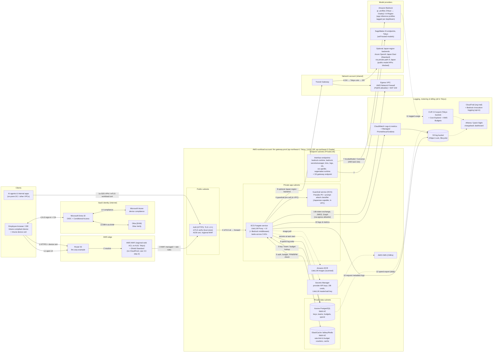

# 4. Step 2a: AWS design

**Baseline:** the AWS guidance repository, with ECS Fargate compute (the repo supports either ECS or EKS), deployed in **Asia Pacific (Tokyo) `ap-northeast-1`**, with **Asia Pacific (Osaka) `ap-northeast-3`** as the DR Region. In this section the gateway is exposed through an **internet-facing zero-trust edge** (regional WAF + ALB with mTLS, all in Tokyo). Step 4 ([§8.2](07-private-connectivity.md#82-aws-direct-connect-overlay)) adds the private Direct Connect path as an overlay. Japan residency rules from [§2.5](01-common-design.md#25-japan-data-residency-applies-to-every-design) apply throughout.

## 4.1 Architecture diagram (AWS)

> **Diagram conventions** (matching the AWS guidance style): solid arrows show the request path with numbered steps, and dotted arrows show supporting, asynchronous, or batch flows. **L-steps** are the login flow ([§2.2](01-common-design.md#22-common-login-flow-sequence)), and **numbered steps** are the API request flow ([§4.3](#43-request-flow-walkthrough-aws)).

## 4.2 Component table (AWS)

| # | AWS service | Purpose in this design | Azure equivalent | GCP equivalent |
|---|---|---|---|---|
| 1 | [Route 53](https://docs.aws.amazon.com/Route53/latest/DeveloperGuide/Welcome.html) (public + private hosted zones, Resolver endpoints) | DNS for `llm.corp.example`, and split-horizon resolution for on-premises clients | Azure DNS + DNS Private Resolver | Cloud DNS (+ inbound server policy) |
| 2 | [AWS WAF](https://docs.aws.amazon.com/waf/latest/developerguide/waf-chapter.html) (regional web ACL on the ALB) + Shield Standard. [CloudFront](https://docs.aws.amazon.com/AmazonCloudFront/latest/DeveloperGuide/Introduction.html) is **not** used. | DDoS protection, managed rule groups, rate-based rules, geo/IP restrictions. TLS terminates only in Tokyo. | App Gateway WAF (no Front Door) | Cloud Armor on the regional external ALB |
| 3 | [Application Load Balancer](https://docs.aws.amazon.com/elasticloadbalancing/latest/application/introduction.html) with [mTLS verify mode](https://docs.aws.amazon.com/elasticloadbalancing/latest/application/mutual-authentication.html) | L7 routing to LiteLLM, validation of Intune device certs and workload certs against a trust store | Application Gateway v2 (mTLS) | External/Internal Application LB (mTLS) |
| 4 | [ECS on Fargate](https://docs.aws.amazon.com/AmazonECS/latest/developerguide/AWS_Fargate.html) (alt: EKS) | Runs LiteLLM Proxy, the UI, and the Bedrock middleware. Stateless, autoscaled. | Azure Container Apps (alt: AKS) | Cloud Run (alt: GKE Autopilot) |
| 5 | [Aurora PostgreSQL](https://docs.aws.amazon.com/AmazonRDS/latest/AuroraUserGuide/Aurora.AuroraPostgreSQL.html) Multi-AZ (the repo uses RDS) | LiteLLM DB: users, teams, keys, budgets, spend logs | Azure Database for PostgreSQL Flexible Server (zone-redundant HA) | Cloud SQL for PostgreSQL (HA) / AlloyDB |
| 6 | [ElastiCache (Valkey/Redis OSS)](https://docs.aws.amazon.com/AmazonElastiCache/latest/dg/WhatIs.html) Multi-AZ | Shared counters for TPM/RPM limits and budgets across tasks, plus response cache | Azure Managed Redis | Memorystore for Valkey / Redis Cluster |
| 7 | [Amazon Bedrock](https://docs.aws.amazon.com/bedrock/latest/userguide/what-is-bedrock.html) with [`jp.` geographic inference profiles](https://docs.aws.amazon.com/bedrock/latest/userguide/geographic-cross-region-inference.html) and In-Region models (+ [application inference profiles](https://docs.aws.amazon.com/bedrock/latest/userguide/inference-profiles-create.html) created from them) | Native foundation models processed in Japan (see the [§2.5](01-common-design.md#25-japan-data-residency-applies-to-every-design) snapshot), with tagged profiles for chargeback | Azure OpenAI Standard deployments in Japan East | Vertex AI `asia-northeast1` regional endpoint |
| 8 | In-VPC guardrail service on ECS: [Presidio PII masking](https://docs.litellm.ai/docs/proxy/guardrails/pii_masking_v2) plus a Japanese-capable prompt-attack classifier (self-hosted, optionally on SageMaker AI in Tokyo). [Bedrock Guardrails](https://docs.aws.amazon.com/bedrock/latest/userguide/guardrails.html) is used only if a Japan-only guardrail profile becomes available ([§2.5](01-common-design.md#25-japan-data-residency-applies-to-every-design)). | PII redaction, prompt-attack and jailbreak detection, content policy, called from LiteLLM | Azure AI Content Safety / Prompt Shields (Japan East) | Model Armor (`asia-northeast1`) |
| 9 | [SageMaker AI](https://docs.aws.amazon.com/sagemaker/latest/dg/whatis.html) | Optional self-hosted or fine-tuned models | Foundry managed compute / AML online endpoints | Vertex AI endpoints / GKE |
| 10 | [VPC interface endpoints (PrivateLink)](https://docs.aws.amazon.com/bedrock/latest/userguide/vpc-interface-endpoints.html) | Private access to Bedrock and AWS APIs, with endpoint policies | Private Endpoints (Private Link) | Private Service Connect (Google APIs) |
| 11 | [Transit Gateway](https://docs.aws.amazon.com/vpc/latest/tgw/what-is-transit-gateway.html) + [Direct Connect Gateway](https://docs.aws.amazon.com/directconnect/latest/UserGuide/direct-connect-gateways-intro.html) | Hub routing between on-premises, the gateway VPC, and the egress VPC | Virtual WAN / hub VNet + ER Gateway | NCC / Shared VPC + Cloud Router |
| 12 | [AWS Network Firewall](https://docs.aws.amazon.com/network-firewall/latest/developerguide/what-is-aws-network-firewall.html) + NAT Gateway | Centralized egress with an FQDN/SNI allowlist (Entra, Graph; no public model APIs) | Azure Firewall (FQDN rules) | Secure Web Proxy / Cloud NGFW + Cloud NAT |
| 13 | [Secrets Manager](https://docs.aws.amazon.com/secretsmanager/latest/userguide/intro.html) + [KMS](https://docs.aws.amazon.com/kms/latest/developerguide/overview.html) | Provider keys, DB credentials, LiteLLM master and salt keys; CMK encryption | Key Vault (secrets + keys, HSM) | Secret Manager + Cloud KMS (CMEK) |
| 14 | [ECR](https://docs.aws.amazon.com/AmazonECR/latest/userguide/what-is-ecr.html) (enhanced scanning) | Pinned, scanned LiteLLM images | Azure Container Registry (Defender scanning) | Artifact Registry (+ Artifact Analysis) |
| 15 | [CloudWatch](https://docs.aws.amazon.com/AmazonCloudWatch/latest/monitoring/WhatIsCloudWatch.html), [Managed Prometheus](https://docs.aws.amazon.com/prometheus/latest/userguide/what-is-Amazon-Managed-Service-Prometheus.html) / Grafana | Logs, LiteLLM Prometheus metrics, alarms | Azure Monitor / Log Analytics / App Insights / Managed Prometheus & Grafana | Cloud Logging / Cloud Monitoring (Managed Service for Prometheus) |
| 16 | [S3](https://docs.aws.amazon.com/AmazonS3/latest/userguide/Welcome.html) (+ [Object Lock](https://docs.aws.amazon.com/AmazonS3/latest/userguide/object-lock.html)) | Request-metadata logs, spend exports, audit archive | Storage account (immutable blob) | Cloud Storage (Bucket Lock) |
| 17 | [CloudTrail](https://docs.aws.amazon.com/awscloudtrail/latest/userguide/cloudtrail-user-guide.html) + [Bedrock model invocation logging](https://docs.aws.amazon.com/bedrock/latest/userguide/model-invocation-logging.html) | Control-plane audit; optional content logging for regulated teams | Activity Log + diagnostic settings | Cloud Audit Logs (Admin + Data Access) |
| 18 | [CUR 2.0](https://docs.aws.amazon.com/cur/latest/userguide/what-is-cur.html), [cost allocation tags](https://docs.aws.amazon.com/awsaccountbilling/latest/aboutv2/cost-alloc-tags.html), [AWS Budgets](https://docs.aws.amazon.com/cost-management/latest/userguide/budgets-managing-costs.html) | Billing truth, tag-based allocation, budget alarms as a backstop | Cost Management exports, tags, budgets | Billing export to BigQuery, labels, budgets |
| 19 | [Athena](https://docs.aws.amazon.com/athena/latest/ug/what-is.html) + [Amazon Quick Sight](https://docs.aws.amazon.com/quick/latest/userguide/what-is.html) | Joins LiteLLM spend with CUR for chargeback/showback | Fabric / Power BI | BigQuery + Looker Studio |
| 20 | [IAM Identity Center ↔ Entra ID](https://docs.aws.amazon.com/singlesignon/latest/userguide/idp-microsoft-entra.html) | Operator access to AWS consoles and CLIs via Entra SSO + SCIM | Native (Entra) | Workforce Identity Federation |
| 21 | [AWS Private CA](https://docs.aws.amazon.com/privateca/latest/userguide/PcaWelcome.html) (optional) | Issuing CA for workload mTLS certs (agents ↔ ALB) | Key Vault certificates / partner CA | Certificate Authority Service |
| 22 | [AWS Organizations SCPs](https://docs.aws.amazon.com/organizations/latest/userguide/orgs_manage_policies_scps.html) | Residency guardrail: deny actions outside `ap-northeast-1`/`ap-northeast-3`, and deny invoking `global.`/`apac.` inference profiles | Azure Policy (allowed locations, denied deployment SKUs) | Organization policy `gcp.resourceLocations` |

## 4.3 Request flow walkthrough (AWS)

**Login (L1–L7), as in [§2.2](01-common-design.md#22-common-login-flow-sequence).** The UI is served by the same LiteLLM service. LiteLLM is registered in Entra as an OIDC web app with redirect URI `https://llm.corp.example/sso/callback`. The back-channel token exchange (L6b) and the Microsoft Graph group/team sync leave through the Network Firewall, which allows `login.microsoftonline.com` and `graph.microsoft.com`.

**API request:**

1. **Client → DNS/edge.** An IDE, SDK, or chat UI on an Intune-compliant laptop calls `https://llm.corp.example/v1/chat/completions` with `Authorization: Bearer <Entra JWT | virtual key>`. The client presents its **Intune-issued device certificate**. AI agents in the on-premises DC (1a) use the existing site-to-site VPN in this baseline, or Direct Connect in Step 4, and present a **workload certificate**.
2. **Route 53** resolves the name to the ALB.
3. **AWS WAF (regional web ACL attached to the ALB)** applies AWS Managed Rules (Core, Known Bad Inputs, IP reputation), rate-based rules per source IP, a body-size limit, and a geo restriction to our operating countries. **Design decision:** this design departs from the repo's default CloudFront scenario and uses its scenario 3 (direct ALB + regional WAF), for two reasons. Device-certificate **mTLS must terminate on the ALB**: CloudFront would terminate the client TLS session first, so the ALB could not see the device certificate. Also, LLM traffic gains nothing from CDN caching. There is also a residency reason: CloudFront terminates TLS at whichever edge location is nearest the user, which can be outside Japan for a traveling employee, so prompts would be decrypted outside Japan. Do not add CloudFront later for the same reason.
4. **ALB** verifies the client certificate chain against its trust store, which holds the Intune SCEP/PKCS CA and the workload CA. It also checks revocation using the CRL in S3. It forwards `X-Amzn-Mtls-Clientcert-*` headers and routes to the LiteLLM target group on ECS tasks in 3 AZs.
5. **LiteLLM authn/authz.** LiteLLM validates either the virtual key, by hash lookup in Aurora with a Redis cache, or the Entra JWT (signature via Entra JWKS, plus `aud`, `iss`, and expiry checks). It resolves the user, team, and org, then checks model access groups, key, user, and team **budgets**, and **TPM/RPM limits** using Redis counters. Requests over a limit get `429`, and requests over budget get `400`/`429` with a budget-exceeded error.
6. **Guardrails (pre-call).** LiteLLM calls the **in-VPC guardrail service** (Presidio for PII masking, plus a self-hosted prompt-attack classifier that handles Japanese) on ECS in Tokyo. Bedrock Guardrails is *not* used for Japanese content: its Standard tier routes checks through the `apac` guardrail profile, and its Classic tier does not support Japanese ([§2.5](01-common-design.md#25-japan-data-residency-applies-to-every-design)).
7. **Native models.** LiteLLM calls `bedrock-runtime` through the **interface VPC endpoint**, using the ECS **task IAM role** ([task roles](https://docs.aws.amazon.com/AmazonECS/latest/developerguide/task-iam-roles.html)) with no static keys. The model ID is the **team's application inference profile ARN**, created by copying a **`jp.` system-defined profile** (or an In-Region model), so Bedrock usage carries `CostCenter`/`Team` tags and requests are processed only in Tokyo or Osaka. The endpoint policy and the task-role policy allow only those ARNs. The SCP blocks `global.*` and `apac.*` profiles even if someone adds them to the LiteLLM config.
8. **Other Japan-region backends (optional).** Public model APIs (OpenAI, the Anthropic API, and similar) are blocked [A-7]. If the business needs OpenAI models, LiteLLM calls an **Azure OpenAI Standard deployment in Japan East**. The path runs ECS → TGW → Direct Connect → a router in the Tokyo colocation facility → ExpressRoute private peering → a private endpoint, so traffic never leaves Japan ([§8.2](07-private-connectivity.md#82-aws-direct-connect-overlay)). Do not use the internet path for this backend. It would put a model FQDN on the internet allowlist, and internet routing is not guaranteed to stay inside Japan. Provider API keys, or Entra workload-identity credentials, come from **Secrets Manager**.
9. **Response and metering.** LiteLLM streams the response, runs post-call guardrails if configured, and writes a **spend log** row to Aurora with user, team, key, tags, model, prompt and completion tokens, cost, and latency. Budget counters are updated in Redis and persisted to Postgres asynchronously.
10. **Logs and metrics.** All of these stores are in Tokyo. Container stdout (JSON) goes to **CloudWatch Logs**. LiteLLM's Prometheus `/metrics` endpoint is scraped into **Amazon Managed Prometheus** with Grafana dashboards. The LiteLLM **S3 logging callback** writes request metadata, without content per [A-10], to the S3 log bucket ([LiteLLM logging](https://docs.litellm.ai/docs/proxy/logging)).
11. **Billing.** Bedrock usage appears in **CUR 2.0** with inference-profile tags. External-provider invoices arrive separately.
12. **Chargeback.** A daily job exports LiteLLM spend (by team, tag, and model) to S3 in Tokyo. **Athena** and **Quick Sight**, both in Tokyo, join it with the CUR 2.0 export (also delivered to a Tokyo bucket) and publish showback per department. Month-end true-up: allocate the actual invoice amount in proportion to LiteLLM-measured usage.

## 4.4 Identity & access (AWS)

| Topic | Design |
|---|---|
| SSO to LiteLLM UI | Entra **OIDC** app (`litellm-prod`) using LiteLLM's Microsoft SSO settings (`MICROSOFT_CLIENT_ID`, `MICROSOFT_CLIENT_SECRET`, `MICROSOFT_TENANT`). The client secret is stored in Secrets Manager. Prefer a certificate credential if your LiteLLM version supports one; otherwise rotate the secret every 90–180 days. SAML 2.0 is an alternative ([LiteLLM SAML](https://docs.litellm.ai/docs/proxy/saml_sso)). |
| SSO / auth to API | LiteLLM **JWT auth** with Entra as the issuer. Clients obtain tokens for `api://litellm-prod/.default` through MSAL. `team_ids_jwt_field: groups` (or app roles) maps tokens to LiteLLM teams ([JWT auth](https://docs.litellm.ai/docs/proxy/token_auth)). Virtual keys are a fallback with mandatory expiry. |
| Group-to-role mapping | Entra **app roles** map to LiteLLM global roles (`proxy_admin`, `proxy_admin_viewer`, `internal_user`, `internal_user_viewer`). Entra **security groups** prefixed `llm-team-*` map to LiteLLM teams through team sync on login ([MSFT SSO tutorial](https://docs.litellm.ai/docs/tutorials/msft_sso)). **SCIM** handles deprovisioning ([SCIM](https://docs.litellm.ai/docs/tutorials/scim_litellm)). Only *assigned* groups are emitted in the token, which avoids the >200-group overage problem. |
| Intune compliance | Enforced by CA-GW-01 at Entra sign-in and token issuance, and **again at the edge** by ALB mTLS with Intune device certificates. AWS Verified Access is *not* used. Its device-trust providers are Jamf, CrowdStrike, and JumpCloud, not Intune ([Verified Access device trust](https://docs.aws.amazon.com/verified-access/latest/ug/device-trust.html)). |
| Service-to-service | ECS task role → Bedrock, Secrets Manager, KMS, and S3, using least-privilege policies plus VPC endpoint policies. Aurora uses **IAM DB authentication** or a rotated Secrets Manager credential. Agents → LiteLLM use Entra workload identity JWTs. For agents running in AWS, use [IAM roles](https://docs.aws.amazon.com/IAM/latest/UserGuide/id_roles.html) with Entra federated credentials, or a team service-account virtual key in the caller's Secrets Manager, combined with an mTLS workload cert from AWS Private CA. |
| Operators | IAM Identity Center federated to Entra with SCIM ([guide](https://docs.aws.amazon.com/singlesignon/latest/userguide/idp-microsoft-entra.html)). Break-glass IAM users are kept in a vault. No interactive access to Fargate tasks; ECS Exec is disabled in production. |

## 4.5 Cost allocation & token controls (AWS)

| Control | LiteLLM layer (real-time enforcement) | AWS layer (billing truth / backstop) |
|---|---|---|
| Department chargeback | LiteLLM **organization** per department, or the tag `dept:<code>` on every key and team | Bedrock **application inference profile** per department, tagged `CostCenter=<code>`. LiteLLM model aliases (for example `claude-sonnet`) resolve to the caller-team-specific profile ARN using per-team model lists or deployment aliases. Activate the cost allocation tags; activation is not retroactive. |
| Team / project | Team budget (`max_budget`, `budget_duration: 30d`), TPM/RPM, `metadata.tags: [project:x]` | Inference profiles per team only where volume justifies it, because they add operational overhead. Otherwise, allocation comes from LiteLLM spend × CUR total. |
| Per user | User budget and default personal-key budget; key expiry | IAM-principal cost allocation (April 2026) applies to *AWS principals*. All calls arrive as the single task role, so it does not identify end users. Per-user truth therefore comes from LiteLLM. |
| Token controls | TPM/RPM per key, user, and team; `max_tokens` caps per model; model access groups; [tag budgets](https://docs.litellm.ai/docs/proxy/tag_budgets) | Bedrock **service quotas** (TPM/RPM per model) set the upper bound. For `jp.` profiles, quotas are managed **per source Region**: a Tokyo quota increase does not apply to calls from Osaka ([JP CRIS launch post](https://aws.amazon.com/blogs/machine-learning/introducing-amazon-bedrock-cross-region-inference-for-claude-sonnet-4-5-and-haiku-4-5-in-japan-and-australia)). Request the DR quota in Osaka in advance. Use reserved capacity only if needed. |
| Alerts | LiteLLM budget alerts (Slack/email webhooks); Prometheus alerts on `remaining_budget` | **AWS Budgets** on the gateway account and per `CostCenter` tag, at 80/100% thresholds, with SNS notifications |
| Reporting | LiteLLM UI usage tab, `/spend/*` APIs | CUR 2.0 → Athena → Quick Sight, joined to LiteLLM spend exports on `team_id`/tag and date |

## 4.6 Networking (AWS)

- **Accounts and VPCs:** a `network-prod` account owns the Transit Gateway, the DX Gateway, and the inspection/egress VPC. The `llm-gateway-prod` account has one VPC, `10.60.0.0/20`, across 3 AZs:
  - `public` (/26 ×3): ALB, only when the internet edge is enabled. Omit these subnets entirely in the private-only variant (Step 4).
  - `app` (/24 ×3): Fargate tasks.
  - `data` (/26 ×3): Aurora and ElastiCache.
  - `endpoints` (/26 ×3): interface endpoints for `bedrock-runtime`, `bedrock`, `bedrock-agent-runtime` (if used), `sagemaker.runtime`, `secretsmanager`, `kms`, `logs`, `monitoring`, `sts`, `ecr.api`, `ecr.dkr`, `elasticloadbalancing`, plus the **S3 gateway endpoint**. Private DNS is enabled on the endpoints. Route 53 Resolver inbound endpoints let on-premises DNS resolve them ([Resolver](https://docs.aws.amazon.com/Route53/latest/DeveloperGuide/resolver.html)).
- **Security groups:** ALB SG allows 443 from the internet (filtered by WAF) or from on-premises prefixes only. Tasks SG allows 4000 from the ALB SG only. Data SG allows 5432/6379 from the tasks SG only. Endpoints SG allows 443 from the tasks SG.
- **Egress:** there is no IGW route from the app subnets. The default route goes via TGW to the **inspection VPC** with **Network Firewall** stateful rules that allowlist TLS SNI for `login.microsoftonline.com`, `graph.microsoft.com`, the LiteLLM license endpoint if required ([§2.5](01-common-design.md#25-japan-data-residency-applies-to-every-design)), and `*.okta.com` only if LiteLLM calls Okta (it normally does not). **No model provider FQDN is on the internet allowlist** [A-7]. A Japan-region Azure OpenAI backend is reached over the private path instead. Everything else is denied and logged, which also catches any attempt to reach a non-Japan endpoint.
- **Ingress paths:** (a) Internet: regional WAF → ALB with mTLS. (b) On-premises: site-to-site VPN in the baseline, or **Direct Connect** in Step 4, to TGW → ALB. With only (b), set the ALB to *internal*, which matches the repo's "Private VPC only" scenario.

## 4.7 Data & logging (AWS)

| Data | Store | Protection | Retention (proposed) |
|---|---|---|---|
| LiteLLM config DB (users, teams, keys as hashes, budgets) | Aurora PostgreSQL in Tokyo, Multi-AZ, encrypted with a CMK, PITR on | SG isolation, IAM auth, TLS required (`rds.force_ssl`) | Life of the platform; PITR 35 days; daily snapshot copied to Osaka only |
| Spend logs (per request) | Aurora (`LiteLLM_SpendLogs`). At high volume, use a separate DB or partitioning, per [LiteLLM prod guide](https://docs.litellm.ai/docs/proxy/prod) | Same | 90 days hot in Postgres. Daily export to S3 Parquet, kept 7 years for finance [assumption]. |
| Rate-limit counters and cache | ElastiCache Valkey/Redis, Multi-AZ, encryption in transit and at rest, AUTH/RBAC | SG isolation | Ephemeral |
| Request metadata logs | S3 in Tokyo (LiteLLM S3 callback) → Athena | SSE-KMS, bucket policy restricted to VPC endpoint, Object Lock (governance) | 1 year hot, then Glacier until 7 years |
| Prompt/response content (opt-in teams only) | Bedrock model invocation logging → dedicated S3 bucket in Tokyo, or LiteLLM callback with a per-team flag | Separate KMS key and access role, Macie scanning | Per team's legal requirement (default 30 days) |
| Admin audit (who changed keys and budgets) | LiteLLM audit logs (enterprise) → S3; CloudTrail org trail (home Region Tokyo) | Immutable bucket in the log-archive account | 7 years |
| Infrastructure logs | CloudWatch Logs in Tokyo (ALB access logs, WAF logs, Network Firewall flow/alert logs, VPC Flow Logs) | KMS, cross-account subscription to the SIEM (SIEM storage must also be in Japan) | 90 days in CloudWatch, 1–7 years in S3 |

## 4.8 Security controls (AWS)

- **WAF:** AWS Managed Rules (Core, Known Bad Inputs, Amazon IP reputation, Anonymous IP list), rate-based rules, a request-body size limit (for example 2–5 MB, sized for multimodal), a geo-match allowlist, and a separate stricter rule set on `/ui`, `/sso`, and `/key/*` admin paths.
- **mTLS:** ALB [mutual authentication verify mode](https://docs.aws.amazon.com/elasticloadbalancing/latest/application/mutual-authentication.html), with a trust store containing the Intune issuing CA and the AWS Private CA. CRLs are published to S3.
- **Secrets:** Secrets Manager with automatic rotation for the DB credential. Provider keys rotate on a 90-day schedule using a provider-specific rotation Lambda or a manual runbook. The LiteLLM `LITELLM_MASTER_KEY` and `LITELLM_SALT_KEY` are injected only as ECS secrets. **Never rotate the salt key without a re-encryption plan**, because it encrypts the stored provider credentials.
- **Encryption:** TLS 1.2+ everywhere (ALB security policy `ELBSecurityPolicy-TLS13-1-2-2021-06`). KMS CMKs for Aurora, ElastiCache, S3, CloudWatch Logs, and Secrets Manager.
- **Guardrails / PII:** the in-VPC guardrail service is the default pre- and post-call guardrail for all models: Presidio for PII, plus a Japanese-capable prompt-attack and content classifier. Re-evaluate Bedrock Guardrails when AWS offers a guardrail profile that stays in Japan, or Classic-tier support for Japanese. LiteLLM guardrails are configured per team or key.
- **Residency guardrails:** an SCP denies all Regions except Tokyo and Osaka (global services excepted), and denies `bedrock:InvokeModel*` on `global.*` and `apac.*` inference profiles. An AWS Config rule flags resources outside the two Regions. Every new Bedrock model is onboarded only after `GetInferenceProfile` confirms that its destinations are Tokyo and Osaka.
- **Supply chain:** pin the LiteLLM image digest, mirror it to ECR, run ECR enhanced scanning (Inspector), and promote images through dev → staging → prod.
- **Detection:** GuardDuty (incl. ECS runtime monitoring), Security Hub, Config rules, and IAM Access Analyzer.

## 4.9 Scalability & HA (AWS)

- **Compute:** ECS Fargate service with at least 3 tasks spread across 3 AZs. Target-tracking autoscaling on CPU (~60%) and ALB `RequestCountPerTarget`. Set Uvicorn workers to vCPU count. Long-lived streaming responses need ALB idle timeout ≥ 300–600 s.
- **Alternative:** EKS (Karpenter, HPA, PodDisruptionBudgets) if the platform team already runs EKS. The repo supports either, but not both in one deployment.
- **Data tier:** Aurora Multi-AZ with a reader for the UI and analytics. ElastiCache Multi-AZ with automatic failover.
- **Model capacity:** `jp.` profiles spread load across Tokyo and Osaka. LiteLLM router **fallbacks** handle the rest, but only to other Japan-processing deployments (for example Claude Opus 5.5 `jp.` → Claude Opus 4.8 `jp.`, or → Azure OpenAI Japan East), with `cooldown` on 429/5xx. Never fall back to a `global.` profile or a public API.
- **DR:** warm standby in **Osaka**, deployed from the same Terraform. `jp.` profiles can be called from Osaka as the source Region, so the model layer survives a Tokyo outage. Aurora Global Database Tokyo → Osaka (RPO about 1 s) and a Route 53 failover record. Redis is rebuilt cold, which briefly resets rate-limit counters but keeps budgets in Postgres. RTO is 30–60 min.

---

[← Previous: Step 1: Reference architectures](02-reference-architectures.md) · [Index](../../README.md) · [Next →: Step 2b: Azure](04-azure.md)
