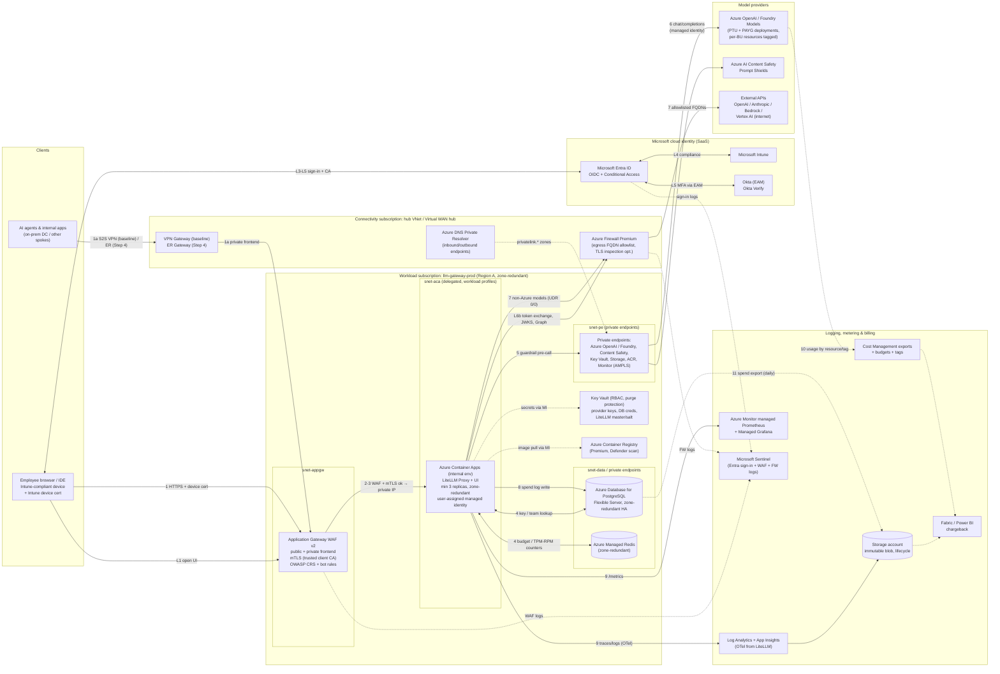

# 5. Step 2b: Azure design

**Baseline:** the Microsoft Foundry chat baseline and the APIM landing zone accelerator *network shape* (App Gateway WAF → internal workload → private endpoints → Azure Firewall egress), with **LiteLLM on Azure Container Apps** (internal environment) in place of APIM as the gateway. Step 4 ([§8.3](07-private-connectivity.md#83-azure-expressroute-overlay)) adds the ExpressRoute overlay.

## 5.1 Architecture diagram (Azure)

## 5.2 Component table (Azure)

| # | Azure service | Purpose | AWS equivalent | GCP equivalent |
|---|---|---|---|---|
| 1 | [Application Gateway WAF v2](https://learn.microsoft.com/azure/web-application-firewall/ag/ag-overview) with [mutual authentication](https://learn.microsoft.com/azure/application-gateway/mutual-authentication-overview) | Regional L7 ingress, OWASP CRS/DRS, bot protection, client-cert validation (Intune CA), public + private frontends | ALB + AWS WAF (mTLS) | External/Internal Application LB + Cloud Armor (mTLS) |
| 2 | [Azure Container Apps](https://learn.microsoft.com/azure/container-apps/overview) (internal environment, [zone redundancy](https://learn.microsoft.com/azure/reliability/reliability-container-apps)) | LiteLLM Proxy + UI. Alternative: [AKS](https://learn.microsoft.com/azure/aks/what-is-aks) with workload identity | ECS Fargate / EKS | Cloud Run / GKE |
| 3 | [Azure Database for PostgreSQL Flexible Server](https://learn.microsoft.com/azure/postgresql/flexible-server/overview) ([zone-redundant HA](https://learn.microsoft.com/azure/postgresql/high-availability/concepts-high-availability)) | LiteLLM DB | Aurora PostgreSQL | Cloud SQL / AlloyDB |
| 4 | [Azure Managed Redis](https://learn.microsoft.com/azure/redis/overview) | Rate-limit and budget counters, cache | ElastiCache | Memorystore |
| 5 | [Azure OpenAI in Foundry Models](https://learn.microsoft.com/azure/foundry/foundry-models/concepts/models-sold-directly-by-azure) | Native models (GPT family, plus Foundry Models such as partner and open models). PTU and PAYG deployments. | Bedrock | Vertex AI |
| 6 | [Azure AI Content Safety](https://learn.microsoft.com/azure/ai-services/content-safety/overview) / [Prompt Shields](https://learn.microsoft.com/azure/ai-services/content-safety/concepts/jailbreak-detection) | Content filtering and jailbreak detection, called from LiteLLM. This is in addition to the built-in Azure OpenAI content filters. | Bedrock Guardrails | Model Armor |
| 7 | [Private Endpoints](https://learn.microsoft.com/azure/private-link/private-endpoint-overview) + [Private DNS zones](https://learn.microsoft.com/azure/private-link/private-endpoint-dns) | Private access to Azure OpenAI (`privatelink.openai.azure.com`), Key Vault, Storage, ACR, Redis, PostgreSQL, Monitor (AMPLS) | VPC interface endpoints | Private Service Connect |
| 8 | [Azure DNS Private Resolver](https://learn.microsoft.com/azure/dns/dns-private-resolver-overview) | On-premises → Azure private zone resolution (inbound endpoint) | Route 53 Resolver | Cloud DNS inbound policy |
| 9 | [Azure Firewall Premium](https://learn.microsoft.com/azure/firewall/overview) (hub) | Egress FQDN allowlist, threat intel, optional TLS inspection | Network Firewall + NAT GW | Secure Web Proxy / Cloud NGFW + Cloud NAT |
| 10 | [Virtual WAN](https://learn.microsoft.com/azure/virtual-wan/virtual-wan-about) or hub-spoke + [ExpressRoute Gateway](https://learn.microsoft.com/azure/expressroute/expressroute-about-virtual-network-gateways) / [VPN Gateway](https://learn.microsoft.com/azure/vpn-gateway/vpn-gateway-about-vpngateways) | Hybrid routing | TGW + DX Gateway / VPN | NCC + Cloud Router / HA VPN |
| 11 | [Key Vault](https://learn.microsoft.com/azure/key-vault/general/overview) | Secrets, CMKs (Managed HSM if required) | Secrets Manager + KMS | Secret Manager + Cloud KMS |
| 12 | [Azure Container Registry](https://learn.microsoft.com/azure/container-registry/container-registry-intro) Premium | Private image registry, geo-replication, Defender scanning | ECR | Artifact Registry |
| 13 | [Azure Monitor](https://learn.microsoft.com/azure/azure-monitor/overview): Log Analytics, [App Insights (OpenTelemetry)](https://learn.microsoft.com/azure/azure-monitor/app/opentelemetry-overview), [managed Prometheus](https://learn.microsoft.com/azure/azure-monitor/metrics/prometheus-metrics-overview), Managed Grafana | Logs, traces, metrics, dashboards | CloudWatch + AMP/AMG | Cloud Logging/Monitoring |
| 14 | [Storage account with immutability policies](https://learn.microsoft.com/azure/storage/blobs/immutable-storage-overview) | Log archive, spend export | S3 + Object Lock | GCS + Bucket Lock |
| 15 | [Microsoft Sentinel](https://learn.microsoft.com/azure/sentinel/overview) | SIEM correlating Entra sign-ins, WAF, Firewall, and LiteLLM audit | Security Lake / 3rd-party SIEM | Google SecOps |
| 16 | [Cost Management](https://learn.microsoft.com/azure/cost-management-billing/costs/overview-cost-management) (exports, budgets) + [resource tags](https://learn.microsoft.com/azure/azure-resource-manager/management/tag-resources) | Billing truth, budget alerts | CUR + Budgets | Billing export + Budgets |
| 17 | [Defender for Cloud](https://learn.microsoft.com/azure/defender-for-cloud/defender-for-cloud-introduction) (incl. AI threat protection) | Posture, container and AI workload threat detection | GuardDuty + Security Hub | Security Command Center |
| 18 | (Optional) [API Management AI gateway](https://learn.microsoft.com/azure/api-management/genai-gateway-capabilities) | Backend pool for shared Azure OpenAI PTU (pattern 2 in [§3.2](02-reference-architectures.md#32-azure)) | n/a | Apigee |
| 19 | (Remote users) [Entra Global Secure Access: Private Access](https://learn.microsoft.com/entra/global-secure-access/concept-private-access) | ZTNA to the private frontend, gated by CA and a compliant device | Verified Access / Client VPN | Chrome Enterprise Premium / IAP |

## 5.3 Request flow walkthrough (Azure)

**Login (L1–L7)** follows [§2.2](01-common-design.md#22-common-login-flow-sequence). On Azure, the LiteLLM app registration, Conditional Access, and Intune all live in the same Microsoft tenant, so the identity integration effort is the lowest of the three clouds. L6b and the Graph team sync leave through **Azure Firewall**, which needs `login.microsoftonline.com` and `graph.microsoft.com` FQDN rules, or the `AzureActiveDirectory` service tag.

**API request:**

1. **Client → ingress.** Laptops resolve `llm.corp.example` to the App Gateway **public** frontend (internet users) or its **private** frontend (on-premises users and agents through VPN in the baseline, or ExpressRoute in Step 4). The client presents its Intune device certificate. Agents present a workload certificate.
2. **App Gateway WAF** applies the Microsoft Default Rule Set and Bot Manager, custom rate limits, a geo filter, and a body-size limit.
3. **App Gateway mTLS** validates the client chain against the uploaded trusted client CA (the Intune SCEP/PKCS CA). It can pass the certificate fields to the backend as server variables. Traffic then goes to the **internal Container Apps environment** on its private IP over HTTPS.
4. **LiteLLM authn/authz** works as on AWS ([§4.3](03-aws.md#43-request-flow-walkthrough-aws) step 5), with Redis on **Azure Managed Redis** and the DB on **PostgreSQL Flexible Server**, both reached via private endpoint or VNet integration.
5. **Guardrails.** LiteLLM calls **Azure AI Content Safety / Prompt Shields** through its private endpoint ([LiteLLM Azure content guardrail](https://docs.litellm.ai/docs/proxy/guardrails/azure_content_guardrail)). Azure OpenAI's built-in content filters also apply to Azure-hosted models.
6. **Native models.** LiteLLM calls Azure OpenAI deployments through the private endpoint, authenticating with **Entra ID via the Container App's managed identity** ([LiteLLM Azure provider](https://docs.litellm.ai/docs/providers/azure); role *Cognitive Services OpenAI User*). Public network access is disabled on the Azure OpenAI resources ([Azure AI services networking](https://learn.microsoft.com/azure/ai-services/cognitive-services-virtual-networks)). The LiteLLM router does PTU-first, PAYG-spillover load balancing across deployments and regions, as recommended in the [multi-backend gateway guide](https://learn.microsoft.com/azure/architecture/ai-ml/guide/generative-ai-gateway-multiple-models).
7. **External models.** A user-defined route sends 0.0.0.0/0 to Azure Firewall, which allows only the model FQDNs, then SNAT to the internet.
8. **Metering.** The spend log row is written to PostgreSQL, and the counters are updated in Redis.
9. **Observability.** LiteLLM's OpenTelemetry callback sends traces to App Insights. The Prometheus `/metrics` endpoint is scraped by Azure Monitor managed Prometheus (via an OTel collector sidecar in ACA, or natively on AKS). Container logs go to Log Analytics.
10. **Billing.** Azure OpenAI usage appears in Cost Management **per resource**, with its tags.
11. **Chargeback.** A daily LiteLLM spend export goes to Storage. Fabric or Power BI joins it with the Cost Management export and allocates shared PTU and PAYG cost to teams by measured tokens.

## 5.4 Identity & access (Azure)

| Topic | Design |
|---|---|
| SSO to LiteLLM UI | Entra OIDC app registration, using the LiteLLM Microsoft SSO settings. The client secret is kept in Key Vault and referenced as an ACA secret through the managed identity. |
| API auth | Entra JWTs validated by LiteLLM (same as AWS). On Azure, *workload* callers in Azure use **managed identities** to get Entra tokens for `api://litellm-prod`, so there are no secrets at all. |
| Group → role mapping | Entra app roles → LiteLLM roles. `llm-team-*` groups → LiteLLM teams (team sync). SCIM for deprovisioning. Use **group assignment to the enterprise app** with "assigned groups only" token claims. |
| Intune compliance | **Native**: CA-GW-01 requires a compliant device for the `litellm-prod` app. Also enforced at App Gateway with mTLS device certs, and by **Entra Private Access** for remote users, where a CA policy targets the Private Access app and requires a compliant device. Azure has the tightest Intune integration of the three. |
| Service-to-service | User-assigned managed identity for ACA → Azure OpenAI, Content Safety, Key Vault, Storage, and ACR, using RBAC with least-privilege roles. PostgreSQL uses a password from Key Vault. Entra auth for PostgreSQL is possible but needs token refresh support in LiteLLM's DB client, so verify before relying on it. Use [AKS workload identity](https://learn.microsoft.com/azure/aks/workload-identity-overview) if you choose AKS. |
| Operators | PIM-eligible Azure RBAC roles. No standing Owner access. Azure Policy enforces private endpoints and disabled public access. |

## 5.5 Cost allocation & token controls (Azure)

| Control | LiteLLM layer | Azure layer |
|---|---|---|
| Department chargeback | LiteLLM org per department, or a `dept:` tag | **Option A (default):** shared Azure OpenAI resources (one per region), with cost allocated from LiteLLM spend. **Option B (high-spend BUs):** a dedicated Azure OpenAI resource per BU, tagged `CostCenter`. LiteLLM maps that BU's teams to that resource's deployments. Azure billing is per resource or deployment, *not* per request, so per-request attribution must come from LiteLLM or APIM metrics. |
| Team / project | Team budgets, tags, TPM/RPM | [Cost allocation rules](https://learn.microsoft.com/azure/cost-management-billing/costs/allocate-costs) can redistribute shared-resource cost. Optional APIM `llm-emit-token-metric` with a team dimension if APIM is used (pattern 2). |
| Token controls | TPM/RPM, budgets, model access groups, `max_tokens` | Azure OpenAI **deployment TPM quotas** and **PTU** capacity are the hard ceiling. LiteLLM limits should total ≤ deployment quota per region. |
| Alerts | LiteLLM budget alerts, Prometheus alerts | [Cost Management budgets](https://learn.microsoft.com/azure/cost-management-billing/costs/tutorial-acm-create-budgets) with action groups per subscription, resource group, or tag |
| Reporting | LiteLLM UI and APIs | Cost exports to Storage → Fabric/Power BI joined with LiteLLM spend |

## 5.6 Networking (Azure)

- **Topology:** Azure landing zone hub-and-spoke or Virtual WAN. Spoke VNet `10.70.0.0/21`, zone-redundant:
  - `snet-appgw` (/24): App Gateway v2 (dedicated).
  - `snet-aca` (/23 for workload-profile environment, delegated `Microsoft.App/environments`).
  - `snet-pe` (/26): private endpoints.
  - `snet-data` (/27 delegated): PostgreSQL Flexible Server in VNet-integrated mode, or PostgreSQL via private endpoint.
- **Private endpoints and DNS:** Private DNS zones (`privatelink.openai.azure.com`, `privatelink.cognitiveservices.azure.com`, `privatelink.vaultcore.azure.net`, `privatelink.blob.core.windows.net`, `privatelink.azurecr.io`, `privatelink.redis.azure.net`, `privatelink.postgres.database.azure.com`, `privatelink.monitor.azure.com` …) are linked to the hub. On-premises DNS conditionally forwards these zones to the **DNS Private Resolver inbound endpoint** ([private endpoint DNS](https://learn.microsoft.com/azure/private-link/private-endpoint-dns-integration)).
- **NSGs:** `snet-appgw` allows 443 from the internet (if public), on-premises prefixes, and `GatewayManager`. `snet-aca` allows only from `snet-appgw`. The private-endpoint subnet allows only from `snet-aca`.
- **Egress:** UDR 0.0.0.0/0 → Azure Firewall in the hub. Application rules allowlist the model FQDNs plus Entra and Graph. Use Firewall **Premium** if TLS inspection or IDPS is required. NAT Gateway on the firewall subnet gives a stable SNAT IP for provider allowlists.
- **Ingress paths:** public frontend (internet, zero trust) and private frontend (VPN/ExpressRoute). In the private-only variant, delete the public IP listener.

## 5.7 Data & logging (Azure)

| Data | Store | Protection | Retention |
|---|---|---|---|
| LiteLLM DB | PostgreSQL Flexible Server, zone-redundant HA, CMK, geo-redundant backup | Private access only, TLS enforced | PITR up to 35 days; geo-backup to the paired region |
| Spend logs | Same DB (or a separate server at scale) → daily export to Storage (Parquet) | Same | 90 days hot, 7 years in immutable blob [assumption] |
| Counters/cache | Azure Managed Redis (TLS, Entra or access-key auth, private endpoint) | | Ephemeral |
| Request metadata, traces | Log Analytics (App Insights) | Workspace RBAC, AMPLS private link, CMK via dedicated cluster if required | 90 days interactive, 2–7 years archive tier |
| Prompt/response content (opt-in) | Dedicated storage container with its own key, or Azure OpenAI stored completions only if enabled deliberately | Separate RBAC, Purview scanning | Per policy |
| Admin audit | LiteLLM audit log → Log Analytics; Azure Activity Log; Entra audit and sign-in logs → Sentinel | Immutable export | 7 years |

## 5.8 Security controls (Azure)

- **WAF:** App Gateway WAF v2 in Prevention mode, with Microsoft DRS 2.x, Bot Manager, custom rate-limit rules, and a stricter policy on admin paths. Front Door is not used, because it would terminate TLS before the App Gateway mTLS check, the same issue as CloudFront on AWS.
- **mTLS:** App Gateway mutual authentication with the Intune CA (devices) and an internal CA (workloads). Enable CRL/OCSP checking if supported in your App Gateway SKU and region; otherwise use short-lived certificates.
- **Secrets & keys:** Key Vault (RBAC model, purge protection, private endpoint). CMKs for PostgreSQL, Storage, and Azure OpenAI where supported.
- **Guardrails / PII:** Azure OpenAI default content filters plus a custom filter policy per deployment, and LiteLLM pre-call **Prompt Shields** and Content Safety. Presidio for PII masking. Defender for Cloud AI threat protection for Azure OpenAI.
- **Policy:** Azure Policy initiatives deny public network access on Cognitive Services, Key Vault, Storage, and PostgreSQL, and require private endpoints, diagnostic settings, and tags.

## 5.9 Scalability & HA (Azure)

- **Compute:** Container Apps on a dedicated workload profile, zone-redundant, with min 3 and max N replicas. KEDA HTTP scaling on concurrent requests. Long streaming responses need a high ingress timeout; the App Gateway request timeout should be ≥ 300 s. **AKS** is the alternative if you need sidecars, custom ingress, or existing AKS operations.
- **Data:** PostgreSQL zone-redundant HA (synchronous standby in another AZ). Azure Managed Redis with zone redundancy; active geo-replication is available for multi-region.
- **Models:** LiteLLM router across Azure OpenAI deployments in ≥2 regions (data-zone or global deployment types where data residency allows), PTU-first with PAYG spillover and fallback to Bedrock or Vertex through egress.
- **DR:** secondary region spoke deployed from the same Bicep/Terraform. PostgreSQL geo-restore or a read replica promotion. Traffic Manager or DNS failover between App Gateways. RTO 30–60 min.

---

[← Previous: Step 2a: AWS](03-aws.md) · [Index](../../README.md) · [Next →: Step 2c: GCP](05-gcp.md)
