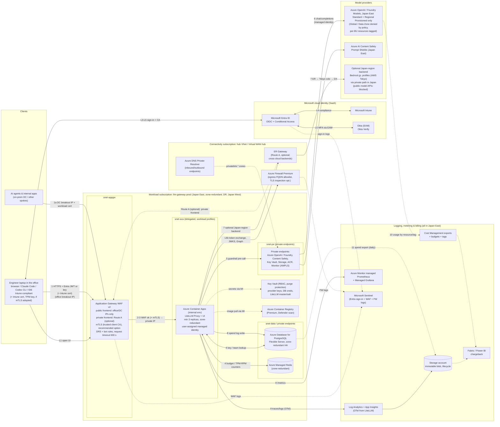

# 5. Step 2b: Azure design

**Baseline:** the Microsoft Foundry chat baseline and the APIM landing zone accelerator *network shape* (App Gateway WAF → internal workload → private endpoints → Azure Firewall egress), with **LiteLLM on Azure Container Apps** (internal environment) in place of APIM as the gateway. The primary region is **Japan East**, and the DR region is **Japan West**, its paired region. Japan residency rules from [§2.5](01-common-design.md#25-japan-data-residency-applies-to-every-design) apply throughout. The gateway is exposed on **Route B** ([§2.6](01-common-design.md#26-ingress-model-applies-to-every-design)): the App Gateway public frontend admits only our office and DC egress IPs, with Entra JWT checks in LiteLLM and, as a recommended option, mTLS with Intune certificates. **Route A** is optional: Step 4 ([§8.3](07-private-connectivity.md#83-azure-expressroute-overlay)) uses the App Gateway private frontend over ExpressRoute.

## 5.1 Architecture diagram (Azure)

## 5.2 Component table (Azure)

| # | Azure service | Purpose | AWS equivalent | GCP equivalent |
|---|---|---|---|---|
| 1 | [Application Gateway WAF v2](https://learn.microsoft.com/azure/web-application-firewall/ag/ag-overview) with [mutual authentication](https://learn.microsoft.com/azure/application-gateway/mutual-authentication-overview) | Regional L7 ingress, OWASP CRS/DRS, bot protection, public + private frontends. Recommended option: client-cert validation (Intune CA). | ALB + AWS WAF (mTLS) | External/Internal Application LB + Cloud Armor (mTLS) |
| 2 | [Azure Container Apps](https://learn.microsoft.com/azure/container-apps/overview) (internal environment, [zone redundancy](https://learn.microsoft.com/azure/reliability/reliability-container-apps)) | LiteLLM Proxy + UI. Alternative: [AKS](https://learn.microsoft.com/azure/aks/what-is-aks) with workload identity | ECS Fargate / EKS | Cloud Run / GKE |
| 3 | [Azure Database for PostgreSQL Flexible Server](https://learn.microsoft.com/azure/postgresql/flexible-server/overview) ([zone-redundant HA](https://learn.microsoft.com/azure/postgresql/high-availability/concepts-high-availability)) | LiteLLM DB | Aurora PostgreSQL | Cloud SQL / AlloyDB |
| 4 | [Azure Managed Redis](https://learn.microsoft.com/azure/redis/overview) | Rate-limit and budget counters (no response cache, [§2.8](01-common-design.md#28-who-can-see-prompts)) | ElastiCache | Memorystore |
| 5 | [Azure OpenAI in Foundry Models](https://learn.microsoft.com/azure/foundry/foundry-models/concepts/models-sold-directly-by-azure), using only the [Standard and Regional Provisioned deployment types](https://learn.microsoft.com/azure/foundry/foundry-models/concepts/deployment-types) in Japan East | Native models processed in the Japan geography (GPT family, plus any Foundry Models offered as Standard in Japan East). Regional PTU and Standard PAYG deployments. | Bedrock `jp.` profiles | Vertex AI `asia-northeast1` |
| 6 | [Azure AI Content Safety](https://learn.microsoft.com/azure/ai-services/content-safety/overview) / [Prompt Shields](https://learn.microsoft.com/azure/ai-services/content-safety/concepts/jailbreak-detection) in Japan East ([region availability](https://learn.microsoft.com/azure/ai-services/content-safety/region-availability)) | Content filtering and jailbreak detection, called from LiteLLM. This is in addition to the built-in Azure OpenAI content filters. | In-VPC guardrail service (Bedrock Guardrails is not Japan-only) | Model Armor |
| 7 | [Private Endpoints](https://learn.microsoft.com/azure/private-link/private-endpoint-overview) + [Private DNS zones](https://learn.microsoft.com/azure/private-link/private-endpoint-dns) | Private access to Azure OpenAI (`privatelink.openai.azure.com`), Key Vault, Storage, ACR, Redis, PostgreSQL, Monitor (AMPLS) | VPC interface endpoints | Private Service Connect |
| 8 | [Azure DNS Private Resolver](https://learn.microsoft.com/azure/dns/dns-private-resolver-overview) | On-premises → Azure private zone resolution (inbound endpoint) | Route 53 Resolver | Cloud DNS inbound policy |
| 9 | [Azure Firewall Premium](https://learn.microsoft.com/azure/firewall/overview) (hub) | Egress FQDN allowlist, threat intel, optional TLS inspection | Network Firewall + NAT GW | Secure Web Proxy / Cloud NGFW + Cloud NAT |
| 10 | [Virtual WAN](https://learn.microsoft.com/azure/virtual-wan/virtual-wan-about) or hub-spoke + [ExpressRoute Gateway](https://learn.microsoft.com/azure/expressroute/expressroute-about-virtual-network-gateways) / [VPN Gateway](https://learn.microsoft.com/azure/vpn-gateway/vpn-gateway-about-vpngateways) | Hybrid routing, only for Route A and cross-cloud backends | TGW + DX Gateway / VPN | NCC + Cloud Router / HA VPN |
| 11 | [Key Vault](https://learn.microsoft.com/azure/key-vault/general/overview) | Secrets, CMKs (Managed HSM if required) | Secrets Manager + KMS | Secret Manager + Cloud KMS |
| 12 | [Azure Container Registry](https://learn.microsoft.com/azure/container-registry/container-registry-intro) Premium | Private image registry, geo-replication, Defender scanning | ECR | Artifact Registry |
| 13 | [Azure Monitor](https://learn.microsoft.com/azure/azure-monitor/overview): Log Analytics, [App Insights (OpenTelemetry)](https://learn.microsoft.com/azure/azure-monitor/app/opentelemetry-overview), [managed Prometheus](https://learn.microsoft.com/azure/azure-monitor/metrics/prometheus-metrics-overview), Managed Grafana | Logs, traces, metrics, dashboards | CloudWatch + AMP/AMG | Cloud Logging/Monitoring |
| 14 | [Storage account with immutability policies](https://learn.microsoft.com/azure/storage/blobs/immutable-storage-overview) | Log archive, spend export | S3 + Object Lock | GCS + Bucket Lock |
| 15 | [Microsoft Sentinel](https://learn.microsoft.com/azure/sentinel/overview) | SIEM correlating Entra sign-ins, WAF, Firewall, and LiteLLM audit | Security Lake / 3rd-party SIEM | Google SecOps |
| 16 | [Cost Management](https://learn.microsoft.com/azure/cost-management-billing/costs/overview-cost-management) (exports, budgets) + [resource tags](https://learn.microsoft.com/azure/azure-resource-manager/management/tag-resources) | Billing truth, budget alerts | CUR + Budgets | Billing export + Budgets |
| 17 | [Defender for Cloud](https://learn.microsoft.com/azure/defender-for-cloud/defender-for-cloud-introduction) (incl. AI threat protection) | Posture, container and AI workload threat detection | GuardDuty + Security Hub | Security Command Center |
| 18 | (Optional) [API Management AI gateway](https://learn.microsoft.com/azure/api-management/genai-gateway-capabilities) | Backend pool for shared Azure OpenAI PTU (pattern 2 in [§3.2](02-reference-architectures.md#32-azure)) | n/a | Apigee |
| 19 | (Future, if remote access is added [A-13]) [Entra Global Secure Access: Private Access](https://learn.microsoft.com/entra/global-secure-access/concept-private-access) | ZTNA to the private frontend, gated by CA and a compliant device | Verified Access / Client VPN | Chrome Enterprise Premium / IAP |
| 20 | [Azure Policy](https://learn.microsoft.com/azure/governance/policy/overview) (allowed locations + a custom deny on deployment SKUs) | Residency guardrail: only `japaneast`/`japanwest`, and no `GlobalStandard`, `GlobalProvisionedManaged`, `GlobalBatch`, `DataZone*`, or `DeveloperTier` deployments ([policy example](https://learn.microsoft.com/azure/foundry/foundry-models/concepts/deployment-types)) | SCPs + IAM | Organization policy `gcp.resourceLocations` |

## 5.3 Request flow walkthrough (Azure)

**Login (L1–L7)** follows [§2.2](01-common-design.md#22-common-login-flow-sequence). On Azure, the LiteLLM app registration, Conditional Access, and Intune all live in the same Microsoft tenant, so the identity integration effort is the lowest of the three clouds. L6b and the Graph team sync leave through **Azure Firewall**, which needs `login.microsoftonline.com` and `graph.microsoft.com` FQDN rules, or the `AzureActiveDirectory` service tag.

**API request:**

1. **Client → ingress.** Laptops in the office resolve `llm.corp.example` to the App Gateway **public** frontend, whose NSG and WAF admit only office and DC egress IPs (Route B). The request leaves through the office breakout without TLS inspection [A-15]. With Route A, split-horizon DNS returns the **private** frontend, reached over ExpressRoute. Claude Code and Codex CLI send an Entra JWT from their token command; IDE plugins that accept only a pasted key send a virtual key ([§2.3.4](01-common-design.md#234-coding-agent-clients)). If mTLS is adopted, the client presents the user's Intune certificate and agents present a workload certificate.
2. **App Gateway WAF** applies the Microsoft Default Rule Set and Bot Manager, an allow rule for office/DC egress IPs, custom rate limits, and body settings tuned for LLM requests ([§2.7](01-common-design.md#27-waf-tuning-and-timeouts-for-llm-traffic)). The default 128 KB request-body limit is too small for coding agents.
3. **App Gateway mTLS (if adopted)** validates the client chain against the uploaded trusted client CA (the CA that Intune deploys from) ([§2.3.2](01-common-design.md#232-what-mtls-checks-at-the-load-balancer)). It can pass the certificate serial to the backend as a server variable for logging; LiteLLM does not match the certificate's user to the token ([§2.3.3](01-common-design.md#233-certificateuser-binding-not-adopted)). Traffic then goes to the **internal Container Apps environment** on its private IP over HTTPS. The backend request timeout is raised from the 20 s default to 600 s.
4. **LiteLLM authn/authz** works as on AWS ([§4.3](03-aws.md#43-request-flow-walkthrough-aws) step 5), with Redis on **Azure Managed Redis** and the DB on **PostgreSQL Flexible Server**, both reached via private endpoint or VNet integration.
5. **Guardrails.** LiteLLM calls **Azure AI Content Safety / Prompt Shields** through its private endpoint ([LiteLLM Azure content guardrail](https://docs.litellm.ai/docs/proxy/guardrails/azure_content_guardrail)). Azure OpenAI's built-in content filters also apply to Azure-hosted models.
6. **Native models.** LiteLLM calls Azure OpenAI deployments through the private endpoint, authenticating with **Entra ID via the Container App's managed identity** ([LiteLLM Azure provider](https://docs.litellm.ai/docs/providers/azure); role *Cognitive Services OpenAI User*). Public network access is disabled on the Azure OpenAI resources ([Azure AI services networking](https://learn.microsoft.com/azure/ai-services/cognitive-services-virtual-networks)). The LiteLLM router sends traffic to Regional Provisioned (PTU) deployments first and spills over to Standard deployments, as recommended in the [multi-backend gateway guide](https://learn.microsoft.com/azure/architecture/ai-ml/guide/generative-ai-gateway-multiple-models). All of these deployments are in Japan East, plus Japan West where the model is offered there. Azure Policy prevents anyone from creating a Global or Data Zone deployment for a model that Japan East lacks.
7. **Other Japan-region backends (optional).** Public model APIs are blocked [A-7]. If Claude is required, LiteLLM calls **Bedrock `jp.` profiles** in AWS Tokyo over a private path inside Japan: ExpressRoute → a router in the Tokyo colocation facility → Direct Connect → a Bedrock VPC endpoint ([§8.3](07-private-connectivity.md#83-azure-expressroute-overlay)). The 0.0.0.0/0 UDR to Azure Firewall carries only Entra and Graph traffic.
8. **Metering.** The spend log row is written to PostgreSQL, and the counters are updated in Redis.
9. **Observability.** All workspaces are in Japan East. LiteLLM's OpenTelemetry callback sends traces to App Insights. The Prometheus `/metrics` endpoint is scraped by Azure Monitor managed Prometheus (via an OTel collector sidecar in ACA, or natively on AKS). Container logs go to Log Analytics.
10. **Billing.** Azure OpenAI usage appears in Cost Management **per resource**, with its tags.
11. **Chargeback.** A daily LiteLLM spend export goes to Storage in Japan East, next to the Cost Management export. Fabric or Power BI joins it with the Cost Management export and allocates shared PTU and PAYG cost to teams by measured tokens.

## 5.4 Identity & access (Azure)

| Topic | Design |
|---|---|
| SSO to LiteLLM UI | Entra OIDC app registration, using the LiteLLM Microsoft SSO settings. The client secret is kept in Key Vault and referenced as an ACA secret through the managed identity. |
| API auth | Entra JWTs validated by LiteLLM (same as AWS), fetched by the Claude Code and Codex CLI token command ([§2.3.4](01-common-design.md#234-coding-agent-clients)). On Azure, *workload* callers in Azure use **managed identities** to get Entra tokens for `api://litellm-prod`, so there are no secrets at all. |
| Group → role mapping | Entra app roles → LiteLLM roles. `llm-team-*` groups → LiteLLM teams (team sync). SCIM for deprovisioning. Use **group assignment to the enterprise app** with "assigned groups only" token claims. |
| Intune compliance | **Native**: CA-GW-01 requires a compliant device for the `litellm-prod` app at every token issuance and refresh. If mTLS is adopted, also enforced on every request at App Gateway with Intune certificates ([§2.3.2](01-common-design.md#232-what-mtls-checks-at-the-load-balancer)); the certificate's user is not matched to the token ([§2.3.3](01-common-design.md#233-certificateuser-binding-not-adopted)). If remote access is added later [A-13], **Entra Private Access** applies the same CA policy to remote users. Azure has the tightest Intune integration of the three. |
| Service-to-service | User-assigned managed identity for ACA → Azure OpenAI, Content Safety, Key Vault, Storage, and ACR, using RBAC with least-privilege roles. PostgreSQL uses a password from Key Vault. Entra auth for PostgreSQL is possible but needs token refresh support in LiteLLM's DB client, so verify before relying on it. Use [AKS workload identity](https://learn.microsoft.com/azure/aks/workload-identity-overview) if you choose AKS. |
| Operators (scenarios A2, A3 in [§2.9](01-common-design.md#29-access-scenarios-and-checkpoints)) | PIM-eligible Azure RBAC roles with a 1 h activation window. No standing Owner access. **CA-GW-05** targets Azure management (the portal, Azure CLI, and PowerShell): phishing-resistant MFA, compliant device, office/DC named locations, and device-code flow blocked. Azure RBAC has no source-IP condition, so the named location at sign-in is the network check. Azure Policy enforces private endpoints and disabled public access. |

## 5.5 Cost allocation & token controls (Azure)

| Control | LiteLLM layer | Azure layer |
|---|---|---|
| Department chargeback | LiteLLM org per department, or a `dept:` tag | **Option A (default):** shared Azure OpenAI resources (one per region), with cost allocated from LiteLLM spend. **Option B (high-spend BUs):** a dedicated Azure OpenAI resource per BU, tagged `CostCenter`. LiteLLM maps that BU's teams to that resource's deployments. Azure billing is per resource or deployment, *not* per request, so per-request attribution must come from LiteLLM or APIM metrics. |
| Team / project | Team budgets, tags, TPM/RPM | [Cost allocation rules](https://learn.microsoft.com/azure/cost-management-billing/costs/allocate-costs) can redistribute shared-resource cost. Optional APIM `llm-emit-token-metric` with a team dimension if APIM is used (pattern 2). |
| Token controls | TPM/RPM, budgets, model access groups, `max_tokens` | Azure OpenAI **deployment TPM quotas** and **PTU** capacity are the hard ceiling. LiteLLM limits should total ≤ deployment quota per region. |
| Alerts | LiteLLM budget alerts, Prometheus alerts | [Cost Management budgets](https://learn.microsoft.com/azure/cost-management-billing/costs/tutorial-acm-create-budgets) with action groups per subscription, resource group, or tag |
| Reporting | LiteLLM UI and APIs | Cost exports to Storage → Fabric/Power BI joined with LiteLLM spend |

## 5.6 Networking (Azure)

- **Topology:** Azure landing zone hub-and-spoke or Virtual WAN. Spoke VNet `10.70.0.0/21`, zone-redundant:
  - `snet-appgw` (/24): App Gateway v2 (dedicated).
  - `snet-aca` (/23 for workload-profile environment, delegated `Microsoft.App/environments`).
  - `snet-pe` (/26): private endpoints.
  - `snet-data` (/27 delegated): PostgreSQL Flexible Server in VNet-integrated mode, or PostgreSQL via private endpoint.
- **Private endpoints and DNS:** Private DNS zones (`privatelink.openai.azure.com`, `privatelink.cognitiveservices.azure.com`, `privatelink.vaultcore.azure.net`, `privatelink.blob.core.windows.net`, `privatelink.azurecr.io`, `privatelink.redis.azure.net`, `privatelink.postgres.database.azure.com`, `privatelink.monitor.azure.com` …) are linked to the hub. On-premises DNS conditionally forwards these zones to the **DNS Private Resolver inbound endpoint** ([private endpoint DNS](https://learn.microsoft.com/azure/private-link/private-endpoint-dns-integration)).
- **NSGs:** `snet-appgw` allows 443 only from office and DC egress CIDRs [A-14] (plus on-premises prefixes if Route A is added), and the `GatewayManager` service tag. Never allow the whole internet. `snet-aca` allows only from `snet-appgw`. The private-endpoint subnet allows only from `snet-aca`.
- **Egress:** UDR 0.0.0.0/0 → Azure Firewall in the hub. Application rules allowlist Entra and Graph (and the LiteLLM license endpoint if required). No public model FQDN is allowed [A-7]. Use Firewall **Premium** if TLS inspection or IDPS is required. NAT Gateway on the firewall subnet gives a stable SNAT IP for provider allowlists.
- **Ingress paths:** **Route B (primary):** the public frontend, office/DC IPs only, with a static public IP that fixed-IP egress rules can allow. **Route A (optional):** the private frontend over ExpressRoute. Without Route A, the private listener is not needed. If policy forces a private-only deployment, delete the public listener.

## 5.7 Data & logging (Azure)

| Data | Store | Protection | Retention |
|---|---|---|---|
| LiteLLM DB | PostgreSQL Flexible Server in Japan East, zone-redundant HA, CMK, geo-redundant backup | Private access only, TLS enforced | PITR up to 35 days; geo-backup to the paired region, Japan West |
| Spend logs | Same DB (or a separate server at scale) → daily export to Storage (Parquet) | Same | 90 days hot, 7 years in immutable blob [assumption] |
| Counters/cache | Azure Managed Redis (TLS, Entra or access-key auth, private endpoint) | | Ephemeral |
| Request metadata, traces | Log Analytics (App Insights) workspace in Japan East | Workspace RBAC, AMPLS private link, CMK via dedicated cluster if required | 90 days interactive, 2–7 years archive tier |
| Prompt/response content (opt-in) | Dedicated storage container with its own key, or Azure OpenAI stored completions only if enabled deliberately | Separate RBAC, Purview scanning | Per policy |
| Admin audit | LiteLLM audit log → Log Analytics; Azure Activity Log; Entra audit and sign-in logs → Sentinel (workspace in Japan East) | Immutable export | 7 years |

## 5.8 Security controls (Azure)

- **WAF:** App Gateway WAF v2 in Prevention mode, with Microsoft DRS 2.x, Bot Manager, an office/DC IP allow rule, custom rate-limit rules, request-body settings and rule exclusions tuned for LLM requests ([§2.7](01-common-design.md#27-waf-tuning-and-timeouts-for-llm-traffic)), and a stricter policy on admin paths. Front Door is not used ([§2.6](01-common-design.md#26-ingress-model-applies-to-every-design)). Its global edge would terminate TLS, and could decrypt prompts, outside Japan, and App Gateway would then see Front Door's connection instead of the client certificate.
- **mTLS (recommended option; required in the cases in [§2.3.2](01-common-design.md#232-what-mtls-checks-at-the-load-balancer)):** App Gateway mutual authentication with the Intune CA (devices, non-exportable keys) and an internal CA (workloads). Enable CRL/OCSP checking if supported in your App Gateway SKU and region; otherwise use short-lived certificates.
- **Secrets & keys:** Key Vault (RBAC model, purge protection, private endpoint). CMKs for PostgreSQL, Storage, and Azure OpenAI where supported.
- **Guardrails / PII:** Azure OpenAI default content filters plus a custom filter policy per deployment, and LiteLLM pre-call **Prompt Shields** and Content Safety. Presidio for PII masking. Defender for Cloud AI threat protection for Azure OpenAI.
- **Policy:** Azure Policy initiatives deny public network access on Cognitive Services, Key Vault, Storage, and PostgreSQL, and require private endpoints, diagnostic settings, and tags. For residency they also restrict locations to Japan East and Japan West, and deny the Global, Data Zone, and Developer deployment SKUs.
- **Abuse monitoring:** apply for **modified abuse monitoring** on the Azure OpenAI resources, and verify that `ContentLogging` is `false` afterwards. Until approval, flagged prompts are stored in Japan but can be human-reviewed by Microsoft ([data privacy](https://learn.microsoft.com/azure/foundry/responsible-ai/openai/data-privacy)) [A-12]. Do not enable stored completions, the Assistants or Responses stateful features, or Batch, which is a Global type.

## 5.9 Scalability & HA (Azure)

- **Compute:** Container Apps on a dedicated workload profile, zone-redundant, with min 3 and max N replicas. KEDA HTTP scaling on concurrent requests. Set the App Gateway backend request timeout to 600 s (default 20 s) and LiteLLM `request_timeout` below the shortest layer in front of it, which on Container Apps is the 240 s ingress limit. Container Apps ingress has a documented 240 s request timeout that cannot be raised ([§2.7](01-common-design.md#27-waf-tuning-and-timeouts-for-llm-traffic)); test long reasoning streams against it early. **AKS** is the alternative if streams exceed that limit, or if you need sidecars, custom ingress, or existing AKS operations.
- **Data:** PostgreSQL zone-redundant HA (synchronous standby in another AZ). Azure Managed Redis with zone redundancy; active geo-replication is available for multi-region.
- **Models:** LiteLLM router across Standard and Regional Provisioned deployments, PTU first with Standard spillover. Standard deployments may be processed in either Japanese region for capacity reasons ([deployment types](https://learn.microsoft.com/azure/foundry/foundry-models/concepts/deployment-types)), which is still inside Japan. Fallback goes only to Bedrock `jp.` over the private path, never to Global or Data Zone deployments.
- **DR:** a Japan West spoke deployed from the same Bicep/Terraform. PostgreSQL geo-restore or a read replica promotion. Traffic Manager or DNS failover between App Gateways. RTO 30–60 min. **Caveat:** Content Safety is not offered in Japan West ([region availability](https://learn.microsoft.com/azure/ai-services/content-safety/region-availability)), and Azure OpenAI model availability in Japan West must be checked per model ([model availability](https://learn.microsoft.com/azure/foundry/foundry-models/concepts/models-sold-directly-by-azure)). The DR gateway therefore keeps calling Content Safety and Azure OpenAI in Japan East during a partial outage. If all of Japan East is down, guardrails fail closed or fall back to Presidio, and models fall back to Japan West deployments where they exist, or to Bedrock `jp.`.

---

[← Previous: Step 2a: AWS](03-aws.md) · [Index](../../README.md) · [Next →: Step 2c: GCP](05-gcp.md)
