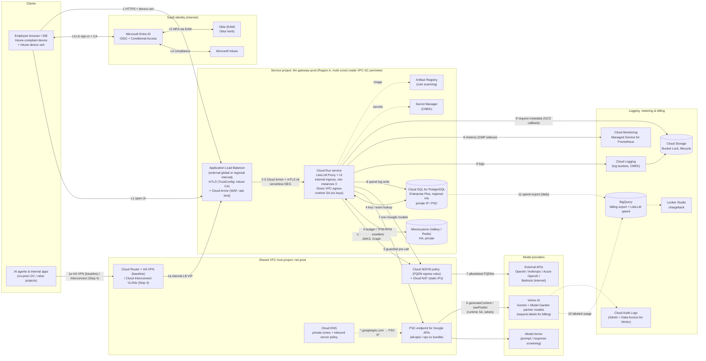

# 6. Step 2c: GCP design

> **Naming note:** Google's documentation now presents Vertex AI's model and agent capabilities under the **Gemini Enterprise Agent Platform** name ([models overview](https://cloud.google.com/gemini-enterprise-agent-platform/models)). This document keeps the name "Vertex AI" because the API surface (`aiplatform.googleapis.com`) and LiteLLM's `vertex_ai/` provider prefix are unchanged. Re-check names and endpoints before implementation.

**Baseline:** Google Cloud security foundations (Shared VPC, VPC Service Controls, Private Service Connect), with **LiteLLM on Cloud Run** behind a **Google Cloud Application Load Balancer with Cloud Armor and mTLS**. Apigee is optional ([§3.3](02-reference-architectures.md#33-google-cloud)). Step 4 ([§8.4](07-private-connectivity.md#84-gcp-cloud-interconnect-overlay)) adds the Cloud Interconnect overlay.

## 6.1 Architecture diagram (GCP)

## 6.2 Component table (GCP)

| # | GCP service | Purpose | AWS equivalent | Azure equivalent |
|---|---|---|---|---|
| 1 | [Cloud Load Balancing: Application LB](https://cloud.google.com/load-balancing/docs/application-load-balancer) with [mTLS](https://cloud.google.com/load-balancing/docs/mtls) | L7 ingress, client-cert validation via TrustConfig (Intune CA) | ALB (mTLS) | App Gateway (mTLS) |
| 2 | [Cloud Armor](https://cloud.google.com/armor/docs/cloud-armor-overview) | WAF (preconfigured OWASP rules), rate limiting, geo/IP rules, Adaptive Protection | AWS WAF + Shield | App Gateway WAF |
| 3 | [Cloud Run](https://cloud.google.com/run/docs/overview/what-is-cloud-run) ([ingress controls](https://cloud.google.com/run/docs/securing/ingress), [Direct VPC egress](https://cloud.google.com/run/docs/configuring/vpc-direct-vpc)). Alternative: [GKE Autopilot](https://cloud.google.com/kubernetes-engine/docs/concepts/autopilot-overview) | LiteLLM Proxy + UI | ECS Fargate / EKS | Container Apps / AKS |
| 4 | [Cloud SQL for PostgreSQL](https://cloud.google.com/sql/docs/postgres) ([HA](https://cloud.google.com/sql/docs/postgres/high-availability)). Alternative: AlloyDB | LiteLLM DB | Aurora PostgreSQL | PostgreSQL Flexible Server |
| 5 | [Memorystore for Valkey](https://cloud.google.com/memorystore/docs/valkey) / [Redis](https://cloud.google.com/memorystore/docs/redis) | Rate-limit and budget counters, cache | ElastiCache | Azure Managed Redis |
| 6 | [Vertex AI generative AI (docs now branded *Gemini Enterprise Agent Platform*)](https://cloud.google.com/gemini-enterprise-agent-platform/models) | Gemini plus partner models (for example Anthropic Claude on Vertex, Llama, Mistral) through Model Garden | Bedrock | Azure OpenAI / Foundry |
| 7 | [Model Armor](https://cloud.google.com/model-armor/overview) | Prompt-injection, jailbreak, sensitive data (SDP), and malicious-URL screening | Bedrock Guardrails | Content Safety / Prompt Shields |
| 8 | [Private Service Connect for Google APIs](https://cloud.google.com/vpc/docs/private-service-connect) | Private VIP for `*.googleapis.com` (Vertex AI, Secret Manager, GCS, Logging) | VPC interface endpoints | Private Endpoints |
| 9 | [VPC Service Controls](https://cloud.google.com/vpc-service-controls/docs/overview) | Data-exfiltration perimeter around the Vertex AI, GCS, BigQuery, Secret Manager, and Cloud SQL APIs | (SCPs + endpoint policies) | (Private endpoints + Azure Policy, NSP) |
| 10 | [Shared VPC](https://cloud.google.com/vpc/docs/shared-vpc) + [Cloud Router](https://cloud.google.com/network-connectivity/docs/router/concepts/overview) + [HA VPN](https://cloud.google.com/network-connectivity/docs/vpn/concepts/overview) / [Cloud Interconnect](https://cloud.google.com/network-connectivity/docs/interconnect/concepts/overview) | Hybrid routing | TGW + VPN / DX | vWAN/hub + VPN/ER |
| 11 | [Cloud DNS](https://cloud.google.com/dns/docs/overview) ([inbound server policy](https://cloud.google.com/dns/docs/server-policies-overview)) | On-premises resolution of private zones and PSC | Route 53 Resolver | DNS Private Resolver |
| 12 | [Cloud NGFW](https://cloud.google.com/firewall/docs/about-firewalls) ([FQDN objects](https://cloud.google.com/firewall/docs/fqdn-objects-overview)) + [Cloud NAT](https://cloud.google.com/nat/docs/overview). Alternative: [Secure Web Proxy](https://cloud.google.com/secure-web-proxy/docs/overview) | Egress allowlist and static egress IPs | Network Firewall + NAT | Azure Firewall |
| 13 | [Secret Manager](https://cloud.google.com/secret-manager/docs/overview) + [Cloud KMS / CMEK](https://cloud.google.com/kms/docs/cmek) | Secrets and keys | Secrets Manager + KMS | Key Vault |
| 14 | [Artifact Registry](https://cloud.google.com/artifact-registry/docs/overview) | Images, vulnerability scanning | ECR | ACR |
| 15 | [Cloud Logging](https://cloud.google.com/logging/docs/overview), [Cloud Monitoring / Managed Service for Prometheus](https://cloud.google.com/stackdriver/docs/managed-prometheus) ([Cloud Run sidecar](https://cloud.google.com/stackdriver/docs/managed-prometheus/cloudrun-sidecar)) | Logs and metrics | CloudWatch / AMP | Azure Monitor |
| 16 | [Cloud Audit Logs](https://cloud.google.com/logging/docs/audit) | Admin Activity + Data Access logs (enable for Vertex AI) | CloudTrail | Activity Log |
| 17 | [Cloud Billing export to BigQuery](https://cloud.google.com/billing/docs/how-to/export-data-bigquery) + [Vertex AI request labels](https://cloud.google.com/vertex-ai/generative-ai/docs/multimodal/add-labels-to-api-calls) + [Budgets](https://cloud.google.com/billing/docs/how-to/budgets) | Billing truth with per-request label granularity | CUR + inference profiles | Cost Management |
| 18 | [Workforce Identity Federation (Entra)](https://cloud.google.com/iam/docs/workforce-sign-in-microsoft-entra-id) | Operator console/CLI SSO via Entra | IAM Identity Center | (native) |
| 19 | (Optional) [Chrome Enterprise Premium + Intune connector](https://cloud.google.com/chrome-enterprise-premium/docs/intune-overview) with [IAP](https://cloud.google.com/iap/docs/concepts-overview) | Context-aware access to the admin UI using Intune compliance signals | Verified Access (no Intune) | Entra Private Access |
| 20 | [Certificate Authority Service](https://cloud.google.com/certificate-authority-service/docs/ca-service-overview) | Workload mTLS certificates | AWS Private CA | Key Vault certs / partner CA |

## 6.3 Request flow walkthrough (GCP)

**Login (L1–L7)** follows [§2.2](01-common-design.md#22-common-login-flow-sequence). LiteLLM is cloud-agnostic here, using the same Entra OIDC app. L6b and the Graph calls egress through Cloud NAT, with Cloud NGFW FQDN rules for `login.microsoftonline.com` and `graph.microsoft.com`.

**API request:**

1. **Client → LB.** Internet users hit the **global external Application LB**. On-premises users and agents reach a **regional internal Application LB** VIP over HA VPN (baseline) or Interconnect (Step 4). Both present the device or workload certificate.
2. **Cloud Armor** applies preconfigured WAF rules (SQLi, XSS, LFI/RFI), per-client rate-limiting (`rate_based_ban`), and geo/IP rules.
3. **mTLS.** The LB validates the client certificate against a **TrustConfig** containing the Intune CA ([LB mTLS](https://cloud.google.com/load-balancing/docs/mtls)), then forwards to **Cloud Run** via a serverless NEG. Cloud Run ingress is set to *internal and Cloud Load Balancing*, so the service cannot be reached directly.
4. **LiteLLM authn/authz.** Same as the other clouds. Cloud Run uses **Direct VPC egress** to reach Memorystore and Cloud SQL private IPs. Cloud SQL is reached through the Cloud SQL Auth Proxy sidecar or a private IP with TLS.
5. **Guardrails.** The LiteLLM **Model Armor** guardrail runs pre-call and post-call ([LiteLLM Model Armor](https://docs.litellm.ai/docs/proxy/guardrails/model_armor)) through the PSC endpoint.
6. **Native models.** LiteLLM calls Vertex AI (`vertex_ai/gemini-*`, `vertex_ai/claude-*`) through **PSC for Google APIs**, inside the **VPC-SC perimeter**. It authenticates as the Cloud Run **runtime service account** through ADC, with no keys. It attaches **request labels** (`team`, `cost_center`, `project`) so that Gemini (`generateContent`) and partner-model (`rawPredict`) usage appears in the billing export by label. Labels are forwarded only for **PayGo** and are ignored for Provisioned Throughput. Confirm whether your LiteLLM version forwards Vertex `labels` from request metadata. If it does not, add them with a LiteLLM pre-call hook or a per-team model alias.
7. **External models.** Cloud NGFW egress rules allowlist the provider FQDNs and deny everything else. Cloud NAT provides static egress IPs.
8. **Metering.** Spend log row to Cloud SQL; counters in Memorystore.
9. **Observability.** Container logs go to Cloud Logging. Prometheus metrics go to Managed Service for Prometheus through the Cloud Run sidecar. The LiteLLM **GCS bucket callback** writes request metadata to Cloud Storage ([LiteLLM logging](https://docs.litellm.ai/docs/proxy/logging)).
10. **Billing.** Cloud Billing **detailed export to BigQuery**, with Vertex usage labeled per team.
11. **Chargeback.** A daily LiteLLM spend export goes to BigQuery and is joined with the billing export by label and date. Looker Studio dashboards show the result. GCP is the **only cloud where per-request billing labels exist natively** for the model service, so reconciliation for Vertex is the most precise.

## 6.4 Identity & access (GCP)

| Topic | Design |
|---|---|
| SSO to LiteLLM UI | Entra OIDC app (same as the other clouds). Optional extra layer: **IAP** on the UI backend with **Workforce Identity Federation** to Entra ([IAP with WIF](https://cloud.google.com/iap/docs/use-workforce-identity-federation)) and **Chrome Enterprise Premium Intune** access levels ([create Intune access levels](https://cloud.google.com/chrome-enterprise-premium/docs/create-access-levels-intune)). Do not put IAP on the API path, because API clients cannot easily get IAP tokens. |
| API auth | Entra JWT validated by LiteLLM. Agents running on GCP use **Workload Identity Federation** in the other direction: Entra federated credentials trust Google service account tokens, which lets a GCP workload get an Entra token for `api://litellm-prod`. |
| Group → role mapping | Same as the other clouds (Entra app roles, team sync, SCIM). |
| Intune compliance | Entra CA (CA-GW-01) at sign-in, plus LB mTLS with Intune device certificates. Optionally, Chrome Enterprise Premium Intune signals for IAP-protected UI paths, which require a CEP license. |
| Service-to-service | A dedicated Cloud Run runtime SA with `roles/aiplatform.user`, `roles/modelarmor.user`, `roles/secretmanager.secretAccessor`, and `roles/cloudsql.client`. No SA keys, enforced by the org policy `iam.disableServiceAccountKeyCreation`. Cloud SQL **IAM database authentication** is possible through the Auth Proxy (`--auto-iam-authn`). |
| Operators | Workforce Identity Federation with Entra. Entra group → IAM role bindings at folder or project level. |

## 6.5 Cost allocation & token controls (GCP)

| Control | LiteLLM layer | GCP layer |
|---|---|---|
| Department chargeback | LiteLLM org or `dept:` tag | Vertex **request labels** `cost_center=<code>` → billing export (PayGo only). Project-level labels on the gateway project for infrastructure cost. |
| Team / project | Team budgets, tags | Labels `team=<id>`, `project=<id>`. Keep label cardinality low, and never put per-request or user IDs in labels. |
| Per user | LiteLLM user spend (the only source; billing labels should not carry user IDs) | n/a |
| Token controls | TPM/RPM, budgets, model access groups | Vertex AI **quotas** per model and region, and Provisioned Throughput where needed. Optional Apigee `LLMTokenQuota` if Apigee is used. |
| Alerts | LiteLLM alerts, Prometheus alerting | [Cloud Billing budgets](https://cloud.google.com/billing/docs/how-to/budgets) → Pub/Sub → notification. Budgets can filter by label. |
| Reporting | LiteLLM UI and APIs | BigQuery (billing export + LiteLLM spend) → Looker Studio |

## 6.6 Networking (GCP)

- **Projects:** `net-prod` (Shared VPC host: Cloud Router, VPN/Interconnect attachments, Cloud DNS, PSC endpoint, firewall policies, Cloud NAT) and `llm-gateway-prod` (service project: Cloud Run, Cloud SQL, Memorystore, LB, Secret Manager) inside a **VPC-SC perimeter** that also includes the BigQuery and GCS logging projects.
- **Subnets (region A):** `snet-run` (/24) for Direct VPC egress; `snet-proxy-only` (/23) for regional internal/external LB proxies; a PSA range (/20) for Cloud SQL and Memorystore, or PSC-based connectivity for those services.
- **PSC for Google APIs:** a global internal IP (for example `10.80.255.10`) for the `all-apis` bundle, or `vpc-sc` to restrict to VPC-SC-supported APIs. Cloud DNS private zones for `googleapis.com` (and `REGION-aiplatform.googleapis.com`) map to the PSC IP. On-premises resolvers forward those zones to the Cloud DNS **inbound server policy** IPs ([Vertex PSC from on-prem](https://cloud.google.com/vertex-ai/docs/general/vertex-psc-gen-ai)).
- **Firewall:** hierarchical firewall policy. Ingress to `snet-run` is not needed for Cloud Run (ingress goes through the LB). Egress from `snet-run` is allowed to PSA ranges, the PSC IP, and FQDN objects for model providers and Entra; everything else is denied and logged.
- **Ingress paths:** global external ALB (internet zero trust) and regional internal ALB (VPN/Interconnect). In the private-only variant, delete the external LB.

## 6.7 Data & logging (GCP)

| Data | Store | Protection | Retention |
|---|---|---|---|
| LiteLLM DB | Cloud SQL PostgreSQL Enterprise Plus, regional HA, CMEK, PITR | Private IP only, IAM DB auth, SSL required | PITR 7–35 days; cross-region read replica for DR |
| Spend logs | Cloud SQL → daily export to BigQuery (partitioned) | Same | 90 days hot in SQL, 7 years in BigQuery/GCS [assumption] |
| Counters/cache | Memorystore (in-transit encryption, AUTH/IAM) | Private | Ephemeral |
| Request metadata | LiteLLM GCS callback → Cloud Storage (Bucket Lock) → BigQuery external table | CMEK, VPC-SC | 1 year standard, then Archive class to 7 years |
| Prompt/response content (opt-in) | Separate bucket; or Vertex AI request-response logging to BigQuery for specific models | Separate CMEK key, SDP (DLP) scanning | Per policy |
| Admin audit | LiteLLM audit logs → Cloud Logging; Cloud Audit Logs (enable **Data Access** for `aiplatform.googleapis.com`) → locked log bucket and SIEM | Locked log bucket | 7 years |

## 6.8 Security controls (GCP)

- **WAF:** Cloud Armor preconfigured WAF rules at sensitivity level 1–2 (tune for LLM payloads, which often contain code and SQL-like text that cause false positives), rate limiting, Adaptive Protection, and a stricter policy on admin paths.
- **mTLS:** LB mTLS with a TrustConfig (Intune CA plus CAS for workloads), and client validation mode `REJECT_INVALID`.
- **Exfiltration control:** a VPC-SC perimeter. Vertex AI, GCS, BigQuery, and Secret Manager are reachable only from inside it.
- **Secrets & keys:** Secret Manager with CMEK; Cloud KMS key rotation.
- **Guardrails / PII:** Model Armor templates (prompt injection, jailbreak, SDP inspect/de-identify, malicious URLs) applied by LiteLLM to **all** models, including external ones. Vertex safety filters apply to Gemini. Presidio is optional.
- **Posture:** Security Command Center (incl. AI Protection where licensed), Binary Authorization for Cloud Run, Artifact Analysis scanning, and org policies (no external IPs, no SA keys, restricted regions).

## 6.9 Scalability & HA (GCP)

- **Compute:** Cloud Run with min instances ≥ 3 (avoids cold starts and keeps Redis connection pools warm), instance-based billing ("CPU always allocated") for background tasks such as spend-log batching and budget resets, concurrency of about 50–80 per instance, and a 60-min request timeout for long streams. **GKE Autopilot** is the alternative if sidecars, Presidio, or a self-hosted model on GKE Inference Gateway are needed.
- **Data:** Cloud SQL regional HA with a synchronous standby in a second zone. Memorystore HA with a replica in another zone.
- **Models:** LiteLLM router across Vertex regions and the global endpoint where residency allows, with fallbacks to Bedrock and Azure OpenAI through egress.
- **DR:** Cloud Run in region B, deployed from the same Terraform. Cloud SQL cross-region replica promotion. The global external LB fails over automatically between serverless NEGs in two regions, and internal clients use DNS failover. RTO 15–45 min.

---

[← Previous: Step 2b: Azure](04-azure.md) · [Index](../../README.md) · [Next →: Step 3: Comparison](06-comparison.md)
