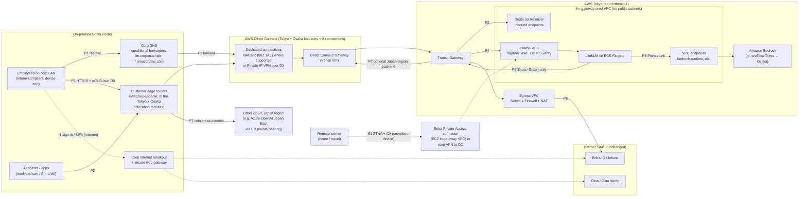
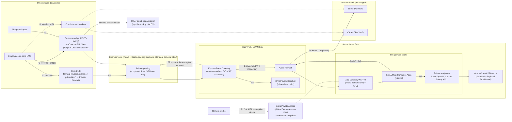
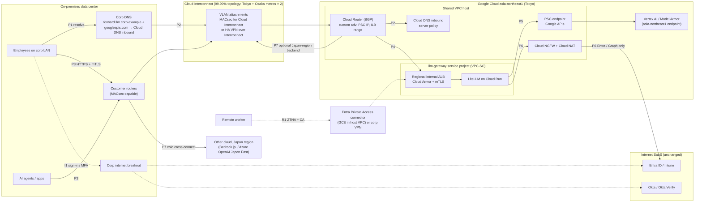
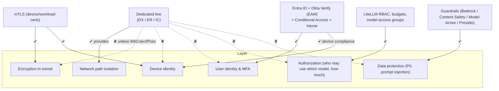
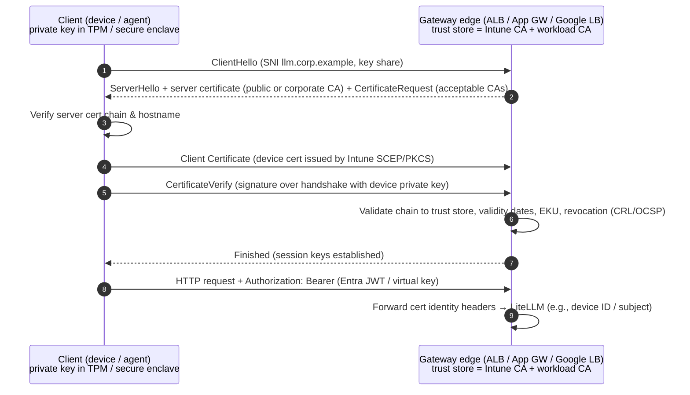

# 8. Step 4: Private connectivity (dedicated line) option

**The proposal:** management wants gateway and AI-agent traffic to ride the existing ExpressRoute, Direct Connect, and Cloud Interconnect circuits, the same as other internal traffic. That would replace internet-based access secured by site-to-site VPN, mTLS, and Intune device identity.

**Summary position:** do it, but **as an additional layer, not a replacement.** Make the dedicated line the *default path* for on-premises users and agents. Make the gateway *internal-only* where possible. Keep every identity, device, and encryption control from the Step 2 designs.

## 8.1 What changes in every design

| Element | Step 2 baseline (internet zero trust) | Step 4 private option |
|---|---|---|
| Gateway ingress | Public LB + WAF + mTLS, plus a private frontend via VPN | **Internal LB only** (ALB internal / App Gateway private frontend / regional internal ALB). Public listener removed, or kept only for a remote-worker ZTNA connector. |
| On-premises → cloud path | Site-to-site IPsec VPN over the internet | DX / ER / Interconnect private routing (BGP), optionally with **MACsec** or **IPsec over the circuit** |
| DNS | Public DNS for `llm.corp.example` | Split-horizon: on-premises resolvers forward `llm.corp.example` and the cloud private-link zones to cloud inbound resolvers |
| Model endpoints | Private endpoints from the gateway VPC (already private) | Unchanged. The gateway still calls models through PrivateLink, Private Endpoint, or PSC. On-premises clients never call models directly, so all usage stays metered. |
| Entra / Okta / Intune | Internet (SaaS) | **Still internet (SaaS).** Unchanged. See 8.5. |
| External model providers | Blocked by the residency rule [A-7] | Still blocked. Another cloud's **Japan-region** models (for example Azure OpenAI Japan East called from AWS Tokyo) are reached **over the private lines** through our router in the Tokyo colocation facility, so the path stays in Japan. |
| Remote workers | Internet → public WAF/mTLS edge | ZTNA (Entra Private Access) or corporate VPN → DC → dedicated line. See 8.6. |

## 8.2 AWS: Direct Connect overlay

**Considerations (AWS):**

| Topic | Notes |
|---|---|
| What DX does and does not protect | DX is a private circuit that is not internet-routed. It **does not encrypt** traffic by default and **does not authenticate** users or devices. Encryption options are [MACsec on dedicated connections](https://docs.aws.amazon.com/directconnect/latest/UserGuide/MACsec.html) (10/100/400 Gbps at supported locations) or a [Private IP VPN over Direct Connect](https://docs.aws.amazon.com/vpn/latest/s2svpn/private-ip-dx.html) terminating on TGW. Keep TLS 1.2+ and mTLS end-to-end regardless. |
| Private routing to PaaS/model endpoints | DX transit VIF → DX Gateway → TGW → gateway VPC. Bedrock is reached only by **LiteLLM** through [interface VPC endpoints](https://docs.aws.amazon.com/bedrock/latest/userguide/vpc-interface-endpoints.html). On-premises clients do not need Bedrock DNS. On-premises DNS forwards `llm.corp.example` (a Route 53 private hosted zone) to [Route 53 Resolver inbound endpoints](https://docs.aws.amazon.com/Route53/latest/DeveloperGuide/resolver-forwarding-inbound-queries.html). Avoid a **public VIF**: it exposes AWS public endpoints but bypasses VPC endpoint policies. |
| Traffic that still uses the internet | (a) User sign-in and MFA to Entra ID, Okta, and Okta Verify push, from the user's device through the corporate internet breakout. (b) LiteLLM → Entra token endpoint, JWKS, and Graph, through Network Firewall. **No model traffic**: public model APIs are blocked [A-7], and cross-cloud Japan-region backends (P7) go DX → colocation router → the other cloud's private peering. |
| Remote / hybrid workers | They are not on the DX path. Options: **Entra Private Access** with a connector in the VPC (CA + compliant device per app); the existing corporate VPN to the DC, then DX (hairpin latency); or keep the Step 2 public mTLS edge for remote users only. [AWS Client VPN](https://docs.aws.amazon.com/vpn/latest/clientvpn-admin/what-is.html) with Entra SAML is possible but does not evaluate Intune compliance. |
| Bandwidth / latency / redundancy / cost | LLM traffic is low-bandwidth (text) but uses many long-lived streaming connections. Model inference time (seconds) dominates DX's latency advantage (milliseconds). Use the [maximum resiliency model](https://docs.aws.amazon.com/directconnect/latest/UserGuide/resiliency_toolkit.html) with DX locations in **Tokyo and Osaka** (2 locations × 2 connections) for 99.99%, which also keeps every physical path in Japan. Incremental cost is small if circuits exist: DX data transfer out (USD 0.041/GB from Tokyo/Osaka to a Japan location), TGW attachment and processing, Resolver endpoints, and MACsec-capable ports if upgrading. Full breakdown: [§8.9](#89-private-connectivity-cost-japan). |
| Ops complexity / failure modes | BGP route withdrawal or leaks, asymmetric routing between DX and VPN backup, **DNS forwarding failure** (clients fall back to public DNS and fail closed, which is good), MTU issues with IPsec over DX, TGW route-table errors that expose the gateway to other spokes, and MACsec key (CKN/CAK) rotation. Monitor with DX CloudWatch metrics, TGW flow logs, and synthetic probes from on-premises. |

## 8.3 Azure: ExpressRoute overlay

**Considerations (Azure):**

| Topic | Notes |
|---|---|
| What ER does and does not protect | ER private peering is a private Layer 3 connection through a connectivity provider. It is **not encrypted** by default and does not identify users or devices. Encryption options are [MACsec on ExpressRoute Direct](https://learn.microsoft.com/azure/expressroute/expressroute-howto-macsec) (port pairs only, not provider circuits) or [site-to-site VPN over ExpressRoute private peering](https://learn.microsoft.com/azure/vpn-gateway/site-to-site-vpn-private-peering). |
| Private routing to PaaS/model endpoints | Use **private endpoints over private peering**. Don't use Microsoft peering to reach PaaS public endpoints, because it complicates routing and bypasses private endpoint controls. On-premises DNS must conditionally forward every `privatelink.*` zone in use to the **DNS Private Resolver inbound endpoint** ([on-premises DNS for private endpoints](https://learn.microsoft.com/azure/private-link/private-endpoint-dns-integration)). Missing zones are the most common failure. |
| Traffic that still uses the internet | Entra ID, Okta, and Intune sign-in and check-in from devices. Microsoft recommends the internet for most M365 and Entra traffic, and ER Microsoft peering for M365 needs authorization ([ExpressRoute for Microsoft 365](https://learn.microsoft.com/microsoft-365/enterprise/azure-expressroute)). LiteLLM → Entra token and Graph go through Azure Firewall. No model traffic uses the internet [A-7]. |
| Remote / hybrid workers | **Entra Private Access** (Global Secure Access client) is the most natural fit. The same CA policy requires a compliant device, and the connector sits in the spoke and targets the App Gateway private frontend. No hairpin through the DC is needed. Alternative: Azure VPN Gateway P2S with Entra auth, or the corporate VPN. |
| Bandwidth / latency / redundancy / cost | Size the **ER gateway SKU** for aggregate throughput and flow count. Many long-lived SSE streams count against connection limits. [FastPath](https://learn.microsoft.com/azure/expressroute/about-fastpath) bypasses the gateway on the data path, but check its limitations with Private Link. For resiliency, use 2 circuits in 2 peering locations, **Tokyo and Osaka** ([ER resiliency design](https://learn.microsoft.com/azure/expressroute/design-architecture-for-resiliency)). A **Standard** circuit reaches only Azure regions in the Japan geopolitical region (Japan East and Japan West). Do not buy the Premium add-on: it adds cost and opens a path to non-Japan regions ([locations](https://learn.microsoft.com/azure/expressroute/expressroute-locations-providers)). Cost: circuit (Local / metered / unlimited), gateway hours, private endpoint per-GB, and firewall processing if hub-inspected. Full breakdown: [§8.9](#89-private-connectivity-cost-japan). |
| Ops complexity / failure modes | Private DNS zone sprawl and drift. Asymmetric routing when hub firewall inspection is added, so UDRs must cover both directions. ER circuit maintenance windows. Gateway SKU saturation. MACsec CAK/CKN rotation in Key Vault. BGP community and route-filter mistakes. Monitor with Connection Monitor, ER metrics, and Firewall logs in Sentinel. |

## 8.4 GCP: Cloud Interconnect overlay

**Considerations (GCP):**

| Topic | Notes |
|---|---|
| What Interconnect does and does not protect | Dedicated or Partner Interconnect gives private L2/L3 connectivity into the VPC. It is **not encrypted** by default and has no user or device identity. Encryption options are [MACsec for Cloud Interconnect](https://cloud.google.com/network-connectivity/docs/interconnect/concepts/macsec-overview) or [HA VPN over Cloud Interconnect](https://cloud.google.com/network-connectivity/docs/interconnect/concepts/ha-vpn-interconnect) (IPsec). |
| Private routing to PaaS/model endpoints | On-premises clients reach only the **internal ALB**. LiteLLM reaches Vertex AI and Model Armor through **PSC for Google APIs**. Cloud Router must **custom-advertise** the internal LB subnet, and the PSC IP if on-premises tools call Google APIs directly. On-premises DNS forwards to the **Cloud DNS inbound server policy** ([Vertex PSC from on-prem](https://cloud.google.com/vertex-ai/docs/general/vertex-psc-gen-ai), [private Google access for on-prem](https://cloud.google.com/vpc/docs/configure-private-google-access-hybrid)). VPC-SC ingress rules must allow the on-premises access level if on-premises tools call Vertex directly. That is not needed when traffic always goes through LiteLLM. |
| Traffic that still uses the internet | Entra, Okta, and Intune (device ↔ SaaS); LiteLLM → Entra and Graph via Cloud NGFW FQDN rules and Cloud NAT static IPs. No model traffic [A-7]. |
| Remote / hybrid workers | Entra Private Access connector on GCE in the host VPC (CA + compliant device), the corporate VPN, or Chrome Enterprise Premium + IAP for **UI-only** access with Intune signals. |
| Bandwidth / latency / redundancy / cost | Use the [99.99% topology](https://cloud.google.com/network-connectivity/docs/interconnect/tutorials/dedicated-creating-9999-availability) (4 connections, 2 metros, 2 Cloud Routers), with the two metros in **Tokyo and Osaka**. VLAN attachment capacity and Cloud Router route limits apply. Egress over Interconnect (USD 0.042/GiB Asia → Asia) is cheaper than internet egress, but LLM traffic volume is small, so fixed attachment and port costs dominate. Full breakdown: [§8.9](#89-private-connectivity-cost-japan). |
| Ops complexity / failure modes | Missing custom route advertisements (the most common issue). DNS forwarding loops between on-premises and Cloud DNS. VPC-SC denials that look like 403s. MACsec key rotation. Partner Interconnect provider outages. Monitor with Interconnect metrics, Network Intelligence Center Connectivity Tests, and VPC-SC dry-run logs. |

## 8.5 What private connectivity does *not* solve (all clouds)

Key points to communicate to management:

- **A private line is a path, not an identity.** Any compromised host on the corporate network, or in any VPC, VNet, or project routed to the gateway, can reach it. Without per-request user, device, and workload authentication, a private line *widens* the trusted zone.
- **Dedicated circuits are not encrypted by default.** If our policy requires link encryption, enable MACsec (where the port type supports it) or IPsec over the circuit. In all cases, keep TLS 1.2+/1.3 end-to-end to the gateway, because TLS protects against insiders on the path, not just the provider.
- **SaaS identity stays on the internet.** Entra ID, Okta Verify push, and Intune check-ins are SaaS. The dedicated line does not carry them, and a dedicated-line outage does not affect them. An *internet* outage at the DC, however, breaks sign-in even while the circuits are up. The corporate breakout must be redundant.
- **Public model APIs are out, for residency, not for network reasons.** OpenAI, the Anthropic API, and similar providers are blocked [A-7]. The cloud-hosted equivalents in Japanese regions (Claude on Bedrock `jp.`, OpenAI models as Azure Standard deployments in Japan East) replace them. Cross-cloud calls between those regions ride the private lines through our Tokyo colocation router, which keeps both the path and the processing in Japan.
- **The circuits themselves should stay in Japan.** Use DX, ER, and Interconnect locations in Tokyo and Osaka only, and do not buy global-reach options (ER Premium) that would make non-Japan regions routable.

## 8.6 Remote and hybrid workers

| Option | Device trust | User experience | Recommendation |
|---|---|---|---|
| **Entra Private Access** (Global Secure Access) with connectors in each cloud VPC/VNet | Entra CA + Intune compliance per app segment ([Private Access](https://learn.microsoft.com/entra/global-secure-access/concept-private-access)) | Transparent, per-app, no full tunnel | **Recommended**: same policy engine everywhere, and it works for all three clouds |
| Corporate full-tunnel VPN → DC → dedicated line | VPN posture checks (vendor-specific) | Hairpin latency, plus VPN capacity planning | Acceptable short-term |
| Keep the Step 2 public edge (WAF + mTLS + CA) for remote users only | Intune device cert at the edge + CA | Direct, lowest latency | Acceptable. This is the "internet zero trust" path, kept intentionally for remote users. |

## 8.7 mTLS explainer

**How it works (TLS 1.3, simplified):**

| | mTLS secures | mTLS does **not** secure / limitations |
|---|---|---|
| **Authentication** | *Mutual* authentication: the client proves possession of a private key bound to a certificate from a trusted CA (device or workload identity), and the server proves its identity to the client | It is **not user authentication or authorization**. A valid device cert says nothing about *which user* or *which models and budgets*. Entra JWT, virtual keys, and LiteLLM RBAC are still required. |
| **Encryption** | Confidentiality and integrity in transit between client and TLS terminator, with forward secrecy (TLS 1.3) | Only up to the **termination point** (LB). The LB → backend hop needs its own TLS. A corporate **TLS-inspecting proxy** breaks mTLS, so exempt `llm.corp.example` from inspection. |
| **Certificate lifecycle** | Automatable: Intune SCEP/PKCS profiles for devices; Private CA / Key Vault / CAS for workloads | Issuance, renewal, and CA rotation are operational work. Expired certs cause outages, so monitor expiry and use 30–90 day validity with auto-renewal. |
| **Revocation** | CRL/OCSP checks at the edge, where supported (ALB supports CRLs; check App Gateway and Google LB capabilities per region) | Revocation is often slow or unsupported. Short-lived certs are more reliable than CRLs. Compliance loss in Intune does not automatically revoke the cert unless that is automated. |
| **Key protection** | TPM- or Secure Enclave–bound non-exportable keys (Intune can require a TPM KSP) | Software-stored keys can be copied to an unmanaged machine. |
| **Header trust** | The edge passes cert attributes to LiteLLM | The backend must accept those headers **only** from the LB. Strip client-supplied copies. |

**mTLS vs. dedicated lines:**

| Property | Dedicated line (DX / ER / IC) | mTLS |
|---|---|---|
| Layer | L1–L3 path | L4–L7 session |
| Authenticates | Nothing (the BGP peer at most) | Each client device or workload, and the server |
| Encrypts | No (unless MACsec or IPsec added) | Yes, end-to-end to the TLS terminator |
| Protects against internet exposure / DDoS | Yes (no public endpoint) | No (endpoint may be public; WAF/DDoS still needed) |
| Protects against a compromised internal host | No | Partly. The attacker also needs a valid cert and key. |
| Works for remote workers | No (needs VPN/ZTNA) | Yes |
| Deterministic bandwidth/latency, SLA | Yes | No (rides whatever path) |
| Main operational burden | Circuits, BGP, DNS forwarding, provider SLAs | PKI, cert lifecycle, revocation, proxy exemptions |

They are **complementary**: the dedicated line reduces *exposure*, and mTLS provides *cryptographic identity and encryption*.

## 8.8 Recommended zero-trust posture (combining both)

| Layer | Control (all clouds) |
|---|---|
| **User identity** | Entra ID OIDC/JWT for UI and API. Okta Verify via **EAM** for MFA, phishing-resistant for admins. Short token lifetimes. SCIM deprovisioning. |
| **Device** | Intune compliance enforced by **Conditional Access** at token issuance, **and** an Intune-issued, TPM-bound **device certificate** checked by **mTLS** at the gateway edge. |
| **Workload** | Agents authenticate with Entra workload identity (federated credentials) plus **mTLS workload certificates**. Service-account virtual keys only as an exception, with expiry, budgets, and IP scoping. |
| **Network** | **Dedicated line is the default** for on-premises users and agents to an **internal-only** gateway. **Entra Private Access** for remote users. The public edge is either removed, or kept only with WAF + mTLS + CA, terminated in Tokyo. Models are reached only through private endpoints, or through the private lines for another cloud's Japan-region models. Egress is allowlisted, with no public model APIs. |
| **Transport encryption** | TLS 1.2+ (prefer 1.3) end-to-end, including LB → LiteLLM → model. **MACsec or IPsec over the circuits** if data classification requires link-layer encryption. |
| **Authorization & usage** | LiteLLM RBAC, model access groups, budgets, and TPM/RPM per org, team, user, and key. Cloud quotas as the outer limit. |
| **Data** | Guardrails on every request (PII, prompt injection), processed in Japan. Metadata-only logging by default. CMK encryption. Immutable audit. Every store, backup, and export is in Tokyo or Osaka ([§2.5](01-common-design.md#25-japan-data-residency-applies-to-every-design)). |
| **Detect & respond** | Entra sign-in logs, WAF, firewall, and LiteLLM audit/spend anomalies in Sentinel or the SIEM. Automated key revocation on user offboarding or device non-compliance. |

> **Bottom line for management:** routing gateway traffic over ExpressRoute, Direct Connect, and Interconnect is a good choice for exposure reduction and predictable connectivity. It is **not** a substitute for user MFA, device compliance, mTLS, or encryption. Approve the private-path design together with the identity, device, and mTLS controls, not instead of them.

## 8.9 Private connectivity cost (Japan)

List prices in USD from the vendors' pricing pages, checked 2026-10-30. Our negotiated rates, currency, and taxes will differ. The circuits already exist [A-8], so their port and circuit fees are mostly **sunk**. What the gateway adds is per-GB transfer, attachments and gateways, and a share of the fixed fees if we choose to charge it back.

| Cost element | AWS Direct Connect | Azure ExpressRoute | GCP Cloud Interconnect |
|---|---|---|---|
| **Port / circuit (fixed)** | Dedicated port **in Japan**: 1 Gbps **USD 0.285/h** (≈ USD 208/month), 10 Gbps **USD 2.142/h** (≈ USD 1,564/month). Hosted connections are priced per capacity, partly through partners ([DX pricing](https://aws.amazon.com/directconnect/pricing/)). | Provider circuits: a monthly fee by bandwidth and SKU (**Local**, **Standard**, Premium) and plan (**metered** or **unlimited**). **ER Direct** 10 Gbps port pair in **Zone 2**: **USD 7,000/month**; 100 Gbps: USD 60,000/month. Tokyo, Tokyo2, Tokyo3, and Osaka are all Zone 2 ([ER pricing](https://azure.microsoft.com/en-us/pricing/details/expressroute/), [locations and zones](https://learn.microsoft.com/azure/expressroute/expressroute-locations-providers)). | Dedicated 10 Gbps circuit **USD 2.328/h** (≈ USD 1,699/month); 100 Gbps USD 23.28/h ([Interconnect pricing](https://cloud.google.com/network-connectivity/docs/interconnect/pricing)). |
| **Attachment / virtual interface** | Transit VIF and DX Gateway: no separate fee on the DX pricing page | Included in the circuit | Dedicated VLAN attachment ≤10 Gbps: **USD 0.10/h** (≈ USD 73/month each). Partner VLAN attachment: 1 Gbps **USD 0.2778/h**, 10 Gbps USD 2.36/h. |
| **Gateway / hub in the cloud** | Transit Gateway: per attachment-hour plus per-GB data processing. The pricing page's example (US East, Ohio) shows **USD 0.05 per attachment-hour** and **USD 0.02/GB**; check the Tokyo rate in the AWS Pricing Calculator ([TGW pricing](https://aws.amazon.com/transit-gateway/pricing/)). | ExpressRoute gateway: hourly by SKU (ErGw1AZ/2AZ/3AZ, or ErGwScale billed per 1 Gbps scale unit) ([ER pricing](https://azure.microsoft.com/en-us/pricing/details/expressroute/)) | Cloud Router: no line item on the Interconnect pricing page |
| **Data out of the cloud (cloud → on-premises)** | **USD 0.041/GB** from Tokyo/Osaka to a Japan DX location | Metered plan, Zone 2: **USD 0.05/GB**. **Unlimited** plan and **Local** SKU: included. Local is available at Tokyo (→ Japan East) and Osaka (→ Japan West) ([ER FAQ: Local](https://learn.microsoft.com/azure/expressroute/expressroute-faqs)). | **USD 0.042/GiB** for an Asia connection location with an Asia VLAN attachment region |
| **Data into the cloud** | Free | Free | Free (resources that process the data may still charge) |
| **Link encryption option** | MACsec on dedicated 10/100/400 Gbps ports (no separate line item on the pricing page), or Private IP VPN over DX (Site-to-Site VPN hourly charges apply) | MACsec on ER Direct only, or VPN Gateway over private peering (VPN gateway hours) | MACsec for Cloud Interconnect, or HA VPN over Interconnect (HA VPN tunnel hours) |
| **Outside the cloud bill** | Colocation cross-connects in Tokyo/Osaka, carrier circuits to the DC, DX partner fees for hosted connections, and our own edge routers (including the colocation router that links DX, ER, and Interconnect for cross-cloud Japan-region backends) | Same, plus ER connectivity-provider fees for provider circuits | Same, plus Partner Interconnect provider fees |

**Worked example at our scale [A-9].** Assumptions: about 1 TiB/month of responses flows from the gateway to on-premises clients, and about 1 TiB/month of prompts flows the other way. That is roughly 100 million responses of 10 KB each, a deliberately high estimate for text traffic.

| Item | AWS | Azure | GCP |
|---|---|---|---|
| Data out (1 TiB) | 1,024 GB × 0.041 ≈ **USD 42** | Metered: 1,024 GB × 0.05 ≈ **USD 51**; Local or unlimited: **USD 0** | 1,024 GiB × 0.042 ≈ **USD 43** |
| Hub processing | TGW: 2,048 GB × 0.02 ≈ **USD 41** at the example rate (both directions pass through TGW), plus one VPC attachment ≈ USD 37 | ER gateway hours (existing hub gateway: USD 0 incremental) | USD 0 |
| New attachments for the gateway | USD 0 if the gateway VPC attaches to the existing TGW | USD 0 if the spoke peers with the existing hub | USD 0 if the gateway uses the Shared VPC host's existing attachments; otherwise 4 × USD 73 ≈ **USD 292** |
| **Incremental total** | **≈ USD 120/month** | **≈ USD 0–51/month** plus any gateway upsizing | **≈ USD 43–335/month** |
| Sunk fixed cost, for showback only (4 connections across Tokyo + Osaka) | 4 × 1 Gbps ≈ USD 832/month; 4 × 10 Gbps ≈ USD 6,255/month | 2 × ER Direct 10 Gbps ≈ USD 14,000/month, or provider circuit fees | 4 × 10 Gbps Dedicated ≈ USD 6,798/month, plus attachments |

**Cross-cloud Japan-region backend (P7).** Example: AWS Tokyo → Azure OpenAI Japan East. Each GB of prompts leaves AWS over DX (USD 0.041/GB), and each GB of responses leaves Azure over ER (USD 0.05/GB metered, or included on Local/unlimited). Both clouds charge nothing for inbound traffic. At LLM text volumes this is tens of dollars a month. The real cost is the colocation router and cross-connects that join the two circuits.

**Takeaways:**

- Per-GB transfer is small for text LLM traffic. Fixed port and circuit fees dominate, and they are already paid.
- The gateway's private-line cost is mostly a **shared-infrastructure allocation decision**. Agree with finance whether to charge a share of the fixed fees to the gateway, for example in proportion to its GB on the circuit. Then add that share to the platform overhead line in showback ([§7.2](06-comparison.md#72-recommendation)).
- On Azure, **ExpressRoute Local** at Tokyo or Osaka removes per-GB egress for the region in the same metro. It is a good fit if Japan East is the only target.
- Re-check prices before budgeting. The AWS TGW and Azure gateway rates above come from examples or need the pricing calculator for Japanese regions.

---

[← Previous: Step 3: Comparison](06-comparison.md) · [Index](../../README.md) · [Next →: References](08-references.md)
