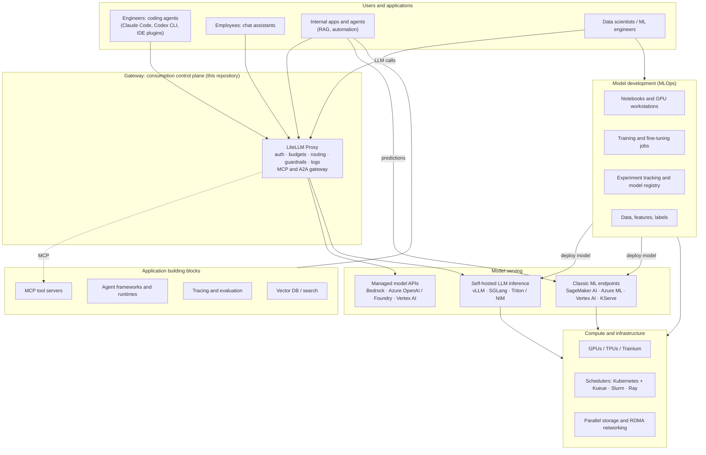

# 10. Appendix: The AI operations landscape (background)

> **Scope:** Background reading, not part of the gateway design. The rest of this repository designs one component, the LLM gateway. This page steps back and places the gateway among the other environments a company builds when it adopts AI, including ones that have nothing to do with LLMs, such as GPU clusters and classic machine learning. It answers three questions: what "AI Ops" means, which AI environments exist and who uses them, and which of them LiteLLM can serve.
>
> **Status:** Orientation guide, written 2026-11-13. Unlike §2–§8, the vendor details on this page (GPU models, instance families, product names, the LiteLLM endpoint list) come from general knowledge and were **not** re-checked against live documentation. Hardware generations and product names change every year. Check the linked pages before you use anything here in a decision.

---

## 10.1 Summary

- **"AIOps" means two things.** The established industry term (Gartner's) means *AI for IT operations*: using machine learning to correlate alerts and find incidents. What we are building runs the other way, *operations for AI*. Calling it "AIOps" will lead vendors and search results to the wrong products. Say "AI platform", "LLM gateway", or "LLMOps" instead ([§10.2](#102-aiops-means-two-different-things)).
- **MLOps and LLMOps manage different assets.** MLOps is the lifecycle of models you train yourself: data, training, evaluation, deployment, drift monitoring, retraining. LLMOps is the lifecycle of systems built on foundation models you mostly rent: prompts, model choice, retrieval, guardrails, evaluation, and token cost ([§10.4](#104-mlops-vs-llmops-what-changes-when-you-stop-training-the-model)). Most companies need LLMOps first, and MLOps only where they own a predictive model or a fine-tuned one.
- **There are about a dozen distinct AI environments**, from coding agents at the top to GPU clusters at the bottom ([§10.6](#106-the-ai-environments-one-by-one)). They have different users, different cost units (tokens or GPU-hours), and usually different owners.
- **The LLM gateway controls how models are *consumed*.** Every environment that sends prompts to a model should go through it. It is not a platform for *building* models: training, notebooks, GPU scheduling, experiment tracking, and classic ML serving belong elsewhere.
- **LiteLLM covers more than chat** ([§10.8](#108-what-litellm-supports-and-what-it-does-not)): embeddings, rerank, images, audio, batch, managed fine-tuning jobs, vector stores, an MCP gateway for tools, an A2A gateway for agents, and pass-through to provider-native APIs. Every one of these is a new data path, and each must meet the Japan residency rules in [§2.5](01-common-design.md#25-japan-data-residency-applies-to-every-design).
- **GPUs enter our design only if we self-host models.** If we do (for residency, for cost at high steady volume, or for a model that no cloud processes in Japan), the GPU inference cluster becomes one more LiteLLM backend, and the gateway's budgets and tags allocate its cost.
- **Shared foundations matter more than shared tools.** Use the same identity (Entra ID), the same cost-allocation tags, the same Japan-only policy, and the same log pipeline for the gateway, any GPU platform, and any MLOps platform. Token spend and GPU spend then add up to one AI cost report.

## 10.2 "AIOps" means two different things

| | AIOps: AI **for** IT operations | AI operations: operations **for** AI |
|---|---|---|
| Direction | AI helps run IT | IT runs AI |
| Origin | Gartner term from the mid-2010s | Umbrella for MLOps, LLMOps, GenAIOps, and AgentOps |
| Typical job | Correlate alerts, detect anomalies in metrics and logs, suggest a root cause, automate remediation | Give people and applications governed, affordable access to models; build, deploy, and monitor models |
| Example products | Datadog Watchdog, Dynatrace Davis AI, Splunk ITSI, PagerDuty AIOps, BigPanda | AI gateways such as LiteLLM, Langfuse, MLflow, SageMaker AI, Azure Machine Learning, Vertex AI, vLLM, Kubeflow |
| Relation to this repository | A consumer: an in-house SRE agent can call models through the gateway | The gateway is one part of it |

In documents and vendor conversations, avoid "AIOps" for what we are building. Use **AI platform** for the whole, **LLM gateway** for this component, and **LLMOps / MLOps** for the practices.

## 10.3 The "Ops" family

The names overlap, and vendors use them loosely. What matters is which lifecycle each one covers.

| Term | What it operates | Main concerns | Typical people |
|---|---|---|---|
| DevOps | Application code | Ship changes safely and often: CI/CD, infrastructure as code, monitoring | All engineering |
| DataOps | Data pipelines | Data quality, freshness, lineage | Data engineers |
| **MLOps** | Models you train | Reproducible training, data and model versioning, deployment, drift monitoring, retraining | Data scientists, ML engineers |
| **LLMOps** (Microsoft says **GenAIOps**) | Applications built on foundation models | Prompts, model selection, retrieval (RAG), evaluation, guardrails, token cost, latency | Application engineers, platform team |
| AgentOps | Agents that call tools and take actions | Tool permissions (MCP), traces of multi-step runs, sandboxes, human approval, runaway loops and cost | Application engineers, security |
| FinOps for AI | AI spend | Allocating token and GPU cost, budgets, commitments (provisioned throughput, reserved GPUs) | Finance, platform team |
| AIOps | IT operations, with AI as the tool | Alert noise, incident detection, root cause | SRE, IT operations |
| AI platform engineering | The shared infrastructure under all of the above | GPUs, schedulers, gateways, identity, networking, residency | Platform and infrastructure team |

## 10.4 MLOps vs LLMOps: what changes when you stop training the model

| | MLOps (you train the model) | LLMOps (you use a foundation model) |
|---|---|---|
| What you version | Training data, training code, model weights | Prompt, model ID and version, retrieval settings, tools, guardrail configuration |
| Typical models | Gradient-boosted trees, forecasting, recommendation, image and speech models, your own fine-tuned LLM | Claude, GPT, Gemini, open-weight LLMs, embedding models |
| Main cost | GPU or CPU hours for training, plus serving infrastructure | Tokens per request, or GPU-hours if you self-host |
| How you test | Metrics on a held-out dataset (accuracy, AUC, RMSE) | Golden-set evaluations, LLM-as-judge, human review, red-teaming. Outputs are open-ended, so there is rarely one right answer. |
| What fails in production | Data drift: the world changes and the model goes stale | Hallucination, prompt injection, data leakage, cost spikes, regressions when the provider changes the model |
| What triggers a release | New data, a new model architecture | A new model version, a prompt change, a new tool |
| Core tools | Notebooks, training pipelines, feature store, experiment tracking, model registry, model serving | Gateway, prompt management, tracing, evaluation, vector database, guardrails |

The key change: **in MLOps the asset is the model; in LLMOps the asset is the system around a model you rent.** The MLOps disciplines (versioning, evaluation, monitoring) still apply, but to prompts and configuration, and the model can change underneath you when a provider ships a new version.

The two meet at **fine-tuning**. A fine-tuned LLM is trained like an MLOps model ([E7](#1067-e7-model-training-and-fine-tuning)) and then served and governed like any other LLM, behind the gateway.

## 10.5 The layers of an AI platform

Read the diagram top-down for *consumption*: a prompt travels from a tool, through the gateway, to a model. Read it bottom-up for *production*: GPUs train a model, the model is deployed to a serving layer, and the gateway exposes it.



| Layer | What it does | Unit of cost | Typical owner |
|---|---|---|---|
| Users and applications | Coding, chat, apps, agents, experiments | Tokens consumed | Each product team |
| Gateway | Authenticates, limits, routes, and logs every model call | Small: CPU containers, Postgres, Redis | Platform team (this repository) |
| Application building blocks | Retrieval, agent orchestration, evaluation, tools | Storage and compute per component | Application teams, platform team for shared parts |
| Model serving | Answers inference requests | Tokens (managed APIs) or GPU-hours (self-hosted) | Cloud provider, or the platform team when self-hosting |
| Model development | Produces new or adapted models | GPU-hours, storage | ML team |
| Compute and infrastructure | Provides accelerators, scheduling, storage, network | GPU-hours, reservations, power | Infrastructure team |

## 10.6 The AI environments one by one

| # | Environment | Main users | Cost unit | LiteLLM role |
|---|---|---|---|---|
| E1 | AI-assisted development ("vibe coding") | All engineers | Tokens | ✅ Core |
| E2 | Chat assistants for knowledge work | All employees | Tokens, or SaaS seats | ✅ for self-hosted chat UIs · ❌ for SaaS suites |
| E3 | LLM applications (RAG, extraction, summarization) | Application teams | Tokens, plus vector DB | ✅ Model and embedding calls |
| E4 | Agents and agent runtimes | Application teams, operations | Tokens, plus tool calls | ✅ Model calls, MCP gateway, A2A gateway |
| E5 | Self-hosted model inference | Platform team | GPU-hours | ✅ As a backend |
| E6 | Classic and predictive ML | Data scientists | CPU/GPU-hours | ❌ |
| E7 | Model training and fine-tuning | ML engineers | GPU-hours | 🟡 Managed fine-tuning jobs only |
| E8 | GPU notebooks and workstations | Data scientists, researchers | GPU-hours | 🟡 Their LLM calls only |
| E9 | GPU compute infrastructure | Infrastructure team | GPU-hours, power | ❌ |
| E10 | Managed AI services (speech, OCR, translation, vision) | Application teams | Per minute, page, or call | 🟡 Some endpoints, or pass-through |
| E11 | Generative media (image, video, voice) | Design, marketing, applications | Per image or per second | 🟡 Image generation, some video |
| E12 | AIOps (AI for IT operations) | SRE, IT operations | Licenses | 🟡 Only for in-house agents |

### 10.6.1 E1: AI-assisted development (vibe coding)

- **What:** Coding agents and IDE assistants that read the codebase, run commands, and write changes. "Vibe coding" is the extreme end, where the engineer describes intent and the agent writes most of the code. This is the main reason the gateway exists.
- **Tools:** Claude Code and Codex CLI (our supported clients, [§2.3.4](01-common-design.md#234-coding-agent-clients)); IDE plugins such as Cline, Continue, and Roo Code; commercial products such as GitHub Copilot and Cursor.
- **Needs:** Frontier-quality models, long context (often more than 100k tokens per request), streaming, low latency, MCP tools, per-user budgets, and a safe place for the commands the agent runs.
- **Gateway fit:** Core. One caveat: some SaaS coding products send prompts through the vendor's own backend even when a custom key or endpoint is configured. The gateway then cannot see or control that traffic, and rule 5 of [§2.5](01-common-design.md#25-japan-data-residency-applies-to-every-design) applies. Check each tool before approving it.
- **Not covered by the gateway:** Code review of what the agent wrote, and sandboxing of the commands it runs. Both remain engineering-process and endpoint controls.

### 10.6.2 E2: Chat assistants for knowledge work

- **What:** A ChatGPT-style assistant for everyone: drafting, summarizing, translating, asking questions about documents.
- **Tools:** Self-hosted chat UIs such as Open WebUI and LibreChat; SaaS suites such as Microsoft 365 Copilot, ChatGPT Enterprise, Claude Enterprise, and Gemini for Google Workspace.
- **Gateway fit:** A self-hosted UI uses LiteLLM as its model backend. Make sure the UI passes each end user's identity, so spend is attributed per person and not to the UI's single key (see behavior 5 in [§2.4](01-common-design.md#24-litellm-tenancy-model-same-on-all-clouds)). SaaS suites call their own models and bypass the gateway completely. Govern them with contracts and tenant settings, and check their data location against the residency rules.

### 10.6.3 E3: LLM applications (RAG and internal apps)

- **What:** Teams building products or internal tools on LLMs: search over internal documents (retrieval-augmented generation, RAG), extracting fields from forms, classification, summarization pipelines.
- **Building blocks:** Embedding models and a vector database (pgvector, OpenSearch, Azure AI Search, Vertex AI Vector Search, Qdrant); document parsing and OCR; rerankers; frameworks (LangChain / LangGraph, LlamaIndex, provider SDKs); tracing and evaluation (Langfuse, MLflow, Arize Phoenix, LangSmith); prompt management.
- **Gateway fit:** Strong for model calls: chat, embeddings, rerank, batch. LiteLLM does not store documents or run the vector database, although it can proxy provider-managed vector stores. Its logging callbacks can send gateway traces to a tracing tool hosted in Japan.

### 10.6.4 E4: Agents and agent runtimes

- **What:** Software that plans, calls tools, and acts with some autonomy, such as ticket-triage bots, operations agents, and data-analysis agents. Coding agents (E1) are one kind.
- **Tools:** SDKs (Claude Agent SDK, OpenAI Agents SDK, LangGraph, Google ADK); managed runtimes (Amazon Bedrock AgentCore, Foundry Agent Service on Azure, Vertex AI Agent Engine); protocols: **MCP** (agent ↔ tools) and **A2A** (agent ↔ agent); sandboxes for code execution.
- **Needs:** An identity for the agent itself (a workload identity, not a person's key), least-privilege tools, approval steps for risky actions, traces across many calls, and limits on loops and spend.
- **Gateway fit:** Model calls go through LiteLLM with per-agent keys and budgets. LiteLLM's MCP gateway can be the single registry and access-control point for MCP tool servers, and its A2A gateway can front agents. LiteLLM does not *run* agents or sandboxes.

### 10.6.5 E5: Self-hosted model inference

- **What:** Running open-weight models on GPUs we control: for example gpt-oss, Llama, Qwen, Mistral, and Japanese-language models such as LLM-jp, Swallow, PLaMo, and Sarashina (licenses vary).
- **Why:** Residency (processing on infrastructure we control in Japan), air-gapped or highly restricted data, steady high volume where GPUs cost less than tokens, a required model that no cloud processes in Japan, or embeddings and classification at large scale.
- **Tools:** Inference servers: vLLM, SGLang, NVIDIA Triton with TensorRT-LLM, NVIDIA NIM, Hugging Face TGI. On Kubernetes: KServe, llm-d, Ray Serve. Managed hosting: SageMaker AI endpoints, Azure ML online endpoints, Vertex AI endpoints, Bedrock Custom Model Import. On a laptop: Ollama, llama.cpp, LM Studio.
- **Trade-off:** We would own capacity planning, the cost of idle GPUs, upgrades, and quality evaluation. Coding agents depend heavily on model quality and long context, so for E1 the managed frontier models in [§2.5](01-common-design.md#25-japan-data-residency-applies-to-every-design) usually remain the default. Self-hosted models fit narrower jobs.
- **Gateway fit:** Strong. vLLM, SGLang, Ollama, and NIM expose OpenAI-compatible APIs, which LiteLLM routes to like any other deployment. LiteLLM does not scale, schedule, or monitor the GPUs, and it cannot know what they cost, so set custom pricing ([§10.8.5](#1085-pricing-self-hosted-models)).

### 10.6.6 E6: Classic and predictive ML

- **What:** Models trained on our own data to predict a number or a label: demand forecasting, churn, fraud, recommendations, anomaly detection, visual inspection, speech recognition tuned to our domain. This is what most people mean by MLOps.
- **Lifecycle:** collect data → build features → train → evaluate → register → deploy → monitor drift → retrain.
- **Tools:** Cloud platforms: Amazon SageMaker AI, Azure Machine Learning, Vertex AI, Databricks. Open source: MLflow (experiment tracking and model registry), Kubeflow Pipelines, Feast (feature store), Evidently (drift monitoring), scikit-learn, XGBoost, PyTorch.
- **Gateway fit:** None. These models are not prompted; applications call them with structured input. They are served by the ML platform's own endpoints. They share only the foundations: GPUs, identity, residency, cost tags.

### 10.6.7 E7: Model training and fine-tuning

- **What:** Changing model weights: fine-tuning an LLM on company data (LoRA or full fine-tuning), continued pre-training, distillation into a smaller model, or training a deep-learning model from scratch.
- **Two routes:**
  - **Managed fine-tuning APIs** (Bedrock custom models, Azure OpenAI fine-tuning, Vertex AI tuning): upload data; the provider trains and hosts the model.
  - **Self-managed training on GPUs:** PyTorch with FSDP or DeepSpeed, Hugging Face TRL and PEFT, Axolotl, Unsloth, NVIDIA NeMo; run on SageMaker HyperPod, Azure ML, Vertex AI training, or our own Kubernetes or Slurm cluster.
- **Reality check:** To give a model company knowledge ("teach it our docs"), retrieval (E3) usually beats fine-tuning. Fine-tuning helps with style, output format, narrow classification, or making a small model good at one task. Every fine-tuned model is a new artifact to evaluate, version, secure, and serve.
- **Residency:** Training data comes from prompts and company data, so treat it like prompts under [A-11](00-overview.md#1-assumptions). Check where each managed fine-tuning service trains and stores the model.
- **Gateway fit:** Partial. LiteLLM's fine-tuning endpoint forwards job creation to managed fine-tuning APIs; the training runs at the provider. Once deployed, the tuned model is served through the gateway like any other. Self-managed training is outside LiteLLM.

### 10.6.8 E8: GPU notebooks and workstations

- **What:** Interactive environments where data scientists explore data, prototype, and test models on a GPU.
- **Tools:** JupyterHub on Kubernetes, VS Code remote or dev containers on GPU VMs, Amazon SageMaker Studio, Azure ML compute instances, Vertex AI Workbench and Colab Enterprise, Databricks notebooks; physical workstations with RTX-class GPUs or desk-side systems such as NVIDIA DGX Spark.
- **Operational issues:** Idle GPUs are the biggest waste, so enforce auto-shutdown. Notebooks often pull production data, so data access and secrets need the same controls as any application. Teams need quotas, and images need matching CUDA versions.
- **Gateway fit:** LLM calls from notebooks should go through the gateway with the user's own credential, so prompts from experiments are governed like everything else. LiteLLM sees none of the GPU time.

### 10.6.9 E9: GPU compute infrastructure

The base layer under E5–E8. See [§10.7](#107-gpu-environments-in-more-depth).

### 10.6.10 E10: Managed AI services (non-LLM APIs)

- **What:** Pre-trained AI services called as APIs: speech-to-text, text-to-speech, translation, OCR and document extraction, image analysis.
- **Tools:** AWS (Transcribe, Polly, Translate, Textract, Rekognition); Azure AI services (Speech, Translator, Document Intelligence, Vision); Google Cloud (Speech-to-Text, Text-to-Speech, Translation, Document AI, Vision AI).
- **Trend:** Multimodal LLMs increasingly do these jobs directly (reading a scanned invoice, translating a document), which moves the work into E3 and through the gateway.
- **Gateway fit:** Partial. LiteLLM covers OpenAI-style audio endpoints and OCR for the providers it integrates. Most cloud-native AI services are called directly with cloud IAM, or through LiteLLM pass-through routes. Japan availability varies by service; check each one against [§2.5](01-common-design.md#25-japan-data-residency-applies-to-every-design).

### 10.6.11 E11: Generative media

- **What:** Image, video, and voice generation (for example OpenAI image models, Imagen, Veo, Amazon Nova Canvas and Reel, Stable Diffusion).
- **Gateway fit:** LiteLLM has image generation and editing endpoints and, for some providers, video generation. Media models often have narrower region availability than text models, so residency is the first check.

### 10.6.12 E12: AIOps (AI for IT operations)

- **What:** AI that helps run IT ([§10.2](#102-aiops-means-two-different-things)): AIOps features in monitoring and incident tools, or in-house SRE agents that read alerts and logs and propose fixes.
- **Gateway fit:** In-house agents are gateway consumers, like E4. SaaS AIOps features send telemetry to the vendor; if those logs contain prompts or other data in scope of [A-11](00-overview.md#1-assumptions), residency applies to them too.

## 10.7 GPU environments in more depth

### 10.7.1 Why GPU memory is the first question

A model must fit in accelerator memory (HBM) to run at useful speed. These rough rules ignore framework overhead:

| Job | Memory needed (rough) | 8B-parameter model | 70B-parameter model |
|---|---|---|---|
| Inference, 16-bit weights | ~2 bytes × parameters, plus KV cache | ~16 GB + cache: one 24–48 GB GPU | ~140 GB + cache: two 80 GB GPUs, or one 141 GB+ GPU with little room for cache |
| Inference, 4-bit quantized | ~0.5–0.6 bytes × parameters, plus KV cache | ~5 GB: a laptop or small GPU | ~40 GB: one 48–80 GB GPU |
| LoRA fine-tuning (16-bit base) | Base weights, small adapters, activations | One 24–48 GB GPU | Several 80 GB GPUs |
| QLoRA fine-tuning (4-bit base) | Quantized base, adapters, activations | One 16–24 GB GPU | One 48–80 GB GPU |
| Full fine-tuning (mixed precision, Adam) | ~16 bytes × parameters, plus activations | ~130 GB: 2–4 × 80 GB GPUs with sharding | ~1.1 TB: several 8-GPU nodes |
| Pre-training from scratch | Thousands to millions of GPU-hours | Out of scope for us | Out of scope for us |

The **KV cache** holds the context of each active request. It grows with context length × concurrent requests. Coding agents send very long contexts, so serving them from our own GPUs needs far more memory than the weights alone suggest.

### 10.7.2 Accelerator options

| Class | Examples | Memory per device (approx.) | Typical use |
|---|---|---|---|
| Entry inference and development | NVIDIA L4, A10G | 24 GB | Small models, embeddings, notebooks, vision |
| Mid-range | NVIDIA L40S, RTX PRO 6000 Blackwell | 48–96 GB | Mid-size inference, LoRA fine-tuning, graphics |
| Data-center training and large inference | NVIDIA A100, H100, H200, B200, B300; GB200 / GB300 NVL72 rack systems | 40–80 GB (A100), 80 GB (H100), 141 GB (H200), ~180 GB (B200), ~288 GB (B300) | Large-model inference, fine-tuning, training |
| AMD | Instinct MI300X, MI325X, MI355X | 192 / 256 / 288 GB | Large-model inference and training on the ROCm software stack |
| Cloud-specific chips | AWS Trainium and Inferentia, Google TPU | Varies | Training and inference on that cloud only; needs framework support (AWS Neuron SDK, JAX/XLA) |

NVIDIA's CUDA ecosystem is the default that most tools assume. Other chips can be cheaper per unit of work, but check that the frameworks and models you need run on them first. Each generation is replaced in about a year, and older generations get cheaper and easier to obtain.

### 10.7.3 Where GPUs come from

| Source | Examples | Strengths | Weaknesses and Japan notes |
|---|---|---|---|
| Hyperscaler VMs | AWS EC2 G and P families (g6, g6e, p5, p5e/p5en, p6), Azure NC and ND series, GCP G2, A3, A4, and TPU | Same accounts, network, IAM, and residency controls as the gateway | Large GPUs are scarce. Tokyo and Osaka offer fewer GPU types than US regions, quotas are low by default, and capacity often needs a reservation. |
| Hyperscaler managed ML | SageMaker AI (including HyperPod), Azure Machine Learning, Vertex AI | Less to operate: managed jobs, endpoints, notebooks | Higher unit price; the same capacity limits underneath |
| Japanese GPU clouds | Sakura Internet (高火力 / Koukaryoku), KDDI, SoftBank, GMO GPU Cloud, Highreso; ABCI 3.0 (AIST) for research use | Data in Japan by default, domestic contracts, large H100/H200-class pools | Separate identity and network integration; service maturity varies |
| GPU-specialist clouds ("neoclouds") | CoreWeave, Lambda, Nebius, Crusoe | Price, early access to new GPUs | Check first whether they have capacity in Japan |
| On-premises | NVIDIA DGX / HGX, OEM GPU servers | Full control, predictable cost once bought | Power and cooling (about 10 kW per 8-GPU H100 server; well over 100 kW per liquid-cooled GB200 NVL72 rack), lead times, operations staff |

**Ways to buy capacity:** on-demand; reserved or committed use; short-term reservations for a training run (for example AWS EC2 Capacity Blocks for ML, Google Cloud Dynamic Workload Scheduler); and spot or preemptible instances for jobs that can restart from a checkpoint.

### 10.7.4 The GPU software stack

| Layer | What it does | Examples |
|---|---|---|
| Driver and runtime | Lets the OS and containers use the GPU | NVIDIA driver, CUDA, NVIDIA Container Toolkit; AMD ROCm |
| Cluster integration | Exposes GPUs to Kubernetes; health checks and metrics | NVIDIA GPU Operator, device plugins, DCGM Exporter |
| Sharing | Splits one GPU across workloads | MIG (hardware partitions on A100/H100-class GPUs), time-slicing, MPS, Kubernetes Dynamic Resource Allocation |
| Queueing and quotas | Decides who gets GPUs and when; fair share between teams | Kueue, Volcano, NVIDIA Run:ai, Slurm, Ray |
| Distributed training and serving | Splits a model across GPUs and nodes | PyTorch FSDP, DeepSpeed, Megatron-LM, NCCL; tensor and pipeline parallelism in vLLM and SGLang |
| Network and storage | Moves data and synchronizes GPUs fast enough | InfiniBand or RoCE, AWS EFA, GPUDirect; Lustre file systems (FSx for Lustre, Azure Managed Lustre, Google Cloud Managed Lustre); object storage for checkpoints |

### 10.7.5 Running a shared GPU platform: what goes wrong

- **Idle GPUs.** Shared clusters often run at low utilization. Measure it with DCGM metrics, stop idle notebooks automatically, and queue batch work instead of reserving GPUs per person.
- **Fairness.** Without quotas, the first team to arrive takes everything. Use a queue with per-team quotas and borrowing of unused capacity.
- **Chargeback.** Allocate GPU-hours per team from Kubernetes namespace labels (OpenCost, Kubecost) or cloud resource tags. Use the same `cost-center` and `project` values as the LiteLLM tags.
- **Capacity.** Large GPUs need planning months ahead. A common pattern is a reserved base plus on-demand or short-term reservations for peaks.
- **Hardware failures.** GPUs fail more often than CPUs (memory errors, interconnect faults, overheating). Run node health checks, and checkpoint long training jobs.
- **Version drift.** Driver, CUDA, framework, and container image versions must match. Pin them per image and upgrade on purpose.
- **Security.** Model weights and training data are sensitive assets. Load untrusted models only in `safetensors` format, not pickle-based formats that can execute code, and scan container images.
- **Residency.** Training data, checkpoints, and job logs fall under the same Japan-only rule as gateway logs. Apply the same cloud policy (SCP, Azure Policy, organization policy) to GPU and ML services.

## 10.8 What LiteLLM supports, and what it does not

### 10.8.1 Two products

LiteLLM is an open-source project with two parts ([LiteLLM docs](https://docs.litellm.ai/docs/)):

- **Python SDK:** a library with one `completion()` interface for 100+ LLMs, plus a Router for retries, fallbacks, and load balancing. Developers import it into their own code.
- **Proxy (AI gateway):** a self-hosted, OpenAI-compatible server with virtual keys, budgets, logging, guardrails, caching, and an Admin UI. **This repository designs the Proxy.** It runs on ordinary CPU containers and needs no GPU.

### 10.8.2 API surface of the Proxy

Not every endpoint works with every provider; support is per provider. Paths are also served under `/v1/`. Check the [supported endpoints](https://docs.litellm.ai/docs/supported_endpoints) page for the version we pin.

| Family | Endpoint(s) | Used for | Notes |
|---|---|---|---|
| Chat (OpenAI format) | `/chat/completions` (legacy `/completions`) | Most SDKs, IDE plugins, chat UIs | Translated to each provider's native API |
| Anthropic Messages | `/v1/messages` | Claude Code | See [§2.3.4](01-common-design.md#234-coding-agent-clients) |
| OpenAI Responses | `/responses` | Codex CLI, newer OpenAI SDK features | Verify behavior per model when the backend is not OpenAI |
| Embeddings | `/embeddings` | RAG, search, clustering | |
| Rerank | `/rerank` | Reordering retrieval results | Cohere-style API |
| Images | `/images/generations`, `/images/edits` | Image generation | |
| Audio | `/audio/transcriptions`, `/audio/speech` | Speech-to-text, text-to-speech | |
| Realtime | `/realtime` | Low-latency voice | Few providers |
| Moderation | `/moderations` | Content classification | |
| Batch and files | `/batches`, `/files` | Large offline jobs at a lower price | Azure Batch is a Global deployment type, which [§2.5](01-common-design.md#25-japan-data-residency-applies-to-every-design) blocks |
| Fine-tuning | `/fine_tuning/jobs` | Submitting managed fine-tuning jobs | The training runs at the provider |
| Vector stores | `/vector_stores` and their search | Searching provider-managed knowledge bases | LiteLLM is not a vector database |
| OCR, video, web search | Newer endpoints | Document parsing, video generation, search tools for agents | Few providers; most call external SaaS, which usually breaks [§2.5](01-common-design.md#25-japan-data-residency-applies-to-every-design) |
| MCP gateway | `/mcp` | One governed entry point for MCP tool servers | Tool access per key and team ([MCP](https://docs.litellm.ai/docs/mcp)) |
| A2A agent gateway | Agent endpoints | Fronting agents that speak the A2A protocol | Newer feature |
| Pass-through | `/bedrock/…`, `/vertex_ai/…`, `/azure/…`, `/anthropic/…`, `/openai/…`, and custom routes | Provider-native APIs that LiteLLM does not translate (for example Bedrock Agents or Knowledge Bases) | Authentication and logging still apply; check how spend is tracked for each route |

### 10.8.3 Backends LiteLLM can call

| Group | Examples | Status in our design |
|---|---|---|
| Hyperscaler model services | Amazon Bedrock, Azure OpenAI / Foundry Models, Vertex AI, SageMaker AI endpoints | Allowed when processed in Japan ([§2.5](01-common-design.md#25-japan-data-residency-applies-to-every-design)) |
| Model vendors' public APIs | OpenAI, Anthropic, Google AI Studio, Mistral, Cohere, xAI, DeepSeek | Blocked unless the provider commits to processing in Japan ([A-7](00-overview.md#1-assumptions)) |
| Inference platforms | Groq, Together AI, Fireworks AI, OpenRouter, Databricks | Same rule as public APIs |
| Self-hosted servers | vLLM, SGLang, Ollama, NVIDIA NIM, Triton, Hugging Face TGI, any OpenAI-compatible server | Allowed when hosted in Japan (E5) |

### 10.8.4 Platform functions on every endpoint

Virtual keys, the org/team/user hierarchy, budgets, TPM/RPM limits, model access groups, spend tracking, routing with fallbacks and load balancing, caching, guardrails, logging callbacks (for example Langfuse, MLflow, OpenTelemetry, Prometheus, S3), the Admin UI, and enterprise SSO and SCIM. [§2.4](01-common-design.md#24-litellm-tenancy-model-same-on-all-clouds) describes how this repository uses them.

### 10.8.5 Pricing self-hosted models

A self-hosted model has no list price, so LiteLLM cannot price it by itself. Set [custom pricing](https://docs.litellm.ai/docs/proxy/custom_pricing) on the deployment:

```
price per token ≈ (GPU cost per hour × number of GPUs) ÷ (tokens per hour measured at the target utilization)
```

Re-measure when utilization changes, or budgets drift. The same caution as behavior 3 in [§2.4](01-common-design.md#24-litellm-tenancy-model-same-on-all-clouds) applies: a deployment with no price raises no error, and its budgets never trip.

### 10.8.6 Coverage by environment

| Environment | LiteLLM covers | LiteLLM does not cover |
|---|---|---|
| E1 AI-assisted development | Model access, auth, budgets, routing, logs; MCP tools | Sandboxing agent commands; SaaS tools that call their vendor's backend |
| E2 Chat assistants | Backend for self-hosted chat UIs | The UI itself; SaaS suites |
| E3 LLM applications | Chat, embeddings, rerank, batch, provider vector stores, tracing callbacks | The vector database, document pipelines, evaluation datasets |
| E4 Agents | Model calls per agent, MCP gateway, A2A gateway | Running agents, sandboxes, workflow state |
| E5 Self-hosted inference | Routing, auth, budgets, failover to other backends | Running the model, GPU scaling, GPU monitoring |
| E6 Classic ML | — | Everything: training, feature store, registry, prediction endpoints |
| E7 Training and fine-tuning | Submitting managed fine-tuning jobs; serving the result | Self-managed training, datasets, experiment tracking |
| E8 GPU notebooks | LLM calls made from notebooks | Notebook hosting, GPU allocation, idle shutdown |
| E9 GPU infrastructure | — | Everything |
| E10 Managed AI services | OpenAI-style audio and OCR endpoints; pass-through routes | Most cloud-native AI APIs, which are called directly |
| E11 Generative media | Image generation, some video generation | Asset storage, licensing review |
| E12 AIOps | Model access for in-house SRE agents | Commercial AIOps features |

### 10.8.7 Residency checklist for features beyond chat

Each endpoint family above is a new data path. Before enabling one, apply [§2.5](01-common-design.md#25-japan-data-residency-applies-to-every-design):

- **Batch:** Azure Batch is a Global type and is blocked. Check where every other provider's batch runs.
- **Web search, OCR, and media endpoints** usually call external SaaS. Block them unless the provider processes in Japan.
- **Vector stores:** the data lives in the provider's store; check its region.
- **MCP servers** can send data anywhere. Register only reviewed servers, and keep egress controls on the hosts that run them.
- **Fine-tuning:** both the training data and the resulting model must stay in Japan.
- **Pass-through routes:** the target API's region decides residency, not LiteLLM's.

## 10.9 What this means for our gateway

1. **Position.** The gateway is the consumption control plane for all prompt traffic: E1–E5, E8, and in-house E12 agents. Make it the only approved path to models, and block the alternatives on the secure web gateway ([§2.5](01-common-design.md#25-japan-data-residency-applies-to-every-design), rule 5).
2. **Likely next additions, in rough order:** embeddings and rerank for RAG teams (E3); the MCP gateway, to govern coding agents' tools (E1, E4); per-agent keys and budgets for automation (E4); a self-hosted backend (E5) only when one of its triggers appears.
3. **Triggers for self-hosting.** A required model has no Japan-processed option; steady volume makes GPUs measurably cheaper than tokens; a data class may not leave infrastructure we control; or embeddings and classification run at very large scale.
4. **Shared foundations.** Use Entra ID for every platform (notebooks, GPU clusters, MLOps tools). Use one tag schema (`cost-center`, `project`, `env`) for LiteLLM tags, cloud tags, and Kubernetes labels. Extend the Japan-only cloud policy to GPU and ML services. Send all logs to one pipeline in Japan.
5. **Keep the scopes separate.** Do not stretch LiteLLM into training or notebook management, and do not put a GPU scheduler in front of managed APIs. Each layer in [§10.5](#105-the-layers-of-an-ai-platform) has its own owner.
6. **One AI cost report.** Total AI cost per cost center = tokens (LiteLLM allocation reconciled with cloud billing, [§2.4](01-common-design.md#24-litellm-tenancy-model-same-on-all-clouds)) + GPU-hours (cloud billing or OpenCost) + SaaS seats (Copilot, ChatGPT Enterprise, and similar).

## 10.10 Which environment do I need?

| I want to… | Environment | Through the gateway? |
|---|---|---|
| Use Claude in my terminal or IDE | E1 | Yes |
| Ask an assistant about documents | E2 | Yes for a self-hosted UI; no for a SaaS suite |
| Build a search bot over internal wikis | E3 | Yes: model and embedding calls |
| Automate a workflow with an agent that uses tools | E4 | Yes, plus the MCP gateway |
| Run an open-weight or Japanese model on our own GPUs | E5 + E9 | Yes, as a backend |
| Forecast demand or detect fraud from tables | E6 | No |
| Make a model follow our format or classify our tickets | Prompting and retrieval first, then E7 | Yes, once the tuned model is deployed |
| Give data scientists a GPU notebook | E8 + E9 | Their LLM calls, yes |
| Transcribe meetings or read invoices | E10, or a multimodal LLM through E3 | Partly |
| Reduce alert noise in monitoring | E12 | Only for in-house agents |

## 10.11 Further reading

**Concepts:** [MLOps: continuous delivery and automation pipelines in ML (Google Cloud)](https://cloud.google.com/architecture/mlops-continuous-delivery-and-automation-pipelines-in-machine-learning) · [AIOps definition (Gartner glossary)](https://www.gartner.com/en/information-technology/glossary/aiops-artificial-intelligence-operations)

**LiteLLM:** [Docs home](https://docs.litellm.ai/docs/) · [Supported endpoints](https://docs.litellm.ai/docs/supported_endpoints) · [Providers](https://docs.litellm.ai/docs/providers) · [vLLM provider](https://docs.litellm.ai/docs/providers/vllm) · [MCP gateway](https://docs.litellm.ai/docs/mcp) · [Fine-tuning](https://docs.litellm.ai/docs/fine_tuning) · [Pass-through endpoints](https://docs.litellm.ai/docs/pass_through/intro) · [Custom pricing](https://docs.litellm.ai/docs/proxy/custom_pricing)

**Cloud ML platforms:** [Amazon SageMaker AI](https://aws.amazon.com/sagemaker-ai/) · [SageMaker HyperPod](https://docs.aws.amazon.com/sagemaker/latest/dg/sagemaker-hyperpod.html) · [Azure Machine Learning](https://learn.microsoft.com/azure/machine-learning/) · [Vertex AI](https://cloud.google.com/vertex-ai/docs)

**GPU capacity:** [EC2 instance types](https://aws.amazon.com/ec2/instance-types/) · [EC2 Capacity Blocks for ML](https://aws.amazon.com/ec2/capacityblocks/) · [Azure VM sizes](https://learn.microsoft.com/azure/virtual-machines/sizes/overview) · [Google Cloud GPUs](https://cloud.google.com/compute/docs/gpus) · [Cloud TPU](https://cloud.google.com/tpu/docs) · [ABCI](https://abci.ai/) · [Sakura Internet 高火力](https://www.sakura.ad.jp/koukaryoku/)

**GPU software and scheduling:** [NVIDIA GPU Operator](https://docs.nvidia.com/datacenter/cloud-native/gpu-operator/latest/) · [Kueue](https://kueue.sigs.k8s.io/) · [Slurm](https://slurm.schedmd.com/)

**Inference servers:** [vLLM](https://docs.vllm.ai/) · [SGLang](https://docs.sglang.ai/) · [KServe](https://kserve.github.io/website/) · [llm-d](https://github.com/llm-d/llm-d) · [Ollama](https://ollama.com/)

**MLOps and LLMOps tools:** [MLflow](https://mlflow.org/docs/latest/) · [Kubeflow](https://www.kubeflow.org/docs/) · [Feast](https://feast.dev/) · [Langfuse](https://langfuse.com/docs)

**Protocols:** [Model Context Protocol](https://modelcontextprotocol.io/) · [Agent2Agent (A2A)](https://a2a-protocol.org/)

---

[← Previous: References](08-references.md) · [Index](../../README.md)
