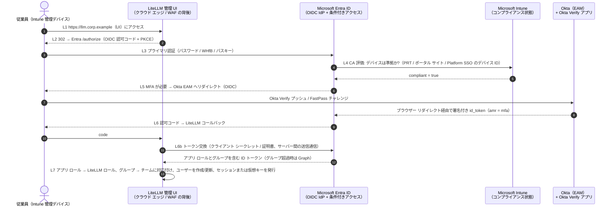
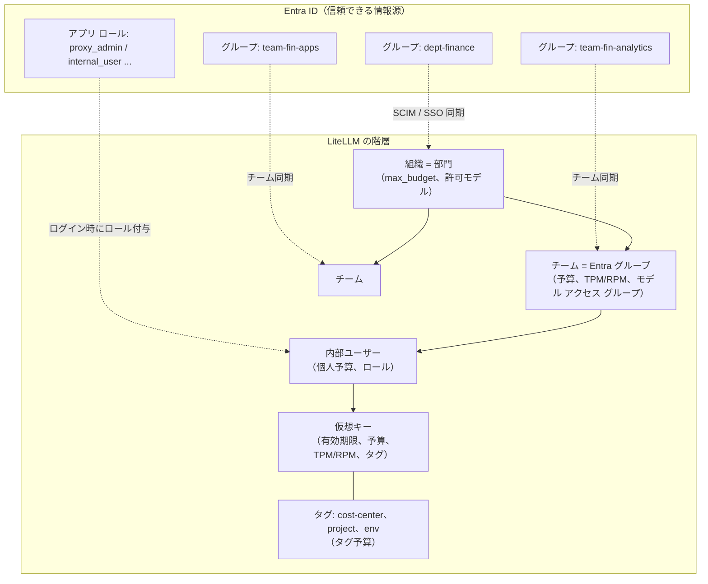

# 2. 共通設計（3 クラウド共通）

## 2.1 Okta Verify と Entra ID の統合パターン

Entra ID を中心とした環境で Okta MFA を組み合わせる方法は 3 つある。

| パターン | 仕組み | 長所 | 短所 |
|---|---|---|---|
| **2.1.1 Entra ID 外部認証方法（EAM）: ✅ 採用** | Entra ID が IdP のままとなる。Okta は Entra に *外部認証方法* として登録する。条件付きアクセス ポリシーで MFA が要求されると、Entra は OIDC 交換でユーザーを Okta にリダイレクトする。Okta が **Okta Verify** のチャレンジを行い、署名付き id_token を返す。Entra はこれを MFA を満たしたものとして受け入れる。 | 単一のポリシー エンジン（Entra 条件付きアクセス）が MFA、**Intune コンプライアンス**、場所、リスクをまとめて評価する。アプリ（LiteLLM、AWS、GCP）は Entra だけを信頼すればよい。 | EAM はインライン登録に対応しないため、ユーザーは事前に Okta Verify へ登録しておく必要がある。2 つのディレクトリ間でユーザーを対応付ける必要がある（Entra オブジェクト ID ↔ Okta ユーザー）。自テナントのクラウドで EAM が GA かどうかを確認すること。 |
| 2.1.2 Okta へのフェデレーション + `federatedIdpMfaBehavior` | M365 ドメインを Okta にフェデレーション（WS-Fed/SAML）する。Okta がプライマリ認証と Okta Verify を行い、MFA クレームを送る。Entra 側でこれを受け入れるよう設定する（`acceptIfMfaDoneByFederatedIdp` / `enforceMfaByFederatedIdp`）。 | Okta がすでに M365 の IdP である場合に使える。 | ポリシーが 2 つのエンジンに分散する。Intune コンプライアンスは引き続き Entra 条件付きアクセスでしか評価されない。ドメイン フェデレーションの変更は影響範囲が大きい。 |
| 2.1.3 条件付きアクセスの「カスタム コントロール」 | サードパーティ MFA 用のレガシーな仕組み。 | 新規設計での利点はない。 | Microsoft は EAM を後継と位置付けている。使用しないこと。 |

**採用パターン: EAM（2.1.1）、[A-2] に基づく。** Okta 側の手順は [Configure Okta as an external authentication method for Microsoft Entra ID](https://help.okta.com/oie/en-us/content/topics/apps/configure-okta-as-microsoft-entra-id-eam.htm)、Microsoft 側の手順は [Manage an external authentication method in Microsoft Entra ID](https://learn.microsoft.com/entra/identity/authentication/how-to-authentication-external-method-manage) を参照。フェデレーションの代替案については [federatedIdpMfaBehavior (internalDomainFederation)](https://learn.microsoft.com/graph/api/resources/internaldomainfederation) と [Satisfy Entra MFA with MFA claims from a federated IdP](https://learn.microsoft.com/entra/identity/authentication/how-to-mfa-expected-inbound-assertions) を参照。Okta は、`eam_amr_unsatisfiable` や `AADSTS50012620` エラーなど、EAM の既知の障害パターンを公開している。[Okta EAM integration failures](https://support.okta.com/help/s/article/entra-id-external-authentication-method-eam-integration-failures-with-okta) を参照。

**ゲートウェイ用の条件付きアクセス ポリシー セット**（ゲートウェイ環境ごとに Entra アプリ登録を 1 つ作成する。例: `litellm-prod`）:

| CA ポリシー | 対象 | 付与制御 |
|---|---|---|
| CA-GW-01 | 全ユーザー → `litellm-prod`（管理 UI へのサインイン。個人用仮想キーはここで発行する） | MFA を必須にする（Okta EAM で充足）**かつ** 準拠としてマークされたデバイスを必須にする（[CA における Intune コンプライアンス](https://learn.microsoft.com/entra/identity/conditional-access/policy-all-users-device-compliance)） |
| CA-GW-02 | 管理者ロール保持者（`proxy_admin`） | MFA と準拠デバイスを必須にし、サインイン頻度を 4〜8 時間とし、可能な場合はフィッシング耐性のある MFA を使う（Okta FastPass、または Entra の認証方法としての Windows Hello for Business） |
| CA-GW-03 | ワークロード ID（ゲートウェイを呼び出すサービス プリンシパル） | **使わない。** ワークロードは Entra トークンではなく、サービス アカウント用仮想キーで認証する（[§2.3](#23-litellm-api-トラフィックの認証方式)）。将来 Entra ワークロード ID を採用する場合: ワークロード ID 向け条件付きアクセスで、ネームド ロケーション（クラウドの送信元 IP、オンプレミスの NAT）に制限する（Workload ID プレミアム ライセンスが必要）。 |
| CA-GW-04 | `litellm-prod` に対するレガシー認証とデバイス コード フローのブロック | ブロック |
| CA-GW-05 | 運用者向けのクラウド コントロール プレーン アプリ（IAM Identity Center のエンタープライズ アプリ、Azure の管理、Google の Workforce Identity Federation） | フィッシング耐性のある MFA、準拠デバイス、**オフィスと DC の送信元 IP に限定したネームド ロケーション**、サインイン頻度 4〜8 時間。CA-GW-04 は `litellm-prod` だけが対象なので、ここでもデバイス コード フローをブロックする。（[§2.9](#29-アクセス-シナリオとチェックポイント) のシナリオ A2〜A3） |

## 2.2 共通ログイン フロー（シーケンス）

3 つのクラウドの図はいずれも、このシーケンスを **ステップ L1〜L7** として参照する。

補足:

- ステップ L3〜L6 は **ユーザーのデバイスと SaaS エンドポイント（`login.microsoftonline.com`、`*.okta.com`）の間** で行われ、ゲートウェイのネットワークは一切通らない。これはステップ 4 で重要になる。意図的にそう経路設定しない限り、閉域回線はこのトラフィックを運ばない。
- ゲートウェイに関わるのは L1、L2、L6、L6b だけである。L6b（バックチャネルのトークン交換）とチーム同期用の Graph 呼び出しは、ゲートウェイ サブネットからインターネットへの送信通信なので、送信許可リストに含める必要がある。
- LiteLLM は、Microsoft SSO 連携、汎用 OIDC、SAML 2.0 による Entra SSO に対応している。[Admin UI SSO](https://docs.litellm.ai/docs/proxy/admin_ui_sso)、[Microsoft SSO とチーム同期のチュートリアル](https://docs.litellm.ai/docs/tutorials/msft_sso)、[SAML SSO](https://docs.litellm.ai/docs/proxy/saml_sso) を参照。

## 2.3 LiteLLM API トラフィックの認証方式

**決定: すべての API クライアントは、オフィス／DC の IP 許可リストの背後で LiteLLM 仮想キーを使う。** API トラフィックに Entra トークン（JWT）は使わず、mTLS は [§2.3.2](#232-ロード-バランサーで-mtls-が確認すること) の場合に限って構築する。ユーザーがキーを得るために管理 UI へサインインするときは、引き続き Entra が MFA と準拠デバイスでユーザーを認証する。[§2.3.6](#236-各認証方式が防ぐ脅威) では、この方式を Entra トークンや mTLS と脅威ごとに比較し、管理対象外デバイスが当社の送信元 IP を使えない限り [A-16] これで十分である理由を示す。

| クライアント種別 | LiteLLM への認証 | デバイス信頼の適用方法 | 補足 |
|---|---|---|---|
| 管理 UI（ブラウザー） | Entra OIDC SSO（L1〜L7） | サインイン時の条件付きアクセス CA-GW-01/02 | ロールは Entra の **アプリ ロール**（`proxy_admin`、`proxy_admin_viewer`、`internal_user`、`internal_user_viewer`）から取得する。[MSFT SSO チュートリアル](https://docs.litellm.ai/docs/tutorials/msft_sso) と [Entra アプリ ロール](https://learn.microsoft.com/entra/identity-platform/howto-add-app-roles-in-apps) を参照。 |
| ユーザーの API クライアント: CLI コーディング エージェント（Claude Code、Codex CLI）、IDE プラグイン、SDK | **個人用仮想キー**。1 ユーザー 1 本、有効期限 30〜90 日。ユーザーが管理 UI で、固定の上限の範囲内で作成する（[§2.3.5](#235-キーの発行マスター-キー許可リストに載せたワークロード)）。[§2.9](#29-アクセス-シナリオとチェックポイント) のシナリオ U2。 | キーの作成・更新のためにサインインするときの CA-GW-01（MFA と準拠デバイス）。**キーを使うときにデバイスを確認し直すものはない。** すべてのリクエストで、オフィス／DC の IP 許可リスト（経路 B）または閉域経路（経路 A）を適用する。「当社ネットワークから」を「管理対象デバイスから」と同じ意味にするのが [A-16] である。Intune 証明書（mTLS）は [§2.3.2](#232-ロード-バランサーで-mtls-が確認すること) で必須になる場合だけ。 | Claude Code と Codex CLI はヘルパー コマンドを通じて OS の資格情報ストアからキーを読む（[§2.3.4](#234-コーディング-エージェントのクライアント)）。貼り付けたキーしか受け付けないツールは、ツール自身の設定にキーを保持する。 |
| 社内アプリ / AI エージェント / チャット フロントエンド（ワークロード） | チーム単位の **サービス アカウント用仮想キー**。呼び出し元のシークレット ストアに保管し、少なくとも 90 日ごとにローテーションする。Open WebUI などのチャット フロントエンドは 1 本のキーを使い、リクエストの `user` フィールドで各ユーザーの ID を渡して、利用額を個人ごとに表示できるようにする（[§2.10](#210-ローンチ-ゲート-本番前に検証する) の V-7）。 | ネットワーク制限: 専用の DC またはクラウドの送信元 IP を許可リストに登録するか、閉域経路を使う。共有 NAT は決して許可リストに入れない（[§2.3.5](#235-キーの発行マスター-キー許可リストに載せたワークロード)）。mTLS のワークロード証明書は、[§2.3.2](#232-ロード-バランサーで-mtls-が確認すること) で mTLS が必須になる場合だけ。 | ワークロードごとにキーを 1 本とし、個人のキーは決して使わない。すべてのキーに予算、TPM/RPM、明示的なモデル一覧を設定する。 |
| CI / 自動化（キー管理 API） | シークレット マネージャーにのみ保管した管理者用仮想キー | CI の固定送信元 IP を許可リストに登録する。管理パスにはより厳しい WAF ルールを適用する | LiteLLM の管理 API（`/key/generate`、`/team/new`）を IaC とパイプライン経由で使う。本番環境で UI からの場当たり的な変更はしない。 |

### 2.3.1 リクエストごとに誰が何を検証するか

クラウド事業者自身のサービスはエンド ユーザーを識別しない。WAF とロード バランサーはネットワーク上の送信元を確認し、mTLS が必須の場合は Intune デバイス証明書も確認する。ユーザーを識別するのは **LiteLLM** で、仮想キーから識別する。個人用キーの所有者は、それを作成した Entra ユーザー 1 人である。つまり Entra がユーザーを認証したのはキーの発行時であり、リクエストごとではない。モデル サービス（Bedrock、Azure OpenAI、Vertex AI）から見えるのはゲートウェイ自身のワークロード ID だけなので、ユーザー単位の利用実績は LiteLLM の利用額ログから得る。

| ステップ | コンポーネント | 確認する内容 | ユーザーを知っているか |
|---|---|---|---|
| 0 | Entra ID（ユーザーが管理 UI にサインインするとき。クラウドの外の SaaS） | プライマリ認証、EAM 経由の Okta Verify MFA、CA-GW-01 による Intune コンプライアンス。ユーザーはここで個人用キーを作成・更新する（[§2.3.5](#235-キーの発行マスター-キー許可リストに載せたワークロード)）。API リクエストのたびには繰り返さない。 | はい |
| 1 | WAF とロード バランサーの許可リスト | 送信元 IP が当社のオフィスまたは DC の送信元 IP であること [A-14]。[A-16] が成り立つ間は、管理対象デバイスであることも意味する。 | いいえ |
| 2 | ロード バランサー（mTLS）、**必須の場合だけ** | Intune CA までの証明書チェーン、秘密鍵の所持、有効期間、失効（[§2.3.2](#232-ロード-バランサーで-mtls-が確認すること)） | いいえ。証明するのは管理対象デバイスであり、ユーザーではない。 |
| 3 | LiteLLM | 仮想キー: 存在し（ハッシュ照合）、期限切れでなく、ブロックされていないこと。その後、キーの所有者とチーム → モデル アクセス、予算、TPM/RPM を確認する。 | **はい。キーがユーザーを識別する。** |
| 4 | クラウド IAM → モデル | ゲートウェイのワークロード ID（タスク ロール、マネージド ID、サービス アカウント）が呼び出せるのは日本国内処理のモデルだけ | いいえ |

**API トラフィックへの Entra トークン: 採用しない。** トークン コマンドで約 1 時間ごとに Entra トークンを取得すれば、そのたびに条件付きアクセスがデバイスを確認し直す。しかし [§2.3.6](#236-各認証方式が防ぐ脅威) が示すとおり、これが防ぐのは [A-16] と [§2.3.5](#235-キーの発行マスター-キー許可リストに載せたワークロード) のネットワーク制御が既に防いでいる脅威だけである。その一方で、LiteLLM のエンタープライズ機能である JWT 認証 [A-6]、全クライアントへのトークン コマンド、全クライアントが約 1 時間ごとに Entra へサインインできることが必要になる。リモート アクセスを追加する場合は [A-13]、mTLS と合わせて見直す。

### 2.3.2 ロード バランサーで mTLS が確認すること

**位置付け: 条件付き。既定では構築しない。** LiteLLM の仮想キーは発行後に Entra の目に触れることがないため、各リクエストでキー自体のほかに確認するのは IP 許可リストだけであり、許可リストが証明するのはネットワークであってデバイスではない。[A-16] が成り立つ間はそれで十分である（[§2.3.6](#236-各認証方式が防ぐ脅威)）。Intune 発行の証明書による mTLS は、当社の送信元 IP を共有する管理対象外デバイスで、コピーされたキーが使われるのを止める制御である。利用者が設定することは何もない。証明書は Intune が配布し、管理対象外デバイスは証明書を受け取っていないので TLS ハンドシェイクに失敗する。

次のいずれかに当てはまる場合は **必須** になる。

- [A-16] が成り立たない。管理対象外デバイス（ゲスト／BYOD の Wi-Fi、認証のない LAN ポート）がオフィスや DC の送信元 IP から外に出られる、または出られないことを誰も確認できない。ゲート V-11（[§2.10](#210-ローンチ-ゲート-本番前に検証する)）でテストする。
- リモート アクセスを追加する [A-13]。IP 許可リストが使えなくなる。

それ以外の場合は構築しない。必須になった場合、作業の大半はクライアント側にある。TLS インスペクションの除外 [A-15]、秘密鍵をエクスポート不可にする Intune 証明書プロファイル、CLI 向けのローカル mTLS ヘルパーである（[§2.3.4](#234-コーディング-エージェントのクライアント)）。この節の残りでは mTLS が何を確認するかを説明し、トリガーに該当したときに各設計がすぐ対応できるようにしておく。

TLS ハンドシェイクの間、つまり HTTP リクエストが存在する前に、ロード バランサーはクライアントに証明書を要求し、次の 4 点を確認する。

1. **チェーン:** 証明書がロード バランサーのトラスト ストアにある CA から発行されていること。これは Intune が証明書を配布する元の CA（Microsoft Cloud PKI、または Intune Certificate Connector 経由の AD CS）とワークロード用 CA である。自作の証明書は失敗する。
2. **所持:** クライアントが証明書の秘密鍵でハンドシェイクに署名すること（TLS の `CertificateVerify` メッセージ）。鍵のない公開証明書をコピーしても役に立たない。
3. **有効期間:** 証明書の期限が切れていないこと。
4. **失効:** 証明書が失効リストに載っていないこと。AWS ALB は当社が S3 にアップロードした CRL を読む。App Gateway と Google Cloud Load Balancing は対応が異なる。[§5.8](04-azure.md#58-セキュリティ制御azure) と [§6.8](05-gcp.md#68-セキュリティ制御gcp) を参照。

どれかが失敗すると接続は拒否され、LiteLLM はそのリクエストを受け取らない。すべて通ると、ロード バランサーは証明書の詳細をヘッダーで渡せる。AWS では `X-Amzn-Mtls-Clientcert-Subject`、`-Issuer`、`-Serial-Number`、`-Validity`、`-Leaf`（証明書全体）である（[ALB mTLS](https://docs.aws.amazon.com/elasticloadbalancing/latest/application/mutual-authentication.html)）。LiteLLM はこれらを判定には使わない（[§2.3.3](#233-証明書とユーザーの紐付け-採用しない)）が、調査用に証明書のシリアル番号をリクエストごとに記録する。バックエンドはこれらのヘッダーをロード バランサーからのものだけ受け入れる必要がある。

**mTLS が確認しないこと:**

- **その時点のコンプライアンス。** 証明書は期限切れか失効まで有効なままである。Entra がコンプライアンスを確認するのは、ユーザーがサインインするときだけである（CA-GW-01）。
- **自動的な失効。** Intune が証明書を失効させるのは、デバイスの撤去・ワイプ時やプロファイル削除時である（CA による）。デバイスが非準拠になっただけでは失効させない。CRL を定期的にロード バランサーへ反映し、証明書の有効期間を短く（30〜90 日、自動更新）する。
- **デバイス上のどのプロセスか。** mTLS が証明するのはデバイスであり、プログラムではない。サインイン中のユーザーとして動くプロセスなら、どれでもキー ヘルパーを通じて仮想キーを読めるし、ローカル mTLS ヘルパーは接続してきたものすべてのハンドシェイクに署名する（[§2.3.4](#234-コーディング-エージェントのクライアント)）。準拠したノート PC 上のマルウェアは、この設計のすべての確認を通過する。デバイスの信頼はデバイスの境界で終わり、ノート PC そのものを守るのはエンドポイント保護である。

**鍵の保護: mTLS が機能するための条件。** **Intune 証明書プロファイル** で、秘密鍵を TPM（Windows）またはキーチェーン／Secure Enclave（macOS）に置き、**エクスポート不可** にする（[Intune 証明書プロファイル](https://learn.microsoft.com/intune/fundamentals/certificates/overview)）。これは証明書の秘密鍵であり、LiteLLM のキーではない。エクスポート不可の鍵は別のマシンにコピーできないため、有効な署名は「この管理対象ノート PC」を意味する。鍵がエクスポート可能だと、利用者は証明書と鍵を仮想キーと一緒に私物 PC にコピーでき、そこでも mTLS を通過してしまう。

### 2.3.3 証明書とユーザーの紐付け: 採用しない

条件付きアクセスの「準拠デバイスを必須にする」は、デバイスが当社テナントに登録され準拠していることを確認する。サインインした人がそのデバイスの登録ユーザーであることは **確認しない**。mTLS が証明するのも管理対象デバイスであることだけである。したがって、同僚の仮想キーを受け取った利用者は、自分の管理対象ノート PC からそれを使える。

これを防ぐ方法として、Intune のユーザー証明書の UPN とキーの所有者を比較する独自の LiteLLM 事前チェックを検討した。これには mTLS が必要であり、mTLS 自体が条件付きである（[§2.3.2](#232-ロード-バランサーで-mtls-が確認すること)）。**これは採用しない。** 防げるのは、従業員が同僚のキーを自分の管理対象ノート PC から使う場合だけである。その場合の害は利用額の付け替えの誤りであり、データ漏えいではない。同僚は自分のキーを取得できるからである。一方で、LiteLLM のアップグレードのたびに保守する独自フック、偽装された証明書ヘッダーへの対策が必要になり、同じノート PC の Windows に別のユーザーがサインインすると機能しない。また、自分のノート PC から他人の代わりにリクエストを中継する利用者は止められない。

代わりに次のようにする。

- キーは SSO 経由でのみ発行し、すべてのキーに所有者を持たせる。有効期限 30〜90 日は維持する。
- キーを使うのは所有者本人だけにする。利用規程でキーの共有を禁止し、1 本のキーが複数の IP やユーザー エージェントから使われたら SIEM でアラートを出す。
- フィッシング耐性のある MFA（Okta FastPass または Windows Hello for Business）を使う。同僚にプッシュ通知を承認させて他人のサインインを完了させることを防げる。
- ユーザーごとの利用額とリクエスト送信元の異常を SIEM で監視する。

キーの共有が常態化した場合や、機密データを扱うチームがリクエストごとのユーザー証明を必要とする場合は、この判断を見直す。

### 2.3.4 コーディング エージェントのクライアント

当社がサポートする公式 CLI である **Claude Code** と **Codex CLI** は、どちらもコマンドを実行して資格情報を取得する。このコマンドで OS の資格情報ストアからユーザーの個人用仮想キーを読むことで、キーを平文の設定ファイルや環境変数に置かずに済む。

| | Claude Code | Codex CLI |
|---|---|---|
| エンドポイント | `ANTHROPIC_BASE_URL=https://llm.corp.example` → LiteLLM の Anthropic 互換 `/v1/messages` | `~/.codex/config.toml` のカスタム プロバイダー: `[model_providers.litellm]` に `base_url = "https://llm.corp.example/v1"` |
| キー ヘルパー | [`apiKeyHelper`](https://code.claude.com/docs/en/authentication.md#credential-management): 出力が資格情報になるスクリプト | [`model_providers.<id>.auth.command`](https://learn.chatgpt.com/docs/config-file/config-reference): ベアラー トークンを出力する。`auth.refresh_interval_ms` で再実行の間隔を設定する（既定 5 分） |
| 配布方法 | Intune で配布する管理設定（`managed-settings.json`） | Intune で配布するユーザー レベルの `config.toml`。プロジェクト レベルの `.codex/config.toml` ではプロバイダーを設定できない。 |
| クライアント証明書（mTLS が必須の場合だけ） | `CLAUDE_CODE_CLIENT_CERT` / `CLAUDE_CODE_CLIENT_KEY`。**ファイルのみ** | 現在の設定リファレンスには、モデル プロバイダー向けのクライアント証明書オプションがない（展開前に確認する） |

- **キー ヘルパー。** 両ツールで 1 つの小さなコマンド（例: `litellm-key`）を共用する。Windows 資格情報マネージャーまたは macOS キーチェーンからユーザーの仮想キーを出力するものである。ユーザーはキーを作成した後に一度だけ保存し（例: `litellm-key set`）、更新したときにもう一度保存する。コマンドは Intune がマネージド設定と一緒に配布するので、利用者がほかに設定することはない。ヘルパーは、ノート PC 上のプロセスがキーを読むことまでは防がない（[§2.3.6](#236-各認証方式が防ぐ脅威) の 5 行目）。ドットファイル、シェル履歴、バックアップにキーが残らないようにするもので、コピーされるキーの出どころはたいていそこである。将来 Entra トークンを採用する場合も、変えるのはこのコマンドだけである。
- **ヘッダー。** EKS サンプル（[§3.1](02-reference-architectures.md#31-aws)）によると、LiteLLM の仮想キー確認は `x-api-key` を読むため、キーの場合は固定の `ANTHROPIC_AUTH_TOKEN` だけでは足りない。Claude Code の `apiKeyHelper` は資格情報を両方のヘッダーで送る。Codex CLI は `Authorization: Bearer` で送る。固定した LiteLLM のバージョンで両ツールを試験する。
- **貼り付けたキーしか受け付けないツール。** 多くの IDE プラグインはコマンドを実行できず、キーをプラグイン自身の設定に保持する。使うのは同じ個人用キーである。コピーされたキーが使える場所は IP 許可リストが制限する（[§2.3.6](#236-各認証方式が防ぐ脅威)）。
- **クライアント証明書（mTLS が必須になった場合だけ）。** ブラウザーは OS の証明書ストアを使うが、これらの CLI は使わない。Claude Code は証明書と鍵をファイルでしか読まず、エクスポート不可の TPM 鍵はファイルにできない。Codex CLI には証明書のオプション自体が見当たらない。対応するツールをすべて早期に試験し、ツールごとに選ぶ。TPM 鍵で mTLS ハンドシェイクを行う小さなローカル フォワード プロキシを置く（ツールの `base_url` を `localhost` に向ける）か、そのツールに限りエクスポート可能な鍵を許可するかである。後者では mTLS の意味が「証明書のコピーが存在する」に弱まる（[§2.3.2](#232-ロード-バランサーで-mtls-が確認すること) の「鍵の保護」を参照）。ローカル ヘルパーはループバック インターフェイスでのみ待ち受けること。それでもローカルのどのプロセスでも受け付けるので、デバイスの信頼をデバイスより狭い範囲に絞るものではない（[§2.3.2](#232-ロード-バランサーで-mtls-が確認すること)）。[A-16] を確認できない場合は mTLS が必須になり、このクライアント側の選択はローンチ後ではなくローンチ前に、ツールごとに決めて試験しなければならない。

### 2.3.5 キーの発行、マスター キー、許可リストに載せたワークロード

作成された後は Entra が確認しなくなる資格情報が 3 種類あり、それぞれに専用の制御が必要である。

**個人用仮想キー。** ユーザーの API クライアントはすべてこれを使う（[§2.3](#23-litellm-api-トラフィックの認証方式)）。LiteLLM は `internal_user` ロールを「ログインし、自分のキーを表示・作成・削除できる」ロールと説明している（[仮想キー](https://docs.litellm.ai/docs/proxy/virtual_keys)）。これを発行経路として使う。ユーザーは Entra（MFA と準拠デバイス、CA-GW-01）を通じて管理 UI にサインインし、自分のキーを作成する。こうして各キーには所有者がおり、キーの発行時にはデバイスが準拠していたことになる。セルフサービスを安全にするのは次の制限である。

- `upperbound_key_generate_params`: `duration` の上限（90 日）、予算、TPM/RPM。ドキュメントによると、上限を超える値は丸められるのではなく拒否される。
- `key_generation_settings`（ドキュメントでは「キーを生成できる人を制御する」方法と説明されている）: ユーザーが作成できる個人用キーは自分用だけとし、チーム用とサービス アカウント用のキーはチーム管理者か CI パイプラインだけが作成する。
- ユーザー単位の予算と TPM/RPM。方針は「有効な個人用キーは 1 ユーザー 1 本」だが、更新中などに一時的に 2 本持つことはあり、固定したバージョンではユーザーごとのキー数を制限できない可能性もある。ユーザー単位の制限があれば、キーが増えても使える量は増えない。
- 退職時の失効: SCIM [A-6]、または Entra がアカウントを無効にしたときにそのユーザーのキーをブロックするジョブ（[§2.4](#24-litellm-テナント-モデル全クラウド共通)）。
- セルフサービスには全ユーザーの管理 UI SSO が必要で、6 ユーザー以上ではエンタープライズ ライセンスが要る [A-6]。ライセンスがない場合、ユーザーはワークフローでキーを申請し、CI パイプラインが作成する。
- ゲート V-2（[§2.10](#210-ローンチ-ゲート-本番前に検証する)）: 固定した LiteLLM のバージョンで、`internal_user` が上限を超えるキー、他のユーザーやチーム用のキー、管理者権限付きのキーを作成できないこと。

**マスター キー。** `LITELLM_MASTER_KEY` は「管理 API の呼び出しを認証し、管理 UI のログイン パスワードでもある」（[本番ガイド](https://docs.litellm.ai/docs/proxy/prod)）。Entra の目に触れない固定の管理者資格情報であり、許可リストに載ったすべての IP から受け付けられる。

- シークレット マネージャーにだけ置く。日常業務では誰も使わない。管理者は SSO でサインインし（A1）、自動化は専用の管理者キーを使う。
- このシークレットを読めるプリンシパルは、事実上プロキシ管理者である。ほかの管理者ロールと一緒に見直す。
- 定期的に、また管理者が離任したときにローテーションする。`LITELLM_SALT_KEY` を設定していれば、ローテーションは新しい値の設定と全インスタンスの再起動だけで済み、データ移行は不要である（[マスター キーのローテーション](https://docs.litellm.ai/docs/proxy/master_key_rotations)）。
- **未決:** 上記の LiteLLM のページには、SSO を有効にしたまま管理 UI のマスター キー ログインを無効にする方法が書かれていない。ゲート V-3 で固定したバージョンを確認する。無効にできない場合、`/ui` のログインは許可リストに載ったすべての IP からマスター キーを受け付け、守りはシークレットの取り扱いだけになる。

**許可リストに載せたワークロードの送信元 IP。** N1 は、許可リストに載った IP の背後にあるすべてのホストを通す。許可リストには、ゲートウェイを実際に呼び出す送信元 IP だけを加える。中央のネットワーク アカウントの送信用 VPC など、共有 NAT は許可リストに入れない。その背後のすべてのワークロードが N1 を通過してしまうからである。クラウドで動くエージェントは、専用の送信元 IP か閉域経路（経路 A）を使う。

### 2.3.6 各認証方式が防ぐ脅威

この表は、経路 B で API クライアントが認証する 3 つの方式を比較したもので、[§2.3](#23-litellm-api-トラフィックの認証方式) の決定の根拠である。3 つとも同じ IP 許可リスト（N1）の背後にある。送信元 IP の偽装は役に立たない。ロード バランサーの TCP 応答はそのアドレスの本当の持ち主に届くため、ハンドシェイクが完了しないからである。したがって盗まれた資格情報を使えるのは、許可リストに載った IP から実際に通信を送れる者だけである。

| # | 脅威 | 仮想キー + IP 許可リスト（**採用**、U2） | mTLS を追加（必須の場合だけ、[§2.3.2](#232-ロード-バランサーで-mtls-が確認すること)） | Entra トークン + IP 許可リスト（採用しない） | クライアント認証以外の対策 |
|---|---|---|---|---|---|
| 1 | キーやトークンがインターネットに漏れ（Git、チャット、ペースト サイト）、社外から使われる | 許可リストで防げる | 防げる | 防げる | キーの形式を対象にした、プッシュ保護付きのシークレット スキャン |
| 2 | マルウェア、悪意のあるパッケージや IDE 拡張機能、プロンプト インジェクションを受けたコーディング エージェントが資格情報を盗み、社外から使う | 許可リストで防げる | 防げる | 防げる | EDR。キーは平文の設定ファイルではなく OS のキーチェーンに置き、`apiKeyHelper` または `auth.command` で読む（[§2.3.4](#234-コーディング-エージェントのクライアント)）。 |
| 3 | 従業員が資格情報を自宅の PC にコピーする | 許可リストで防げる | 防げる | 防げる | 不要 |
| 4 | 社内ネットワーク上の管理対象外デバイス（同じ送信元を使うゲスト／BYOD の Wi-Fi、空いている LAN ポート）が、コピーされた資格情報を使う | **防げない** | 防げる: 証明書がないのでハンドシェイクが失敗する | コピーされたトークンの期限切れ（約 60〜90 分）後は防げる。そのデバイスは新しいトークンを取得できない。 | ゲストと BYOD のネットワークに別の送信元 IP を使い、LAN と Wi-Fi に 802.1X/NAC を適用する [A-16]。ゲート V-11 でテストする |
| 5 | マルウェアやプロンプト インジェクションを受けたエージェントが、管理対象ノート PC 上でそのまま資格情報を使う | **防げない** | **防げない**。mTLS が証明するのはデバイスであり、プロセスではない。 | **防げない** | EDR。MCP の書き込み系ツールは必要なチームだけに許可する。キー単位の予算と TPM/RPM。 |
| 6 | 退職者のキーがまだ有効である | 失効させるまで、許可リストの内側からだけ使える | 仮想キーと同じ | Entra アカウントを無効にすれば防げる | 退職時にキーを失効させる: SCIM [A-6]、または Entra がアカウントを無効にしたときに動くジョブ（[§2.3.5](#235-キーの発行マスター-キー許可リストに載せたワークロード)） |
| 7 | ユーザーが資格情報を同僚と共有する | **防げない** | **防げない**。同僚のノート PC も管理対象である。 | 難しい。トークンは約 1 時間で期限切れになり、新しいトークンには所有者のサインインが必要。 | 1 ユーザー 1 本のキー。1 本のキーが複数の IP やユーザー エージェントから使われたらアラートを出す。 |
| 8 | 許可リストに載った共有 NAT の背後にある、ゲートウェイを呼ぶべきでないワークロードが、盗んだ資格情報を使う | **防げない** | ワークロードにワークロード証明書の提示を必須にすれば防げる | 盗んだトークンが有効な間は **防げない** | ゲートウェイの呼び出し元に専用の送信元 IP を使う。共有 NAT は決して許可リストに入れない（[§2.3.5](#235-キーの発行マスター-キー許可リストに載せたワークロード)）。 |
| 9 | TLS インスペクションを行うプロキシが資格情報とプロンプトを読み、ログに残す | **防げない** | インスペクションを通すと mTLS が失敗するので、除外せざるを得なくなる | **防げない** | `llm.corp.example` を TLS インスペクションの対象外にする [A-15] |
| 10 | 正規のユーザーが使いすぎる、またはツールを誤用する | **防げない** | **防げない** | **防げない** | 予算、TPM/RPM、モデルと MCP ツールの範囲の限定、利用額アラート（[§2.4](#24-litellm-テナント-モデル全クラウド共通)） |

**読み方:**

- **1〜3 行目** は資格情報が漏れる最も一般的な経路で、どの方式でも許可リストがすべて防ぐ。だから許可リストはどの経路にも残し、管理対象デバイスが使う専用の送信元 IP だけを通すようにしなければならない。
- **mTLS や Entra トークンが追加で防ぐのは 4、6、7、8 行目だけである。** これらの行にはどれも、最終列にクライアント認証以外の対策がある。その対策を実施していれば、仮想キーと許可リストの組み合わせは、ほかの 2 方式と同じ脅威を防ぐ。しかもクライアント側に証明書やトークン サービスが要らず、失敗する要因も少ない。証明書の期限切れがなく、API 呼び出しが Entra に依存しない。
- **5 行目と 10 行目はどの方式でも防げない。** そこでの制御は、どの方式を選んでもキーの範囲の限定、EDR、ログである。コーディング エージェントは自分の資格情報を読めるので、プロンプト インジェクションがそれに届くものと考え、キーでできることを制限する。
- **対策を確認できない行があれば、それが mTLS や Entra トークンを追加する理由になる。** 典型は 4 行目の A-16 で、ローンチ前にゲート V-11 でテストする。リモート アクセスを追加するときにもこの表を見直す [A-13]。許可リストがなくなり、仮想キーでは 1〜3 行目が「防げない」になる。

## 2.4 LiteLLM テナント モデル（全クラウド共通）

| 要件 | LiteLLM の機能（ドキュメント） |
|---|---|
| オンボーディング / オフボーディング | 初回ログイン時の SSO 自動プロビジョニングと、Entra からの **SCIM** によるプロビジョニング解除（[SCIM](https://docs.litellm.ai/docs/tutorials/scim_litellm)）。プロビジョニング解除されたユーザーのキーがブロックまたは削除されるかを使用中の LiteLLM バージョンで確認し、されない場合はオフボーディング ジョブを追加する。 |
| ロール | Entra アプリ ロール → LiteLLM ロール。複数ある場合は最上位のロールが優先される（[MSFT SSO](https://docs.litellm.ai/docs/tutorials/msft_sso)） |
| 仮想 API キー | [仮想キー](https://docs.litellm.ai/docs/proxy/virtual_keys): キーごとの `max_budget`、`budget_duration`、`tpm_limit`、`rpm_limit`、`models`、`expires`、`metadata.tags` |
| チーム予算 / クォータ | [チーム予算](https://docs.litellm.ai/docs/proxy/team_budgets)、[ユーザー/チームのレート制限と予算](https://docs.litellm.ai/docs/proxy/users) |
| 部門 / プロジェクトのチャージバック | 組織またはタグと [タグ予算](https://docs.litellm.ai/docs/proxy/tag_budgets)、[利用額トラッキング](https://docs.litellm.ai/docs/proxy/cost_tracking)（キー、ユーザー、チーム、タグ、モデルごとの利用額） |
| モデル アクセス ポリシー | [モデル アクセス グループ](https://docs.litellm.ai/docs/proxy/model_access): 例として `tier-standard`（小型モデル）と `tier-premium`（フロンティア モデル）をチームごとに付与する |
| メトリクス | [Prometheus メトリクス](https://docs.litellm.ai/docs/proxy/prometheus): チームとキーごとの利用額、トークン数、残予算、レイテンシ、失敗数 |
| ガードレール | 呼び出し前後のガードレール: [Bedrock Guardrails](https://docs.litellm.ai/docs/proxy/guardrails/bedrock)、[Azure Content Safety / Prompt Shields](https://docs.litellm.ai/docs/proxy/guardrails/azure_content_guardrail)、[Google Model Armor](https://docs.litellm.ai/docs/proxy/guardrails/model_armor)、[Presidio による PII マスキング](https://docs.litellm.ai/docs/proxy/guardrails/pii_masking_v2) |
| 本番環境の堅牢化 | [LiteLLM 本番運用のベスト プラクティス](https://docs.litellm.ai/docs/proxy/prod): インスタンス間のレート制限と予算のための Redis、ワーカー数、データベース障害時の挙動（[§2.10](#210-ローンチ-ゲート-本番前に検証する) の V-8）。利用額ログの量はそれ自体がサイジングの判断事項である（[§4.7](03-aws.md#47-データとログaws)）。 |

**設計上考慮すべき挙動:**

1. **LiteLLM の利用額は *推定値* である。** LiteLLM はモデル価格表、または当社が設定したモデル別のカスタム価格からコストを計算する。この値はクラウドの請求額と一致しないことがある。企業割引、プロビジョニング スループット（PTU）や確約利用の価格、キャッシュ トークンの価格、税金がいずれもずれの原因になる。そのため本設計では **LiteLLM を配賦キー**（誰が何を使ったか）、**クラウド請求をコストの正**（実際にいくら払ったか）として扱い、毎月両者を突合する（[§4.5](03-aws.md#45-コスト配賦とトークン制御aws)、[§5.5](04-azure.md#55-コスト配賦とトークン制御azure)、[§6.5](05-gcp.md#65-コスト配賦とトークン制御gcp)）。
2. **予算とレート制限は Redis と Postgres の状態に基づいて適用される。** Redis が利用できなくなると、LiteLLM の複数インスタンス間の制限が機能低下する。各設計ではゾーン冗長のマネージド Redis を使い、Redis エラーでアラートを出す。
3. **価格が誤っていてもゼロでもエラーにならない。** LiteLLM はリクエストごとに、解決したモデルから価格を計算する。Bedrock のアプリケーション推論プロファイルでは、ARN を `model_id` に、基盤モデルを `model` に設定する。ドキュメントには「LiteLLM は ARN からその背後のモデルを判別できない」とあり、ARN の場合のコストの計算方法は書かれていない（[LiteLLM Bedrock プロバイダー](https://docs.litellm.ai/docs/providers/bedrock)）。`LITELLM_OFFLINE_MODE=true`（[§2.5](#25-日本国内データ所在全設計に適用)）では価格表はイメージに組み込まれたものになるため、新しく追加したモデルに価格があるのは、イメージに含まれているか独自の価格を設定した場合だけである。ゼロのコストを与えられた予算は決して発動せず、それは正しく機能している予算と見分けがつかない。ゲート V-4（[§2.10](#210-ローンチ-ゲート-本番前に検証する)）で全デプロイメントを確認する。キャッシュの読み書きはほかの入力トークンと価格が異なるため、プロンプト キャッシュを使うリクエストも含める。
4. **予算はリクエストの前に確認されるが、コストが分かるのはリクエストの後である。** 呼び出し元が予算内のうちに始まったリクエストはすべて最後まで実行されるので、並行リクエストで予算を超過しうる。超過額の上限は、ユーザーまたはキーに許可された同時リクエスト数に、許可される最も高価なリクエスト（`max_tokens` と入力サイズの上限にモデルの価格を掛けたもの）を掛けたものである。両方の制限を意図して設定し、その結果の上限を財務部門が承認する予算方針に記載する。
5. **クライアントはログと利用額の帰属に影響を与えられる。** リクエスト本文に `no-log=True` を含めると、`global_disable_no_log_param: true` を設定していない限り、そのリクエストの「すべての追跡・ログ」が無効になる（[ログ](https://docs.litellm.ai/docs/proxy/logging)）。それに利用額の追跡が含まれるかはドキュメントに書かれていないので、このパラメーターを設定してテストする（V-6）。リクエスト本文のタグや OpenAI の `user` フィールドで利用額ログの帰属が変わるか、キーの所有者が複数の `llm-team-*` チームに属する場合にどのチームに課金されるかもテストする（V-7）。
6. **完了しなかったリクエスト。** クライアントの切断、タイムアウト、タスクの停止などで、応答が完了する前に終わるリクエストもある。本設計で確認したドキュメントには、そうしたリクエストが LiteLLM やプロバイダーでどう計量されるかが書かれていない。ゲート V-5 で、キャンセルされたストリームについてプロバイダーの使用量と LiteLLM の利用額ログを比較する。差分は、どのチームにも課金されないコストである（[§4.5](03-aws.md#45-コスト配賦とトークン制御aws)）。

## 2.5 日本国内データ所在（全設計に適用）

**要件 [A-5, A-11]:** 推論、LLM 処理（ガードレール チェックを含む）、ログ、データ パイプラインを日本国内に閉じる。実務上は次の 5 つのルールになる。

1. **リージョン:** ゲートウェイのコンピューティング、データベース、キャッシュ、シークレット、ログ保存先、バックアップ、請求エクスポート、分析には、東京（プライマリ）と大阪（DR）だけを使う。
2. **モデル:** LiteLLM には、*処理* が日本国内で行われるデプロイだけを設定する。日本の *エンドポイント* であるだけでは不十分である。グローバルや複数国にまたがるルーティング方式では、プロンプトが日本国外で処理されるためである。
3. **パイプライン:** 利用額エクスポート、請求エクスポート、SIEM へのコピー、ダッシュボードは同じ日本のリージョンに構築する。グローバルや米国・EU の分析用ロケーションにはコピーを置かない。
4. **強制:** クラウドのポリシー（SCP、Azure Policy、GCP 組織ポリシー）で日本国外のものをすべて拒否する。ドキュメントや慣習だけでは不十分である。
5. **クライアント:** ルール 1〜4 が制御するのはゲートウェイであり、ノート PC ではない。利用者がコーディング エージェントを公開モデル API に向けたり、一般向けチャット サイトにコードを貼り付けたりしても、ゲートウェイからは何も見えない。オフィスのセキュア Web ゲートウェイで公開モデル API と一般向け AI サービスをブロックする。サポートする各クライアント（Claude Code、Codex CLI、承認済みの IDE プラグイン）について、ゲートウェイに向けたときにモデル呼び出し以外にベンダーへ何を送るか（テレメトリやエラー レポートなど）を確認し、クライアントが許す範囲でマネージド設定により無効にする。これをしないと、所在要件が守られるのはゲートウェイを使うことを選んだ利用者についてだけになる。

**各クラウドで推論を日本国内で処理する方式:**

| | AWS（Bedrock） | Azure（Azure OpenAI / Foundry Models） | GCP（Vertex AI） |
|---|---|---|---|
| **許可する方式** | 東京／大阪の **In-Region** モデル ID と、東京・大阪間だけでルーティングする **`jp.` 地理的クロスリージョン推論プロファイル**。AWS は、地理的プロファイルがリクエストをその地域内に留めること、また不正検知のための保存が必要なモデルでは送信先リージョンに保存することを明記している（[地理的 CRIS](https://docs.aws.amazon.com/bedrock/latest/userguide/geographic-cross-region-inference.html)、[不正検知](https://docs.aws.amazon.com/bedrock/latest/userguide/abuse-detection.html)）。 | Japan East の **Standard**（`Standard`）と **Regional Provisioned**（`ProvisionedManaged`）デプロイ。プロンプトと応答は顧客が指定した Azure ジオグラフィ（Japan East + Japan West）内で処理される（[デプロイの種類](https://learn.microsoft.com/azure/foundry/foundry-models/concepts/deployment-types)）。 | Google が日本でのリージョン内 ML 処理を掲載しているモデルに限り、**リージョン エンドポイント `asia-northeast1`** を使う（[データ所在地](https://docs.cloud.google.com/vertex-ai/generative-ai/docs/learn/data-residency)）。 |
| **禁止する方式** | `global.` プロファイル（任意の商用リージョン）と `apac.` プロファイル（ソウル、シンガポール、シドニー、ムンバイなど） | `GlobalStandard`、`GlobalProvisionedManaged`、`GlobalBatch`（任意の Azure リージョン）、`DataZone*`（APAC データ ゾーンは複数国にまたがる）、および `DeveloperTier`。Batch は Global の種類なので、これも禁止する。 | `global` エンドポイント（「任意の Google Cloud ロケーションで処理される可能性がある」）と、所在表に日本の記載がないモデル |
| **日本国内でのガードレール** | ⚠️ **ギャップ。** 日本語に対応する Bedrock Guardrails の **Standard** 階層にはクロスリージョン推論が必須である。東京からは `apac.guardrail.v1:0` が使われ、その送信先には日本国外のリージョンが含まれる。`jp.` のガードレール プロファイルはない。**Classic** 階層はリージョン内に留まるが、対応言語は英語、フランス語、スペイン語だけである（[階層](https://docs.aws.amazon.com/bedrock/latest/userguide/guardrails-tiers.html)、[ガードレール プロファイル](https://docs.aws.amazon.com/bedrock/latest/userguide/guardrails-cross-region-support.html)）。そのため日本語のコンテンツには VPC 内のガードレールが必要になる（[§4.8](03-aws.md#48-セキュリティ制御aws)）。 | ✅ **Japan East** の Content Safety でコンテンツの有害性、Prompt Shields、保護対象素材を利用できる。有害性分類器は日本語で学習・テストされている。**Japan West ではいずれも提供されていない。** Foundry のガードレールはデプロイの種類に従うため、リージョン デプロイではガードレール処理もそのリージョンに留まる（[Content Safety のリージョン](https://learn.microsoft.com/azure/ai-services/content-safety/region-availability)）。 | ✅ Model Armor は `asia-northeast1` に対応している。`asia-northeast2` は記載がない（[Model Armor のロケーション](https://docs.cloud.google.com/model-armor/locations)）。 |
| **ポリシーによる強制** | SCP で `ap-northeast-1`/`ap-northeast-3` 以外での操作を拒否する。LiteLLM タスク ロールの IAM では、その 2 リージョンの `jp.*` 推論プロファイル、In-Region の基盤モデル、自社のアプリケーション推論プロファイルに対してのみ `bedrock:InvokeModel*` を許可する。AWS はプロファイルの接頭辞だけを信用しないよう注意しているため、各送信元リージョンから `GetInferenceProfile` を呼び出して送信先を確認する（[対応プロファイル](https://docs.aws.amazon.com/bedrock/latest/userguide/inference-profiles-support.html)）。 | Azure Policy の *許可されている場所* を `japaneast`/`japanwest` に設定する。カスタム ポリシーで Global、Data Zone、Developer のデプロイ SKU を拒否する。この方法は Microsoft がデプロイの種類のページで説明している。 | 組織ポリシー `gcp.resourceLocations` を `in:asia-northeast1-locations` と `in:asia-northeast2-locations` に設定する（[ロケーションの制限](https://docs.cloud.google.com/organization-policy/restrict-locations)）。LiteLLM の `vertex_location` は `asia-northeast1` に固定し、決して `global` にしない。 |
| **ログ** | CloudWatch、S3、CloudTrail 組織証跡はいずれも東京に置き、レプリカは大阪にのみ置く | Log Analytics と Sentinel のワークスペースは Japan East に置く。Storage の GRS と PostgreSQL の geo バックアップは、ペア リージョンの Japan West に送る（[リージョン ペア](https://learn.microsoft.com/azure/reliability/cross-region-replication-azure)）。 | ⚠️ `_Default` と `_Required` のログ バケットは既定で `global` に作成される。プロジェクトを作成する **前に** 組織の既定のログ保存先を `asia-northeast1` に設定し、`_Default` シンクをリージョン バケットにリダイレクトする（[ログのリージョン化](https://docs.cloud.google.com/logging/docs/regionalized-logs)、[既定の設定](https://docs.cloud.google.com/logging/docs/default-settings)）。 |
| **請求エクスポート** | CUR 2.0 / Data Exports のバケットは東京に置く | Cost Management のエクスポート先は Japan East のストレージ アカウントにする | BigQuery の請求エクスポート データセットは `asia-northeast1` に置く。エクスポートはこのリージョンに対応している（[エクスポートの設定](https://docs.cloud.google.com/billing/docs/how-to/export-data-bigquery-setup)） |
| **プロバイダーの不正利用監視** | 保存が必要なモデルでは、送信先リージョン（東京または大阪）に保存される | 不正利用監視のデータ ストアはリソースのジオグラフィ（日本）にある。**modified abuse monitoring** の承認を得ない限り、人によるレビューの対象になる。レビュー担当者の所在について Microsoft が記載しているのは EEA の場合だけである（[データ プライバシー](https://learn.microsoft.com/azure/foundry/responsible-ai/openai/data-privacy)）[A-12]。 | Google Cloud の利用規約に従う。法務に確認すること [A-12] |

**日本国内で処理されるモデルのスナップショット（2026-10-30 確認。各モデルの導入前に再確認すること）:**

| クラウド | 日本国内で処理される（許可） | 東京から利用できるが日本国内だけでは処理 **されない**（禁止） |
|---|---|---|
| AWS Bedrock | `jp.` プロファイル: Claude Opus 5.5、Claude Haiku 5.5、Claude Opus 4.8、Claude Sonnet 4.6、Claude Haiku 4.5、Amazon Nova 2 Lite（[Sonnet 4.6 のモデル カードの例](https://docs.aws.amazon.com/bedrock/latest/userguide/model-card-anthropic-claude-sonnet-4-6.html)）。東京の In-Region: Titan Text Embeddings V2、Cohere Embed v4、Mistral Large 3、gpt-oss-120b。 | 東京からは Global のみ: Claude Sonnet 5.5、Claude Fable 5.1、Claude Opus 5、Claude Sonnet 5。APAC のみ: Amazon Nova Pro。（[Models at a glance](https://docs.aws.amazon.com/bedrock/latest/userguide/model-cards.html) にモデルごとのページがある。） |
| Azure OpenAI | Japan East が `Standard` または `ProvisionedManaged` として提供しているもの。Microsoft は、ジオグラフィ単位のデプロイの種類は「最後に提供される」もので「提供日の保証はない」としている。そのため Global より対象モデルが少なく古いと想定すること（[デプロイの種類](https://learn.microsoft.com/azure/foundry/foundry-models/concepts/deployment-types)、[モデルの提供状況](https://learn.microsoft.com/azure/foundry/foundry-models/concepts/models-sold-directly-by-azure)）。 | Japan East で Global または Data Zone としてのみ提供されるもの |
| Vertex AI | 日本（`asia-northeast1`）向けに掲載: Gemini 3.5 Flash、Gemini 2.5 Flash（128k）、Gemini 2.5 Pro（64k）、text-embedding-004、text-multilingual-embedding、Chirp 3 | 上記以外の Gemini モデル。**すべてのパートナー モデル（Claude、Mistral）とオープン モデル**: 所在表に日本の列がない。大阪（`asia-northeast2`）の記載はない。 |

**LiteLLM 固有の所在設定:**

- `LITELLM_OFFLINE_MODE=true` を設定する。これで既定の `raw.githubusercontent.com` への呼び出し（モデル価格表などのファイル）とリリース確認が止まり、残りは送信ファイアウォールが拒否する（[送信リクエスト](https://docs.litellm.ai/docs/proxy/outbound_requests)）。ただしエンタープライズ ライセンスの確認は、キーをローカルで検証できない場合に `license.litellm.ai` へ接続することがある。この通信が運ぶのはライセンス キーでありプロンプトではない。許可リストに入れるか、オフラインでのライセンス運用をベンダーに確認する。そのエンドポイントに到達できないときにタスクが起動した場合の動作もテストする（V-9）。SSO はエンタープライズ機能である [A-6]。確認に失敗して SSO が無効になると、次のタスク再起動以降、ユーザーは管理 UI にサインインできず、キーも作成できない。既存の仮想キーによる API リクエストは SSO を使わない。ほかに必要なものが無効にならないかは V-9 で確認する。
- ログのコールバックは、保存先が日本国内のものだけを使う。たとえば日本リージョンの S3、GCS、Azure Blob や、同じ VPC 内のセルフホスト Langfuse である。**SaaS の可観測性・アラート送信先は、日本国内でホストされていない限り使わない。** 予算アラートはメールまたは Teams/Slack で送り、アラート本文にプロンプトの内容を含めない。
- ルーターのフォールバック先は、日本国内で処理される他のデプロイに限る。`global.` プロファイルや公開 API へのフォールバックは、気づかないうちに所在要件を破る。
- プロンプト中の画像 URL があると、LiteLLM（と Bedrock）はその画像を置き場所から取得する（[送信リクエスト](https://docs.litellm.ai/docs/proxy/outbound_requests)）。送信許可リストは任意の取得を遮断するため、クライアントは画像をインライン（base64）で送る必要がある。

## 2.6 接続経路モデル（全設計に適用）

利用者は全員社内ネットワーク上にいる [A-13]。ゲートウェイへの経路は 2 つある。

| | **経路 B: インターネット + ゼロトラスト エッジ（主経路）** | **経路 A: 専用線（任意）** |
|---|---|---|
| 経路 | オフィスまたは DC のインターネット ブレイクアウト → インターネット → 東京のリージョナル ロード バランサー | 社内ネットワーク → DC → Direct Connect / ExpressRoute / Interconnect → 東京の内部ロード バランサー |
| ロード バランサー | インターネット向け。当社のオフィスと DC の送信元 IP からのみ到達可能（セキュリティ グループ、NSG、Cloud Armor の許可リストを WAF でも重ねる） | 内部のみ。社内のアドレス範囲を許可する |
| ID とデバイスの確認 | 仮想キー（[§2.3](#23-litellm-api-トラフィックの認証方式)）。[A-16] が成り立つ間は、許可リストがデバイス確認の代わりになる。Intune 証明書（mTLS）は [§2.3.2](#232-ロード-バランサーで-mtls-が確認すること) で必須になる場合だけ。 | 同じ。内部ロード バランサーは社内のアドレス範囲を許可するので、[A-16] の重要性も同じである。 |
| 暗号化 | ノート PC → ロード バランサーまでエンドツーエンドの TLS | 同じ TLS。回線はそれをそのまま運び、独自の暗号化は加えない。 |
| 依存するもの | オフィス プロキシでの TLS インスペクション除外と、安定した送信元 IP [A-14, A-15] | 通信事業者との契約と帯域、DC のルーティング、DNS フォワーディング、クラウドのハブ（TGW、ER ゲートウェイ、Cloud Router） |
| 位置付け | 最初に構築する | [§8.0](07-private-connectivity.md#80-経路-a-を採用すべき場合) の契機がある場合にのみ構築する |

両経路は同時に運用できる。ロード バランサーはインターネット向けか内部向けのどちらかなので、経路 A では同じ LiteLLM サービスの前に 2 つ目の内部ロード バランサーを置き、スプリット ホライズン DNS でクライアントの接続先を決める。

**ロード バランサーをインターネット全体に開放しない。** EKS サンプル（[§3.1](02-reference-architectures.md#31-aws)）は `0.0.0.0/0` を越えてはならない一線とし、それを含む構成のデプロイを拒否する。本設計も同様に、公開ロード バランサーは当社の送信元 CIDR だけを許可する。

**ゲートウェイの前段に CDN やグローバル エッジを置かない**（CloudFront、Azure Front Door、Google のグローバル外部アプリケーション ロード バランサー）:

- **キャッシュするものがない。** すべてのリクエストは認証済みで内容が毎回異なる POST である。
- **所在要件。** これらのエッジは日本に限られないエッジ拠点で TLS を終端するため、プロンプトが日本国外で復号され、エッジの WAF で検査される可能性がある。AWS では CloudFront 用の WAF を us-east-1 で管理するため、リージョン拒否ポリシーに例外が必要になる。
- **タイムアウト。** CloudFront のオリジン応答タイムアウトは既定 30 秒で、延長にはクォータ引き上げが必要である。推論モデルは最初のトークンまでそれ以上沈黙することがある（[§2.7](#27-llm-トラフィック向けの-waf-調整とタイムアウト)）。
- **フェイルオーバー。** CloudFront のオリジン フェイルオーバーが再試行するのは GET、HEAD、OPTIONS だけで、LLM API が使う POST は対象外である。代わりにリージョナル ロード バランサー間の DNS フェイルオーバーを使う。
- mTLS は理由では **ない**。CloudFront は現在ビューアー mTLS に対応している（[CloudFront ビューアー mTLS](https://docs.aws.amazon.com/AmazonCloudFront/latest/DeveloperGuide/mtls-authentication.html)）。理由は所在要件、タイムアウト、利点がないことである。

**オフィス ネットワークの前提条件 [A-14, A-15]:**

- 社内プロキシで `llm.corp.example` を TLS インスペクションの対象外にする。インスペクションはノート PC の TLS 接続をプロキシ自身の接続に置き換えるため、プロキシがすべてのプロンプトと仮想キーを読め、ログに残す可能性もある（[§2.3.6](#236-各認証方式が防ぐ脅威) の 9 行目）。mTLS が必須になった場合は、クライアント証明書がロード バランサーに届かなくなる。
- 送信ファイアウォールで `llm.corp.example` を FQDN 単位で許可する。ファイアウォールが固定の宛先 IP しか許可できない場合: Azure と GCP のロード バランサーはフロントエンド IP がすでに固定である。AWS ALB のアドレスは時間とともに変わるため、ALB の前に **AWS Global Accelerator** を置く。固定のエニーキャスト IP を提供し、暗号化された TCP ストリームをそのまま通し、許可リスト用にクライアント IP を保持する（[クライアント IP の保持](https://docs.aws.amazon.com/global-accelerator/latest/dg/preserve-client-ip-address.html)）。あるいは経路 A を使う。

## 2.7 LLM トラフィック向けの WAF 調整とタイムアウト

**WAF。** マネージド ルール セットは Web フォームを想定して作られている。LLM のリクエストはソース コードを大量に含む大きな JSON 本文なので、既定のままでは正当な通信を遮断する。

| クラウド | 問題 | 変更 |
|---|---|---|
| AWS | Core ルール セットの `SizeRestrictions_BODY` ルールは 8 KB を超える本文をすべて遮断し、これはほぼすべてのコーディング エージェントのリクエストにあたる。ALB 上の AWS WAF が検査するのは本文の先頭 8 KB だけである（[ベースライン ルール グループ](https://docs.aws.amazon.com/waf/latest/developerguide/aws-managed-rule-groups-baseline.html)、[本文の検査](https://repost.aws/knowledge-center/waf-http-request-body-inspection)）。EKS サンプルは Core ルール セットを変更せずに適用している。 | API パスでは `SizeRestrictions_BODY` を Count に上書きする。コードに一致する `CrossSiteScripting_BODY`、`GenericLFI_BODY`、`GenericRFI_BODY` も見直す。 |
| Azure | App Gateway WAF の最大リクエスト本文サイズは既定で 128 KB（[リクエスト サイズの制限](https://learn.microsoft.com/azure/web-application-firewall/ag/application-gateway-waf-request-size-limits)） | CRS 3.2 以降 / DRS のポリシーで本文サイズの強制を引き上げるか無効にし、検査上限を別に設定する。コードで誤検知するルールには除外を追加する。 |
| GCP | 感度の高い Cloud Armor 事前構成ルールは SQL やスクリプトに似た文字列に反応する | API パスでは感度レベル 1〜2 を使う（[§6.8](05-gcp.md#68-セキュリティ制御gcp)）。 |

IP 許可リスト、IP レピュテーション リスト、管理パス（`/ui`、`/sso`、`/key/*`）の厳しいルールは維持する。**送信元 IP ごとのレート制限はユーザーを制限しない。** オフィスの利用者は全員が少数の NAT IP を共有するため [A-14]、IP ごとの制限はオフィス全体を 1 つのクライアントとして扱う。ユーザー単位の制限ではなく、オフィスのピークを上回る洪水対策の上限として設定する。ユーザー単位・チーム単位の制限は LiteLLM（TPM/RPM）の役割である。AWS WAF はヘッダーでレート ルールを集計することもできるが（[集計オプション](https://docs.aws.amazon.com/waf/latest/developerguide/waf-rule-statement-type-rate-based-aggregation-options.html)）、ヘッダーの値はクライアントが決めるので、強制には頼らない。最大リクエスト サイズは WAF ではなく LiteLLM（現行バージョンでは `max_request_size_mb`）で強制する。PII やプロンプト インジェクションなどの内容のチェックは WAF ではなく LiteLLM のガードレールの役割である。

**タイムアウト。** 経路上のすべての層が最も長いリクエストを許容し、層どうしで値をそろえる必要がある。常に最も短い層が先に発火する。クライアントには 504 が返り、LiteLLM はまだモデルを待っていてエラーを記録しない。ストリーミングでも避けられない。アイドル タイムアウトはチャンク間の沈黙を数え、推論モデルは最初のトークンまで数分沈黙することがある。

| 層 | 既定値 | 設定値 |
|---|---|---|
| AWS ALB のアイドル タイムアウト | 60 秒 | 600 秒（最大 4,000 秒）。EKS サンプルと同じ |
| Azure App Gateway のバックエンド要求タイムアウト | 20 秒 | 600 秒（[バックエンド設定](https://learn.microsoft.com/azure/application-gateway/configuration-http-settings)） |
| Azure Container Apps のイングレス | 240 秒。固定の制限として文書化されている（[イングレス](https://learn.microsoft.com/azure/container-apps/ingress-overview)） | 引き上げられない。長いストリームを試験し、超える場合は AKS を使う（[§5.9](04-azure.md#59-スケーラビリティと-haazure)）。 |
| Google Cloud Run の要求タイムアウト | 300 秒 | 600 秒以上（[要求タイムアウト](https://cloud.google.com/run/docs/configuring/request-timeout)） |
| LiteLLM の `request_timeout` | — | 前段のすべての層より短くする。例えば 600 秒の背後なら 570 秒にし、LiteLLM が先にタイムアウトしてエラーを記録するようにする |
| AWS ALB ターゲット グループの登録解除の遅延 | 300 秒 | 最長のリクエスト（600 秒）以上 |

**デプロイとスケールイン。** インスタンスを停止しても、実行中のストリームを切ってはならない。ECS では、サービスはロード バランサーがターゲットのドレインを終えるのを、最大で登録解除の遅延の間待ってからタスクを停止する（[接続のドレイン](https://docs.aws.amazon.com/AmazonECS/latest/developerguide/load-balancer-connection-draining.html)）。その後コンテナーには停止タイムアウトが与えられ、Fargate では最大 120 秒である（[タスク定義のパラメーター](https://docs.aws.amazon.com/AmazonECS/latest/developerguide/task_definition_parameters.html)）。既定の 300 秒の遅延のままだと、それより長いストリームはデプロイやスケールインのたびに切断され、クライアントはリクエスト全体を再試行する。Azure（Container Apps または AKS）と GCP（Cloud Run）でも、頼る前に選んだプラットフォームのドレインの仕組みを確認する。

## 2.8 プロンプトを見られるのは誰か

- **クラウド事業者。** モデルはプロンプトを読む必要があるため、どの設計でもプロンプトは事業者のシステム内（ロード バランサー、ゲートウェイのコンテナー、モデル サービス）で復号される。事業者の従業員によるアクセスを制限しているのは暗号ではなく契約と監査である。AWS は、サービス提供または法令順守に必要な場合を除き顧客コンテンツにアクセスしないと約束しており（[AWS データ プライバシー FAQ](https://aws.amazon.com/compliance/data-privacy-faq/)）、SOC 2、ISO 27001、ISMAP の監査を受けている。Bedrock はプロンプトと補完を保存・記録せず、モデル プロバイダーもアクセスできないと文書化している（[Bedrock のデータ保護](https://docs.aws.amazon.com/bedrock/latest/userguide/data-protection.html)）。CDN やグローバル エッジを置くと、復号される場所が増え、それが日本国外になる可能性もある（[§2.6](#26-接続経路モデル全設計に適用)）。
- **ログと保存先を通じた当社の従業員。** 実務上はこちらのリスクのほうが大きい。1 つの設定ですべての保存先から内容を締め出すことはできず、内容が届きうる場所ごとに専用の制御が必要である。

| 内容が届きうる場所 | 制御 |
|---|---|
| LiteLLM の利用額ログ テーブル | `store_prompts_in_spend_logs: false`。EKS サンプルは `true` にしているが、[A-10] に従って変更する。この設定が対象とするのは利用額ログ テーブルだけである。 |
| LiteLLM のログ コールバック（S3、Langfuse、OpenTelemetry など） | `litellm_settings` の下で `turn_off_message_logging: true`。ドキュメントによると、これで「メッセージと応答がログ プロバイダーに記録される」ことを防ぎ、利用額は引き続き追跡される（[ログ](https://docs.litellm.ai/docs/proxy/logging)）。クライアントはヘッダーで秘匿のオプトアウトを求められるが、それが受け入れられるのはメタデータに `allow_client_message_redaction_opt_out: true` を設定したキーやチームだけなので、承認済みのオプトイン チーム以外にこのフラグを設定しない。`global_disable_no_log_param: true` も設定する（[§2.4](#24-litellm-テナント-モデル全クラウド共通)）。 |
| オプトイン チームの内容ログ [A-10] | **未決。** LiteLLM のログのドキュメントにあるのは、全体のスイッチ、リクエスト単位の制御、OpenTelemetry についてだけ文書化されたコールバック単位のメッセージ設定である。承認済みチームの内容だけを記録し、ほかの全員の内容を秘匿する方法はまだ設計できていない。そのチームの設定を入れた状態で V-1 に合格するまで、どのチームにも有効にしない。 |
| プロバイダー側の呼び出しログ（Bedrock） | Bedrock のモデル呼び出しログは、リージョン内の「AWS アカウントのすべての呼び出し」について、選んだモダリティに対応するすべてのモデルのデータを収集する（[呼び出しログ](https://docs.aws.amazon.com/bedrock/latest/userguide/model-invocation-logging.html)）。共有のゲートウェイ アカウントでは、チーム単位のオプトインには使えない。そこでは無効のままにする。 |
| LiteLLM のエラー ログ | 「LLM の例外は既定でデータベースに書き込まれる」。`disable_error_logs: true` で止められる（[本番ガイド](https://docs.litellm.ai/docs/proxy/prod)）。例外のテキストにリクエストの内容が含まれるかは、プロバイダーが拒否したリクエストも含めて V-1 で確認する。 |
| コンテナー ログ | 本番環境では `LITELLM_LOG=INFO`。`DEBUG` はリクエスト本文をコンテナー ログに書き出す。 |
| 応答キャッシュ | 使わない。Redis が保持するのはレート制限と予算の状態だけである。応答キャッシュは、リクエストの内容をキーにして応答全体を保存してしまう。 |
| ガードレール サービス | すべてのプロンプトを平文で見る。ログはメタデータだけにするよう設定し、V-1 の対象に含める。 |
| WAF ログ | `authorization` と `x-api-key` ヘッダーを秘匿する。 |

LiteLLM のデータベース、ログ保存先、管理 UI への読み取りアクセスを制限し、そのアクセスを監査する。**メタデータも個人データである。** 利用額ログとリクエストのメタデータには、どの従業員がどのモデルをいつどれだけ使ったかが記録される。ダッシュボードを共有する前に、ユーザー単位のレポートを誰が見られるか、データをどれだけの期間保持するかをプライバシー部門と合意する。

## 2.9 アクセス シナリオとチェックポイント

利用者がゲートウェイとその背後のクラウド アカウントに到達する方法は、5 つのシナリオで整理できる。どのシナリオにも、サインインの段階と、その後の「リクエストごと」の段階がある。サインイン時にしか確認しないものは、そのサインインで得た資格情報が期限切れになるまで再確認されない。ワークロード（エージェント、アプリ、CI）はネットワークで範囲を限定したサービス アカウント用キーを使い（[§2.3](#23-litellm-api-トラフィックの認証方式)）、サインインの段階はない。

| ID | 誰が | 何を | サインイン後に残る資格情報 | 有効期間 |
|---|---|---|---|---|
| **U1** | 利用者 | ブラウザーで LiteLLM ダッシュボード（個人用キーの作成と更新を含む） | LiteLLM のセッション Cookie | LiteLLM のセッション設定による |
| **U2** | 利用者 | 個人用仮想キーで API: Claude Code、Codex CLI、IDE プラグイン、SDK | LiteLLM の仮想キー | 30〜90 日 |
| **A1** | 管理者 | `proxy_admin` として LiteLLM ダッシュボード | 管理者ロール付きのセッション Cookie | 4〜8 時間ごとに再サインイン（CA-GW-02） |
| **A2** | 管理者 | クラウド コンソール（IAM Identity Center 経由の AWS コンソール、Azure portal、Google Cloud コンソール） | ポータル セッション + コンソール セッション | 管理者用権限セットは 1 時間（AWS の上限は 12 時間） |
| **A3** | 管理者 | クラウド CLI（`aws sso login`、`az login`、`gcloud auth login`） | ディスクにキャッシュされる一時的な資格情報 | A2 と同じ |

**チェックポイント。** ID は下のフローと各クラウド設計で参照する。*条件付き* と *提案* は、まだすべての設計に入っていない制御を表す。

| ID | 場所 | 確認する内容 | 位置付け |
|---|---|---|---|
| E1 | Entra | プライマリ サインイン（パスワード、Windows Hello for Business、パスキー） | 設計に含む |
| E2 | Entra | Okta EAM による MFA。管理者はフィッシング耐性のある方式（CA-GW-02） | 設計に含む |
| E3 | Entra | Intune 準拠デバイス（CA-GW-01）。サインインしてセッションが始まるとき（つまりキーを作成するとき）だけ実行される。 | 設計に含む |
| E4 | Entra | ネームド ロケーション: 運用者向けアプリはオフィスと DC の送信元 IP のみ（CA-GW-05） | 提案 |
| E5 | Entra | サインイン頻度（管理者は 4〜8 時間） | 設計に含む |
| E6 | Entra | デバイス コード フローのブロック（`litellm-prod` は CA-GW-04、運用者向けアプリは CA-GW-05） | 設計に含む／提案 |
| N1 | WAF + LB | 送信元 IP がオフィスまたは DC の送信元 IP であること [A-14]。管理対象デバイスであることを意味するのは [A-16] が成り立つ間だけ（ゲート V-11）。 | 設計に含む |
| N2 | LB | mTLS: Intune CA の証明書、TPM 鍵の所持、CRL（[§2.3.2](#232-ロード-バランサーで-mtls-が確認すること)） | 条件付き: [A-16] が成り立たない場合か、リモート アクセスを追加する場合だけ |
| N3 | WAF | `/ui`、`/sso`、`/key/*` へのより厳しいルール | 設計に含む |
| G1 | LiteLLM | SSO コールバック: ID トークンが有効であること。アプリ ロール → ロール、グループ → チーム | 設計に含む |
| G2 | LiteLLM | 資格情報: セッション Cookie または仮想キー（存在、期限内、ブロックされていない） | 設計に含む |
| G3 | LiteLLM | ロール、チーム、許可モデル、予算、TPM/RPM | 設計に含む |
| G4 | LiteLLM | 監査ログ: リクエストごとの利用額、キー／チーム／予算の変更 | 設計に含む |
| C1 | クラウド IdP | IAM Identity Center / Azure / Workforce Identity Federation が Entra のアサーションを受け入れること。ユーザーは SCIM でプロビジョニング済み | 設計に含む |
| C2 | クラウド IAM | ユーザーがアカウントまたはプロジェクトとロール（権限セット、PIM 対象ロール、IAM バインディング）に割り当てられていること | 設計に含む |
| C3 | クラウド IAM | すべての API 呼び出しをポリシーで確認する。加えて、オフィス／DC の IP に限る送信元 IP 条件（例: `aws:SourceIp` と `aws:ViaAWSService` の例外） | 設計に含む／提案 |
| C4 | クラウド IAM | 短い管理者セッション（1 時間の権限セット、PIM のアクティブ化時間） | 提案 |
| C5 | クラウド監査 | CloudTrail、アクティビティ ログ、Cloud Audit Logs | 設計に含む |

**フロー**（`[ ]` = チェックポイント、*cond* = mTLS が必須の場合だけ）:

| ID | サインイン | その後のリクエストごと |
|---|---|---|
| U1 | ブラウザー → LB [N1, N3, N2 *cond*] → LiteLLM `/ui` → Entra [E1, E2, E3, E5] → LiteLLM コールバック [G1] | ブラウザー（Cookie）→ LB [N1, N3, N2 *cond*] → LiteLLM [G2, G3, G4] |
| U2 | U1 を経て、上限の範囲内で `/key/generate` [G3] により作成（所有者 = UPN、有効期限を設定）し、キー ヘルパーに保存する。更新も同じ手順 | CLI またはツール（`x-api-key` または `Authorization: Bearer`）→ LB [N1, N2 *cond*] → LiteLLM [G2, G3, G4] → モデル。**Entra のチェックポイントはない。** |
| A1 | ブラウザー → LB [N1, N3, N2 *cond*] → Entra CA-GW-02 [E1, E2, E3, E4, E5] → LiteLLM コールバック [G1] | ブラウザー → LB [N1, N3, N2 *cond*] → LiteLLM の管理ルート [G2, G3, G4] |
| A2 | ブラウザー → クラウドのアクセス ポータル → Entra CA-GW-05 [E1, E2, E3, E4, E5] → クラウド IdP [C1, C2] → コンソール セッション [C4] | コンソールの各操作は API 呼び出しである [C3, C5]。**N1 はない:** コンソールはパブリック インターネット上にある。 |
| A3 | CLI ログイン → 同じマシンのブラウザー → A2 と同じサインイン [+ E6] | CLI の各コマンド（キャッシュされた資格情報で署名）[C3, C5] |

**フローからわかること:**

1. **デバイスはサインイン時（E3）にしか確認されない。** その後は、どのシナリオも Entra が再確認しないベアラー資格情報に頼っている。
2. **U2 はネットワークに頼っている。** 仮想キーは最長 90 日有効で、発行後に Entra の目に触れることはない。N1 がそれを当社のネットワークに限定し、[A-16] がそのネットワークを管理対象デバイスに限定する。これはローンチ前にゲート V-11 でテストする。[A-16] を確認できない場合は N2 が必須になる（[§2.3.2](#232-ロード-バランサーで-mtls-が確認すること)、[§2.3.6](#236-各認証方式が防ぐ脅威)）。
3. **A2 と A3 の前にはゲートウェイがない。** クラウド アカウントへの運用者アクセスは設計全体で最も強力な経路なので、サインイン時の E4 と、すべての呼び出しでの C3 の送信元 IP 条件が必要である。どちらもクラウド側の既定にはない。
4. **A3 はディスクに資格情報を残す。** CLI のキャッシュをコピーした人はセッション終了まで使えるため、管理者セッションは 1 時間に保つ（C4）。AWS では `aws sso login` は既定で同じマシンのブラウザーを使う。`--use-device-code` を使うと、サインインしたマシンとは別のマシンに資格情報が渡る。CA-GW-04 は IAM Identity Center を対象にしていない。クラウドが対応していれば運用者向けアプリ（CA-GW-05）でデバイス コード フローをブロックし、対応していなければ C3 に頼る。
5. **A1 はほぼ読み取り専用にする。** キー、チーム、予算の本番変更は IaC と CI で行う（[§2.3](#23-litellm-api-トラフィックの認証方式)）。

## 2.10 ローンチ ゲート: 本番前に検証する

本設計のいくつかの制御は、ベンダーのドキュメントが扱っていないか一部しか扱っていない製品の動作、または当社ネットワークの実態に依存する。これらのゲートは、推測をテストに置き換えるものである。どのゲートも、固定した LiteLLM のバージョンと本番の設定に対して実行し、LiteLLM をアップグレードするたびに繰り返す。不合格のゲートがあれば、設計を変えるまでローンチ（または次のアップグレード）を止める。

| ID | ゲート | テスト方法 | 合格条件 |
|---|---|---|---|
| V-1 | 承認済みの保存先以外にプロンプトの内容がない（[§2.8](#28-プロンプトを見られるのは誰か)） | 固有のカナリア文字列を含むリクエストを、すべてのモデルとすべての API 形式で送る。ガードレールがブロックするものと、プロバイダーが拒否するものも 1 件ずつ送る。利用額ログ、エラー ログ、S3／コールバック バケット、コンテナー ログ、Redis、ガードレールのログ、SIEM のすべてでカナリアを検索する。 | オプトインの内容ストア以外でヒットしない。ログ バケットで保持ロック（例: S3 Object Lock）を有効にする **前に** 実行する。 |
| V-2 | キーの作成が制限の範囲内に収まる（[§2.3.5](#235-キーの発行マスター-キー許可リストに載せたワークロード)） | `internal_user` として、UI と `/key/generate` の両方で、各上限（期間、予算、TPM/RPM）を超えるキー、他のユーザーやチーム用のキー、管理者権限付きのキーの作成を試みる。また 2 本のキーを作成し、ユーザー単位の制限が両方にまたがって適用されることを確認する。 | すべての試みが拒否され、ユーザー単位の制限がそのユーザーのすべてのキーに及ぶ。 |
| V-3 | 管理 UI のマスター キー ログイン（[§2.3.5](#235-キーの発行マスター-キー許可リストに載せたワークロード)） | SSO を有効にしたまま `/ui` のパスワード ログインを無効にできるか調べる。 | 無効にできている。または残るリスクを書面で受容している。 |
| V-4 | デプロイメントごとに利用額が正しい（[§2.4](#24-litellm-テナント-モデル全クラウド共通)） | 各デプロイメント（アプリケーション推論プロファイルの ARN を含む）に、プロンプト キャッシュありとなしのリクエストを送り、利用額ログのトークン数とコストをプロバイダーの価格表と比較する。 | ゼロではなく、合意した許容範囲内である。 |
| V-5 | キャンセルされたリクエストが計量される（[§2.4](#24-litellm-テナント-モデル全クラウド共通)） | 応答の途中でストリームをキャンセルする（クライアントの切断とタイムアウト）。プロバイダーの使用量（Bedrock なら CloudWatch のトークン メトリクス）と LiteLLM の利用額ログを比較する。 | 差分が測定され、チャージバック モデルの中で担当者が決まっている。 |
| V-6 | クライアントが追跡を回避できない（[§2.4](#24-litellm-テナント-モデル全クラウド共通)） | `global_disable_no_log_param: true` を設定した状態で `no-log=True` を送る。 | 利用額ログの行が書き込まれる。 |
| V-7 | クライアントが支払うチームを選べない（[§2.4](#24-litellm-テナント-モデル全クラウド共通)） | リクエスト本文のタグと `user` フィールドを付けたリクエスト、および 2 つの `llm-team-*` チームに属するユーザーのキーでのリクエストを送る。 | 課金されるチームとタグがプラットフォームの割り当てたものである。またはクライアントが設定するフィールドがショーバック専用であると文書化されている。 |
| V-8 | データベース障害時の挙動 | 負荷をかけた状態で、仮想キーの呼び出し元がいる中でデータベースをフェイルオーバーする。キーはキャッシュを介してデータベースと照合されるので、何がどれだけの時間失敗するか、新しいキーや最近失効させたキーで挙動が違うかを記録する。LiteLLM の `allow_requests_on_db_unavailable` はこの挙動を変え、ドキュメントは公開インターネットから到達できないデプロイメントでだけ `true` を推奨している（[本番ガイド](https://docs.litellm.ai/docs/proxy/prod)）。経路 B はインターネットに面している。 | 挙動が把握され、オンコールのランブックがそれに合っている。 |
| V-9 | ライセンス確認が使えない（[§2.5](#25-日本国内データ所在全設計に適用)） | ライセンス エンドポイントをブロックしてタスクを再起動する。仮想キーで API リクエストを送り、管理 UI にサインインする。 | API リクエストと SSO が引き続き動く。またはそのエンドポイントを、監視付きの本番依存先として扱う。 |
| V-10 | ID のエンドポイントが使えない | ゲートウェイから Entra と Graph への送信をブロックする。仮想キーで API リクエストを送り続け、管理 UI へのサインインを試みる。 | API リクエストは動き続ける。サインインとチーム同期は分かりやすいエラーで失敗し、アラートが上がる。 |
| V-11 | 管理対象外デバイスがゲートウェイに到達できない（[A-16]、[§2.3.6](#236-各認証方式が防ぐ脅威)） | 各オフィスと DC から、ゲスト Wi-Fi のデバイス、BYOD デバイス、認証のない LAN ポート、管理対象外デバイスを受け入れる VPN プールから `llm.corp.example` に接続する。許可リストのすべての CIDR とその所有者を一覧にする。送信 NAT、ゲスト ネットワーク、許可リストを変更するたびに繰り返す。 | すべての接続が N1 で拒否され、すべての CIDR が当社専用の送信元である（共有の SASE やクラウド NAT の範囲を含まない）。接続が 1 つでも成功したら mTLS が必須になる（[§2.3.2](#232-ロード-バランサーで-mtls-が確認すること)）。 |

---

[← 前へ: 概要と前提条件](00-overview.md) · [目次](../../README.md) · [次へ →: ステップ 1: リファレンス アーキテクチャ](02-reference-architectures.md)
