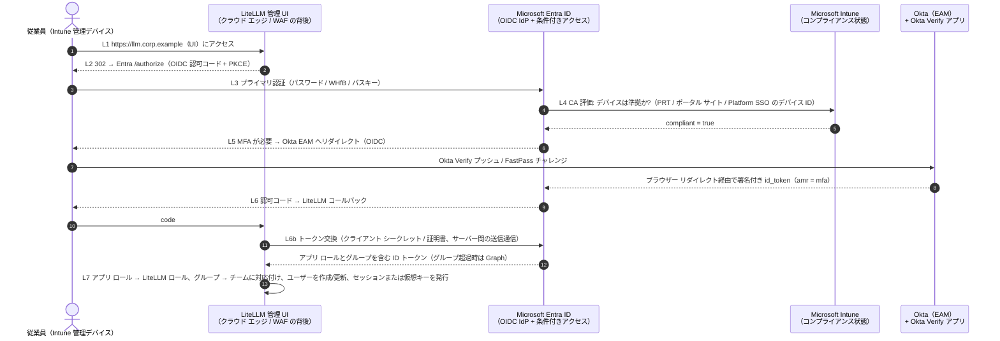
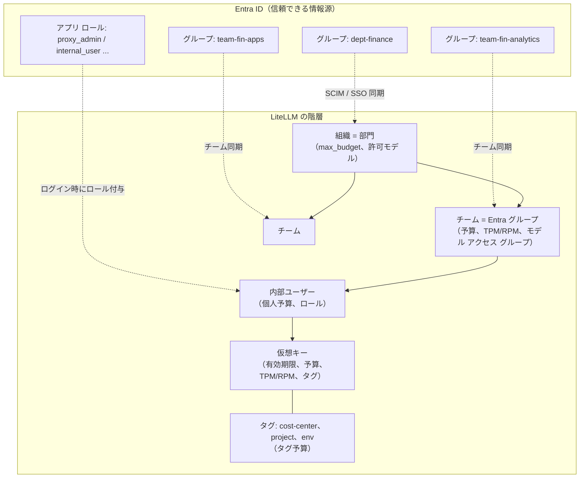

# 2. 共通設計（3 クラウド共通）

## 2.1 Okta Verify と Entra ID の統合パターン

Entra ID を中心とした環境で Okta MFA を組み合わせる方法は 3 つある。

| パターン | 仕組み | 長所 | 短所 |
|---|---|---|---|
| **2.1.1 Entra ID 外部認証方法（EAM）: ✅ 採用** | Entra ID が IdP のままとなる。Okta は Entra に *外部認証方法* として登録する。条件付きアクセス ポリシーで MFA が要求されると、Entra は OIDC 交換でユーザーを Okta にリダイレクトする。Okta が **Okta Verify** のチャレンジを行い、署名付き id_token を返す。Entra はこれを MFA を満たしたものとして受け入れる。 | 単一のポリシー エンジン（Entra 条件付きアクセス）が MFA、**Intune コンプライアンス**、場所、リスクをまとめて評価する。アプリ（LiteLLM、AWS、GCP）は Entra だけを信頼すればよい。 | EAM はインライン登録に対応しないため、ユーザーは事前に Okta Verify へ登録しておく必要がある。2 つのディレクトリ間でユーザーを対応付ける必要がある（Entra オブジェクト ID ↔ Okta ユーザー）。自テナントのクラウドで EAM が GA かどうかを確認すること。 |
| 2.1.2 Okta へのフェデレーション + `federatedIdpMfaBehavior` | M365 ドメインを Okta にフェデレーション（WS-Fed/SAML）する。Okta がプライマリ認証と Okta Verify を行い、MFA クレームを送る。Entra 側でこれを受け入れるよう設定する（`acceptIfMfaDoneByFederatedIdp` / `enforceMfaByFederatedIdp`）。 | Okta がすでに M365 の IdP である場合に使える。 | ポリシーが 2 つのエンジンに分散する。Intune コンプライアンスは引き続き Entra 条件付きアクセスでしか評価されない。ドメイン フェデレーションの変更は影響範囲が大きい。 |
| 2.1.3 条件付きアクセスの「カスタム コントロール」 | サードパーティ MFA 用のレガシーな仕組み。 | 新規設計での利点はない。 | Microsoft は EAM を後継と位置付けている。使用しないこと。 |

**採用パターン: EAM（2.1.1）、[A-2] に基づく。** Okta 側の手順は [Configure Okta as an external authentication method for Microsoft Entra ID](https://help.okta.com/oie/en-us/content/topics/apps/configure-okta-as-microsoft-entra-id-eam.htm)、Microsoft 側の手順は [Manage an external authentication method in Microsoft Entra ID](https://learn.microsoft.com/entra/identity/authentication/how-to-authentication-external-method-manage) を参照。フェデレーションの代替案については [federatedIdpMfaBehavior (internalDomainFederation)](https://learn.microsoft.com/graph/api/resources/internaldomainfederation) と [Satisfy Entra MFA with MFA claims from a federated IdP](https://learn.microsoft.com/entra/identity/authentication/how-to-mfa-expected-inbound-assertions) を参照。Okta は、`eam_amr_unsatisfiable` や `AADSTS50012620` エラーなど、EAM の既知の障害パターンを公開している。[Okta EAM integration failures](https://support.okta.com/help/s/article/entra-id-external-authentication-method-eam-integration-failures-with-okta) を参照。

**ゲートウェイ用の条件付きアクセス ポリシー セット**（ゲートウェイ環境ごとに Entra アプリ登録を 1 つ作成する。例: `litellm-prod`）:

| CA ポリシー | 対象 | 付与制御 |
|---|---|---|
| CA-GW-01 | 全ユーザー → `litellm-prod`（Web/UI と API の両方の audience） | MFA を必須にする（Okta EAM で充足）**かつ** 準拠としてマークされたデバイスを必須にする（[CA における Intune コンプライアンス](https://learn.microsoft.com/entra/identity/conditional-access/policy-all-users-device-compliance)） |
| CA-GW-02 | 管理者ロール保持者（`proxy_admin`） | MFA と準拠デバイスを必須にし、サインイン頻度を 4〜8 時間とし、可能な場合はフィッシング耐性のある MFA を使う（Okta FastPass、または Entra の認証方法としての Windows Hello for Business） |
| CA-GW-03 | ワークロード ID（ゲートウェイを呼び出すサービス プリンシパル） | ワークロード ID 向け条件付きアクセスで、ネームド ロケーション（クラウドの送信 IP、オンプレミスの NAT）に制限する（Workload ID プレミアム ライセンスが必要） |
| CA-GW-04 | `litellm-prod` に対するレガシー認証とデバイス コード フローのブロック | ブロック |

## 2.2 共通ログイン フロー（シーケンス）

3 つのクラウドの図はいずれも、このシーケンスを **ステップ L1〜L7** として参照する。

補足:

- ステップ L3〜L6 は **ユーザーのデバイスと SaaS エンドポイント（`login.microsoftonline.com`、`*.okta.com`）の間** で行われ、ゲートウェイのネットワークは一切通らない。これはステップ 4 で重要になる。意図的にそう経路設定しない限り、閉域回線はこのトラフィックを運ばない。
- ゲートウェイに関わるのは L1、L2、L6、L6b だけである。L6b（バックチャネルのトークン交換）とチーム同期用の Graph 呼び出しは、ゲートウェイ サブネットからインターネットへの送信通信なので、送信許可リストに含める必要がある。
- LiteLLM は、Microsoft SSO 連携、汎用 OIDC、SAML 2.0 による Entra SSO に対応している。[Admin UI SSO](https://docs.litellm.ai/docs/proxy/admin_ui_sso)、[Microsoft SSO とチーム同期のチュートリアル](https://docs.litellm.ai/docs/tutorials/msft_sso)、[SAML SSO](https://docs.litellm.ai/docs/proxy/saml_sso) を参照。

## 2.3 LiteLLM API トラフィックの認証方式

| クライアント種別 | LiteLLM への認証 | デバイス信頼の適用方法 | 補足 |
|---|---|---|---|
| 管理 UI（ブラウザー） | Entra OIDC SSO（L1〜L7） | サインイン時の条件付きアクセス CA-GW-01/02 | ロールは Entra の **アプリ ロール**（`proxy_admin`、`proxy_admin_viewer`、`internal_user`、`internal_user_viewer`）から取得する。[MSFT SSO チュートリアル](https://docs.litellm.ai/docs/tutorials/msft_sso) と [Entra アプリ ロール](https://learn.microsoft.com/entra/identity-platform/howto-add-app-roles-in-apps) を参照。 |
| 開発者 / IDE / チャット フロントエンド（例: Open WebUI） | **推奨:** Entra アクセス トークン（JWT）を LiteLLM の [OIDC/JWT 認証](https://docs.litellm.ai/docs/proxy/token_auth) で検証する（チームは `groups` クレームから `team_ids_jwt_field` / エイリアス マッピングで決定）。**代替:** 有効期限 30〜90 日の個人用仮想キー。 | トークン発行時の CA と短いトークン有効期間（約 60〜90 分）。仮想キーの場合は、エッジでの **Intune 発行デバイス証明書による mTLS**、または閉域経路のみ（ステップ 4）とする。 | JWT は仮想キーと同等の制御（予算、TPM/RPM）に対応付けられる。[JWT → キー マッピング](https://docs.litellm.ai/docs/proxy/jwt_key_mapping) を参照。 |
| 社内アプリ / AI エージェント（ワークロード） | 方式 1: Entra **ワークロード ID**。クライアント資格情報の JWT、または AWS/GCP/K8s からのフェデレーション資格情報を LiteLLM の JWT 認証で検証する。方式 2: チーム単位の **サービス アカウント用仮想キー** を呼び出し元のシークレット ストアに保管し、ローテーションする。 | ネットワーク制限（閉域経路、セキュリティ グループ、送信元 IP 許可リスト）と mTLS ワークロード証明書 | 長期間有効なシークレットをなくせるため、方式 1 を推奨する。 |
| CI / 自動化（キー管理 API） | シークレット マネージャーにのみ保管した管理者用仮想キー、または管理者スコープの JWT | 閉域経路のみ | LiteLLM の管理 API（`/key/generate`、`/team/new`）を IaC とパイプライン経由で使う。本番環境で UI からの場当たり的な変更はしない。 |

**mTLS 用の Intune デバイス証明書。** Intune は管理デバイスに SCEP/PKCS クライアント証明書を配布できる（[Intune 証明書プロファイル](https://learn.microsoft.com/intune/fundamentals/certificates/overview)）。クラウドのエッジ（AWS ALB、Azure Application Gateway、Google Cloud Load Balancing）には、発行元 CA を含むトラスト ストアを設定する。こうするとエッジは管理デバイスからの接続だけを受け付けるため、仮想キーを使う API 呼び出しに *デバイス ID* を結び付けられる。デバイスが非準拠になったら証明書を失効させるか、証明書の有効期間を短くして、Intune が準拠デバイスにのみ再発行するようにする。

## 2.4 LiteLLM テナント モデル（全クラウド共通）

| 要件 | LiteLLM の機能（ドキュメント） |
|---|---|
| オンボーディング / オフボーディング | 初回ログイン時の SSO 自動プロビジョニングと、Entra からの **SCIM** によるプロビジョニング解除（[SCIM](https://docs.litellm.ai/docs/tutorials/scim_litellm)）。プロビジョニング解除されたユーザーのキーがブロックまたは削除されるかを使用中の LiteLLM バージョンで確認し、されない場合はオフボーディング ジョブを追加する。 |
| ロール | Entra アプリ ロール → LiteLLM ロール。複数ある場合は最上位のロールが優先される（[MSFT SSO](https://docs.litellm.ai/docs/tutorials/msft_sso)） |
| 仮想 API キー | [仮想キー](https://docs.litellm.ai/docs/proxy/virtual_keys): キーごとの `max_budget`、`budget_duration`、`tpm_limit`、`rpm_limit`、`models`、`expires`、`metadata.tags` |
| チーム予算 / クォータ | [チーム予算](https://docs.litellm.ai/docs/proxy/team_budgets)、[ユーザー/チームのレート制限と予算](https://docs.litellm.ai/docs/proxy/users) |
| 部門 / プロジェクトのチャージバック | 組織またはタグと [タグ予算](https://docs.litellm.ai/docs/proxy/tag_budgets)、[利用額トラッキング](https://docs.litellm.ai/docs/proxy/cost_tracking)（キー、ユーザー、チーム、タグ、モデルごとの利用額） |
| モデル アクセス ポリシー | [モデル アクセス グループ](https://docs.litellm.ai/docs/proxy/model_access): 例として `tier-standard`（小型モデル）と `tier-premium`（フロンティア モデル）をチームごとに付与する |
| メトリクス | [Prometheus メトリクス](https://docs.litellm.ai/docs/proxy/prometheus): チームとキーごとの利用額、トークン数、残予算、レイテンシ、失敗数 |
| ガードレール | 呼び出し前後のガードレール: [Bedrock Guardrails](https://docs.litellm.ai/docs/proxy/guardrails/bedrock)、[Azure Content Safety / Prompt Shields](https://docs.litellm.ai/docs/proxy/guardrails/azure_content_guardrail)、[Google Model Armor](https://docs.litellm.ai/docs/proxy/guardrails/model_armor)、[Presidio による PII マスキング](https://docs.litellm.ai/docs/proxy/guardrails/pii_masking_v2) |
| 本番環境の堅牢化 | [LiteLLM 本番運用のベスト プラクティス](https://docs.litellm.ai/docs/proxy/prod): インスタンス間のレート制限と予算のための Redis、大規模時の利用額ログ用 DB の分離、ワーカー数 |

**設計上考慮すべき 2 つの重要な挙動:**

1. **LiteLLM の利用額は *推定値* である。** LiteLLM はモデル価格表、または当社が設定したモデル別のカスタム価格からコストを計算する。この値はクラウドの請求額と一致しないことがある。企業割引、プロビジョニング スループット（PTU）や確約利用の価格、キャッシュ トークンの価格、税金がいずれもずれの原因になる。そのため本設計では **LiteLLM を配賦キー**（誰が何を使ったか）、**クラウド請求をコストの正**（実際にいくら払ったか）として扱い、毎月両者を突合する（[§4.5](03-aws.md#45-コスト配賦とトークン制御aws)、[§5.5](04-azure.md#55-コスト配賦とトークン制御azure)、[§6.5](05-gcp.md#65-コスト配賦とトークン制御gcp)）。
2. **予算とレート制限は Redis と Postgres の状態に基づいて適用される。** Redis が利用できなくなると、LiteLLM の複数インスタンス間の制限が機能低下する。各設計ではゾーン冗長のマネージド Redis を使い、Redis エラーでアラートを出す。

## 2.5 日本国内データ所在（全設計に適用）

**要件 [A-5, A-11]:** 推論、LLM 処理（ガードレール チェックを含む）、ログ、データ パイプラインを日本国内に閉じる。実務上は次の 4 つのルールになる。

1. **リージョン:** ゲートウェイのコンピューティング、データベース、キャッシュ、シークレット、ログ保存先、バックアップ、請求エクスポート、分析には、東京（プライマリ）と大阪（DR）だけを使う。
2. **モデル:** LiteLLM には、*処理* が日本国内で行われるデプロイだけを設定する。日本の *エンドポイント* であるだけでは不十分である。グローバルや複数国にまたがるルーティング方式では、プロンプトが日本国外で処理されるためである。
3. **パイプライン:** 利用額エクスポート、請求エクスポート、SIEM へのコピー、ダッシュボードは同じ日本のリージョンに構築する。グローバルや米国・EU の分析用ロケーションにはコピーを置かない。
4. **強制:** クラウドのポリシー（SCP、Azure Policy、GCP 組織ポリシー）で日本国外のものをすべて拒否する。ドキュメントや慣習だけでは不十分である。

**各クラウドで推論を日本国内で処理する方式:**

| | AWS（Bedrock） | Azure（Azure OpenAI / Foundry Models） | GCP（Vertex AI） |
|---|---|---|---|
| **許可する方式** | 東京／大阪の **In-Region** モデル ID と、東京・大阪間だけでルーティングする **`jp.` 地理的クロスリージョン推論プロファイル**。AWS は、地理的プロファイルがリクエストをその地域内に留めること、また不正検知のための保存が必要なモデルでは送信先リージョンに保存することを明記している（[地理的 CRIS](https://docs.aws.amazon.com/bedrock/latest/userguide/geographic-cross-region-inference.html)、[不正検知](https://docs.aws.amazon.com/bedrock/latest/userguide/abuse-detection.html)）。 | Japan East の **Standard**（`Standard`）と **Regional Provisioned**（`ProvisionedManaged`）デプロイ。プロンプトと応答は顧客が指定した Azure ジオグラフィ（Japan East + Japan West）内で処理される（[デプロイの種類](https://learn.microsoft.com/azure/foundry/foundry-models/concepts/deployment-types)）。 | Google が日本でのリージョン内 ML 処理を掲載しているモデルに限り、**リージョン エンドポイント `asia-northeast1`** を使う（[データ所在地](https://docs.cloud.google.com/vertex-ai/generative-ai/docs/learn/data-residency)）。 |
| **禁止する方式** | `global.` プロファイル（任意の商用リージョン）と `apac.` プロファイル（ソウル、シンガポール、シドニー、ムンバイなど） | `GlobalStandard`、`GlobalProvisionedManaged`、`GlobalBatch`（任意の Azure リージョン）、`DataZone*`（APAC データ ゾーンは複数国にまたがる）、および `DeveloperTier`。Batch は Global の種類なので、これも禁止する。 | `global` エンドポイント（「任意の Google Cloud ロケーションで処理される可能性がある」）と、所在表に日本の記載がないモデル |
| **日本国内でのガードレール** | ⚠️ **ギャップ。** 日本語に対応する Bedrock Guardrails の **Standard** 階層にはクロスリージョン推論が必須である。東京からは `apac.guardrail.v1:0` が使われ、その送信先には日本国外のリージョンが含まれる。`jp.` のガードレール プロファイルはない。**Classic** 階層はリージョン内に留まるが、対応言語は英語、フランス語、スペイン語だけである（[階層](https://docs.aws.amazon.com/bedrock/latest/userguide/guardrails-tiers.html)、[ガードレール プロファイル](https://docs.aws.amazon.com/bedrock/latest/userguide/guardrails-cross-region-support.html)）。そのため日本語のコンテンツには VPC 内のガードレールが必要になる（[§4.8](03-aws.md#48-セキュリティ制御aws)）。 | ✅ **Japan East** の Content Safety でコンテンツの有害性、Prompt Shields、保護対象素材を利用できる。有害性分類器は日本語で学習・テストされている。**Japan West ではいずれも提供されていない。** Foundry のガードレールはデプロイの種類に従うため、リージョン デプロイではガードレール処理もそのリージョンに留まる（[Content Safety のリージョン](https://learn.microsoft.com/azure/ai-services/content-safety/region-availability)）。 | ✅ Model Armor は `asia-northeast1` に対応している。`asia-northeast2` は記載がない（[Model Armor のロケーション](https://docs.cloud.google.com/model-armor/locations)）。 |
| **ポリシーによる強制** | SCP で `ap-northeast-1`/`ap-northeast-3` 以外での操作を拒否する。LiteLLM タスク ロールの IAM では、その 2 リージョンの `jp.*` 推論プロファイル、In-Region の基盤モデル、自社のアプリケーション推論プロファイルに対してのみ `bedrock:InvokeModel*` を許可する。AWS はプロファイルの接頭辞だけを信用しないよう注意しているため、各送信元リージョンから `GetInferenceProfile` を呼び出して送信先を確認する（[対応プロファイル](https://docs.aws.amazon.com/bedrock/latest/userguide/inference-profiles-support.html)）。 | Azure Policy の *許可されている場所* を `japaneast`/`japanwest` に設定する。カスタム ポリシーで Global、Data Zone、Developer のデプロイ SKU を拒否する。この方法は Microsoft がデプロイの種類のページで説明している。 | 組織ポリシー `gcp.resourceLocations` を `in:asia-northeast1-locations` と `in:asia-northeast2-locations` に設定する（[ロケーションの制限](https://docs.cloud.google.com/organization-policy/restrict-locations)）。LiteLLM の `vertex_location` は `asia-northeast1` に固定し、決して `global` にしない。 |
| **ログ** | CloudWatch、S3、CloudTrail 組織証跡はいずれも東京に置き、レプリカは大阪にのみ置く | Log Analytics と Sentinel のワークスペースは Japan East に置く。Storage の GRS と PostgreSQL の geo バックアップは、ペア リージョンの Japan West に送る（[リージョン ペア](https://learn.microsoft.com/azure/reliability/cross-region-replication-azure)）。 | ⚠️ `_Default` と `_Required` のログ バケットは既定で `global` に作成される。プロジェクトを作成する **前に** 組織の既定のログ保存先を `asia-northeast1` に設定し、`_Default` シンクをリージョン バケットにリダイレクトする（[ログのリージョン化](https://docs.cloud.google.com/logging/docs/regionalized-logs)、[既定の設定](https://docs.cloud.google.com/logging/docs/default-settings)）。 |
| **請求エクスポート** | CUR 2.0 / Data Exports のバケットは東京に置く | Cost Management のエクスポート先は Japan East のストレージ アカウントにする | BigQuery の請求エクスポート データセットは `asia-northeast1` に置く。エクスポートはこのリージョンに対応している（[エクスポートの設定](https://docs.cloud.google.com/billing/docs/how-to/export-data-bigquery-setup)） |
| **プロバイダーの不正利用監視** | 保存が必要なモデルでは、送信先リージョン（東京または大阪）に保存される | 不正利用監視のデータ ストアはリソースのジオグラフィ（日本）にある。**modified abuse monitoring** の承認を得ない限り、人によるレビューの対象になる。レビュー担当者の所在について Microsoft が記載しているのは EEA の場合だけである（[データ プライバシー](https://learn.microsoft.com/azure/foundry/responsible-ai/openai/data-privacy)）[A-12]。 | Google Cloud の利用規約に従う。法務に確認すること [A-12] |

**日本国内で処理されるモデルのスナップショット（2026-10-30 確認。各モデルの導入前に再確認すること）:**

| クラウド | 日本国内で処理される（許可） | 東京から利用できるが日本国内だけでは処理 **されない**（禁止） |
|---|---|---|
| AWS Bedrock | `jp.` プロファイル: Claude Opus 5.5、Claude Haiku 5.5、Claude Opus 4.8、Claude Sonnet 4.6、Claude Haiku 4.5、Amazon Nova 2 Lite（[Sonnet 4.6 のモデル カードの例](https://docs.aws.amazon.com/bedrock/latest/userguide/model-card-anthropic-claude-sonnet-4-6.html)）。東京の In-Region: Titan Text Embeddings V2、Cohere Embed v4、Mistral Large 3、gpt-oss-120b。 | 東京からは Global のみ: Claude Sonnet 5.5、Claude Fable 5.1、Claude Opus 5、Claude Sonnet 5。APAC のみ: Amazon Nova Pro。（[Models at a glance](https://docs.aws.amazon.com/bedrock/latest/userguide/model-cards.html) にモデルごとのページがある。） |
| Azure OpenAI | Japan East が `Standard` または `ProvisionedManaged` として提供しているもの。Microsoft は、ジオグラフィ単位のデプロイの種類は「最後に提供される」もので「提供日の保証はない」としている。そのため Global より対象モデルが少なく古いと想定すること（[デプロイの種類](https://learn.microsoft.com/azure/foundry/foundry-models/concepts/deployment-types)、[モデルの提供状況](https://learn.microsoft.com/azure/foundry/foundry-models/concepts/models-sold-directly-by-azure)）。 | Japan East で Global または Data Zone としてのみ提供されるもの |
| Vertex AI | 日本（`asia-northeast1`）向けに掲載: Gemini 3.5 Flash、Gemini 2.5 Flash（128k）、Gemini 2.5 Pro（64k）、text-embedding-004、text-multilingual-embedding、Chirp 3 | 上記以外の Gemini モデル。**すべてのパートナー モデル（Claude、Mistral）とオープン モデル**: 所在表に日本の列がない。大阪（`asia-northeast2`）の記載はない。 |

**LiteLLM 固有の所在設定:**

- `LITELLM_OFFLINE_MODE=true` を設定する。これで既定の `raw.githubusercontent.com` への呼び出し（モデル価格表などのファイル）とリリース確認が止まり、残りは送信ファイアウォールが拒否する（[送信リクエスト](https://docs.litellm.ai/docs/proxy/outbound_requests)）。ただしエンタープライズ ライセンスの確認は、キーをローカルで検証できない場合に `license.litellm.ai` へ接続することがある。この通信が運ぶのはライセンス キーでありプロンプトではない。許可リストに入れるか、オフラインでのライセンス運用をベンダーに確認する。
- ログのコールバックは、保存先が日本国内のものだけを使う。たとえば日本リージョンの S3、GCS、Azure Blob や、同じ VPC 内のセルフホスト Langfuse である。**SaaS の可観測性・アラート送信先は、日本国内でホストされていない限り使わない。** 予算アラートはメールまたは Teams/Slack で送り、アラート本文にプロンプトの内容を含めない。
- ルーターのフォールバック先は、日本国内で処理される他のデプロイに限る。`global.` プロファイルや公開 API へのフォールバックは、気づかないうちに所在要件を破る。
- プロンプト中の画像 URL があると、LiteLLM（と Bedrock）はその画像を置き場所から取得する（[送信リクエスト](https://docs.litellm.ai/docs/proxy/outbound_requests)）。送信許可リストは任意の取得を遮断するため、クライアントは画像をインライン（base64）で送る必要がある。

---

[← 前へ: 概要と前提条件](00-overview.md) · [目次](../../README.md) · [次へ →: ステップ 1: リファレンス アーキテクチャ](02-reference-architectures.md)
