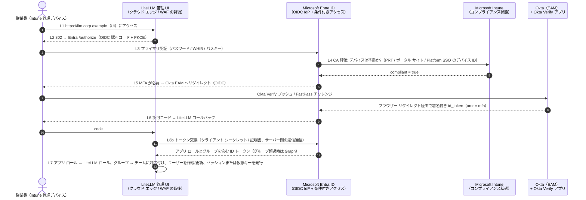
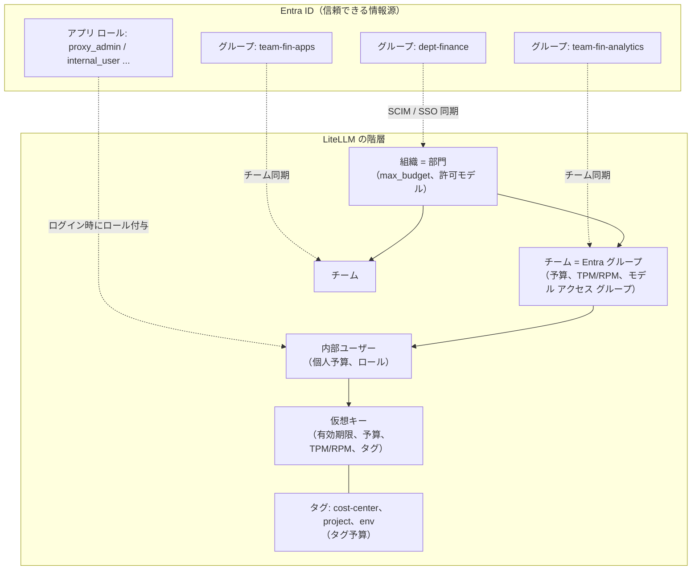

# 2. 共通設計（3 クラウド共通）

## 2.1 Okta Verify と Entra ID の統合パターン

Entra ID を中心とした環境で Okta MFA を組み合わせる方法は 3 つある。

| パターン | 仕組み | 長所 | 短所 |
|---|---|---|---|
| **2.1.1 Entra ID 外部認証方法（EAM）: ✅ 採用** | Entra ID が IdP のままとなる。Okta は Entra に *外部認証方法* として登録する。条件付きアクセス ポリシーで MFA が要求されると、Entra は OIDC 交換でユーザーを Okta にリダイレクトする。Okta が **Okta Verify** のチャレンジを行い、署名付き id_token を返す。Entra はこれを MFA を満たしたものとして受け入れる。 | 単一のポリシー エンジン（Entra 条件付きアクセス）が MFA、**Intune コンプライアンス**、場所、リスクをまとめて評価する。アプリ（LiteLLM、AWS、GCP）は Entra だけを信頼すればよい。 | EAM はインライン登録に対応しないため、ユーザーは事前に Okta Verify へ登録しておく必要がある。2 つのディレクトリ間でユーザーを対応付ける必要がある（Entra オブジェクト ID ↔ Okta ユーザー）。自テナントのクラウドで EAM が GA かどうかを確認すること。 |
| 2.1.2 Okta へのフェデレーション + `federatedIdpMfaBehavior` | M365 ドメインを Okta にフェデレーション（WS-Fed/SAML）する。Okta がプライマリ認証と Okta Verify を行い、MFA クレームを送る。Entra 側でこれを受け入れるよう設定する（`acceptIfMfaDoneByFederatedIdp` / `enforceMfaByFederatedIdp`）。 | Okta がすでに M365 の IdP である場合に使える。 | ポリシーが 2 つのエンジンに分散する。Intune コンプライアンスは引き続き Entra 条件付きアクセスでしか評価されない。ドメイン フェデレーションの変更は影響範囲が大きい。 |
| 2.1.3 条件付きアクセスの「カスタム コントロール」 | サードパーティ MFA 用のレガシーな仕組み。 | 新規設計での利点はない。 | Microsoft は EAM を後継と位置付けている。使用しないこと。 |

**採用パターン: EAM（2.1.1）、[A-2] に基づく。** Okta 側の手順は [Configure Okta as an external authentication method for Microsoft Entra ID](https://help.okta.com/oie/en-us/content/topics/apps/configure-okta-as-microsoft-entra-id-eam.htm)、Microsoft 側の手順は [Manage an external authentication method in Microsoft Entra ID](https://learn.microsoft.com/entra/identity/authentication/how-to-authentication-external-method-manage) を参照。フェデレーションの代替案については [federatedIdpMfaBehavior (internalDomainFederation)](https://learn.microsoft.com/graph/api/resources/internaldomainfederation) と [Satisfy Entra MFA with MFA claims from a federated IdP](https://learn.microsoft.com/entra/identity/authentication/how-to-mfa-expected-inbound-assertions) を参照。Okta は、`eam_amr_unsatisfiable` や `AADSTS50012620` エラーなど、EAM の既知の障害パターンを公開している。[Okta EAM integration failures](https://support.okta.com/help/s/article/entra-id-external-authentication-method-eam-integration-failures-with-okta) を参照。

**ゲートウェイ用の条件付きアクセス ポリシー セット**（ゲートウェイ環境ごとに Entra アプリ登録を 1 つ作成する。例: `litellm-prod`）:

| CA ポリシー | 対象 | 付与制御 |
|---|---|---|
| CA-GW-01 | 全ユーザー → `litellm-prod`（Web/UI と API の両方の audience） | MFA を必須にする（Okta EAM で充足）**かつ** 準拠としてマークされたデバイスを必須にする（[CA における Intune コンプライアンス](https://learn.microsoft.com/entra/identity/conditional-access/policy-all-users-device-compliance)） |
| CA-GW-02 | 管理者ロール保持者（`proxy_admin`） | MFA と準拠デバイスを必須にし、サインイン頻度を 4〜8 時間とし、可能な場合はフィッシング耐性のある MFA を使う（Okta FastPass、または Entra の認証方法としての Windows Hello for Business） |
| CA-GW-03 | ワークロード ID（ゲートウェイを呼び出すサービス プリンシパル） | ワークロード ID 向け条件付きアクセスで、ネームド ロケーション（クラウドの送信 IP、オンプレミスの NAT）に制限する（Workload ID プレミアム ライセンスが必要） |
| CA-GW-04 | `litellm-prod` に対するレガシー認証とデバイス コード フローのブロック | ブロック |
| CA-GW-05 | 運用者向けのクラウド コントロール プレーン アプリ（IAM Identity Center のエンタープライズ アプリ、Azure の管理、Google の Workforce Identity Federation） | フィッシング耐性のある MFA、準拠デバイス、**オフィスと DC の送信元 IP に限定したネームド ロケーション**、サインイン頻度 4〜8 時間。CA-GW-04 は `litellm-prod` だけが対象なので、ここでもデバイス コード フローをブロックする。（[§2.9](#29-アクセス-シナリオとチェックポイント) のシナリオ A2〜A3） |

## 2.2 共通ログイン フロー（シーケンス）

3 つのクラウドの図はいずれも、このシーケンスを **ステップ L1〜L7** として参照する。

補足:

- ステップ L3〜L6 は **ユーザーのデバイスと SaaS エンドポイント（`login.microsoftonline.com`、`*.okta.com`）の間** で行われ、ゲートウェイのネットワークは一切通らない。これはステップ 4 で重要になる。意図的にそう経路設定しない限り、閉域回線はこのトラフィックを運ばない。
- ゲートウェイに関わるのは L1、L2、L6、L6b だけである。L6b（バックチャネルのトークン交換）とチーム同期用の Graph 呼び出しは、ゲートウェイ サブネットからインターネットへの送信通信なので、送信許可リストに含める必要がある。
- LiteLLM は、Microsoft SSO 連携、汎用 OIDC、SAML 2.0 による Entra SSO に対応している。[Admin UI SSO](https://docs.litellm.ai/docs/proxy/admin_ui_sso)、[Microsoft SSO とチーム同期のチュートリアル](https://docs.litellm.ai/docs/tutorials/msft_sso)、[SAML SSO](https://docs.litellm.ai/docs/proxy/saml_sso) を参照。

## 2.3 LiteLLM API トラフィックの認証方式

| クライアント種別 | LiteLLM への認証 | デバイス信頼の適用方法 | 補足 |
|---|---|---|---|
| 管理 UI（ブラウザー） | Entra OIDC SSO（L1〜L7） | サインイン時の条件付きアクセス CA-GW-01/02 | ロールは Entra の **アプリ ロール**（`proxy_admin`、`proxy_admin_viewer`、`internal_user`、`internal_user_viewer`）から取得する。[MSFT SSO チュートリアル](https://docs.litellm.ai/docs/tutorials/msft_sso) と [Entra アプリ ロール](https://learn.microsoft.com/entra/identity-platform/howto-add-app-roles-in-apps) を参照。 |
| CLI コーディング エージェント（Claude Code、Codex CLI）、SDK、チャット フロントエンド（例: Open WebUI） | **既定:** Entra アクセス トークン（JWT）をヘルパー コマンドで取得し、LiteLLM の [OIDC/JWT 認証](https://docs.litellm.ai/docs/proxy/token_auth) で検証する（チームは `groups` クレームから `team_ids_jwt_field` / エイリアス マッピングで決定）。[§2.9](#29-アクセス-シナリオとチェックポイント) のシナリオ U2。 | CA は **トークンの発行・更新のたびに** デバイスを確認し直す（有効期間 約 60〜90 分）。すべてのリクエストで、オフィス／DC の IP 許可リスト（経路 B）または閉域経路（経路 A）を適用し、採用する場合は Intune 証明書（mTLS）も確認する（[§2.3.2](#232-ロード-バランサーで-mtls-が確認すること)）。 | ツールごとのヘルパー設定は [§2.3.4](#234-コーディング-エージェントのクライアント) を参照。JWT は仮想キーと同等の制御（予算、TPM/RPM）に対応付けられる。[JWT → キー マッピング](https://docs.litellm.ai/docs/proxy/jwt_key_mapping) を参照。 |
| 貼り付けたキーしか受け付けない IDE プラグインやツール | **代替:** 有効期限 30〜90 日の個人用仮想キー。[§2.9](#29-アクセス-シナリオとチェックポイント) のシナリオ U3。 | CA はキー作成時だけで、**キーを使うときにデバイスを確認し直すものはない。** すべてのリクエストで IP 許可リストを適用し、採用する場合は mTLS も確認する。オフィス内の管理対象外デバイスでコピーされたキーが使われるのを止められるのは mTLS だけである（[A-16]）。 | この対象は小さく保つ。トークン コマンドを実行できるようになったツールは、すぐ既定の行に移す。 |
| 社内アプリ / AI エージェント（ワークロード） | 方式 1: Entra **ワークロード ID**。クライアント資格情報の JWT、または AWS/GCP/K8s からのフェデレーション資格情報を LiteLLM の JWT 認証で検証する。方式 2: チーム単位の **サービス アカウント用仮想キー** を呼び出し元のシークレット ストアに保管し、ローテーションする。 | ネットワーク制限（DC またはクラウドの送信元 IP を許可リストに登録、または閉域経路）。mTLS を採用する場合はワークロード証明書も使う | 長期間有効なシークレットをなくせるため、方式 1 を推奨する。 |
| CI / 自動化（キー管理 API） | シークレット マネージャーにのみ保管した管理者用仮想キー、または管理者スコープの JWT | CI の固定送信元 IP を許可リストに登録し、mTLS を採用する場合はワークロード証明書も使う。管理パスにはより厳しい WAF ルールを適用する | LiteLLM の管理 API（`/key/generate`、`/team/new`）を IaC とパイプライン経由で使う。本番環境で UI からの場当たり的な変更はしない。 |

### 2.3.1 リクエストごとに誰が何を検証するか

クラウド事業者自身のサービスはエンド ユーザーを識別しない。WAF はネットワーク上の送信元を、ロード バランサーは mTLS を採用する場合に Intune デバイス証明書を確認し、ユーザーを Entra に照らして確認するのは **LiteLLM** である。モデル サービス（Bedrock、Azure OpenAI、Vertex AI）から見えるのはゲートウェイ自身のワークロード ID だけなので、ユーザー単位の利用実績は LiteLLM の利用額ログから得る。

| ステップ | コンポーネント | 確認する内容 | ユーザーを知っているか |
|---|---|---|---|
| 0 | Entra ID（サインイン時とトークン更新のたび。クラウドの外の SaaS） | プライマリ認証、EAM 経由の Okta Verify MFA、CA-GW-01 による Intune コンプライアンス。その後 `api://litellm-prod` 向けのアクセス トークンを発行する（有効期間 約 60〜90 分、[アクセス トークンのクレーム](https://learn.microsoft.com/entra/identity-platform/access-token-claims-reference)）。 | はい（トークンを発行する） |
| 1 | WAF とロード バランサーの許可リスト | 送信元 IP が当社のオフィスまたは DC の送信元 IP であること [A-14] | いいえ |
| 2 | ロード バランサー（mTLS）、**推奨オプション** | Intune CA までの証明書チェーン、秘密鍵の所持、有効期間、失効（[§2.3.2](#232-ロード-バランサーで-mtls-が確認すること)） | いいえ。証明するのは管理対象デバイスであり、ユーザーではない。 |
| 3 | LiteLLM | Entra トークン: Entra の公開鍵（JWKS）による署名、発行者 = 当社テナント、対象者 = `api://litellm-prod`、有効期限。または仮想キー: 存在し、期限切れでなく、ブロックされていないこと。その後、アプリ ロールまたはグループ → チーム、モデル アクセス、予算、TPM/RPM を確認する。 | **はい。ユーザーはここで検証される。** |
| 4 | クラウド IAM → モデル | ゲートウェイのワークロード ID（タスク ロール、マネージド ID、サービス アカウント）が呼び出せるのは日本国内処理のモデルだけ | いいえ |

LiteLLM の JWT 認証はエンタープライズ機能である [A-6]。ライセンスがない場合、すべてのクライアントが仮想キーを使い（[§2.9](#29-アクセス-シナリオとチェックポイント) のシナリオ U3）、ネットワークとデバイスの確認はステップ 1 と 2 だけが担う。その場合 mTLS は任意ではなくなる。

### 2.3.2 ロード バランサーで mTLS が確認すること

**位置付け: 推奨オプション。** Entra がデバイスを確認するのはトークンを発行するときだけである。LiteLLM の仮想キーは作成後に Entra の目に触れることがないため、ほかに確認するのは IP 許可リストだけであり、許可リストが証明するのはネットワークであってデバイスではない。Intune 発行の証明書による mTLS は、当社の送信元 IP を共有する管理対象外デバイスで、コピーされたキーが使われるのを止められる唯一の制御である。利用者が設定することは何もない。証明書は Intune が配布し、管理対象外デバイスは証明書を受け取っていないので TLS ハンドシェイクに失敗する。

次のいずれかに当てはまる場合は **必須** として採用する。

- [A-16] が成り立たない。管理対象外デバイス（ゲスト／BYOD の Wi-Fi、認証のない LAN ポート）がオフィスや DC の送信元 IP から外に出られる、または出られないことを誰も確認できない。
- リモート アクセスを追加する [A-13]。IP 許可リストが使えなくなる。
- LiteLLM エンタープライズ ライセンスなしで運用する [A-6]。すべてのクライアントが仮想キーを使う。

それ以外の場合も構築する価値はあり、コストは主にクライアント側にかかる。TLS インスペクションの除外 [A-15] と、[§2.3.4](#234-コーディング-エージェントのクライアント) の CLI での証明書の扱いである。

TLS ハンドシェイクの間、つまり HTTP リクエストが存在する前に、ロード バランサーはクライアントに証明書を要求し、次の 4 点を確認する。

1. **チェーン:** 証明書がロード バランサーのトラスト ストアにある CA から発行されていること。これは Intune が証明書を配布する元の CA（Microsoft Cloud PKI、または Intune Certificate Connector 経由の AD CS）とワークロード用 CA である。自作の証明書は失敗する。
2. **所持:** クライアントが証明書の秘密鍵でハンドシェイクに署名すること（TLS の `CertificateVerify` メッセージ）。鍵のない公開証明書をコピーしても役に立たない。
3. **有効期間:** 証明書の期限が切れていないこと。
4. **失効:** 証明書が失効リストに載っていないこと。AWS ALB は当社が S3 にアップロードした CRL を読む。App Gateway と Google Cloud Load Balancing は対応が異なる。[§5.8](04-azure.md#58-セキュリティ制御azure) と [§6.8](05-gcp.md#68-セキュリティ制御gcp) を参照。

どれかが失敗すると接続は拒否され、LiteLLM はそのリクエストを受け取らない。すべて通ると、ロード バランサーは証明書の詳細をヘッダーで渡せる。AWS では `X-Amzn-Mtls-Clientcert-Subject`、`-Issuer`、`-Serial-Number`、`-Validity`、`-Leaf`（証明書全体）である（[ALB mTLS](https://docs.aws.amazon.com/elasticloadbalancing/latest/application/mutual-authentication.html)）。LiteLLM はこれらを判定には使わない（[§2.3.3](#233-証明書とユーザーの紐付け-採用しない)）が、調査用に証明書のシリアル番号をリクエストごとに記録する。バックエンドはこれらのヘッダーをロード バランサーからのものだけ受け入れる必要がある。

**mTLS が確認しないこと:**

- **その時点のコンプライアンス。** 証明書は期限切れか失効まで有効なままである。コンプライアンスは Entra がトークンを発行するときに適用されるため、設計には両方が必要である。
- **自動的な失効。** Intune が証明書を失効させるのは、デバイスの撤去・ワイプ時やプロファイル削除時である（CA による）。デバイスが非準拠になっただけでは失効させない。CRL を定期的にロード バランサーへ反映し、証明書の有効期間を短く（30〜90 日、自動更新）する。

**鍵の保護: mTLS が機能するための条件。** **Intune 証明書プロファイル** で、秘密鍵を TPM（Windows）またはキーチェーン／Secure Enclave（macOS）に置き、**エクスポート不可** にする（[Intune 証明書プロファイル](https://learn.microsoft.com/intune/fundamentals/certificates/overview)）。これは証明書の秘密鍵であり、LiteLLM のキーではない。エクスポート不可の鍵は別のマシンにコピーできないため、有効な署名は「この管理対象ノート PC」を意味する。鍵がエクスポート可能だと、利用者は証明書と鍵を仮想キーと一緒に私物 PC にコピーでき、そこでも mTLS を通過してしまう。

### 2.3.3 証明書とユーザーの紐付け: 採用しない

条件付きアクセスの「準拠デバイスを必須にする」は、デバイスが当社テナントに登録され準拠していることを確認する。サインインした人がそのデバイスの登録ユーザーであることは **確認しない**。mTLS が証明するのも管理対象デバイスであることだけである。したがって、同僚の仮想キーを受け取った利用者は、自分の管理対象ノート PC からそれを使える。

これを防ぐ方法として、Intune のユーザー証明書の UPN と、トークンのユーザーまたはキーの所有者を比較する独自の LiteLLM 事前チェックを検討した。**これは採用しない。** 防げるのは、従業員が同僚のキーを自分の管理対象ノート PC から使う場合だけである。その場合の害は利用額の付け替えの誤りであり、データ漏えいではない。同僚は自分のキーを取得できるからである。一方で、LiteLLM のアップグレードのたびに保守する独自フック、偽装された証明書ヘッダーへの対策が必要になり、同じノート PC の Windows に別のユーザーがサインインすると機能しない。また、自分のノート PC から他人の代わりにリクエストを中継する利用者は止められない。

代わりに次のようにする。

- キーは SSO 経由でのみ発行し、すべてのキーに所有者を持たせる。有効期限 30〜90 日は維持する。
- Entra トークン（シナリオ U2）を優先する。トークンはサインインした本人のもので、有効期間は約 1 時間である。
- フィッシング耐性のある MFA（Okta FastPass または Windows Hello for Business）を使う。同僚にプッシュ通知を承認させて他人のサインインを完了させることを防げる。
- ユーザーごとの利用額とリクエスト送信元の異常を SIEM で監視する。

キーの共有が常態化した場合や、機密データを扱うチームがリクエストごとのユーザー証明を必要とする場合は、この判断を見直す。

### 2.3.4 コーディング エージェントのクライアント

当社がサポートする公式 CLI である **Claude Code** と **Codex CLI** は、どちらもコマンドを実行して資格情報を取得し、期限切れの前に再実行する。これは Entra トークンにちょうど必要な動作なので、どちらも既定でシナリオ U2 を使う。

| | Claude Code | Codex CLI |
|---|---|---|
| エンドポイント | `ANTHROPIC_BASE_URL=https://llm.corp.example` → LiteLLM の Anthropic 互換 `/v1/messages` | `~/.codex/config.toml` のカスタム プロバイダー: `[model_providers.litellm]` に `base_url = "https://llm.corp.example/v1"` |
| トークン コマンド | [`apiKeyHelper`](https://code.claude.com/docs/en/authentication.md#credential-management): 出力が資格情報になるスクリプト。「短期間有効なトークン」向けと文書化されている | [`model_providers.<id>.auth.command`](https://learn.chatgpt.com/docs/config-file/config-reference): ベアラー トークンを出力する。`auth.refresh_interval_ms` で更新間隔を設定する（既定 5 分） |
| 配布方法 | Intune で配布する管理設定（`managed-settings.json`） | Intune で配布するユーザー レベルの `config.toml`。プロジェクト レベルの `.codex/config.toml` ではプロバイダーを設定できない。 |
| mTLS を採用する場合のクライアント証明書 | `CLAUDE_CODE_CLIENT_CERT` / `CLAUDE_CODE_CLIENT_KEY`。**ファイルのみ** | 現在の設定リファレンスには、モデル プロバイダー向けのクライアント証明書オプションがない（展開前に確認する） |

- **トークン コマンド。** 両ツールで 1 つの小さなコマンド（例: `litellm-token`）を共用できる。MSAL で `api://litellm-prod/.default` 向けの Entra アクセス トークンを取得して出力するものである。このコマンドは **OS のサインイン ブローカー**（Windows では WAM、macOS では Enterprise SSO プラグインまたは Platform SSO）を使う必要がある。ブローカーを使わないとトークン要求にデバイス ID が含まれず、CA-GW-01 の準拠デバイス確認が失敗するか実行できない。デバイス コード フローは CA-GW-04 でブロックされるため、サインインは常に同じマシンで行われる。ブローカーが Windows や Mac のサインインを再利用するので、利用者には通常プロンプトが表示されない。
- **ヘッダー。** LiteLLM の JWT 認証は `Authorization: Bearer` を読む。EKS サンプル（[§3.1](02-reference-architectures.md#31-aws)）によると、LiteLLM の仮想キー確認は `x-api-key` を読むため、キーの場合は固定の `ANTHROPIC_AUTH_TOKEN` だけでは足りない。Claude Code の `apiKeyHelper` は資格情報を両方のヘッダーで送る。
- **固定キーが必要なツール（シナリオ U3）。** 多くの IDE プラグインは貼り付けたキーしか受け付けず、コマンドを実行できない。その利用者には有効期限 30〜90 日の個人用仮想キーを発行する。そのキーが使える場所は IP 許可リストと、採用する場合は mTLS で制限される。
- **クライアント証明書（mTLS を採用する場合の実務上の最大のリスク）。** ブラウザーは OS の証明書ストアを使うが、これらの CLI は使わない。Claude Code は証明書と鍵をファイルでしか読まず、エクスポート不可の TPM 鍵はファイルにできない。Codex CLI には証明書のオプション自体が見当たらない。対応するツールをすべて早期に試験し、ツールごとに選ぶ。TPM 鍵で mTLS ハンドシェイクを行う小さなローカル フォワード プロキシを置く（ツールの `base_url` を `localhost` に向ける）か、そのツールに限りエクスポート可能な鍵を許可するかである。後者では mTLS の意味が「証明書のコピーが存在する」に弱まる（[§2.3.2](#232-ロード-バランサーで-mtls-が確認すること) の「鍵の保護」を参照）。

## 2.4 LiteLLM テナント モデル（全クラウド共通）

| 要件 | LiteLLM の機能（ドキュメント） |
|---|---|
| オンボーディング / オフボーディング | 初回ログイン時の SSO 自動プロビジョニングと、Entra からの **SCIM** によるプロビジョニング解除（[SCIM](https://docs.litellm.ai/docs/tutorials/scim_litellm)）。プロビジョニング解除されたユーザーのキーがブロックまたは削除されるかを使用中の LiteLLM バージョンで確認し、されない場合はオフボーディング ジョブを追加する。 |
| ロール | Entra アプリ ロール → LiteLLM ロール。複数ある場合は最上位のロールが優先される（[MSFT SSO](https://docs.litellm.ai/docs/tutorials/msft_sso)） |
| 仮想 API キー | [仮想キー](https://docs.litellm.ai/docs/proxy/virtual_keys): キーごとの `max_budget`、`budget_duration`、`tpm_limit`、`rpm_limit`、`models`、`expires`、`metadata.tags` |
| チーム予算 / クォータ | [チーム予算](https://docs.litellm.ai/docs/proxy/team_budgets)、[ユーザー/チームのレート制限と予算](https://docs.litellm.ai/docs/proxy/users) |
| 部門 / プロジェクトのチャージバック | 組織またはタグと [タグ予算](https://docs.litellm.ai/docs/proxy/tag_budgets)、[利用額トラッキング](https://docs.litellm.ai/docs/proxy/cost_tracking)（キー、ユーザー、チーム、タグ、モデルごとの利用額） |
| モデル アクセス ポリシー | [モデル アクセス グループ](https://docs.litellm.ai/docs/proxy/model_access): 例として `tier-standard`（小型モデル）と `tier-premium`（フロンティア モデル）をチームごとに付与する |
| メトリクス | [Prometheus メトリクス](https://docs.litellm.ai/docs/proxy/prometheus): チームとキーごとの利用額、トークン数、残予算、レイテンシ、失敗数 |
| ガードレール | 呼び出し前後のガードレール: [Bedrock Guardrails](https://docs.litellm.ai/docs/proxy/guardrails/bedrock)、[Azure Content Safety / Prompt Shields](https://docs.litellm.ai/docs/proxy/guardrails/azure_content_guardrail)、[Google Model Armor](https://docs.litellm.ai/docs/proxy/guardrails/model_armor)、[Presidio による PII マスキング](https://docs.litellm.ai/docs/proxy/guardrails/pii_masking_v2) |
| 本番環境の堅牢化 | [LiteLLM 本番運用のベスト プラクティス](https://docs.litellm.ai/docs/proxy/prod): インスタンス間のレート制限と予算のための Redis、大規模時の利用額ログ用 DB の分離、ワーカー数 |

**設計上考慮すべき 2 つの重要な挙動:**

1. **LiteLLM の利用額は *推定値* である。** LiteLLM はモデル価格表、または当社が設定したモデル別のカスタム価格からコストを計算する。この値はクラウドの請求額と一致しないことがある。企業割引、プロビジョニング スループット（PTU）や確約利用の価格、キャッシュ トークンの価格、税金がいずれもずれの原因になる。そのため本設計では **LiteLLM を配賦キー**（誰が何を使ったか）、**クラウド請求をコストの正**（実際にいくら払ったか）として扱い、毎月両者を突合する（[§4.5](03-aws.md#45-コスト配賦とトークン制御aws)、[§5.5](04-azure.md#55-コスト配賦とトークン制御azure)、[§6.5](05-gcp.md#65-コスト配賦とトークン制御gcp)）。
2. **予算とレート制限は Redis と Postgres の状態に基づいて適用される。** Redis が利用できなくなると、LiteLLM の複数インスタンス間の制限が機能低下する。各設計ではゾーン冗長のマネージド Redis を使い、Redis エラーでアラートを出す。

## 2.5 日本国内データ所在（全設計に適用）

**要件 [A-5, A-11]:** 推論、LLM 処理（ガードレール チェックを含む）、ログ、データ パイプラインを日本国内に閉じる。実務上は次の 4 つのルールになる。

1. **リージョン:** ゲートウェイのコンピューティング、データベース、キャッシュ、シークレット、ログ保存先、バックアップ、請求エクスポート、分析には、東京（プライマリ）と大阪（DR）だけを使う。
2. **モデル:** LiteLLM には、*処理* が日本国内で行われるデプロイだけを設定する。日本の *エンドポイント* であるだけでは不十分である。グローバルや複数国にまたがるルーティング方式では、プロンプトが日本国外で処理されるためである。
3. **パイプライン:** 利用額エクスポート、請求エクスポート、SIEM へのコピー、ダッシュボードは同じ日本のリージョンに構築する。グローバルや米国・EU の分析用ロケーションにはコピーを置かない。
4. **強制:** クラウドのポリシー（SCP、Azure Policy、GCP 組織ポリシー）で日本国外のものをすべて拒否する。ドキュメントや慣習だけでは不十分である。

**各クラウドで推論を日本国内で処理する方式:**

| | AWS（Bedrock） | Azure（Azure OpenAI / Foundry Models） | GCP（Vertex AI） |
|---|---|---|---|
| **許可する方式** | 東京／大阪の **In-Region** モデル ID と、東京・大阪間だけでルーティングする **`jp.` 地理的クロスリージョン推論プロファイル**。AWS は、地理的プロファイルがリクエストをその地域内に留めること、また不正検知のための保存が必要なモデルでは送信先リージョンに保存することを明記している（[地理的 CRIS](https://docs.aws.amazon.com/bedrock/latest/userguide/geographic-cross-region-inference.html)、[不正検知](https://docs.aws.amazon.com/bedrock/latest/userguide/abuse-detection.html)）。 | Japan East の **Standard**（`Standard`）と **Regional Provisioned**（`ProvisionedManaged`）デプロイ。プロンプトと応答は顧客が指定した Azure ジオグラフィ（Japan East + Japan West）内で処理される（[デプロイの種類](https://learn.microsoft.com/azure/foundry/foundry-models/concepts/deployment-types)）。 | Google が日本でのリージョン内 ML 処理を掲載しているモデルに限り、**リージョン エンドポイント `asia-northeast1`** を使う（[データ所在地](https://docs.cloud.google.com/vertex-ai/generative-ai/docs/learn/data-residency)）。 |
| **禁止する方式** | `global.` プロファイル（任意の商用リージョン）と `apac.` プロファイル（ソウル、シンガポール、シドニー、ムンバイなど） | `GlobalStandard`、`GlobalProvisionedManaged`、`GlobalBatch`（任意の Azure リージョン）、`DataZone*`（APAC データ ゾーンは複数国にまたがる）、および `DeveloperTier`。Batch は Global の種類なので、これも禁止する。 | `global` エンドポイント（「任意の Google Cloud ロケーションで処理される可能性がある」）と、所在表に日本の記載がないモデル |
| **日本国内でのガードレール** | ⚠️ **ギャップ。** 日本語に対応する Bedrock Guardrails の **Standard** 階層にはクロスリージョン推論が必須である。東京からは `apac.guardrail.v1:0` が使われ、その送信先には日本国外のリージョンが含まれる。`jp.` のガードレール プロファイルはない。**Classic** 階層はリージョン内に留まるが、対応言語は英語、フランス語、スペイン語だけである（[階層](https://docs.aws.amazon.com/bedrock/latest/userguide/guardrails-tiers.html)、[ガードレール プロファイル](https://docs.aws.amazon.com/bedrock/latest/userguide/guardrails-cross-region-support.html)）。そのため日本語のコンテンツには VPC 内のガードレールが必要になる（[§4.8](03-aws.md#48-セキュリティ制御aws)）。 | ✅ **Japan East** の Content Safety でコンテンツの有害性、Prompt Shields、保護対象素材を利用できる。有害性分類器は日本語で学習・テストされている。**Japan West ではいずれも提供されていない。** Foundry のガードレールはデプロイの種類に従うため、リージョン デプロイではガードレール処理もそのリージョンに留まる（[Content Safety のリージョン](https://learn.microsoft.com/azure/ai-services/content-safety/region-availability)）。 | ✅ Model Armor は `asia-northeast1` に対応している。`asia-northeast2` は記載がない（[Model Armor のロケーション](https://docs.cloud.google.com/model-armor/locations)）。 |
| **ポリシーによる強制** | SCP で `ap-northeast-1`/`ap-northeast-3` 以外での操作を拒否する。LiteLLM タスク ロールの IAM では、その 2 リージョンの `jp.*` 推論プロファイル、In-Region の基盤モデル、自社のアプリケーション推論プロファイルに対してのみ `bedrock:InvokeModel*` を許可する。AWS はプロファイルの接頭辞だけを信用しないよう注意しているため、各送信元リージョンから `GetInferenceProfile` を呼び出して送信先を確認する（[対応プロファイル](https://docs.aws.amazon.com/bedrock/latest/userguide/inference-profiles-support.html)）。 | Azure Policy の *許可されている場所* を `japaneast`/`japanwest` に設定する。カスタム ポリシーで Global、Data Zone、Developer のデプロイ SKU を拒否する。この方法は Microsoft がデプロイの種類のページで説明している。 | 組織ポリシー `gcp.resourceLocations` を `in:asia-northeast1-locations` と `in:asia-northeast2-locations` に設定する（[ロケーションの制限](https://docs.cloud.google.com/organization-policy/restrict-locations)）。LiteLLM の `vertex_location` は `asia-northeast1` に固定し、決して `global` にしない。 |
| **ログ** | CloudWatch、S3、CloudTrail 組織証跡はいずれも東京に置き、レプリカは大阪にのみ置く | Log Analytics と Sentinel のワークスペースは Japan East に置く。Storage の GRS と PostgreSQL の geo バックアップは、ペア リージョンの Japan West に送る（[リージョン ペア](https://learn.microsoft.com/azure/reliability/cross-region-replication-azure)）。 | ⚠️ `_Default` と `_Required` のログ バケットは既定で `global` に作成される。プロジェクトを作成する **前に** 組織の既定のログ保存先を `asia-northeast1` に設定し、`_Default` シンクをリージョン バケットにリダイレクトする（[ログのリージョン化](https://docs.cloud.google.com/logging/docs/regionalized-logs)、[既定の設定](https://docs.cloud.google.com/logging/docs/default-settings)）。 |
| **請求エクスポート** | CUR 2.0 / Data Exports のバケットは東京に置く | Cost Management のエクスポート先は Japan East のストレージ アカウントにする | BigQuery の請求エクスポート データセットは `asia-northeast1` に置く。エクスポートはこのリージョンに対応している（[エクスポートの設定](https://docs.cloud.google.com/billing/docs/how-to/export-data-bigquery-setup)） |
| **プロバイダーの不正利用監視** | 保存が必要なモデルでは、送信先リージョン（東京または大阪）に保存される | 不正利用監視のデータ ストアはリソースのジオグラフィ（日本）にある。**modified abuse monitoring** の承認を得ない限り、人によるレビューの対象になる。レビュー担当者の所在について Microsoft が記載しているのは EEA の場合だけである（[データ プライバシー](https://learn.microsoft.com/azure/foundry/responsible-ai/openai/data-privacy)）[A-12]。 | Google Cloud の利用規約に従う。法務に確認すること [A-12] |

**日本国内で処理されるモデルのスナップショット（2026-10-30 確認。各モデルの導入前に再確認すること）:**

| クラウド | 日本国内で処理される（許可） | 東京から利用できるが日本国内だけでは処理 **されない**（禁止） |
|---|---|---|
| AWS Bedrock | `jp.` プロファイル: Claude Opus 5.5、Claude Haiku 5.5、Claude Opus 4.8、Claude Sonnet 4.6、Claude Haiku 4.5、Amazon Nova 2 Lite（[Sonnet 4.6 のモデル カードの例](https://docs.aws.amazon.com/bedrock/latest/userguide/model-card-anthropic-claude-sonnet-4-6.html)）。東京の In-Region: Titan Text Embeddings V2、Cohere Embed v4、Mistral Large 3、gpt-oss-120b。 | 東京からは Global のみ: Claude Sonnet 5.5、Claude Fable 5.1、Claude Opus 5、Claude Sonnet 5。APAC のみ: Amazon Nova Pro。（[Models at a glance](https://docs.aws.amazon.com/bedrock/latest/userguide/model-cards.html) にモデルごとのページがある。） |
| Azure OpenAI | Japan East が `Standard` または `ProvisionedManaged` として提供しているもの。Microsoft は、ジオグラフィ単位のデプロイの種類は「最後に提供される」もので「提供日の保証はない」としている。そのため Global より対象モデルが少なく古いと想定すること（[デプロイの種類](https://learn.microsoft.com/azure/foundry/foundry-models/concepts/deployment-types)、[モデルの提供状況](https://learn.microsoft.com/azure/foundry/foundry-models/concepts/models-sold-directly-by-azure)）。 | Japan East で Global または Data Zone としてのみ提供されるもの |
| Vertex AI | 日本（`asia-northeast1`）向けに掲載: Gemini 3.5 Flash、Gemini 2.5 Flash（128k）、Gemini 2.5 Pro（64k）、text-embedding-004、text-multilingual-embedding、Chirp 3 | 上記以外の Gemini モデル。**すべてのパートナー モデル（Claude、Mistral）とオープン モデル**: 所在表に日本の列がない。大阪（`asia-northeast2`）の記載はない。 |

**LiteLLM 固有の所在設定:**

- `LITELLM_OFFLINE_MODE=true` を設定する。これで既定の `raw.githubusercontent.com` への呼び出し（モデル価格表などのファイル）とリリース確認が止まり、残りは送信ファイアウォールが拒否する（[送信リクエスト](https://docs.litellm.ai/docs/proxy/outbound_requests)）。ただしエンタープライズ ライセンスの確認は、キーをローカルで検証できない場合に `license.litellm.ai` へ接続することがある。この通信が運ぶのはライセンス キーでありプロンプトではない。許可リストに入れるか、オフラインでのライセンス運用をベンダーに確認する。
- ログのコールバックは、保存先が日本国内のものだけを使う。たとえば日本リージョンの S3、GCS、Azure Blob や、同じ VPC 内のセルフホスト Langfuse である。**SaaS の可観測性・アラート送信先は、日本国内でホストされていない限り使わない。** 予算アラートはメールまたは Teams/Slack で送り、アラート本文にプロンプトの内容を含めない。
- ルーターのフォールバック先は、日本国内で処理される他のデプロイに限る。`global.` プロファイルや公開 API へのフォールバックは、気づかないうちに所在要件を破る。
- プロンプト中の画像 URL があると、LiteLLM（と Bedrock）はその画像を置き場所から取得する（[送信リクエスト](https://docs.litellm.ai/docs/proxy/outbound_requests)）。送信許可リストは任意の取得を遮断するため、クライアントは画像をインライン（base64）で送る必要がある。

## 2.6 接続経路モデル（全設計に適用）

利用者は全員社内ネットワーク上にいる [A-13]。ゲートウェイへの経路は 2 つある。

| | **経路 B: インターネット + ゼロトラスト エッジ（主経路）** | **経路 A: 専用線（任意）** |
|---|---|---|
| 経路 | オフィスまたは DC のインターネット ブレイクアウト → インターネット → 東京のリージョナル ロード バランサー | 社内ネットワーク → DC → Direct Connect / ExpressRoute / Interconnect → 東京の内部ロード バランサー |
| ロード バランサー | インターネット向け。当社のオフィスと DC の送信元 IP からのみ到達可能（セキュリティ グループ、NSG、Cloud Armor の許可リストを WAF でも重ねる） | 内部のみ。社内のアドレス範囲を許可する |
| ID とデバイスの確認 | Entra トークン（または仮想キー）。採用する場合は Intune 証明書（mTLS）も（[§2.3](#23-litellm-api-トラフィックの認証方式)） | 同じ |
| 暗号化 | ノート PC → ロード バランサーまでエンドツーエンドの TLS | 同じ TLS。回線はそれをそのまま運び、独自の暗号化は加えない。 |
| 依存するもの | オフィス プロキシでの TLS インスペクション除外と、安定した送信元 IP [A-14, A-15] | 通信事業者との契約と帯域、DC のルーティング、DNS フォワーディング、クラウドのハブ（TGW、ER ゲートウェイ、Cloud Router） |
| 位置付け | 最初に構築する | [§8.0](07-private-connectivity.md#80-経路-a-を採用すべき場合) の契機がある場合にのみ構築する |

両経路は同時に運用できる。ロード バランサーはインターネット向けか内部向けのどちらかなので、経路 A では同じ LiteLLM サービスの前に 2 つ目の内部ロード バランサーを置き、スプリット ホライズン DNS でクライアントの接続先を決める。

**ロード バランサーをインターネット全体に開放しない。** EKS サンプル（[§3.1](02-reference-architectures.md#31-aws)）は `0.0.0.0/0` を越えてはならない一線とし、それを含む構成のデプロイを拒否する。本設計も同様に、公開ロード バランサーは当社の送信元 CIDR だけを許可する。

**ゲートウェイの前段に CDN やグローバル エッジを置かない**（CloudFront、Azure Front Door、Google のグローバル外部アプリケーション ロード バランサー）:

- **キャッシュするものがない。** すべてのリクエストは認証済みで内容が毎回異なる POST である。
- **所在要件。** これらのエッジは日本に限られないエッジ拠点で TLS を終端するため、プロンプトが日本国外で復号され、エッジの WAF で検査される可能性がある。AWS では CloudFront 用の WAF を us-east-1 で管理するため、リージョン拒否ポリシーに例外が必要になる。
- **タイムアウト。** CloudFront のオリジン応答タイムアウトは既定 30 秒で、延長にはクォータ引き上げが必要である。推論モデルは最初のトークンまでそれ以上沈黙することがある（[§2.7](#27-llm-トラフィック向けの-waf-調整とタイムアウト)）。
- **フェイルオーバー。** CloudFront のオリジン フェイルオーバーが再試行するのは GET、HEAD、OPTIONS だけで、LLM API が使う POST は対象外である。代わりにリージョナル ロード バランサー間の DNS フェイルオーバーを使う。
- mTLS は理由では **ない**。CloudFront は現在ビューアー mTLS に対応している（[CloudFront ビューアー mTLS](https://docs.aws.amazon.com/AmazonCloudFront/latest/DeveloperGuide/mtls-authentication.html)）。理由は所在要件、タイムアウト、利点がないことである。

**オフィス ネットワークの前提条件 [A-14, A-15]:**

- 社内プロキシで `llm.corp.example` を TLS インスペクションの対象外にする。インスペクションはノート PC の TLS 接続をプロキシ自身の接続に置き換えるため、クライアント証明書がロード バランサーに届かず（mTLS が機能しない）、プロキシがすべてのプロンプト、トークン、キーを読めてしまう。
- 送信ファイアウォールで `llm.corp.example` を FQDN 単位で許可する。ファイアウォールが固定の宛先 IP しか許可できない場合: Azure と GCP のロード バランサーはフロントエンド IP がすでに固定である。AWS ALB のアドレスは時間とともに変わるため、ALB の前に **AWS Global Accelerator** を置く。固定のエニーキャスト IP を提供し、暗号化された TCP ストリームをそのまま通し、許可リスト用にクライアント IP を保持する（[クライアント IP の保持](https://docs.aws.amazon.com/global-accelerator/latest/dg/preserve-client-ip-address.html)）。あるいは経路 A を使う。

## 2.7 LLM トラフィック向けの WAF 調整とタイムアウト

**WAF。** マネージド ルール セットは Web フォームを想定して作られている。LLM のリクエストはソース コードを大量に含む大きな JSON 本文なので、既定のままでは正当な通信を遮断する。

| クラウド | 問題 | 変更 |
|---|---|---|
| AWS | Core ルール セットの `SizeRestrictions_BODY` ルールは 8 KB を超える本文をすべて遮断し、これはほぼすべてのコーディング エージェントのリクエストにあたる。ALB 上の AWS WAF が検査するのは本文の先頭 8 KB だけである（[ベースライン ルール グループ](https://docs.aws.amazon.com/waf/latest/developerguide/aws-managed-rule-groups-baseline.html)、[本文の検査](https://repost.aws/knowledge-center/waf-http-request-body-inspection)）。EKS サンプルは Core ルール セットを変更せずに適用している。 | API パスでは `SizeRestrictions_BODY` を Count に上書きする。コードに一致する `CrossSiteScripting_BODY`、`GenericLFI_BODY`、`GenericRFI_BODY` も見直す。 |
| Azure | App Gateway WAF の最大リクエスト本文サイズは既定で 128 KB（[リクエスト サイズの制限](https://learn.microsoft.com/azure/web-application-firewall/ag/application-gateway-waf-request-size-limits)） | CRS 3.2 以降 / DRS のポリシーで本文サイズの強制を引き上げるか無効にし、検査上限を別に設定する。コードで誤検知するルールには除外を追加する。 |
| GCP | 感度の高い Cloud Armor 事前構成ルールは SQL やスクリプトに似た文字列に反応する | API パスでは感度レベル 1〜2 を使う（[§6.8](05-gcp.md#68-セキュリティ制御gcp)）。 |

IP 許可リスト、送信元 IP ごとのレート制限、IP レピュテーション リスト、管理パス（`/ui`、`/sso`、`/key/*`）の厳しいルールは維持する。最大リクエスト サイズは WAF ではなく LiteLLM（現行バージョンでは `max_request_size_mb`）で強制する。PII やプロンプト インジェクションなどの内容のチェックは WAF ではなく LiteLLM のガードレールの役割である。

**タイムアウト。** 経路上のすべての層が最も長いリクエストを許容し、層どうしで値をそろえる必要がある。常に最も短い層が先に発火する。クライアントには 504 が返り、LiteLLM はまだモデルを待っていてエラーを記録しない。ストリーミングでも避けられない。アイドル タイムアウトはチャンク間の沈黙を数え、推論モデルは最初のトークンまで数分沈黙することがある。

| 層 | 既定値 | 設定値 |
|---|---|---|
| AWS ALB のアイドル タイムアウト | 60 秒 | 600 秒（最大 4,000 秒）。EKS サンプルと同じ |
| Azure App Gateway のバックエンド要求タイムアウト | 20 秒 | 600 秒（[バックエンド設定](https://learn.microsoft.com/azure/application-gateway/configuration-http-settings)） |
| Azure Container Apps のイングレス | 240 秒。固定の制限として文書化されている（[イングレス](https://learn.microsoft.com/azure/container-apps/ingress-overview)） | 引き上げられない。長いストリームを試験し、超える場合は AKS を使う（[§5.9](04-azure.md#59-スケーラビリティと-haazure)）。 |
| Google Cloud Run の要求タイムアウト | 300 秒 | 600 秒以上（[要求タイムアウト](https://cloud.google.com/run/docs/configuring/request-timeout)） |
| LiteLLM の `request_timeout` | — | 600 秒 |

## 2.8 プロンプトを見られるのは誰か

- **クラウド事業者。** モデルはプロンプトを読む必要があるため、どの設計でもプロンプトは事業者のシステム内（ロード バランサー、ゲートウェイのコンテナー、モデル サービス）で復号される。事業者の従業員によるアクセスを制限しているのは暗号ではなく契約と監査である。AWS は、サービス提供または法令順守に必要な場合を除き顧客コンテンツにアクセスしないと約束しており（[AWS データ プライバシー FAQ](https://aws.amazon.com/compliance/data-privacy-faq/)）、SOC 2、ISO 27001、ISMAP の監査を受けている。Bedrock はプロンプトと補完を保存・記録せず、モデル プロバイダーもアクセスできないと文書化している（[Bedrock のデータ保護](https://docs.aws.amazon.com/bedrock/latest/userguide/data-protection.html)）。CDN やグローバル エッジを置くと、復号される場所が増え、それが日本国外になる可能性もある（[§2.6](#26-接続経路モデル全設計に適用)）。
- **ログを通じた当社の従業員。** 実務上はこちらのリスクのほうが大きい。
  - `store_prompts_in_spend_logs: false` を設定する。EKS サンプルは `true` にしているが、[A-10] に従って変更する。
  - ログのコールバックは既定でメタデータだけを送る。内容を送るのは承認済みチームのオプトイン用ストアだけである。
  - 本番環境では LiteLLM を `LITELLM_LOG=INFO` で動かす。`DEBUG` はリクエスト本文をコンテナー ログに書き出す。
  - WAF ログでは `authorization` と `x-api-key` ヘッダーを秘匿する。
  - LiteLLM のデータベース、ログ保存先、管理 UI への読み取りアクセスを制限し、そのアクセスを監査する。

## 2.9 アクセス シナリオとチェックポイント

利用者がゲートウェイとその背後のクラウド アカウントに到達する方法は、6 つのシナリオで整理できる。どのシナリオにも、サインインの段階と、その後の「リクエストごと」の段階がある。サインイン時にしか確認しないものは、そのサインインで得た資格情報が期限切れになるまで再確認されない。

| ID | 誰が | 何を | サインイン後に残る資格情報 | 有効期間 |
|---|---|---|---|---|
| **U1** | 利用者 | ブラウザーで LiteLLM ダッシュボード | LiteLLM のセッション Cookie | LiteLLM のセッション設定による |
| **U2** | 利用者 | Entra トークンで API: Claude Code、Codex CLI、SDK（既定） | Entra アクセス トークン | 60〜90 分。自動更新 |
| **U3** | 利用者 | 仮想キーで API: 貼り付けたキーしか受け付けない IDE プラグインやツール（代替） | LiteLLM の仮想キー | 30〜90 日 |
| **A1** | 管理者 | `proxy_admin` として LiteLLM ダッシュボード | 管理者ロール付きのセッション Cookie | 4〜8 時間ごとに再サインイン（CA-GW-02） |
| **A2** | 管理者 | クラウド コンソール（IAM Identity Center 経由の AWS コンソール、Azure portal、Google Cloud コンソール） | ポータル セッション + コンソール セッション | 管理者用権限セットは 1 時間（AWS の上限は 12 時間） |
| **A3** | 管理者 | クラウド CLI（`aws sso login`、`az login`、`gcloud auth login`） | ディスクにキャッシュされる一時的な資格情報 | A2 と同じ |

**チェックポイント。** ID は下のフローと各クラウド設計で参照する。*推奨オプション* と *提案* は、まだすべての設計に入っていない制御を表す。

| ID | 場所 | 確認する内容 | 位置付け |
|---|---|---|---|
| E1 | Entra | プライマリ サインイン（パスワード、Windows Hello for Business、パスキー） | 設計に含む |
| E2 | Entra | Okta EAM による MFA。管理者はフィッシング耐性のある方式（CA-GW-02） | 設計に含む |
| E3 | Entra | Intune 準拠デバイス（CA-GW-01）。トークンまたはセッションの発行時だけ実行される。 | 設計に含む |
| E4 | Entra | ネームド ロケーション: 運用者向けアプリはオフィスと DC の送信元 IP のみ（CA-GW-05） | 提案 |
| E5 | Entra | サインイン頻度（管理者は 4〜8 時間） | 設計に含む |
| E6 | Entra | デバイス コード フローのブロック（`litellm-prod` は CA-GW-04、運用者向けアプリは CA-GW-05） | 設計に含む／提案 |
| N1 | WAF + LB | 送信元 IP がオフィスまたは DC の送信元 IP であること [A-14] | 設計に含む |
| N2 | LB | mTLS: Intune CA の証明書、TPM 鍵の所持、CRL（[§2.3.2](#232-ロード-バランサーで-mtls-が確認すること)） | 推奨オプション |
| N3 | WAF | `/ui`、`/sso`、`/key/*` へのより厳しいルール | 設計に含む |
| G1 | LiteLLM | SSO コールバック: ID トークンが有効であること。アプリ ロール → ロール、グループ → チーム | 設計に含む |
| G2 | LiteLLM | 資格情報: セッション Cookie、JWT（署名、`aud`、`exp`）、または仮想キー（存在、期限内、ブロックされていない） | 設計に含む |
| G3 | LiteLLM | ロール、チーム、許可モデル、予算、TPM/RPM | 設計に含む |
| G4 | LiteLLM | 監査ログ: リクエストごとの利用額、キー／チーム／予算の変更 | 設計に含む |
| C1 | クラウド IdP | IAM Identity Center / Azure / Workforce Identity Federation が Entra のアサーションを受け入れること。ユーザーは SCIM でプロビジョニング済み | 設計に含む |
| C2 | クラウド IAM | ユーザーがアカウントまたはプロジェクトとロール（権限セット、PIM 対象ロール、IAM バインディング）に割り当てられていること | 設計に含む |
| C3 | クラウド IAM | すべての API 呼び出しをポリシーで確認する。加えて、オフィス／DC の IP に限る送信元 IP 条件（例: `aws:SourceIp` と `aws:ViaAWSService` の例外） | 設計に含む／提案 |
| C4 | クラウド IAM | 短い管理者セッション（1 時間の権限セット、PIM のアクティブ化時間） | 提案 |
| C5 | クラウド監査 | CloudTrail、アクティビティ ログ、Cloud Audit Logs | 設計に含む |

**フロー**（`[ ]` = チェックポイント、*opt* = 推奨オプション）:

| ID | サインイン | その後のリクエストごと |
|---|---|---|
| U1 | ブラウザー → LB [N1, N3, N2 *opt*] → LiteLLM `/ui` → Entra [E1, E2, E3, E5] → LiteLLM コールバック [G1] | ブラウザー（Cookie）→ LB [N1, N3, N2 *opt*] → LiteLLM [G2, G3, G4] |
| U2 | CLI のトークン コマンド → OS ブローカー付きの MSAL → Entra [E1, E2, E3, E5, E6]。E3 は更新のたびに再確認される | CLI（`Authorization: Bearer`）→ LB [N1, N2 *opt*] → LiteLLM [G2, G3, G4] → モデル |
| U3 | U1 で一度作成し、`/key/generate` [G3]（所有者 = UPN、有効期限を設定） | ツール（`x-api-key`）→ LB [N1, N2 *opt*] → LiteLLM [G2, G3, G4] → モデル。**Entra のチェックポイントはない。** |
| A1 | ブラウザー → LB [N1, N3, N2 *opt*] → Entra CA-GW-02 [E1, E2, E3, E4, E5] → LiteLLM コールバック [G1] | ブラウザー → LB [N1, N3, N2 *opt*] → LiteLLM の管理ルート [G2, G3, G4] |
| A2 | ブラウザー → クラウドのアクセス ポータル → Entra CA-GW-05 [E1, E2, E3, E4, E5] → クラウド IdP [C1, C2] → コンソール セッション [C4] | コンソールの各操作は API 呼び出しである [C3, C5]。**N1 はない:** コンソールはパブリック インターネット上にある。 |
| A3 | CLI ログイン → 同じマシンのブラウザー → A2 と同じサインイン [+ E6] | CLI の各コマンド（キャッシュされた資格情報で署名）[C3, C5] |

**フローからわかること:**

1. **デバイスはサインイン時（E3）にしか確認されない。** その後は、どのシナリオも誰も再確認しないベアラー資格情報に頼っている。U2 はこのすき間を縮める例外で、Entra はトークンを更新するたび（約 1 時間ごと）に CA を実行し直す。
2. **U3 が最も弱い経路である。** 仮想キーは 30〜90 日有効で、作成後に Entra の目に触れることはない。N1 は当社のネットワークに限定するだけで、そのネットワーク内の管理対象外デバイスで止められるのは N2 だけである [A-16]。
3. **A2 と A3 の前にはゲートウェイがない。** クラウド アカウントへの運用者アクセスは設計全体で最も強力な経路なので、サインイン時の E4 と、すべての呼び出しでの C3 の送信元 IP 条件が必要である。どちらもクラウド側の既定にはない。
4. **A3 はディスクに資格情報を残す。** CLI のキャッシュをコピーした人はセッション終了まで使えるため、管理者セッションは 1 時間に保つ（C4）。AWS では `aws sso login` は既定で同じマシンのブラウザーを使う。`--use-device-code` を使うと、サインインしたマシンとは別のマシンに資格情報が渡る。CA-GW-04 は IAM Identity Center を対象にしていない。クラウドが対応していれば運用者向けアプリ（CA-GW-05）でデバイス コード フローをブロックし、対応していなければ C3 に頼る。
5. **A1 はほぼ読み取り専用にする。** キー、チーム、予算の本番変更は IaC と CI で行う（[§2.3](#23-litellm-api-トラフィックの認証方式)）。

---

[← 前へ: 概要と前提条件](00-overview.md) · [目次](../../README.md) · [次へ →: ステップ 1: リファレンス アーキテクチャ](02-reference-architectures.md)
