# 4. ステップ 2a: AWS 設計

**ベースライン:** AWS ガイダンス リポジトリを基に、コンピューティングには ECS Fargate を使う（リポジトリは ECS と EKS のどちらにも対応）。本セクションでは、ゲートウェイを **インターネットに面したゼロトラスト エッジ**（リージョン WAF + mTLS 付き ALB）で公開する。ステップ 4（[§8.2](07-private-connectivity.md#82-aws-direct-connect-オーバーレイ)）では、閉域の Direct Connect 経路をオーバーレイとして追加する。

## 4.1 アーキテクチャ図（AWS）

```mermaid
flowchart LR
    %% ---------- クライアント ----------
    subgraph CLIENTS["クライアント"]
        direction TB
        U["従業員のブラウザー / IDE<br/>Intune 準拠デバイス<br/>+ Intune デバイス証明書"]
        AGT["AI エージェントと社内アプリ<br/>（オンプレミス DC / 他の VPC）"]
    end

    %% ---------- SaaS ID ----------
    subgraph IDP["SaaS ID 基盤（インターネット）"]
        direction TB
        ENTRA["Microsoft Entra ID<br/>OIDC + 条件付きアクセス"]
        INTUNE["Microsoft Intune<br/>デバイス コンプライアンス"]
        OKTA["Okta（EAM）<br/>Okta Verify"]
    end

    %% ---------- AWS エッジ ----------
    subgraph EDGE["AWS エッジ"]
        direction TB
        R53["Route 53<br/>llm.corp.example"]
        CF["AWS WAF（ALB 上のリージョン Web ACL）<br/>+ Shield Standard<br/>（CloudFront は任意、4.3 ステップ 3 参照）"]
    end

    %% ---------- ワークロード アカウント ----------
    subgraph ACCT["AWS ワークロード アカウント: llm-gateway-prod（リージョン A、3 AZ）"]
        direction TB
        subgraph PUB["パブリック サブネット"]
            ALB["ALB（HTTPS、TLS 1.2+）<br/>mTLS 検証（トラスト ストア）<br/>ACM 証明書、リージョン WAF"]
        end
        subgraph APP["プライベート アプリ サブネット"]
            ECS["ECS Fargate サービス<br/>LiteLLM Proxy + UI<br/>（+ Bedrock ミドルウェア）<br/>3 AZ にタスクを分散"]
        end
        subgraph DATA["プライベート データ サブネット"]
            AUR[("Aurora PostgreSQL<br/>マルチ AZ<br/>キー、チーム、予算、利用額")]
            REDIS[("ElastiCache Valkey/Redis<br/>マルチ AZ<br/>レート制限・予算カウンター、キャッシュ")]
        end
        subgraph EP["エンドポイント サブネット（PrivateLink）"]
            VPCE["インターフェイス エンドポイント:<br/>bedrock-runtime、bedrock、<br/>secretsmanager、kms、logs、sts、<br/>ecr.api/dkr、sagemaker.runtime<br/>+ S3 ゲートウェイ エンドポイント"]
        end
        SM["Secrets Manager<br/>プロバイダー API キー、DB 資格情報、<br/>LiteLLM マスター/ソルト キー"]
        KMS["AWS KMS（CMK）"]
        ECR["Amazon ECR<br/>LiteLLM イメージ（スキャン済み）"]
    end

    %% ---------- 送信 ----------
    subgraph NET["ネットワーク アカウント（共有）"]
        direction TB
        TGW["Transit Gateway"]
        NFW["送信用 VPC:<br/>AWS Network Firewall<br/>（FQDN 許可リスト）+ NAT GW"]
    end

    %% ---------- モデル ----------
    subgraph MODELS["モデル プロバイダー"]
        direction TB
        BR["Amazon Bedrock<br/>（部門/チームごとにタグ付けした<br/>アプリケーション推論プロファイル）<br/>+ Bedrock Guardrails"]
        SMK["SageMaker AI エンドポイント<br/>（セルフホスト モデル）"]
        EXT["外部 API<br/>OpenAI / Anthropic / Azure OpenAI /<br/>Vertex AI（インターネット）"]
    end

    %% ---------- 可観測性と請求 ----------
    subgraph OBS["ログ、計量、請求"]
        direction TB
        CW["CloudWatch Logs とメトリクス<br/>+ Managed Prometheus/Grafana"]
        S3L[("S3 ログ バケット<br/>（Object Lock、ライフサイクル）")]
        CT["CloudTrail（組織の証跡）<br/>+ Bedrock 呼び出しログ（オプトイン）"]
        CUR["CUR 2.0 + Cost Explorer<br/>+ AWS Budgets"]
        ATH["Athena / Quick Sight<br/>チャージバック ダッシュボード"]
    end

    %% ---------- ログイン フロー ----------
    U -->|"L1 UI を開く"| R53
    U <-->|"L3-L5 サインイン + CA"| ENTRA
    ENTRA <-->|"L4 コンプライアンス"| INTUNE
    ENTRA <-->|"L5 EAM による MFA"| OKTA
    ECS -->|"L6b トークン交換、JWKS、Graph<br/>（送信許可リスト経由）"| NFW

    %% ---------- API フロー ----------
    U -->|"1 HTTPS + デバイス証明書"| R53
    R53 -->|"2 名前解決"| CF
    CF -->|"3 WAF マネージド + レート ルール"| ALB
    AGT -->|"1a S2S VPN / mTLS ワークロード証明書"| ALB
    ALB -->|"4 mTLS OK → 転送"| ECS
    ECS <-->|"5 認証、予算、TPM/RPM チェック"| REDIS
    ECS <-->|"5 キー / チーム / 予算の参照"| AUR
    ECS -->|"6 ガードレール（呼び出し前）"| VPCE
    VPCE -->|"7 InvokeModel / Converse<br/>（IAM タスク ロール）"| BR
    VPCE -->|"7"| SMK
    ECS -->|"8 AWS 以外のモデル"| TGW
    TGW --> NFW
    NFW -->|"8 許可リストの FQDN"| EXT
    ECS -->|"9 利用額ログの書き込み"| AUR
    ECS -->|"10 ログとメトリクス"| CW
    ECS -->|"10 リクエスト メタデータ ログ"| S3L
    CW --> S3L
    BR -.->|"11 タグ付き利用量"| CUR
    AUR -.->|"12 利用額エクスポート（日次）"| S3L
    S3L -.-> ATH
    CUR -.-> ATH

    %% ---------- 補助 ----------
    ECS -.->|"タスク起動時にシークレット取得"| SM
    SM -.-> KMS
    ECS -.->|"イメージ取得"| ECR
```

> **図の表記**（AWS ガイダンスの図のスタイルに合わせている）: 実線の矢印は番号付きステップのリクエスト経路、点線の矢印は補助・非同期・バッチのフローを表す。**L ステップ** はログイン フロー（[§2.2](01-common-design.md#22-共通ログイン-フローシーケンス)）、**数字のステップ** は API リクエスト フロー（[§4.3](#43-リクエスト-フローの説明aws)）である。

## 4.2 コンポーネント表（AWS）

| # | AWS サービス | 本設計での役割 | Azure の相当サービス | GCP の相当サービス |
|---|---|---|---|---|
| 1 | [Route 53](https://docs.aws.amazon.com/Route53/latest/DeveloperGuide/Welcome.html)（パブリック + プライベート ホストゾーン、Resolver エンドポイント） | `llm.corp.example` の DNS と、オンプレミス クライアント向けのスプリット ホライズン名前解決 | Azure DNS + DNS Private Resolver | Cloud DNS（+ 受信サーバー ポリシー） |
| 2 | [CloudFront](https://docs.aws.amazon.com/AmazonCloudFront/latest/DeveloperGuide/Introduction.html) + [AWS WAF](https://docs.aws.amazon.com/waf/latest/developerguide/waf-chapter.html) + Shield Standard | エッジ TLS、DDoS 対策、マネージド ルール グループ、レートベース ルール、地域/IP 制限 | Front Door + WAF（または App Gateway WAF のみ） | グローバル外部 ALB 上の Cloud Armor |
| 3 | [Application Load Balancer](https://docs.aws.amazon.com/elasticloadbalancing/latest/application/introduction.html)（[mTLS 検証モード](https://docs.aws.amazon.com/elasticloadbalancing/latest/application/mutual-authentication.html)） | LiteLLM への L7 ルーティング、トラスト ストアによる Intune デバイス証明書とワークロード証明書の検証 | Application Gateway v2（mTLS） | 外部/内部アプリケーション LB（mTLS） |
| 4 | [ECS on Fargate](https://docs.aws.amazon.com/AmazonECS/latest/developerguide/AWS_Fargate.html)（代替: EKS） | LiteLLM Proxy、UI、Bedrock ミドルウェアを実行する。ステートレスで自動スケール。 | Azure Container Apps（代替: AKS） | Cloud Run（代替: GKE Autopilot） |
| 5 | [Aurora PostgreSQL](https://docs.aws.amazon.com/AmazonRDS/latest/AuroraUserGuide/Aurora.AuroraPostgreSQL.html) マルチ AZ（リポジトリは RDS を使用） | LiteLLM DB: ユーザー、チーム、キー、予算、利用額ログ | Azure Database for PostgreSQL Flexible Server（ゾーン冗長 HA） | Cloud SQL for PostgreSQL（HA）/ AlloyDB |
| 6 | [ElastiCache（Valkey/Redis OSS）](https://docs.aws.amazon.com/AmazonElastiCache/latest/dg/WhatIs.html) マルチ AZ | タスク間で共有する TPM/RPM 制限と予算のカウンター、応答キャッシュ | Azure Managed Redis | Memorystore for Valkey / Redis Cluster |
| 7 | [Amazon Bedrock](https://docs.aws.amazon.com/bedrock/latest/userguide/what-is-bedrock.html)（+ [アプリケーション推論プロファイル](https://docs.aws.amazon.com/bedrock/latest/userguide/inference-profiles-create.html)） | ネイティブの基盤モデル（Anthropic Claude、Amazon Nova、Llama、Mistral など）と、チャージバック用のタグ付きプロファイル | Azure OpenAI / Foundry Models | Vertex AI（Gemini + Model Garden のパートナー モデル） |
| 8 | [Bedrock Guardrails](https://docs.aws.amazon.com/bedrock/latest/userguide/guardrails.html) | コンテンツ フィルター、PII の秘匿化、拒否トピック、プロンプト攻撃の検出。LiteLLM から呼び出す | Azure AI Content Safety / Prompt Shields | Model Armor |
| 9 | [SageMaker AI](https://docs.aws.amazon.com/sagemaker/latest/dg/whatis.html) | 任意: セルフホストまたはファインチューニング済みモデル | Foundry マネージド コンピューティング / AML オンライン エンドポイント | Vertex AI エンドポイント / GKE |
| 10 | [VPC インターフェイス エンドポイント（PrivateLink）](https://docs.aws.amazon.com/bedrock/latest/userguide/vpc-interface-endpoints.html) | Bedrock と AWS API への閉域アクセス（エンドポイント ポリシー付き） | プライベート エンドポイント（Private Link） | Private Service Connect（Google API） |
| 11 | [Transit Gateway](https://docs.aws.amazon.com/vpc/latest/tgw/what-is-transit-gateway.html) + [Direct Connect Gateway](https://docs.aws.amazon.com/directconnect/latest/UserGuide/direct-connect-gateways-intro.html) | オンプレミス、ゲートウェイ VPC、送信用 VPC 間のハブ ルーティング | Virtual WAN / ハブ VNet + ER Gateway | NCC / 共有 VPC + Cloud Router |
| 12 | [AWS Network Firewall](https://docs.aws.amazon.com/network-firewall/latest/developerguide/what-is-aws-network-firewall.html) + NAT Gateway | FQDN/SNI 許可リスト（モデル API、Entra、Okta、Graph）による集中送信制御 | Azure Firewall（FQDN ルール） | Secure Web Proxy / Cloud NGFW + Cloud NAT |
| 13 | [Secrets Manager](https://docs.aws.amazon.com/secretsmanager/latest/userguide/intro.html) + [KMS](https://docs.aws.amazon.com/kms/latest/developerguide/overview.html) | プロバイダー キー、DB 資格情報、LiteLLM のマスター キーとソルト キー。CMK による暗号化 | Key Vault（シークレット + キー、HSM） | Secret Manager + Cloud KMS（CMEK） |
| 14 | [ECR](https://docs.aws.amazon.com/AmazonECR/latest/userguide/what-is-ecr.html)（拡張スキャン） | バージョン固定・スキャン済みの LiteLLM イメージ | Azure Container Registry（Defender スキャン） | Artifact Registry（+ Artifact Analysis） |
| 15 | [CloudWatch](https://docs.aws.amazon.com/AmazonCloudWatch/latest/monitoring/WhatIsCloudWatch.html)、[Managed Prometheus](https://docs.aws.amazon.com/prometheus/latest/userguide/what-is-Amazon-Managed-Service-Prometheus.html) / Grafana | ログ、LiteLLM の Prometheus メトリクス、アラーム | Azure Monitor / Log Analytics / App Insights / Managed Prometheus & Grafana | Cloud Logging / Cloud Monitoring（Managed Service for Prometheus） |
| 16 | [S3](https://docs.aws.amazon.com/AmazonS3/latest/userguide/Welcome.html)（+ [Object Lock](https://docs.aws.amazon.com/AmazonS3/latest/userguide/object-lock.html)） | リクエスト メタデータ ログ、利用額エクスポート、監査アーカイブ | ストレージ アカウント（不変 BLOB） | Cloud Storage（Bucket Lock） |
| 17 | [CloudTrail](https://docs.aws.amazon.com/awscloudtrail/latest/userguide/cloudtrail-user-guide.html) + [Bedrock モデル呼び出しログ](https://docs.aws.amazon.com/bedrock/latest/userguide/model-invocation-logging.html) | コントロール プレーンの監査。規制対象チーム向けの任意の内容ログ | アクティビティ ログ + 診断設定 | Cloud Audit Logs（管理 + データアクセス） |
| 18 | [CUR 2.0](https://docs.aws.amazon.com/cur/latest/userguide/what-is-cur.html)、[コスト配分タグ](https://docs.aws.amazon.com/awsaccountbilling/latest/aboutv2/cost-alloc-tags.html)、[AWS Budgets](https://docs.aws.amazon.com/cost-management/latest/userguide/budgets-managing-costs.html) | 請求の正、タグベースの配賦、最終防衛線としての予算アラーム | Cost Management エクスポート、タグ、予算 | BigQuery への請求エクスポート、ラベル、予算 |
| 19 | [Athena](https://docs.aws.amazon.com/athena/latest/ug/what-is.html) + [Amazon Quick Sight](https://docs.aws.amazon.com/quick/latest/userguide/what-is.html) | LiteLLM の利用額と CUR を結合してチャージバック/ショーバックを作成 | Fabric / Power BI | BigQuery + Looker Studio |
| 20 | [IAM Identity Center ↔ Entra ID](https://docs.aws.amazon.com/singlesignon/latest/userguide/idp-microsoft-entra.html) | Entra SSO + SCIM による運用者の AWS コンソール/CLI アクセス | ネイティブ（Entra） | Workforce Identity Federation |
| 21 | [AWS Private CA](https://docs.aws.amazon.com/privateca/latest/userguide/PcaWelcome.html)（任意） | ワークロード mTLS 証明書（エージェント ↔ ALB）の発行 CA | Key Vault 証明書 / パートナー CA | Certificate Authority Service |

## 4.3 リクエスト フローの説明（AWS）

**ログイン（L1〜L7）は [§2.2](01-common-design.md#22-共通ログイン-フローシーケンス) のとおり。** UI は同じ LiteLLM サービスが提供する。LiteLLM は Entra に OIDC Web アプリとして登録し、リダイレクト URI は `https://llm.corp.example/sso/callback` とする。バックチャネルのトークン交換（L6b）と Microsoft Graph のグループ/チーム同期は Network Firewall を通って送信される。Network Firewall では `login.microsoftonline.com` と `graph.microsoft.com` を許可する。

**API リクエスト:**

1. **クライアント → DNS/エッジ。** Intune 準拠のノート PC 上の IDE、SDK、チャット UI が、`Authorization: Bearer <Entra JWT | 仮想キー>` を付けて `https://llm.corp.example/v1/chat/completions` を呼び出す。クライアントは **Intune 発行のデバイス証明書** を提示する。オンプレミス DC の AI エージェント（1a）は、このベースラインでは既設のサイト間 VPN を、ステップ 4 では Direct Connect を使い、**ワークロード証明書** を提示する。
2. **Route 53** が ALB の名前を解決する。
3. **AWS WAF（ALB に関連付けたリージョン Web ACL）** が AWS マネージド ルール（Core、Known Bad Inputs、IP レピュテーション）、送信元 IP ごとのレートベース ルール、ボディ サイズ制限、事業展開国への地域制限を適用する。**設計判断:** 本設計はリポジトリ既定の CloudFront シナリオではなく、シナリオ 3（ALB 直接 + リージョン WAF）を採用する。理由は 2 つある。デバイス証明書の **mTLS は ALB で終端する必要がある**。CloudFront を置くと CloudFront が先にクライアントの TLS セッションを終端するため、ALB からデバイス証明書が見えなくなる。また、LLM トラフィックは CDN キャッシュの恩恵を受けない。将来グローバル ユーザー向けに CloudFront が必要になった場合は、まずその時点で自アカウントが CloudFront のビューアー mTLS に対応しているかを確認する。対応していなければ、デバイス証明書の確認はクライアント側（ZTNA）に移す必要があり、ALB を守るのはリポジトリの `X-CloudFront-Secret` オリジン検証ヘッダーだけになる。
4. **ALB** はクライアント証明書チェーンをトラスト ストア（Intune の SCEP/PKCS CA とワークロード CA を含む）で検証する。S3 上の CRL による失効確認も行う。`X-Amzn-Mtls-Clientcert-*` ヘッダーを転送し、3 AZ の ECS タスクで構成される LiteLLM ターゲット グループにルーティングする。
5. **LiteLLM の認証・認可。** LiteLLM は、仮想キー（Aurora でのハッシュ照合 + Redis キャッシュ）か Entra JWT（Entra JWKS による署名検証と `aud`、`iss`、有効期限の確認）のいずれかを検証する。ユーザー、チーム、組織を特定したうえで、モデル アクセス グループ、キー・ユーザー・チームの **予算**、Redis カウンターによる **TPM/RPM 制限** を確認する。制限超過のリクエストには `429`、予算超過には予算超過エラー付きの `400`/`429` を返す。
6. **ガードレール（呼び出し前）。** LiteLLM は VPC エンドポイント経由で **Bedrock Guardrails（ApplyGuardrail）** を呼び出し、PII の秘匿化、拒否トピック、プロンプト攻撃のチェックを行う。ローカルでの PII マスキング用に、任意で Presidio をサイドカーとして動かす。
7. **ネイティブ モデル。** LiteLLM は ECS の **タスク IAM ロール**（[タスク ロール](https://docs.aws.amazon.com/AmazonECS/latest/developerguide/task-iam-roles.html)）を使い、静的キーなしで **インターフェイス VPC エンドポイント** 経由で `bedrock-runtime` を呼び出す。モデル ID には **チームのアプリケーション推論プロファイル ARN** を使うため、Bedrock の利用量に `CostCenter`/`Team` タグが付く。エンドポイント ポリシーで、承認済みのモデルとプロファイルの ARN だけを許可する。
8. **外部モデル。** OpenAI、Anthropic API、Azure OpenAI、Vertex AI へのトラフィックは、ECS → TGW → **送信用 VPC（Network Firewall の FQDN 許可リスト）→ NAT → インターネット** の順に流れる。プロバイダーの API キーは **Secrets Manager** から取得する。
9. **応答と計量。** LiteLLM は応答をストリーミングし、設定されていれば呼び出し後のガードレールを実行する。そのうえで、ユーザー、チーム、キー、タグ、モデル、プロンプト/補完トークン数、コスト、レイテンシを含む **利用額ログ** 行を Aurora に書き込む。予算カウンターは Redis で更新され、非同期で Postgres に永続化される。
10. **ログとメトリクス。** コンテナーの標準出力（JSON）は **CloudWatch Logs** に送られる。LiteLLM の Prometheus `/metrics` エンドポイントは **Amazon Managed Prometheus** がスクレイプし、Grafana のダッシュボードで可視化する。LiteLLM の **S3 ログ コールバック** は、[A-10] に従い内容を含まないリクエスト メタデータを S3 ログ バケットに書き込む（[LiteLLM のログ](https://docs.litellm.ai/docs/proxy/logging)）。
11. **請求。** Bedrock の利用量は推論プロファイルのタグ付きで **CUR 2.0** に表示される。外部プロバイダーの請求書は別途届く。
12. **チャージバック。** 日次ジョブで LiteLLM の利用額（チーム、タグ、モデル別）を S3 にエクスポートする。**Athena** でこれを CUR と結合し、**Quick Sight** で部門ごとのショーバックを公開する。月末の精算では、実際の請求額を LiteLLM で計測した利用量に比例して配賦する。

## 4.4 ID とアクセス（AWS）

| 項目 | 設計 |
|---|---|
| LiteLLM UI への SSO | Entra **OIDC** アプリ（`litellm-prod`）を LiteLLM の Microsoft SSO 設定（`MICROSOFT_CLIENT_ID`、`MICROSOFT_CLIENT_SECRET`、`MICROSOFT_TENANT`）で使う。クライアント シークレットは Secrets Manager に保管する。使用中の LiteLLM バージョンが対応していれば証明書資格情報を優先し、そうでなければシークレットを 90〜180 日ごとにローテーションする。代替として SAML 2.0 も使える（[LiteLLM SAML](https://docs.litellm.ai/docs/proxy/saml_sso)）。 |
| API への SSO / 認証 | Entra を発行者とする LiteLLM の **JWT 認証**。クライアントは MSAL で `api://litellm-prod/.default` のトークンを取得する。`team_ids_jwt_field: groups`（またはアプリ ロール）でトークンを LiteLLM チームに対応付ける（[JWT 認証](https://docs.litellm.ai/docs/proxy/token_auth)）。仮想キーは有効期限必須の代替手段とする。 |
| グループとロールの対応付け | Entra の **アプリ ロール** を LiteLLM のグローバル ロール（`proxy_admin`、`proxy_admin_viewer`、`internal_user`、`internal_user_viewer`）に対応付ける。`llm-team-*` で始まる Entra の **セキュリティ グループ** は、ログイン時のチーム同期で LiteLLM チームに対応付ける（[MSFT SSO チュートリアル](https://docs.litellm.ai/docs/tutorials/msft_sso)）。プロビジョニング解除は **SCIM** で行う（[SCIM](https://docs.litellm.ai/docs/tutorials/scim_litellm)）。トークンには *割り当て済み* のグループだけを含め、200 グループ超過の問題を避ける。 |
| Intune コンプライアンス | Entra のサインイン時とトークン発行時に CA-GW-01 で適用し、**さらにエッジでも** Intune デバイス証明書による ALB mTLS で適用する。AWS Verified Access は *使わない*。そのデバイス信頼プロバイダーは Jamf、CrowdStrike、JumpCloud であり、Intune ではないためである（[Verified Access のデバイス信頼](https://docs.aws.amazon.com/verified-access/latest/ug/device-trust.html)）。 |
| サービス間認証 | ECS タスク ロール → Bedrock、Secrets Manager、KMS、S3 を、最小権限ポリシーと VPC エンドポイント ポリシーで構成する。Aurora には **IAM DB 認証** か、ローテーションされる Secrets Manager の資格情報を使う。エージェント → LiteLLM には Entra ワークロード ID の JWT を使う。AWS 上で動くエージェントには、Entra のフェデレーション資格情報と組み合わせた [IAM ロール](https://docs.aws.amazon.com/IAM/latest/UserGuide/id_roles.html) を使うか、呼び出し元の Secrets Manager に置いたチーム用サービス アカウント仮想キーと AWS Private CA 発行の mTLS ワークロード証明書を組み合わせる。 |
| 運用者 | IAM Identity Center を Entra と SCIM でフェデレーションする（[ガイド](https://docs.aws.amazon.com/singlesignon/latest/userguide/idp-microsoft-entra.html)）。緊急用（break-glass）の IAM ユーザーは金庫で保管する。Fargate タスクへの対話型アクセスは行わず、本番環境では ECS Exec を無効にする。 |

## 4.5 コスト配賦とトークン制御（AWS）

| 制御 | LiteLLM 層（リアルタイムの適用） | AWS 層（請求の正 / 最終防衛線） |
|---|---|---|
| 部門別チャージバック | 部門ごとの LiteLLM **組織**、またはすべてのキーとチームへの `dept:<code>` タグ | 部門ごとに Bedrock の **アプリケーション推論プロファイル** を作成し、`CostCenter=<code>` タグを付ける。LiteLLM のモデル エイリアス（例: `claude-sonnet`）は、チームごとのモデル リストまたはデプロイ エイリアスを使い、呼び出し元チーム固有のプロファイル ARN に解決する。コスト配分タグを有効化する（有効化はさかのぼって適用されない）。 |
| チーム / プロジェクト | チーム予算（`max_budget`、`budget_duration: 30d`）、TPM/RPM、`metadata.tags: [project:x]` | 運用負荷が増えるため、推論プロファイルをチームごとに作るのは利用量に見合う場合だけにする。それ以外は、LiteLLM の利用額 × CUR の合計額で配賦する。 |
| ユーザー単位 | ユーザー予算と、個人キーの既定予算、キーの有効期限 | IAM プリンシパル単位のコスト配賦（2026 年 4 月）は *AWS プリンシパル* が対象である。すべての呼び出しは単一のタスク ロールで届くため、エンド ユーザーは識別できない。したがって、ユーザー単位の正確な値は LiteLLM から取得する。 |
| トークン制御 | キー、ユーザー、チームごとの TPM/RPM、モデルごとの `max_tokens` 上限、モデル アクセス グループ、[タグ予算](https://docs.litellm.ai/docs/proxy/tag_budgets) | Bedrock の **サービス クォータ**（リージョンごと・モデルごとの TPM/RPM）が上限になる。バースト容量にはクロスリージョン推論プロファイルを使う。プロビジョニング スループットは必要な場合のみ使う。 |
| アラート | LiteLLM の予算アラート（Slack/メールの Webhook）、`remaining_budget` に対する Prometheus アラート | ゲートウェイ アカウントと `CostCenter` タグごとに 80/100% のしきい値で **AWS Budgets** を設定し、SNS で通知する |
| レポート | LiteLLM UI の使用状況タブ、`/spend/*` API | CUR 2.0 → Athena → Quick Sight。`team_id`/タグと日付で LiteLLM の利用額エクスポートと結合する |

## 4.6 ネットワーク（AWS）

- **アカウントと VPC:** `network-prod` アカウントが Transit Gateway、DX Gateway、検査/送信用 VPC を所有する。`llm-gateway-prod` アカウントには、3 AZ にまたがる VPC `10.60.0.0/20` を 1 つ置く。
  - `public`（/26 ×3）: ALB。インターネット エッジを有効にする場合のみ。閉域専用の構成（ステップ 4）ではこのサブネット自体を作らない。
  - `app`（/24 ×3）: Fargate タスク。
  - `data`（/26 ×3）: Aurora と ElastiCache。
  - `endpoints`（/26 ×3）: `bedrock-runtime`、`bedrock`、`bedrock-agent-runtime`（使う場合）、`sagemaker.runtime`、`secretsmanager`、`kms`、`logs`、`monitoring`、`sts`、`ecr.api`、`ecr.dkr`、`elasticloadbalancing` のインターフェイス エンドポイントと、**S3 ゲートウェイ エンドポイント**。エンドポイントではプライベート DNS を有効にする。オンプレミスの DNS からは Route 53 Resolver の受信エンドポイントで名前解決できるようにする（[Resolver](https://docs.aws.amazon.com/Route53/latest/DeveloperGuide/resolver.html)）。
- **セキュリティ グループ:** ALB の SG は CloudFront またはオンプレミスのプレフィックスからの 443 のみ許可する。タスクの SG は ALB の SG からの 4000 のみ許可する。データの SG はタスクの SG からの 5432/6379 のみ許可する。エンドポイントの SG はタスクの SG からの 443 を許可する。
- **送信:** アプリ サブネットから IGW へのルートは置かない。デフォルト ルートは TGW 経由で **検査用 VPC** に向け、**Network Firewall** のステートフル ルールで TLS SNI を許可リスト化する。対象は `api.openai.com`、`api.anthropic.com`、`*.openai.azure.com`（使う場合）、`*-aiplatform.googleapis.com`（使う場合）、`login.microsoftonline.com`、`graph.microsoft.com`、そして LiteLLM が Okta を呼び出す場合に限り `*.okta.com`（通常は呼び出さない）である。それ以外はすべて拒否してログに記録する。
- **受信経路:** (a) インターネット: リージョン WAF → mTLS 付き ALB。(b) オンプレミス: ベースラインではサイト間 VPN、ステップ 4 では **Direct Connect** で TGW → ALB。(b) のみにする場合は ALB を *internal* に設定する。これはリポジトリの「Private VPC only」シナリオに当たる。

## 4.7 データとログ（AWS）

| データ | 保存先 | 保護 | 保持期間（案） |
|---|---|---|---|
| LiteLLM 設定 DB（ユーザー、チーム、ハッシュ化したキー、予算） | Aurora PostgreSQL、マルチ AZ、CMK で暗号化、PITR 有効 | SG による分離、IAM 認証、TLS 必須（`rds.force_ssl`） | プラットフォームの存続期間。PITR 35 日。日次スナップショットを DR リージョンにコピー |
| 利用額ログ（リクエストごと） | Aurora（`LiteLLM_SpendLogs`）。大量の場合は別 DB またはパーティショニング（[LiteLLM 本番ガイド](https://docs.litellm.ai/docs/proxy/prod)） | 同上 | Postgres で 90 日間ホット保持。日次で S3 に Parquet でエクスポートし、財務用に 7 年保持 [前提] |
| レート制限カウンターとキャッシュ | ElastiCache Valkey/Redis、マルチ AZ、転送時・保存時の暗号化、AUTH/RBAC | SG による分離 | 一時的 |
| リクエスト メタデータ ログ | S3（LiteLLM の S3 コールバック）→ Athena | SSE-KMS、VPC エンドポイントに限定したバケット ポリシー、Object Lock（ガバナンス） | 1 年ホット、その後 7 年まで Glacier |
| プロンプト/応答の内容（オプトインしたチームのみ） | Bedrock モデル呼び出しログ → 専用 S3 バケット、またはチーム単位のフラグ付き LiteLLM コールバック | 専用の KMS キーとアクセス ロール、Macie によるスキャン | 各チームの法的要件による（既定 30 日） |
| 管理監査（誰がキーや予算を変更したか） | LiteLLM 監査ログ（エンタープライズ）→ S3、CloudTrail 組織証跡 | ログ アーカイブ アカウントの不変バケット | 7 年 |
| インフラのログ | CloudWatch Logs（ALB アクセス ログ、WAF ログ、Network Firewall のフロー/アラート ログ、VPC フロー ログ） | KMS、SIEM へのクロスアカウント サブスクリプション | CloudWatch で 90 日、S3 で 1〜7 年 |

## 4.8 セキュリティ制御（AWS）

- **WAF:** AWS マネージド ルール（Core、Known Bad Inputs、Amazon IP レピュテーション、Anonymous IP リスト）、レートベース ルール、リクエスト ボディのサイズ制限（例: マルチモーダルを考慮して 2〜5 MB）、地域一致の許可リスト。`/ui`、`/sso`、`/key/*` の管理パスには、より厳格な別ルール セットを適用する。
- **mTLS:** ALB の [相互認証の検証モード](https://docs.aws.amazon.com/elasticloadbalancing/latest/application/mutual-authentication.html)。トラスト ストアには Intune の発行 CA と AWS Private CA を含め、CRL は S3 に公開する。
- **シークレット:** Secrets Manager で DB 資格情報を自動ローテーションする。プロバイダー キーは、プロバイダー別のローテーション Lambda または手動の手順書で 90 日ごとにローテーションする。LiteLLM の `LITELLM_MASTER_KEY` と `LITELLM_SALT_KEY` は ECS のシークレットとしてのみ注入する。**ソルト キーは保存済みのプロバイダー資格情報の暗号化に使われるため、再暗号化の計画なしにローテーションしてはならない。**
- **暗号化:** すべての通信で TLS 1.2 以上（ALB のセキュリティ ポリシー `ELBSecurityPolicy-TLS13-1-2-2021-06`）。Aurora、ElastiCache、S3、CloudWatch Logs、Secrets Manager は KMS CMK で暗号化する。
- **ガードレール / PII:** 外部モデルを含むすべてのモデルについて、ApplyGuardrail で Bedrock Guardrails を呼び出し前後の既定ガードレールとする。VPC 内での処理が必要なチームの PII マスキングには Presidio を使う。LiteLLM のガードレールはチームまたはキー単位で設定する。
- **サプライ チェーン:** LiteLLM イメージのダイジェストを固定し、ECR にミラーする。ECR の拡張スキャン（Inspector）を実行し、dev → staging → prod の順にイメージを昇格させる。
- **検出:** GuardDuty（ECS ランタイム モニタリングを含む）、Security Hub、Config ルール、IAM Access Analyzer。

## 4.9 スケーラビリティと HA（AWS）

- **コンピューティング:** ECS Fargate サービスで 3 AZ に最低 3 タスクを分散する。CPU（約 60%）と ALB の `RequestCountPerTarget` によるターゲット追跡の自動スケーリングを使う。Uvicorn のワーカー数は vCPU 数に合わせる。長時間のストリーミング応答のため、ALB のアイドル タイムアウトは 300〜600 秒以上にする。
- **代替:** プラットフォーム チームがすでに EKS を運用している場合は EKS（Karpenter、HPA、PodDisruptionBudget）。リポジトリはどちらにも対応するが、1 回のデプロイで両方は使えない。
- **データ層:** UI と分析用のリーダーを持つ Aurora マルチ AZ。自動フェイルオーバー付きの ElastiCache マルチ AZ。
- **モデル容量:** Bedrock のクロスリージョン推論プロファイルでリージョン単位のスロットリングを吸収する。残りは LiteLLM ルーターの **フォールバック**（例: Bedrock Claude → Anthropic API、Bedrock リージョン A → リージョン B）と 429/5xx 時の `cooldown` で処理する。
- **DR:** 同じ Terraform からデプロイするリージョン B のウォーム スタンバイ。Aurora Global Database（RPO 約 1 秒）と Route 53 のフェイルオーバー レコードを使う。Redis はコールドで再構築するため、レート制限カウンターは一時的にリセットされるが、予算は Postgres に残る。RTO は 30〜60 分。

---

[← 前へ: ステップ 1: リファレンス アーキテクチャ](02-reference-architectures.md) · [目次](../../README.md) · [次へ →: ステップ 2b: Azure](04-azure.md)
