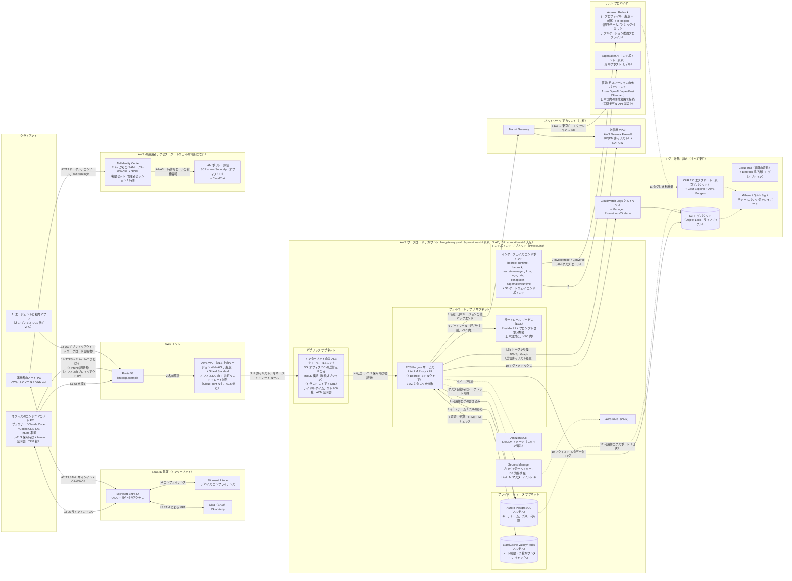

# 4. ステップ 2a: AWS 設計

**ベースライン:** AWS サンプル [sample-litellm-bedrock-gateway-on-eks](https://github.com/aws-samples/sample-litellm-bedrock-gateway-on-eks)（[§3.1](02-reference-architectures.md#31-aws)）の ECS Fargate モード（サンプルの既定は EKS）を使い、その L1 + L2 層（VPC エンドポイント経由の Bedrock）を採用する。デプロイ先は **アジアパシフィック（東京）`ap-northeast-1`**、DR リージョンは **アジアパシフィック（大阪）`ap-northeast-3`** とする。ゲートウェイは **経路 B**（[§2.6](01-common-design.md#26-接続経路モデル全設計に適用)）で公開する。インターネット向け ALB のセキュリティ グループと WAF は当社のオフィスと DC の送信元 IP だけを許可し、LiteLLM で Entra JWT を確認する。推奨オプションとして Intune 証明書による mTLS も確認する。すべて東京で終端する。**経路 A** は任意で、ステップ 4（[§8.2](07-private-connectivity.md#82-aws-direct-connect-オーバーレイ)）で Direct Connect 経由の内部 ALB を追加する。[§2.5](01-common-design.md#25-日本国内データ所在全設計に適用) の日本国内所在ルールを全体に適用する。

## 4.1 アーキテクチャ図（AWS）

> **図の表記**（AWS ガイダンスの図のスタイルに合わせている）: 実線の矢印は番号付きステップのリクエスト経路、点線の矢印は補助・非同期・バッチのフローを表す。**L ステップ** はログイン フロー（[§2.2](01-common-design.md#22-共通ログイン-フローシーケンス)）、**数字のステップ** は API リクエスト フロー（[§4.3](#43-リクエスト-フローの説明aws)）、**A2/A3** は運用者のシナリオ（[§2.9](01-common-design.md#29-アクセス-シナリオとチェックポイント)）である。Intune 証明書のように括弧で囲んだ項目は、mTLS を採用する場合にだけ適用される。

## 4.2 コンポーネント表（AWS）

| # | AWS サービス | 本設計での役割 | Azure の相当サービス | GCP の相当サービス |
|---|---|---|---|---|
| 1 | [Route 53](https://docs.aws.amazon.com/Route53/latest/DeveloperGuide/Welcome.html)（パブリック + プライベート ホストゾーン、Resolver エンドポイント） | `llm.corp.example` の DNS。オンプレミス クライアント向けのスプリット ホライズン名前解決は経路 A を採用する場合のみ | Azure DNS + DNS Private Resolver | Cloud DNS（+ 受信サーバー ポリシー） |
| 2 | [AWS WAF](https://docs.aws.amazon.com/waf/latest/developerguide/waf-chapter.html)（ALB 上のリージョン Web ACL）+ Shield Standard。[CloudFront](https://docs.aws.amazon.com/AmazonCloudFront/latest/DeveloperGuide/Introduction.html) は使 **わない**。 | オフィス/DC の IP 許可リスト（セキュリティ グループと重ねる）、LLM の本文向けに調整したマネージド ルール グループ（[§2.7](01-common-design.md#27-llm-トラフィック向けの-waf-調整とタイムアウト)）、レートベース ルール、DDoS 対策。TLS は東京でのみ終端する。 | App Gateway WAF（Front Door なし） | リージョン外部 ALB 上の Cloud Armor |
| 3 | [Application Load Balancer](https://docs.aws.amazon.com/elasticloadbalancing/latest/application/introduction.html)（[mTLS 検証モード](https://docs.aws.amazon.com/elasticloadbalancing/latest/application/mutual-authentication.html)） | LiteLLM への L7 ルーティング。セキュリティ グループはオフィス/DC の送信元 CIDR だけを許可する（サンプルの `allowlist-explicit` モード）。推奨オプション: トラスト ストアによる Intune 証明書とワークロード証明書の検証（[§2.3.2](01-common-design.md#232-ロード-バランサーで-mtls-が確認すること)）。 | Application Gateway v2（mTLS） | 外部/内部アプリケーション LB（mTLS） |
| 4 | [ECS on Fargate](https://docs.aws.amazon.com/AmazonECS/latest/developerguide/AWS_Fargate.html)（代替: EKS） | LiteLLM Proxy、UI、Bedrock ミドルウェアを実行する。ステートレスで自動スケール。 | Azure Container Apps（代替: AKS） | Cloud Run（代替: GKE Autopilot） |
| 5 | [Aurora PostgreSQL](https://docs.aws.amazon.com/AmazonRDS/latest/AuroraUserGuide/Aurora.AuroraPostgreSQL.html) マルチ AZ（EKS サンプルは Aurora Serverless v2 を使用。プロビジョンドと Serverless v2 のどちらでもよい） | LiteLLM DB: ユーザー、チーム、キー、予算、利用額ログ | Azure Database for PostgreSQL Flexible Server（ゾーン冗長 HA） | Cloud SQL for PostgreSQL（HA）/ AlloyDB |
| 6 | [ElastiCache（Valkey/Redis OSS）](https://docs.aws.amazon.com/AmazonElastiCache/latest/dg/WhatIs.html) マルチ AZ | タスク間で共有する TPM/RPM 制限と予算のカウンター、応答キャッシュ | Azure Managed Redis | Memorystore for Valkey / Redis Cluster |
| 7 | [`jp.` 地理的推論プロファイル](https://docs.aws.amazon.com/bedrock/latest/userguide/geographic-cross-region-inference.html) と In-Region モデルを使う [Amazon Bedrock](https://docs.aws.amazon.com/bedrock/latest/userguide/what-is-bedrock.html)（+ それらから作成する [アプリケーション推論プロファイル](https://docs.aws.amazon.com/bedrock/latest/userguide/inference-profiles-create.html)） | 日本国内で処理されるネイティブの基盤モデル（[§2.5](01-common-design.md#25-日本国内データ所在全設計に適用) のスナップショット参照）と、チャージバック用のタグ付きプロファイル | Japan East の Azure OpenAI Standard デプロイ | Vertex AI の `asia-northeast1` リージョン エンドポイント |
| 8 | ECS 上の VPC 内ガードレール サービス: [Presidio による PII マスキング](https://docs.litellm.ai/docs/proxy/guardrails/pii_masking_v2) と、日本語対応のプロンプト攻撃分類器（セルフホスト。東京の SageMaker AI でも可）。[Bedrock Guardrails](https://docs.aws.amazon.com/bedrock/latest/userguide/guardrails.html) は、日本国内に閉じるガードレール プロファイルが提供された場合にのみ使う（[§2.5](01-common-design.md#25-日本国内データ所在全設計に適用)）。 | PII の秘匿化、プロンプト攻撃・ジェイルブレイクの検出、コンテンツ ポリシー。LiteLLM から呼び出す | Azure AI Content Safety / Prompt Shields（Japan East） | Model Armor（`asia-northeast1`） |
| 9 | [SageMaker AI](https://docs.aws.amazon.com/sagemaker/latest/dg/whatis.html) | 任意: セルフホストまたはファインチューニング済みモデル | Foundry マネージド コンピューティング / AML オンライン エンドポイント | Vertex AI エンドポイント / GKE |
| 10 | [VPC インターフェイス エンドポイント（PrivateLink）](https://docs.aws.amazon.com/bedrock/latest/userguide/vpc-interface-endpoints.html) | Bedrock と AWS API への閉域アクセス（エンドポイント ポリシー付き） | プライベート エンドポイント（Private Link） | Private Service Connect（Google API） |
| 11 | [Transit Gateway](https://docs.aws.amazon.com/vpc/latest/tgw/what-is-transit-gateway.html) + [Direct Connect Gateway](https://docs.aws.amazon.com/directconnect/latest/UserGuide/direct-connect-gateways-intro.html) | 送信用 VPC へのハブ ルーティング。オンプレミスへのルーティングは経路 A と他クラウド バックエンドの場合のみ | Virtual WAN / ハブ VNet + ER Gateway | NCC / 共有 VPC + Cloud Router |
| 12 | [AWS Network Firewall](https://docs.aws.amazon.com/network-firewall/latest/developerguide/what-is-aws-network-firewall.html) + NAT Gateway | FQDN/SNI 許可リスト（Entra、Graph。公開モデル API は含めない）による集中送信制御 | Azure Firewall（FQDN ルール） | Secure Web Proxy / Cloud NGFW + Cloud NAT |
| 13 | [Secrets Manager](https://docs.aws.amazon.com/secretsmanager/latest/userguide/intro.html) + [KMS](https://docs.aws.amazon.com/kms/latest/developerguide/overview.html) | プロバイダー キー、DB 資格情報、LiteLLM のマスター キーとソルト キー。CMK による暗号化 | Key Vault（シークレット + キー、HSM） | Secret Manager + Cloud KMS（CMEK） |
| 14 | [ECR](https://docs.aws.amazon.com/AmazonECR/latest/userguide/what-is-ecr.html)（拡張スキャン） | バージョン固定・スキャン済みの LiteLLM イメージ | Azure Container Registry（Defender スキャン） | Artifact Registry（+ Artifact Analysis） |
| 15 | [CloudWatch](https://docs.aws.amazon.com/AmazonCloudWatch/latest/monitoring/WhatIsCloudWatch.html)、[Managed Prometheus](https://docs.aws.amazon.com/prometheus/latest/userguide/what-is-Amazon-Managed-Service-Prometheus.html) / Grafana | ログ、LiteLLM の Prometheus メトリクス、アラーム | Azure Monitor / Log Analytics / App Insights / Managed Prometheus & Grafana | Cloud Logging / Cloud Monitoring（Managed Service for Prometheus） |
| 16 | [S3](https://docs.aws.amazon.com/AmazonS3/latest/userguide/Welcome.html)（+ [Object Lock](https://docs.aws.amazon.com/AmazonS3/latest/userguide/object-lock.html)） | リクエスト メタデータ ログ、利用額エクスポート、監査アーカイブ | ストレージ アカウント（不変 BLOB） | Cloud Storage（Bucket Lock） |
| 17 | [CloudTrail](https://docs.aws.amazon.com/awscloudtrail/latest/userguide/cloudtrail-user-guide.html) + [Bedrock モデル呼び出しログ](https://docs.aws.amazon.com/bedrock/latest/userguide/model-invocation-logging.html) | コントロール プレーンの監査。規制対象チーム向けの任意の内容ログ | アクティビティ ログ + 診断設定 | Cloud Audit Logs（管理 + データアクセス） |
| 18 | [CUR 2.0](https://docs.aws.amazon.com/cur/latest/userguide/what-is-cur.html)、[コスト配分タグ](https://docs.aws.amazon.com/awsaccountbilling/latest/aboutv2/cost-alloc-tags.html)、[AWS Budgets](https://docs.aws.amazon.com/cost-management/latest/userguide/budgets-managing-costs.html) | 請求の正、タグベースの配賦、最終防衛線としての予算アラーム | Cost Management エクスポート、タグ、予算 | BigQuery への請求エクスポート、ラベル、予算 |
| 19 | [Athena](https://docs.aws.amazon.com/athena/latest/ug/what-is.html) + [Amazon Quick Sight](https://docs.aws.amazon.com/quick/latest/userguide/what-is.html) | LiteLLM の利用額と CUR を結合してチャージバック/ショーバックを作成 | Fabric / Power BI | BigQuery + Looker Studio |
| 20 | [IAM Identity Center ↔ Entra ID](https://docs.aws.amazon.com/singlesignon/latest/userguide/idp-microsoft-entra.html) | Entra SSO（CA-GW-05）+ SCIM による運用者の AWS コンソール/CLI アクセス。管理者用権限セットは 1 時間（[§4.4](#44-id-とアクセスaws)） | ネイティブ（Entra） | Workforce Identity Federation |
| 21 | [AWS Private CA](https://docs.aws.amazon.com/privateca/latest/userguide/PcaWelcome.html)（mTLS を採用する場合のみ） | ワークロード mTLS 証明書（エージェント ↔ ALB）の発行 CA | Key Vault 証明書 / パートナー CA | Certificate Authority Service |
| 22 | [AWS Organizations の SCP](https://docs.aws.amazon.com/organizations/latest/userguide/orgs_manage_policies_scps.html) | 所在要件のガードレール: `ap-northeast-1`/`ap-northeast-3` 以外での操作と、`global.`/`apac.` 推論プロファイルの呼び出しを拒否する | Azure Policy（許可されている場所、デプロイ SKU の拒否） | 組織ポリシー `gcp.resourceLocations` |

## 4.3 リクエスト フローの説明（AWS）

**ログイン（L1〜L7）は [§2.2](01-common-design.md#22-共通ログイン-フローシーケンス) のとおり。** UI は同じ LiteLLM サービスが提供する。LiteLLM は Entra に OIDC Web アプリとして登録し、リダイレクト URI は `https://llm.corp.example/sso/callback` とする。バックチャネルのトークン交換（L6b）と Microsoft Graph のグループ/チーム同期は Network Firewall を通って送信される。Network Firewall では `login.microsoftonline.com` と `graph.microsoft.com` を許可する。

**API リクエスト:**

1. **クライアント → DNS。** オフィスにある Intune 管理ノート PC 上の Claude Code、Codex CLI、SDK、チャット UI が、トークン コマンドで得た **Entra JWT** を付けて `https://llm.corp.example/v1/messages`、`/v1/responses`、または `/v1/chat/completions` を呼び出す。貼り付けたキーしか受け付けない IDE プラグインは代わりに **仮想キー** を送る（[§2.3.4](01-common-design.md#234-コーディング-エージェントのクライアント)）。リクエストはこのホスト名を TLS インスペクションしないオフィスのインターネット ブレイクアウトから出ていく [A-15]。mTLS を採用する場合、クライアントはユーザーの **Intune 発行の証明書** を提示する。オンプレミス DC の AI エージェント（1a）は DC のブレイクアウトから出ていき、mTLS を採用する場合は **ワークロード証明書** を提示する。経路 A の場合は、どちらも Direct Connect を使う（[§8.2](07-private-connectivity.md#82-aws-direct-connect-オーバーレイ)）。
2. **Route 53** が ALB の名前を解決する。
3. **AWS WAF（ALB に関連付けたリージョン Web ACL）** は当社のオフィス/DC の送信元 IP だけを許可する（ALB のセキュリティ グループと重ねる IP セット）。続いて送信元 IP ごとのレート制限、Amazon IP レピュテーション リスト、LLM の本文向けに調整した Core ルール セット（[§2.7](01-common-design.md#27-llm-トラフィック向けの-waf-調整とタイムアウト)）、管理パス向けの厳しいルールを適用する。**設計判断:** EKS サンプルと同様に ALB を唯一の入口とし、CloudFront は使わない（[§2.6](01-common-design.md#26-接続経路モデル全設計に適用)）。CloudFront は現在クライアント証明書を自ら検証できるため、これは mTLS の問題ではない。理由は所在要件（日本に限られない拠点での TLS 終端とエッジ WAF、us-east-1 での WAF 管理）、CloudFront のオリジン タイムアウトが既定 30 秒であること、キャッシュするものがないことである。後から CloudFront を追加することもしない。
4. **ALB。** セキュリティ グループはオフィス/DC の送信元 CIDR だけを受け入れ、`0.0.0.0/0` は決して許可しない。mTLS を採用する場合、TLS ハンドシェイクの間に、ALB はクライアント証明書のチェーンをトラスト ストア（Intune が証明書を配布する元の CA とワークロード CA）で検証し、秘密鍵の所持、有効期間、S3 上の CRL を確認する（[§2.3.2](01-common-design.md#232-ロード-バランサーで-mtls-が確認すること)）。また、LiteLLM が証明書のシリアル番号を記録できるよう `X-Amzn-Mtls-Clientcert-*` ヘッダーを転送する。3 AZ の ECS タスクで構成される LiteLLM ターゲット グループにルーティングする。アイドル タイムアウトは 600 秒（[§2.7](01-common-design.md#27-llm-トラフィック向けの-waf-調整とタイムアウト)）。
5. **LiteLLM の認証・認可。** LiteLLM は、Entra JWT（Entra JWKS による署名検証と `aud`、`iss`、有効期限の確認）か仮想キー（Aurora でのハッシュ照合 + Redis キャッシュ）のいずれかを検証する。証明書のユーザーとトークンやキーの所有者は比較しない（[§2.3.3](01-common-design.md#233-証明書とユーザーの紐付け-採用しない)）。そのうえでユーザー、チーム、組織を特定し、モデル アクセス グループ、キー・ユーザー・チームの **予算**、Redis カウンターによる **TPM/RPM 制限** を確認する。制限超過のリクエストには `429`、予算超過には予算超過エラー付きの `400`/`429` を返す。
6. **ガードレール（呼び出し前）。** LiteLLM は東京の ECS 上の **VPC 内ガードレール サービス**（PII マスキング用の Presidio と、日本語を扱えるセルフホストのプロンプト攻撃分類器）を呼び出す。日本語のコンテンツには Bedrock Guardrails を使 *わない*。Standard 階層は `apac` ガードレール プロファイル経由でチェックをルーティングし、Classic 階層は日本語に対応していないためである（[§2.5](01-common-design.md#25-日本国内データ所在全設計に適用)）。
7. **ネイティブ モデル。** LiteLLM は ECS の **タスク IAM ロール**（[タスク ロール](https://docs.aws.amazon.com/AmazonECS/latest/developerguide/task-iam-roles.html)）を使い、静的キーなしで **インターフェイス VPC エンドポイント** 経由で `bedrock-runtime` を呼び出す。モデル ID には **チームのアプリケーション推論プロファイル ARN** を使う。このプロファイルは **`jp.` のシステム定義プロファイル**（または In-Region モデル）をコピーして作成するため、Bedrock の利用量に `CostCenter`/`Team` タグが付き、リクエストは東京か大阪でのみ処理される。エンドポイント ポリシーとタスク ロールのポリシーでは、これらの ARN だけを許可する。誰かが LiteLLM の設定に `global.*` や `apac.*` のプロファイルを追加しても、SCP がブロックする。
8. **日本リージョンの他バックエンド（任意）。** 公開モデル API（OpenAI、Anthropic API など）は禁止する [A-7]。業務で OpenAI モデルが必要な場合、LiteLLM は **Japan East の Azure OpenAI Standard デプロイ** を呼び出す。経路は ECS → TGW → Direct Connect → 東京のコロケーション施設のルーター → ExpressRoute プライベート ピアリング → プライベート エンドポイントで、トラフィックは日本国外に出ない（[§8.2](07-private-connectivity.md#82-aws-direct-connect-オーバーレイ)）。このバックエンドにはインターネット経路を使わない。インターネット許可リストにモデルの FQDN を載せることになり、インターネットのルーティングが日本国内に留まる保証もないためである。プロバイダーの API キー、または Entra ワークロード ID の資格情報は **Secrets Manager** から取得する。
9. **応答と計量。** LiteLLM は応答をストリーミングし、設定されていれば呼び出し後のガードレールを実行する。そのうえで、ユーザー、チーム、キー、タグ、モデル、プロンプト/補完トークン数、コスト、レイテンシを含む **利用額ログ** 行を Aurora に書き込む。予算カウンターは Redis で更新され、非同期で Postgres に永続化される。
10. **ログとメトリクス。** 以下の保存先はすべて東京にある。コンテナーの標準出力（JSON）は **CloudWatch Logs** に送られる。LiteLLM の Prometheus `/metrics` エンドポイントは **Amazon Managed Prometheus** がスクレイプし、Grafana のダッシュボードで可視化する。LiteLLM の **S3 ログ コールバック** は、[A-10] に従い内容を含まないリクエスト メタデータを S3 ログ バケットに書き込む（[LiteLLM のログ](https://docs.litellm.ai/docs/proxy/logging)）。
11. **請求。** Bedrock の利用量は推論プロファイルのタグ付きで **CUR 2.0** に表示される。外部プロバイダーの請求書は別途届く。
12. **チャージバック。** 日次ジョブで LiteLLM の利用額（チーム、タグ、モデル別）を東京の S3 にエクスポートする。東京の **Athena** と **Quick Sight** で、これを CUR 2.0 エクスポート（これも東京のバケットに配信）と結合し、部門ごとのショーバックを公開する。月末の精算では、実際の請求額を LiteLLM で計測した利用量に比例して配賦する。

## 4.4 ID とアクセス（AWS）

| 項目 | 設計 |
|---|---|
| LiteLLM UI への SSO | Entra **OIDC** アプリ（`litellm-prod`）を LiteLLM の Microsoft SSO 設定（`MICROSOFT_CLIENT_ID`、`MICROSOFT_CLIENT_SECRET`、`MICROSOFT_TENANT`）で使う。クライアント シークレットは Secrets Manager に保管する。使用中の LiteLLM バージョンが対応していれば証明書資格情報を優先し、そうでなければシークレットを 90〜180 日ごとにローテーションする。代替として SAML 2.0 も使える（[LiteLLM SAML](https://docs.litellm.ai/docs/proxy/saml_sso)）。 |
| API への SSO / 認証 | Entra を発行者とする LiteLLM の **JWT 認証**。Claude Code（`apiKeyHelper`）と Codex CLI（`auth.command`）はトークン コマンドを実行し、OS ブローカー付きの MSAL で `api://litellm-prod/.default` のトークンを取得する（[§2.3.4](01-common-design.md#234-コーディング-エージェントのクライアント)）。`team_ids_jwt_field: groups`（またはアプリ ロール）でトークンを LiteLLM チームに対応付ける（[JWT 認証](https://docs.litellm.ai/docs/proxy/token_auth)）。仮想キーは、貼り付けたキーしか受け付けないツール向けの、有効期限必須の代替手段とする。 |
| グループとロールの対応付け | Entra の **アプリ ロール** を LiteLLM のグローバル ロール（`proxy_admin`、`proxy_admin_viewer`、`internal_user`、`internal_user_viewer`）に対応付ける。`llm-team-*` で始まる Entra の **セキュリティ グループ** は、ログイン時のチーム同期で LiteLLM チームに対応付ける（[MSFT SSO チュートリアル](https://docs.litellm.ai/docs/tutorials/msft_sso)）。プロビジョニング解除は **SCIM** で行う（[SCIM](https://docs.litellm.ai/docs/tutorials/scim_litellm)）。トークンには *割り当て済み* のグループだけを含め、200 グループ超過の問題を避ける。 |
| Intune コンプライアンス | Entra のサインイン時と、トークンの発行・更新のたびに CA-GW-01 で適用する。mTLS を採用する場合は、**すべてのリクエストで** Intune 証明書による ALB mTLS でも適用し、これが仮想キーに対する唯一のデバイス確認になる（[§2.3.2](01-common-design.md#232-ロード-バランサーで-mtls-が確認すること)）。証明書のユーザーはトークンと照合しない（[§2.3.3](01-common-design.md#233-証明書とユーザーの紐付け-採用しない)）。AWS のサービスはエンド ユーザーを検証せず、検証するのは LiteLLM である（[§2.3.1](01-common-design.md#231-リクエストごとに誰が何を検証するか)）。AWS Verified Access は *使わない*。そのデバイス信頼プロバイダーは Jamf、CrowdStrike、JumpCloud であり、Intune ではないためである（[Verified Access のデバイス信頼](https://docs.aws.amazon.com/verified-access/latest/ug/device-trust.html)）。 |
| サービス間認証 | ECS タスク ロール → Bedrock、Secrets Manager、KMS、S3 を、最小権限ポリシーと VPC エンドポイント ポリシーで構成する。Aurora には **IAM DB 認証** か、ローテーションされる Secrets Manager の資格情報を使う。エージェント → LiteLLM には Entra ワークロード ID の JWT を使う。AWS 上で動くエージェントには、Entra のフェデレーション資格情報と組み合わせた [IAM ロール](https://docs.aws.amazon.com/IAM/latest/UserGuide/id_roles.html) を使うか、呼び出し元の Secrets Manager に置いたチーム用サービス アカウント仮想キーを使い、mTLS を採用する場合は AWS Private CA 発行の mTLS ワークロード証明書と組み合わせる。 |
| 運用者（[§2.9](01-common-design.md#29-アクセス-シナリオとチェックポイント) のシナリオ A2、A3） | IAM Identity Center を Entra と SCIM でフェデレーションする（[ガイド](https://docs.aws.amazon.com/singlesignon/latest/userguide/idp-microsoft-entra.html)）。Entra の Identity Center エンタープライズ アプリには **CA-GW-05** を適用する（フィッシング耐性のある MFA、準拠デバイス、オフィス/DC のネームド ロケーション、デバイス コード フローのブロック）。管理者用権限セットの **セッション時間は 1 時間** とする（上限は 12 時間）。SCP または権限セットのポリシーで、`aws:SourceIp` がオフィスや DC の送信元 IP でない呼び出しを拒否する。運用者の代わりに AWS のサービスが行う呼び出しが動くよう、`aws:ViaAWSService` の例外を設ける。AWS CLI は `aws sso login` でサインインし、同じマシンのブラウザーを使う。サインインしたマシンとは別のマシンに資格情報が渡る `--use-device-code` は使わない。緊急用（break-glass）の IAM ユーザーは金庫で保管する。Fargate タスクへの対話型アクセスは行わず、本番環境では ECS Exec を無効にする。 |

## 4.5 コスト配賦とトークン制御（AWS）

| 制御 | LiteLLM 層（リアルタイムの適用） | AWS 層（請求の正 / 最終防衛線） |
|---|---|---|
| 部門別チャージバック | 部門ごとの LiteLLM **組織**、またはすべてのキーとチームへの `dept:<code>` タグ | 部門ごとに Bedrock の **アプリケーション推論プロファイル** を作成し、`CostCenter=<code>` タグを付ける。LiteLLM のモデル エイリアス（例: `claude-sonnet`）は、チームごとのモデル リストまたはデプロイ エイリアスを使い、呼び出し元チーム固有のプロファイル ARN に解決する。コスト配分タグを有効化する（有効化はさかのぼって適用されない）。 |
| チーム / プロジェクト | チーム予算（`max_budget`、`budget_duration: 30d`）、TPM/RPM、`metadata.tags: [project:x]` | 運用負荷が増えるため、推論プロファイルをチームごとに作るのは利用量に見合う場合だけにする。それ以外は、LiteLLM の利用額 × CUR の合計額で配賦する。 |
| ユーザー単位 | ユーザー予算と、個人キーの既定予算、キーの有効期限 | IAM プリンシパル単位のコスト配賦（2026 年 4 月）は *AWS プリンシパル* が対象である。すべての呼び出しは単一のタスク ロールで届くため、エンド ユーザーは識別できない。したがって、ユーザー単位の正確な値は LiteLLM から取得する。 |
| トークン制御 | キー、ユーザー、チームごとの TPM/RPM、モデルごとの `max_tokens` 上限、モデル アクセス グループ、[タグ予算](https://docs.litellm.ai/docs/proxy/tag_budgets) | Bedrock の **サービス クォータ**（モデルごとの TPM/RPM）が上限になる。`jp.` プロファイルのクォータは **送信元リージョンごと** に管理され、東京で増やしたクォータは大阪からの呼び出しには適用されない（[JP CRIS の発表記事](https://aws.amazon.com/blogs/machine-learning/introducing-amazon-bedrock-cross-region-inference-for-claude-sonnet-4-5-and-haiku-4-5-in-japan-and-australia)）。DR 用の大阪のクォータは事前に申請しておく。予約容量は必要な場合のみ使う。 |
| アラート | LiteLLM の予算アラート（Slack/メールの Webhook）、`remaining_budget` に対する Prometheus アラート | ゲートウェイ アカウントと `CostCenter` タグごとに 80/100% のしきい値で **AWS Budgets** を設定し、SNS で通知する |
| レポート | LiteLLM UI の使用状況タブ、`/spend/*` API | CUR 2.0 → Athena → Quick Sight。`team_id`/タグと日付で LiteLLM の利用額エクスポートと結合する |

## 4.6 ネットワーク（AWS）

- **アカウントと VPC:** `network-prod` アカウントが Transit Gateway、DX Gateway、検査/送信用 VPC を所有する。`llm-gateway-prod` アカウントには、3 AZ にまたがる VPC `10.60.0.0/20` を 1 つ置く。
  - `public`（/26 ×3）: 経路 B のインターネット向け ALB。ポリシーで閉域専用の構成（経路 A のみ）が求められる場合に限り、このサブネットを作らない。
  - `app`（/24 ×3）: Fargate タスク。
  - `data`（/26 ×3）: Aurora と ElastiCache。
  - `endpoints`（/26 ×3）: `bedrock-runtime`、`bedrock`、`bedrock-agent-runtime`（使う場合）、`sagemaker.runtime`、`secretsmanager`、`kms`、`logs`、`monitoring`、`sts`、`ecr.api`、`ecr.dkr`、`elasticloadbalancing` のインターフェイス エンドポイントと、**S3 ゲートウェイ エンドポイント**。エンドポイントではプライベート DNS を有効にする。オンプレミスの DNS からは Route 53 Resolver の受信エンドポイントで名前解決できるようにする（[Resolver](https://docs.aws.amazon.com/Route53/latest/DeveloperGuide/resolver.html)）。
- **セキュリティ グループ:** ALB の SG はオフィスと DC の送信元 CIDR [A-14] からの 443 だけを許可し、`0.0.0.0/0` は決して許可しない（EKS サンプルの `allowlist-explicit` モード）。WAF の IP セットにも同じリストを登録する。経路 A を追加する場合、その内部 ALB の SG は TGW 経由で届く社内のアドレス範囲を許可する。タスクの SG は ALB の SG からの 4000 のみ許可する。データの SG はタスクの SG からの 5432/6379 のみ許可する。エンドポイントの SG はタスクの SG からの 443 を許可する。
- **送信:** アプリ サブネットから IGW へのルートは置かない。デフォルト ルートは TGW 経由で **検査用 VPC** に向け、**Network Firewall** のステートフル ルールで TLS SNI を許可リスト化する。対象は `login.microsoftonline.com`、`graph.microsoft.com`、必要なら LiteLLM のライセンス エンドポイント（[§2.5](01-common-design.md#25-日本国内データ所在全設計に適用)）、そして LiteLLM が Okta を呼び出す場合に限り `*.okta.com`（通常は呼び出さない）である。**インターネット許可リストにはモデル プロバイダーの FQDN を一切載せない** [A-7]。日本リージョンの Azure OpenAI バックエンドには閉域経路で接続する。それ以外はすべて拒否してログに記録するので、日本国外のエンドポイントへの接続の試みも検知できる。
- **受信経路:** (a) **経路 B（主経路）:** インターネット → リージョン WAF → インターネット向け ALB（オフィス/DC の IP のみ）。mTLS は採用する場合に適用する。サイト間 VPN は不要。(b) **経路 A（任意、[§8.2](07-private-connectivity.md#82-aws-direct-connect-オーバーレイ)）:** Direct Connect → TGW → 同じ ECS サービスの前に置く 2 つ目の *内部* ALB。サンプルの `internal` モードに当たる。経路はスプリット ホライズン DNS で選ぶ。ALB の IP アドレスは時間とともに変わるため、オフィスのファイアウォールが固定の宛先 IP しか許可できない場合は、ALB の前に AWS Global Accelerator を置くか経路 A を使う（[§2.6](01-common-design.md#26-接続経路モデル全設計に適用)）。

## 4.7 データとログ（AWS）

| データ | 保存先 | 保護 | 保持期間（案） |
|---|---|---|---|
| LiteLLM 設定 DB（ユーザー、チーム、ハッシュ化したキー、予算） | 東京の Aurora PostgreSQL、マルチ AZ、CMK で暗号化、PITR 有効 | SG による分離、IAM 認証、TLS 必須（`rds.force_ssl`） | プラットフォームの存続期間。PITR 35 日。日次スナップショットは大阪にのみコピー |
| 利用額ログ（リクエストごと） | Aurora（`LiteLLM_SpendLogs`）。大量の場合は別 DB またはパーティショニング（[LiteLLM 本番ガイド](https://docs.litellm.ai/docs/proxy/prod)） | 同上 | Postgres で 90 日間ホット保持。日次で S3 に Parquet でエクスポートし、財務用に 7 年保持 [前提] |
| レート制限カウンターとキャッシュ | ElastiCache Valkey/Redis、マルチ AZ、転送時・保存時の暗号化、AUTH/RBAC | SG による分離 | 一時的 |
| リクエスト メタデータ ログ | 東京の S3（LiteLLM の S3 コールバック）→ Athena | SSE-KMS、VPC エンドポイントに限定したバケット ポリシー、Object Lock（ガバナンス） | 1 年ホット、その後 7 年まで Glacier |
| プロンプト/応答の内容（オプトインしたチームのみ） | Bedrock モデル呼び出しログ → 東京の専用 S3 バケット、またはチーム単位のフラグ付き LiteLLM コールバック | 専用の KMS キーとアクセス ロール、Macie によるスキャン | 各チームの法的要件による（既定 30 日） |
| 管理監査（誰がキーや予算を変更したか） | LiteLLM 監査ログ（エンタープライズ）→ S3、CloudTrail 組織証跡（ホーム リージョンは東京） | ログ アーカイブ アカウントの不変バケット | 7 年 |
| インフラのログ | 東京の CloudWatch Logs（ALB アクセス ログ、WAF ログ、Network Firewall のフロー/アラート ログ、VPC フロー ログ） | KMS、SIEM へのクロスアカウント サブスクリプション（SIEM の保存先も日本国内にする） | CloudWatch で 90 日、S3 で 1〜7 年 |

## 4.8 セキュリティ制御（AWS）

- **WAF:** オフィス/DC の IP セット、送信元 IP ごとのレートベース ルール、Amazon IP レピュテーション、Known Bad Inputs、そして API パスでは `SizeRestrictions_BODY` を Count に上書きした Core ルール セット。このルールは 8 KB を超える本文をすべて遮断し、これはほぼすべてのコーディング エージェントのリクエストにあたる。本文の XSS/LFI/RFI ルールもコードでの誤検知を確認する（[§2.7](01-common-design.md#27-llm-トラフィック向けの-waf-調整とタイムアウト)）。ALB 上の AWS WAF は本文の先頭 8 KB しか検査しないため、本文全体のサイズは強制できない。それは LiteLLM のリクエスト サイズ制限で行う。`/ui`、`/sso`、`/key/*` の管理パスには、より厳格な別ルール セットを適用する。WAF ログでは `authorization` と `x-api-key` を秘匿する（[§2.8](01-common-design.md#28-プロンプトを見られるのは誰か)）。
- **mTLS（推奨オプション。[§2.3.2](01-common-design.md#232-ロード-バランサーで-mtls-が確認すること) の場合は必須）:** ALB の [相互認証の検証モード](https://docs.aws.amazon.com/elasticloadbalancing/latest/application/mutual-authentication.html)。トラスト ストアには Intune の発行 CA と AWS Private CA を含める。定期ジョブで最新の CRL を S3 に公開し、トラスト ストアの失効リストを更新する。証明書の有効期間は 30〜90 日で自動更新する。Intune 証明書プロファイルで、秘密鍵を TPM または Secure Enclave にエクスポート不可として保持する。
- **シークレット:** Secrets Manager で DB 資格情報を自動ローテーションする。プロバイダー キーは、プロバイダー別のローテーション Lambda または手動の手順書で 90 日ごとにローテーションする。LiteLLM の `LITELLM_MASTER_KEY` と `LITELLM_SALT_KEY` は ECS のシークレットとしてのみ注入する。**ソルト キーは保存済みのプロバイダー資格情報の暗号化に使われるため、再暗号化の計画なしにローテーションしてはならない。**
- **暗号化:** すべての通信で TLS 1.2 以上（ALB のセキュリティ ポリシー `ELBSecurityPolicy-TLS13-1-2-2021-06`）。Aurora、ElastiCache、S3、CloudWatch Logs、Secrets Manager は KMS CMK で暗号化する。
- **ガードレール / PII:** すべてのモデルについて、VPC 内ガードレール サービスを呼び出し前後の既定ガードレールとする。PII には Presidio、プロンプト攻撃とコンテンツには日本語対応の分類器を使う。AWS が日本国内に閉じるガードレール プロファイル、または Classic 階層の日本語対応を提供した時点で、Bedrock Guardrails を再評価する。LiteLLM のガードレールはチームまたはキー単位で設定する。
- **所在要件のガードレール:** SCP で東京と大阪以外のリージョンをすべて拒否し（グローバル サービスは除く）、`global.*` と `apac.*` 推論プロファイルに対する `bedrock:InvokeModel*` を拒否する。AWS Config ルールで 2 リージョン以外のリソースを検出する。新しい Bedrock モデルは、`GetInferenceProfile` で送信先が東京と大阪であることを確認してから導入する。
- **サプライ チェーン:** LiteLLM イメージのダイジェストを固定し、ECR にミラーする。ECR の拡張スキャン（Inspector）を実行し、dev → staging → prod の順にイメージを昇格させる。
- **検出:** GuardDuty（ECS ランタイム モニタリングを含む）、Security Hub、Config ルール、IAM Access Analyzer。

## 4.9 スケーラビリティと HA（AWS）

- **コンピューティング:** ECS Fargate サービスで 3 AZ に最低 3 タスクを分散する。CPU（約 60%）と ALB の `RequestCountPerTarget` によるターゲット追跡の自動スケーリングを使う。Uvicorn のワーカー数は vCPU 数に合わせる。ALB のアイドル タイムアウトと LiteLLM の `request_timeout` はどちらも 600 秒にする（[§2.7](01-common-design.md#27-llm-トラフィック向けの-waf-調整とタイムアウト)）。
- **代替:** プラットフォーム チームがすでに EKS を運用している場合や、サンプルの L4 クロスアカウント アクセスが必要な場合は EKS（サンプルの既定。Pod Identity、HPA、PodDisruptionBudget）。サンプルはどちらにも対応するが、1 回のデプロイで両方は使えない。
- **データ層:** UI と分析用のリーダーを持つ Aurora マルチ AZ。自動フェイルオーバー付きの ElastiCache マルチ AZ。
- **モデル容量:** `jp.` プロファイルが東京と大阪に負荷を分散する。残りは LiteLLM ルーターの **フォールバック** で処理するが、フォールバック先は日本国内で処理される他のデプロイに限る（例: Claude Opus 5.5 `jp.` → Claude Opus 4.8 `jp.`、または Azure OpenAI Japan East）。429/5xx 時には `cooldown` を使う。`global.` プロファイルや公開 API には決してフォールバックしない。
- **DR:** 同じ IaC からデプロイする **大阪** のウォーム スタンバイ。`jp.` プロファイルは大阪を送信元リージョンとして呼び出せるため、東京の障害時もモデル層は動き続ける。Aurora Global Database 東京 → 大阪（RPO 約 1 秒）と Route 53 のフェイルオーバー レコードを使う。大阪の ALB にも同じセキュリティ グループの許可リストと WAF ルールが必要であり、mTLS を採用する場合は同じトラスト ストアと CRL ジョブも必要である。Redis はコールドで再構築するため、レート制限カウンターは一時的にリセットされるが、予算は Postgres に残る。RTO は 30〜60 分。

---

[← 前へ: ステップ 1: リファレンス アーキテクチャ](02-reference-architectures.md) · [目次](../../README.md) · [次へ →: ステップ 2b: Azure](04-azure.md)
