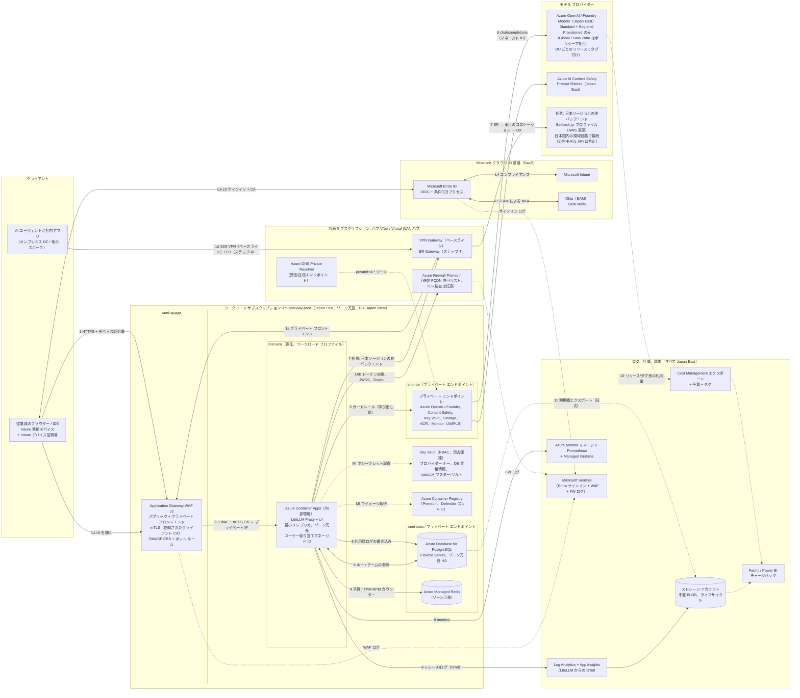

# 5. ステップ 2b: Azure 設計

**ベースライン:** Microsoft Foundry チャットのベースラインと APIM ランディング ゾーン アクセラレーターの *ネットワーク構成*（App Gateway WAF → 内部ワークロード → プライベート エンドポイント → Azure Firewall による送信）を基に、ゲートウェイとして APIM の代わりに **Azure Container Apps（内部環境）上の LiteLLM** を置く。プライマリ リージョンは **Japan East**、DR リージョンはそのペア リージョンである **Japan West** とする。[§2.5](01-common-design.md#25-日本国内データ所在全設計に適用) の日本国内所在ルールを全体に適用する。ステップ 4（[§8.3](07-private-connectivity.md#83-azure-expressroute-オーバーレイ)）では ExpressRoute のオーバーレイを追加する。

## 5.1 アーキテクチャ図（Azure）

## 5.2 コンポーネント表（Azure）

| # | Azure サービス | 役割 | AWS の相当サービス | GCP の相当サービス |
|---|---|---|---|---|
| 1 | [Application Gateway WAF v2](https://learn.microsoft.com/azure/web-application-firewall/ag/ag-overview)（[相互認証](https://learn.microsoft.com/azure/application-gateway/mutual-authentication-overview)） | リージョン L7 受信、OWASP CRS/DRS、ボット対策、クライアント証明書の検証（Intune CA）、パブリック + プライベート フロントエンド | ALB + AWS WAF（mTLS） | 外部/内部アプリケーション LB + Cloud Armor（mTLS） |
| 2 | [Azure Container Apps](https://learn.microsoft.com/azure/container-apps/overview)（内部環境、[ゾーン冗長](https://learn.microsoft.com/azure/reliability/reliability-container-apps)） | LiteLLM Proxy + UI。代替: ワークロード ID を使う [AKS](https://learn.microsoft.com/azure/aks/what-is-aks) | ECS Fargate / EKS | Cloud Run / GKE |
| 3 | [Azure Database for PostgreSQL Flexible Server](https://learn.microsoft.com/azure/postgresql/flexible-server/overview)（[ゾーン冗長 HA](https://learn.microsoft.com/azure/postgresql/high-availability/concepts-high-availability)） | LiteLLM DB | Aurora PostgreSQL | Cloud SQL / AlloyDB |
| 4 | [Azure Managed Redis](https://learn.microsoft.com/azure/redis/overview) | レート制限と予算のカウンター、キャッシュ | ElastiCache | Memorystore |
| 5 | [Azure OpenAI in Foundry Models](https://learn.microsoft.com/azure/foundry/foundry-models/concepts/models-sold-directly-by-azure)。Japan East の [Standard と Regional Provisioned のデプロイの種類](https://learn.microsoft.com/azure/foundry/foundry-models/concepts/deployment-types) だけを使う | 日本ジオグラフィ内で処理されるネイティブ モデル（GPT ファミリーと、Japan East で Standard として提供される Foundry Models）。リージョン PTU と Standard 従量課金のデプロイ。 | Bedrock `jp.` プロファイル | Vertex AI `asia-northeast1` |
| 6 | Japan East の [Azure AI Content Safety](https://learn.microsoft.com/azure/ai-services/content-safety/overview) / [Prompt Shields](https://learn.microsoft.com/azure/ai-services/content-safety/concepts/jailbreak-detection)（[リージョンの提供状況](https://learn.microsoft.com/azure/ai-services/content-safety/region-availability)） | コンテンツ フィルタリングとジェイルブレイク検出。LiteLLM から呼び出す。Azure OpenAI 組み込みのコンテンツ フィルターに追加して使う。 | VPC 内ガードレール サービス（Bedrock Guardrails は日本国内に閉じない） | Model Armor |
| 7 | [プライベート エンドポイント](https://learn.microsoft.com/azure/private-link/private-endpoint-overview) + [プライベート DNS ゾーン](https://learn.microsoft.com/azure/private-link/private-endpoint-dns) | Azure OpenAI（`privatelink.openai.azure.com`）、Key Vault、Storage、ACR、Redis、PostgreSQL、Monitor（AMPLS）への閉域アクセス | VPC インターフェイス エンドポイント | Private Service Connect |
| 8 | [Azure DNS Private Resolver](https://learn.microsoft.com/azure/dns/dns-private-resolver-overview) | オンプレミス → Azure プライベート ゾーンの名前解決（受信エンドポイント） | Route 53 Resolver | Cloud DNS 受信ポリシー |
| 9 | [Azure Firewall Premium](https://learn.microsoft.com/azure/firewall/overview)（ハブ） | 送信 FQDN 許可リスト、脅威インテリジェンス、任意の TLS 検査 | Network Firewall + NAT GW | Secure Web Proxy / Cloud NGFW + Cloud NAT |
| 10 | [Virtual WAN](https://learn.microsoft.com/azure/virtual-wan/virtual-wan-about) またはハブ＆スポーク + [ExpressRoute Gateway](https://learn.microsoft.com/azure/expressroute/expressroute-about-virtual-network-gateways) / [VPN Gateway](https://learn.microsoft.com/azure/vpn-gateway/vpn-gateway-about-vpngateways) | ハイブリッド ルーティング | TGW + DX Gateway / VPN | NCC + Cloud Router / HA VPN |
| 11 | [Key Vault](https://learn.microsoft.com/azure/key-vault/general/overview) | シークレット、CMK（必要に応じて Managed HSM） | Secrets Manager + KMS | Secret Manager + Cloud KMS |
| 12 | [Azure Container Registry](https://learn.microsoft.com/azure/container-registry/container-registry-intro) Premium | プライベート イメージ レジストリ、geo レプリケーション、Defender スキャン | ECR | Artifact Registry |
| 13 | [Azure Monitor](https://learn.microsoft.com/azure/azure-monitor/overview): Log Analytics、[App Insights（OpenTelemetry）](https://learn.microsoft.com/azure/azure-monitor/app/opentelemetry-overview)、[マネージド Prometheus](https://learn.microsoft.com/azure/azure-monitor/metrics/prometheus-metrics-overview)、Managed Grafana | ログ、トレース、メトリクス、ダッシュボード | CloudWatch + AMP/AMG | Cloud Logging/Monitoring |
| 14 | [不変ポリシー付きストレージ アカウント](https://learn.microsoft.com/azure/storage/blobs/immutable-storage-overview) | ログ アーカイブ、利用額エクスポート | S3 + Object Lock | GCS + Bucket Lock |
| 15 | [Microsoft Sentinel](https://learn.microsoft.com/azure/sentinel/overview) | Entra サインイン、WAF、Firewall、LiteLLM 監査を相関分析する SIEM | Security Lake / サードパーティ SIEM | Google SecOps |
| 16 | [Cost Management](https://learn.microsoft.com/azure/cost-management-billing/costs/overview-cost-management)（エクスポート、予算）+ [リソース タグ](https://learn.microsoft.com/azure/azure-resource-manager/management/tag-resources) | 請求の正、予算アラート | CUR + Budgets | 請求エクスポート + Budgets |
| 17 | [Defender for Cloud](https://learn.microsoft.com/azure/defender-for-cloud/defender-for-cloud-introduction)（AI 脅威保護を含む） | ポスチャ管理、コンテナーと AI ワークロードの脅威検出 | GuardDuty + Security Hub | Security Command Center |
| 18 | （任意）[API Management AI ゲートウェイ](https://learn.microsoft.com/azure/api-management/genai-gateway-capabilities) | 共有 Azure OpenAI PTU のバックエンド プール（[§3.2](02-reference-architectures.md#32-azure) のパターン 2） | 該当なし | Apigee |
| 19 | （リモート ユーザー）[Entra Global Secure Access: Private Access](https://learn.microsoft.com/entra/global-secure-access/concept-private-access) | CA と準拠デバイスで制御する、プライベート フロントエンドへの ZTNA | Verified Access / Client VPN | Chrome Enterprise Premium / IAP |
| 20 | [Azure Policy](https://learn.microsoft.com/azure/governance/policy/overview)（許可されている場所 + デプロイ SKU を拒否するカスタム ポリシー） | 所在要件のガードレール: `japaneast`/`japanwest` のみとし、`GlobalStandard`、`GlobalProvisionedManaged`、`GlobalBatch`、`DataZone*`、`DeveloperTier` のデプロイを禁止する（[ポリシーの例](https://learn.microsoft.com/azure/foundry/foundry-models/concepts/deployment-types)） | SCP + IAM | 組織ポリシー `gcp.resourceLocations` |

## 5.3 リクエスト フローの説明（Azure）

**ログイン（L1〜L7）は [§2.2](01-common-design.md#22-共通ログイン-フローシーケンス) のとおり。** Azure では、LiteLLM のアプリ登録、条件付きアクセス、Intune がすべて同じ Microsoft テナント内にあるため、ID 統合の作業量は 3 クラウドの中で最も少ない。L6b と Graph のチーム同期は **Azure Firewall** を通って送信される。Firewall には `login.microsoftonline.com` と `graph.microsoft.com` の FQDN ルール、または `AzureActiveDirectory` サービス タグが必要である。

**API リクエスト:**

1. **クライアント → 受信。** ノート PC は `llm.corp.example` を、App Gateway の **パブリック** フロントエンド（インターネット上のユーザー）か **プライベート** フロントエンド（ベースラインでは VPN、ステップ 4 では ExpressRoute を経由するオンプレミスのユーザーとエージェント）に解決する。クライアントは Intune デバイス証明書を、エージェントはワークロード証明書を提示する。
2. **App Gateway WAF** が Microsoft Default Rule Set と Bot Manager、カスタムのレート制限、地域フィルター、ボディ サイズ制限を適用する。
3. **App Gateway mTLS** が、アップロード済みの信頼されたクライアント CA（Intune の SCEP/PKCS CA）でクライアント証明書チェーンを検証する。証明書のフィールドはサーバー変数としてバックエンドに渡せる。その後、トラフィックは HTTPS で **内部 Container Apps 環境** のプライベート IP に送られる。
4. **LiteLLM の認証・認可** は AWS（[§4.3](03-aws.md#43-リクエスト-フローの説明aws) ステップ 5）と同様に動作する。Redis には **Azure Managed Redis**、DB には **PostgreSQL Flexible Server** を使い、どちらもプライベート エンドポイントまたは VNet 統合で接続する。
5. **ガードレール。** LiteLLM はプライベート エンドポイント経由で **Azure AI Content Safety / Prompt Shields** を呼び出す（[LiteLLM の Azure コンテンツ ガードレール](https://docs.litellm.ai/docs/proxy/guardrails/azure_content_guardrail)）。Azure でホストされるモデルには Azure OpenAI 組み込みのコンテンツ フィルターも適用される。
6. **ネイティブ モデル。** LiteLLM はプライベート エンドポイント経由で Azure OpenAI のデプロイを呼び出し、**Container App のマネージド ID による Entra ID 認証** を使う（[LiteLLM の Azure プロバイダー](https://docs.litellm.ai/docs/providers/azure)、ロールは *Cognitive Services OpenAI User*）。Azure OpenAI リソースのパブリック ネットワーク アクセスは無効にする（[Azure AI サービスのネットワーク](https://learn.microsoft.com/azure/ai-services/cognitive-services-virtual-networks)）。LiteLLM ルーターは、[マルチバックエンド ゲートウェイ ガイド](https://learn.microsoft.com/azure/architecture/ai-ml/guide/generative-ai-gateway-multiple-models) の推奨どおり、Regional Provisioned（PTU）デプロイを優先し、Standard デプロイにスピルオーバーする。これらのデプロイはすべて Japan East にあり、モデルが提供されていれば Japan West も加える。Japan East にないモデルのために誰かが Global や Data Zone のデプロイを作成することは、Azure Policy が防ぐ。
7. **日本リージョンの他バックエンド（任意）。** 公開モデル API は禁止する [A-7]。Claude が必要な場合、LiteLLM は AWS 東京の **Bedrock `jp.` プロファイル** を日本国内の閉域経路で呼び出す。経路は ExpressRoute → 東京のコロケーション施設のルーター → Direct Connect → Bedrock の VPC エンドポイントである（[§8.3](07-private-connectivity.md#83-azure-expressroute-オーバーレイ)）。Azure Firewall への 0.0.0.0/0 UDR が運ぶのは Entra と Graph の通信だけである。
8. **計量。** 利用額ログ行を PostgreSQL に書き込み、Redis のカウンターを更新する。
9. **可観測性。** ワークスペースはすべて Japan East にある。LiteLLM の OpenTelemetry コールバックがトレースを App Insights に送る。Prometheus の `/metrics` エンドポイントは Azure Monitor マネージド Prometheus がスクレイプする（ACA では OTel コレクターのサイドカー経由、AKS ではネイティブ）。コンテナー ログは Log Analytics に送られる。
10. **請求。** Azure OpenAI の利用量は、タグ付きで **リソース単位** に Cost Management に表示される。
11. **チャージバック。** LiteLLM の利用額を日次で Japan East のストレージ（Cost Management のエクスポートと同じ場所）にエクスポートする。Fabric または Power BI でこれを Cost Management のエクスポートと結合し、共有の PTU と従量課金のコストを計測したトークン数でチームに配賦する。

## 5.4 ID とアクセス（Azure）

| 項目 | 設計 |
|---|---|
| LiteLLM UI への SSO | LiteLLM の Microsoft SSO 設定を使った Entra OIDC アプリ登録。クライアント シークレットは Key Vault に保管し、マネージド ID 経由で ACA のシークレットとして参照する。 |
| API 認証 | LiteLLM で検証する Entra JWT（AWS と同じ）。Azure では、Azure 内の *ワークロード* の呼び出し元が **マネージド ID** で `api://litellm-prod` の Entra トークンを取得するため、シークレットが一切不要になる。 |
| グループとロールの対応付け | Entra アプリ ロール → LiteLLM ロール。`llm-team-*` グループ → LiteLLM チーム（チーム同期）。プロビジョニング解除は SCIM。**エンタープライズ アプリへのグループ割り当て** と「割り当てられたグループのみ」のトークン クレームを使う。 |
| Intune コンプライアンス | **ネイティブ**: CA-GW-01 で `litellm-prod` アプリに準拠デバイスを必須にする。さらに、App Gateway で mTLS デバイス証明書により適用し、リモート ユーザーには **Entra Private Access** で適用する（Private Access アプリを対象に準拠デバイスを必須とする CA ポリシー）。3 クラウドの中で Intune との統合が最も緊密である。 |
| サービス間認証 | ACA のユーザー割り当てマネージド ID → Azure OpenAI、Content Safety、Key Vault、Storage、ACR を、最小権限ロールの RBAC で構成する。PostgreSQL は Key Vault のパスワードを使う。PostgreSQL の Entra 認証も可能だが、LiteLLM の DB クライアントがトークン更新に対応している必要があるため、採用前に確認すること。AKS を選ぶ場合は [AKS ワークロード ID](https://learn.microsoft.com/azure/aks/workload-identity-overview) を使う。 |
| 運用者 | PIM で資格付与する Azure RBAC ロール。常時の Owner 権限は持たない。Azure Policy でプライベート エンドポイントとパブリック アクセスの無効化を強制する。 |

## 5.5 コスト配賦とトークン制御（Azure）

| 制御 | LiteLLM 層 | Azure 層 |
|---|---|---|
| 部門別チャージバック | 部門ごとの LiteLLM 組織、または `dept:` タグ | **方式 A（既定）:** 共有の Azure OpenAI リソース（リージョンごとに 1 つ）を使い、LiteLLM の利用額でコストを配賦する。**方式 B（利用額の大きい BU）:** BU ごとに専用の Azure OpenAI リソースを作り、`CostCenter` タグを付ける。LiteLLM はその BU のチームをそのリソースのデプロイに対応付ける。Azure の請求はリクエスト単位 *ではなく* リソースまたはデプロイ単位なので、リクエスト単位の帰属は LiteLLM または APIM のメトリクスから得る必要がある。 |
| チーム / プロジェクト | チーム予算、タグ、TPM/RPM | [コスト配賦ルール](https://learn.microsoft.com/azure/cost-management-billing/costs/allocate-costs) で共有リソースのコストを再配分できる。APIM を使う場合（パターン 2）は、任意でチーム ディメンション付きの APIM `llm-emit-token-metric` を使う。 |
| トークン制御 | TPM/RPM、予算、モデル アクセス グループ、`max_tokens` | Azure OpenAI の **デプロイ TPM クォータ** と **PTU** 容量が上限になる。LiteLLM の制限の合計は、リージョンごとのデプロイ クォータ以下にする。 |
| アラート | LiteLLM の予算アラート、Prometheus アラート | サブスクリプション、リソース グループ、タグごとにアクション グループ付きの [Cost Management 予算](https://learn.microsoft.com/azure/cost-management-billing/costs/tutorial-acm-create-budgets) |
| レポート | LiteLLM の UI と API | ストレージへのコスト エクスポート → LiteLLM の利用額と結合した Fabric/Power BI |

## 5.6 ネットワーク（Azure）

- **トポロジー:** Azure ランディング ゾーンのハブ＆スポークまたは Virtual WAN。スポーク VNet は `10.70.0.0/21` でゾーン冗長とする。
  - `snet-appgw`（/24）: App Gateway v2（専用）。
  - `snet-aca`（ワークロード プロファイル環境用に /23、`Microsoft.App/environments` に委任）。
  - `snet-pe`（/26）: プライベート エンドポイント。
  - `snet-data`（/27、委任）: VNet 統合モードの PostgreSQL Flexible Server、またはプライベート エンドポイント経由の PostgreSQL。
- **プライベート エンドポイントと DNS:** プライベート DNS ゾーン（`privatelink.openai.azure.com`、`privatelink.cognitiveservices.azure.com`、`privatelink.vaultcore.azure.net`、`privatelink.blob.core.windows.net`、`privatelink.azurecr.io`、`privatelink.redis.azure.net`、`privatelink.postgres.database.azure.com`、`privatelink.monitor.azure.com` など）をハブにリンクする。オンプレミスの DNS は、これらのゾーンを **DNS Private Resolver の受信エンドポイント** に条件付きフォワードする（[プライベート エンドポイントの DNS](https://learn.microsoft.com/azure/private-link/private-endpoint-dns-integration)）。
- **NSG:** `snet-appgw` はインターネット（パブリックの場合）、オンプレミスのプレフィックス、`GatewayManager` からの 443 を許可する。`snet-aca` は `snet-appgw` からのみ許可する。プライベート エンドポイントのサブネットは `snet-aca` からのみ許可する。
- **送信:** UDR で 0.0.0.0/0 をハブの Azure Firewall に向ける。アプリケーション ルールで Entra と Graph（必要なら LiteLLM のライセンス エンドポイント）を許可リスト化する。公開モデルの FQDN は一切許可しない [A-7]。TLS 検査や IDPS が必要なら Firewall **Premium** を使う。Firewall サブネットの NAT Gateway で、プロバイダーの許可リスト用に固定の SNAT IP を確保する。
- **受信経路:** パブリック フロントエンド（インターネット、ゼロトラスト）とプライベート フロントエンド（VPN/ExpressRoute）。閉域専用の構成では、パブリック IP のリスナーを削除する。

## 5.7 データとログ（Azure）

| データ | 保存先 | 保護 | 保持期間 |
|---|---|---|---|
| LiteLLM DB | Japan East の PostgreSQL Flexible Server、ゾーン冗長 HA、CMK、geo 冗長バックアップ | プライベート アクセスのみ、TLS 強制 | PITR 最大 35 日。ペア リージョンの Japan West への geo バックアップ |
| 利用額ログ | 同じ DB（大規模時は別サーバー）→ 日次でストレージに Parquet でエクスポート | 同上 | 90 日ホット、不変 BLOB で 7 年 [前提] |
| カウンター/キャッシュ | Azure Managed Redis（TLS、Entra またはアクセス キー認証、プライベート エンドポイント） | | 一時的 |
| リクエスト メタデータ、トレース | Japan East の Log Analytics（App Insights）ワークスペース | ワークスペース RBAC、AMPLS の Private Link、必要に応じて専用クラスターによる CMK | 対話型 90 日、アーカイブ層で 2〜7 年 |
| プロンプト/応答の内容（オプトイン） | 専用キーを持つ専用ストレージ コンテナー。Azure OpenAI の保存済み補完は意図的に有効にした場合のみ | 個別の RBAC、Purview によるスキャン | ポリシーによる |
| 管理監査 | LiteLLM 監査ログ → Log Analytics、Azure アクティビティ ログ、Entra の監査ログとサインイン ログ → Sentinel（ワークスペースは Japan East） | 不変エクスポート | 7 年 |

## 5.8 セキュリティ制御（Azure）

- **WAF:** 防止モードの App Gateway WAF v2。Microsoft DRS 2.x、Bot Manager、カスタムのレート制限ルール、管理パスへのより厳格なポリシー。Front Door は使わない。App Gateway の mTLS チェックより前に TLS を終端してしまうためで、AWS の CloudFront と同じ問題である。さらに、グローバルなエッジでプロンプトが日本国外で復号される可能性もある。
- **mTLS:** Intune CA（デバイス）と社内 CA（ワークロード）による App Gateway の相互認証。使用する App Gateway の SKU とリージョンで対応していれば CRL/OCSP チェックを有効にし、対応していなければ短命な証明書を使う。
- **シークレットとキー:** Key Vault（RBAC モデル、消去保護、プライベート エンドポイント）。PostgreSQL、Storage、Azure OpenAI では、対応している範囲で CMK を使う。
- **ガードレール / PII:** Azure OpenAI 既定のコンテンツ フィルターとデプロイごとのカスタム フィルター ポリシー、LiteLLM の呼び出し前 **Prompt Shields** と Content Safety。PII マスキングには Presidio。Azure OpenAI 向けに Defender for Cloud の AI 脅威保護。
- **ポリシー:** Azure Policy イニシアチブで、Cognitive Services、Key Vault、Storage、PostgreSQL のパブリック ネットワーク アクセスを拒否し、プライベート エンドポイント、診断設定、タグを必須にする。所在要件のため、場所を Japan East と Japan West に制限し、Global、Data Zone、Developer のデプロイ SKU も拒否する。
- **不正利用監視:** Azure OpenAI リソースについて **modified abuse monitoring** を申請し、承認後に `ContentLogging` が `false` であることを確認する。承認までは、フラグの立ったプロンプトは日本国内に保存されるが、Microsoft による人のレビューを受ける可能性がある（[データ プライバシー](https://learn.microsoft.com/azure/foundry/responsible-ai/openai/data-privacy)）[A-12]。stored completions、Assistants や Responses のステートフル機能、Batch（Global の種類）は有効にしない。

## 5.9 スケーラビリティと HA（Azure）

- **コンピューティング:** 専用ワークロード プロファイル上の Container Apps を、ゾーン冗長、最小 3・最大 N レプリカで構成する。同時リクエスト数に基づく KEDA の HTTP スケーリングを使う。長時間のストリーミング応答のため、受信タイムアウトを長くし、App Gateway の要求タイムアウトは 300 秒以上にする。サイドカー、カスタム受信、既存の AKS 運用が必要なら **AKS** が代替となる。
- **データ:** PostgreSQL のゾーン冗長 HA（別 AZ に同期スタンバイ）。ゾーン冗長の Azure Managed Redis。マルチリージョンにはアクティブ geo レプリケーションが使える。
- **モデル:** LiteLLM ルーターで Standard と Regional Provisioned のデプロイをまたぎ、PTU を優先して Standard にスピルオーバーする。Standard デプロイは容量確保のため日本のどちらのリージョンでも処理されうるが（[デプロイの種類](https://learn.microsoft.com/azure/foundry/foundry-models/concepts/deployment-types)）、いずれも日本国内である。フォールバック先は閉域経路の Bedrock `jp.` に限り、Global や Data Zone のデプロイには決してフォールバックしない。
- **DR:** 同じ Bicep/Terraform からデプロイする Japan West のスポーク。PostgreSQL の geo リストアまたは読み取りレプリカの昇格。App Gateway 間は Traffic Manager または DNS でフェイルオーバーする。RTO は 30〜60 分。**注意:** Content Safety は Japan West では提供されておらず（[リージョンの提供状況](https://learn.microsoft.com/azure/ai-services/content-safety/region-availability)）、Japan West での Azure OpenAI のモデル提供状況はモデルごとに確認が必要である（[モデルの提供状況](https://learn.microsoft.com/azure/foundry/foundry-models/concepts/models-sold-directly-by-azure)）。そのため部分的な障害の間、DR ゲートウェイは引き続き Japan East の Content Safety と Azure OpenAI を呼び出す。Japan East 全体が停止した場合、ガードレールはフェイルクローズにするか Presidio にフォールバックし、モデルは Japan West のデプロイ（あれば）または Bedrock `jp.` にフォールバックする。

---

[← 前へ: ステップ 2a: AWS](03-aws.md) · [目次](../../README.md) · [次へ →: ステップ 2c: GCP](05-gcp.md)
