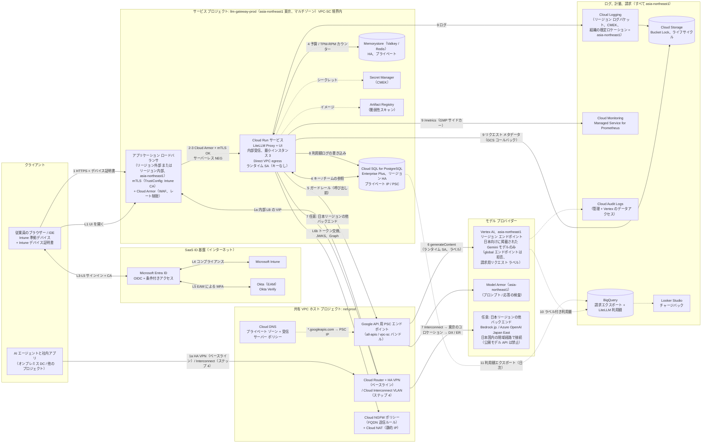

# 6. ステップ 2c: GCP 設計

> **名称に関する注記:** Google のドキュメントでは現在、Vertex AI のモデル機能とエージェント機能が **Gemini Enterprise Agent Platform** という名称で紹介されている（[モデルの概要](https://cloud.google.com/gemini-enterprise-agent-platform/models)）。本書では、API（`aiplatform.googleapis.com`）と LiteLLM の `vertex_ai/` プロバイダー プレフィックスが変わっていないため「Vertex AI」の名称を使う。実装前に名称とエンドポイントを再確認すること。

**ベースライン:** Google Cloud のセキュリティ基盤（共有 VPC、VPC Service Controls、Private Service Connect）を基に、**Cloud Armor と mTLS 付きの Google Cloud アプリケーション ロードバランサ** の背後に **Cloud Run 上の LiteLLM** を置く。Apigee は任意（[§3.3](02-reference-architectures.md#33-google-cloud)）。プライマリ リージョンは **東京（`asia-northeast1`）**、ゲートウェイ インフラの DR リージョンは **大阪（`asia-northeast2`）** とする。[§2.5](01-common-design.md#25-日本国内データ所在全設計に適用) の日本国内所在ルールを全体に適用する。ステップ 4（[§8.4](07-private-connectivity.md#84-gcp-cloud-interconnect-オーバーレイ)）では Cloud Interconnect のオーバーレイを追加する。

## 6.1 アーキテクチャ図（GCP）

## 6.2 コンポーネント表（GCP）

| # | GCP サービス | 役割 | AWS の相当サービス | Azure の相当サービス |
|---|---|---|---|---|
| 1 | [Cloud Load Balancing: アプリケーション LB](https://cloud.google.com/load-balancing/docs/application-load-balancer)。**リージョン** 外部モードとリージョン内部モードのみを使い、[mTLS](https://cloud.google.com/load-balancing/docs/mtls)（すべてのアプリケーション LB で対応）を構成する | `asia-northeast1` での L7 受信、TrustConfig（Intune CA）によるクライアント証明書の検証 | ALB（mTLS） | App Gateway（mTLS） |
| 2 | [Cloud Armor](https://cloud.google.com/armor/docs/cloud-armor-overview) | WAF（事前構成済み OWASP ルール）、レート制限、地域/IP ルール、Adaptive Protection | AWS WAF + Shield | App Gateway WAF |
| 3 | [Cloud Run](https://cloud.google.com/run/docs/overview/what-is-cloud-run)（[受信制御](https://cloud.google.com/run/docs/securing/ingress)、[Direct VPC egress](https://cloud.google.com/run/docs/configuring/vpc-direct-vpc)）。代替: [GKE Autopilot](https://cloud.google.com/kubernetes-engine/docs/concepts/autopilot-overview) | LiteLLM Proxy + UI | ECS Fargate / EKS | Container Apps / AKS |
| 4 | [Cloud SQL for PostgreSQL](https://cloud.google.com/sql/docs/postgres)（[HA](https://cloud.google.com/sql/docs/postgres/high-availability)）。代替: AlloyDB | LiteLLM DB | Aurora PostgreSQL | PostgreSQL Flexible Server |
| 5 | [Memorystore for Valkey](https://cloud.google.com/memorystore/docs/valkey) / [Redis](https://cloud.google.com/memorystore/docs/redis) | レート制限と予算のカウンター、キャッシュ | ElastiCache | Azure Managed Redis |
| 6 | `asia-northeast1` リージョン エンドポイントの [Vertex AI の生成 AI（ドキュメントは現在 *Gemini Enterprise Agent Platform* の名称）](https://cloud.google.com/gemini-enterprise-agent-platform/models) | Google が日本国内での ML 処理を掲載している Gemini モデルと埋め込みモデルのみ（[データ所在地](https://docs.cloud.google.com/vertex-ai/generative-ai/docs/learn/data-residency)）。Vertex 上の Claude などのパートナー モデルには日本国内処理の選択肢がないため使わない。 | Bedrock `jp.` プロファイル | Azure OpenAI Standard（Japan East） |
| 7 | `asia-northeast1` の [Model Armor](https://cloud.google.com/model-armor/overview)（[ロケーション](https://docs.cloud.google.com/model-armor/locations)） | プロンプト インジェクション、ジェイルブレイク、機密データ（SDP）、悪意のある URL の検査 | VPC 内ガードレール サービス | Content Safety / Prompt Shields |
| 8 | [Google API 用 Private Service Connect](https://cloud.google.com/vpc/docs/private-service-connect) | `*.googleapis.com`（Vertex AI、Secret Manager、GCS、Logging）用のプライベート VIP | VPC インターフェイス エンドポイント | プライベート エンドポイント |
| 9 | [VPC Service Controls](https://cloud.google.com/vpc-service-controls/docs/overview) | Vertex AI、GCS、BigQuery、Secret Manager、Cloud SQL の API を囲むデータ流出防止の境界 | （SCP + エンドポイント ポリシー） | （プライベート エンドポイント + Azure Policy、NSP） |
| 10 | [共有 VPC](https://cloud.google.com/vpc/docs/shared-vpc) + [Cloud Router](https://cloud.google.com/network-connectivity/docs/router/concepts/overview) + [HA VPN](https://cloud.google.com/network-connectivity/docs/vpn/concepts/overview) / [Cloud Interconnect](https://cloud.google.com/network-connectivity/docs/interconnect/concepts/overview) | ハイブリッド ルーティング | TGW + VPN / DX | vWAN/ハブ + VPN/ER |
| 11 | [Cloud DNS](https://cloud.google.com/dns/docs/overview)（[受信サーバー ポリシー](https://cloud.google.com/dns/docs/server-policies-overview)） | オンプレミスからのプライベート ゾーンと PSC の名前解決 | Route 53 Resolver | DNS Private Resolver |
| 12 | [Cloud NGFW](https://cloud.google.com/firewall/docs/about-firewalls)（[FQDN オブジェクト](https://cloud.google.com/firewall/docs/fqdn-objects-overview)）+ [Cloud NAT](https://cloud.google.com/nat/docs/overview)。代替: [Secure Web Proxy](https://cloud.google.com/secure-web-proxy/docs/overview) | 送信の許可リストと静的な送信 IP | Network Firewall + NAT | Azure Firewall |
| 13 | [Secret Manager](https://cloud.google.com/secret-manager/docs/overview) + [Cloud KMS / CMEK](https://cloud.google.com/kms/docs/cmek) | シークレットとキー | Secrets Manager + KMS | Key Vault |
| 14 | [Artifact Registry](https://cloud.google.com/artifact-registry/docs/overview) | イメージ、脆弱性スキャン | ECR | ACR |
| 15 | [リージョン化したログバケット](https://docs.cloud.google.com/logging/docs/regionalized-logs) を使う [Cloud Logging](https://cloud.google.com/logging/docs/overview)、[Cloud Monitoring / Managed Service for Prometheus](https://cloud.google.com/stackdriver/docs/managed-prometheus)（[Cloud Run サイドカー](https://cloud.google.com/stackdriver/docs/managed-prometheus/cloudrun-sidecar)） | ログとメトリクス。保存先は `asia-northeast1` | CloudWatch / AMP | Azure Monitor |
| 16 | [Cloud Audit Logs](https://cloud.google.com/logging/docs/audit) | 管理アクティビティ + データアクセス ログ（Vertex AI で有効化） | CloudTrail | アクティビティ ログ |
| 17 | [BigQuery への Cloud Billing エクスポート](https://cloud.google.com/billing/docs/how-to/export-data-bigquery) + [Vertex AI リクエスト ラベル](https://cloud.google.com/vertex-ai/generative-ai/docs/multimodal/add-labels-to-api-calls) + [予算](https://cloud.google.com/billing/docs/how-to/budgets) | リクエスト単位のラベル粒度を持つ請求の正 | CUR + 推論プロファイル | Cost Management |
| 18 | [Workforce Identity Federation（Entra）](https://cloud.google.com/iam/docs/workforce-sign-in-microsoft-entra-id) | Entra による運用者のコンソール/CLI SSO | IAM Identity Center | （ネイティブ） |
| 19 | （任意）[Chrome Enterprise Premium + Intune コネクタ](https://cloud.google.com/chrome-enterprise-premium/docs/intune-overview) と [IAP](https://cloud.google.com/iap/docs/concepts-overview) | Intune のコンプライアンス シグナルを使った、管理 UI へのコンテキストアウェア アクセス | Verified Access（Intune 非対応） | Entra Private Access |
| 20 | [Certificate Authority Service](https://cloud.google.com/certificate-authority-service/docs/ca-service-overview) | ワークロード mTLS 証明書 | AWS Private CA | Key Vault 証明書 / パートナー CA |
| 21 | [組織ポリシー: リソース ロケーション](https://docs.cloud.google.com/organization-policy/restrict-locations) + [ログの既定の設定](https://docs.cloud.google.com/logging/docs/default-settings) | 所在要件のガードレール: `asia-northeast1`/`asia-northeast2` のみとし、新しいログバケットを日本国内に作成させる | SCP | Azure Policy |

## 6.3 リクエスト フローの説明（GCP）

**ログイン（L1〜L7）は [§2.2](01-common-design.md#22-共通ログイン-フローシーケンス) のとおり。** ここでの LiteLLM はクラウドに依存せず、同じ Entra OIDC アプリを使う。L6b と Graph の呼び出しは Cloud NAT から送信され、Cloud NGFW の FQDN ルールで `login.microsoftonline.com` と `graph.microsoft.com` を許可する。

**API リクエスト:**

1. **クライアント → LB。** インターネット上のユーザーは `asia-northeast1` の **リージョン外部アプリケーション LB** にアクセスする。*グローバル* 外部アプリケーション LB は使わない。Google のエッジのフロントエンドで TLS を終端し（[アプリケーション LB の概要](https://cloud.google.com/load-balancing/docs/application-load-balancer)）、そのフロントエンドは日本国内に限られないため、プロンプトが日本国外で復号されるおそれがある。オンプレミスのユーザーとエージェントは、HA VPN（ベースライン）または Interconnect（ステップ 4）経由で **リージョン内部アプリケーション LB** の VIP にアクセスする。いずれもデバイス証明書またはワークロード証明書を提示する。
2. **Cloud Armor** が事前構成済みの WAF ルール（SQLi、XSS、LFI/RFI）、クライアントごとのレート制限（`rate_based_ban`）、地域/IP ルールを適用する。
3. **mTLS。** LB は Intune CA を含む **TrustConfig** でクライアント証明書を検証し（[LB の mTLS](https://cloud.google.com/load-balancing/docs/mtls)）、サーバーレス NEG 経由で **Cloud Run** に転送する。Cloud Run の受信設定は *内部と Cloud Load Balancing* にして、サービスに直接アクセスできないようにする。
4. **LiteLLM の認証・認可。** 他のクラウドと同じ。Cloud Run は **Direct VPC egress** で Memorystore と Cloud SQL のプライベート IP に接続する。Cloud SQL へは Cloud SQL Auth Proxy サイドカーか、TLS 付きのプライベート IP で接続する。
5. **ガードレール。** LiteLLM の **Model Armor** ガードレールが PSC エンドポイント経由で呼び出し前と呼び出し後に実行される（[LiteLLM の Model Armor](https://docs.litellm.ai/docs/proxy/guardrails/model_armor)）。
6. **ネイティブ モデル。** LiteLLM は **VPC-SC 境界** の内側で **Google API 用 PSC** 経由で Vertex AI（`vertex_ai/gemini-*`、`vertex_location: asia-northeast1`）を呼び出す。所在表で日本向けに掲載されているモデルだけを設定する。Vertex 上の Claude には日本国内処理の選択肢がないため、`vertex_ai/claude-*` は使わない。認証は ADC による Cloud Run の **ランタイム サービス アカウント** で行い、キーは使わない。**リクエスト ラベル**（`team`、`cost_center`、`project`）を付与することで、Gemini（`generateContent`）の利用量がラベル別に請求エクスポートに表示される。ラベルが転送されるのは **従量課金（PayGo）** の場合のみで、プロビジョニング スループットでは無視される。使用中の LiteLLM バージョンがリクエスト メタデータから Vertex の `labels` を転送するかを確認すること。転送しない場合は、LiteLLM の呼び出し前フックかチームごとのモデル エイリアスでラベルを付与する。
7. **日本リージョンの他バックエンド（任意）。** 公開モデル API は禁止する [A-7]。Claude（Bedrock `jp.`）や OpenAI（Azure OpenAI Japan East）には、Interconnect → 東京のコロケーション施設のルーター → Direct Connect または ExpressRoute の経路で接続する（[§8.4](07-private-connectivity.md#84-gcp-cloud-interconnect-オーバーレイ)）。Cloud NGFW の送信ルールでインターネットへは Entra と Graph だけを許可し、Cloud NAT を経由させる。
8. **計量。** 利用額ログ行を Cloud SQL に書き込み、Memorystore のカウンターを更新する。
9. **可観測性。** コンテナー ログは Cloud Logging に送られる。Prometheus メトリクスは Cloud Run サイドカー経由で Managed Service for Prometheus に送られる。LiteLLM の **GCS バケット コールバック** がリクエスト メタデータを Cloud Storage に書き込む（[LiteLLM のログ](https://docs.litellm.ai/docs/proxy/logging)）。
10. **請求。** Cloud Billing の **BigQuery への詳細エクスポート** に、チームごとのラベル付きで Vertex の利用量が出力される。
11. **チャージバック。** LiteLLM の利用額を日次で BigQuery にエクスポートし、ラベルと日付で請求エクスポートと結合する。結果は Looker Studio のダッシュボードで示す。モデル サービスについてリクエスト単位の請求ラベルがネイティブに存在するのは **GCP だけ** なので、Vertex の突合が最も正確になる。

## 6.4 ID とアクセス（GCP）

| 項目 | 設計 |
|---|---|
| LiteLLM UI への SSO | Entra OIDC アプリ（他のクラウドと同じ）。任意の追加層として、UI バックエンドに **IAP** を置き、Entra との **Workforce Identity Federation**（[WIF を使った IAP](https://cloud.google.com/iap/docs/use-workforce-identity-federation)）と **Chrome Enterprise Premium の Intune** アクセスレベル（[Intune アクセスレベルの作成](https://cloud.google.com/chrome-enterprise-premium/docs/create-access-levels-intune)）を使う。API クライアントは IAP トークンを簡単に取得できないため、API 経路には IAP を置かない。 |
| API 認証 | LiteLLM で検証する Entra JWT。GCP 上で動くエージェントは逆方向の **Workload Identity Federation** を使う。Entra のフェデレーション資格情報が Google のサービス アカウント トークンを信頼することで、GCP のワークロードが `api://litellm-prod` の Entra トークンを取得できる。 |
| グループとロールの対応付け | 他のクラウドと同じ（Entra アプリ ロール、チーム同期、SCIM）。 |
| Intune コンプライアンス | サインイン時の Entra CA（CA-GW-01）と、Intune デバイス証明書による LB の mTLS。任意で、IAP で保護した UI パスに Chrome Enterprise Premium の Intune シグナルを使う（CEP ライセンスが必要）。 |
| サービス間認証 | 専用の Cloud Run ランタイム SA に `roles/aiplatform.user`、`roles/modelarmor.user`、`roles/secretmanager.secretAccessor`、`roles/cloudsql.client` を付与する。SA キーは使わず、組織ポリシー `iam.disableServiceAccountKeyCreation` で強制する。Auth Proxy（`--auto-iam-authn`）を使えば Cloud SQL の **IAM データベース認証** も可能である。 |
| 運用者 | Entra との Workforce Identity Federation。フォルダまたはプロジェクト レベルで Entra グループ → IAM ロールをバインドする。 |

## 6.5 コスト配賦とトークン制御（GCP）

| 制御 | LiteLLM 層 | GCP 層 |
|---|---|---|
| 部門別チャージバック | LiteLLM 組織または `dept:` タグ | Vertex の **リクエスト ラベル** `cost_center=<code>` → 請求エクスポート（従量課金のみ）。インフラ費用にはゲートウェイ プロジェクトのプロジェクト ラベル。 |
| チーム / プロジェクト | チーム予算、タグ | ラベル `team=<id>`、`project=<id>`。ラベルのカーディナリティは低く抑え、リクエスト ID やユーザー ID をラベルに入れてはならない。 |
| ユーザー単位 | LiteLLM のユーザー利用額（唯一の情報源。請求ラベルにユーザー ID を入れるべきではない） | 該当なし |
| トークン制御 | TPM/RPM、予算、モデル アクセス グループ | モデル・リージョンごとの Vertex AI **クォータ**、必要に応じてプロビジョニング スループット。Apigee を使う場合は任意で Apigee の `LLMTokenQuota`。 |
| アラート | LiteLLM のアラート、Prometheus アラート | [Cloud Billing の予算](https://cloud.google.com/billing/docs/how-to/budgets) → Pub/Sub → 通知。予算はラベルで絞り込める。 |
| レポート | LiteLLM の UI と API | BigQuery（請求エクスポート + LiteLLM 利用額）→ Looker Studio |

## 6.6 ネットワーク（GCP）

- **プロジェクト:** `net-prod`（共有 VPC ホスト: Cloud Router、VPN/Interconnect アタッチメント、Cloud DNS、PSC エンドポイント、ファイアウォール ポリシー、Cloud NAT）と `llm-gateway-prod`（サービス プロジェクト: Cloud Run、Cloud SQL、Memorystore、LB、Secret Manager）。後者は、BigQuery とログ用 GCS のプロジェクトも含む **VPC-SC 境界** の内側に置く。
- **サブネット（`asia-northeast1`。DR 用に `asia-northeast2` にも同じ構成を置く）:** Direct VPC egress 用の `snet-run`（/24）、リージョン内部/外部 LB のプロキシ用の `snet-proxy-only`（/23）、Cloud SQL と Memorystore 用の PSA 範囲（/20）、またはそれらのサービスへの PSC ベースの接続。
- **Google API 用 PSC:** `all-apis` バンドル用、または VPC-SC 対応 API に限定する `vpc-sc` 用のグローバル内部 IP（例: `10.80.255.10`）。`googleapis.com`（と `REGION-aiplatform.googleapis.com`）の Cloud DNS プライベート ゾーンで PSC の IP に対応付ける。オンプレミスのリゾルバーは、これらのゾーンを Cloud DNS の **受信サーバー ポリシー** の IP にフォワードする（[オンプレミスからの Vertex PSC](https://cloud.google.com/vertex-ai/docs/general/vertex-psc-gen-ai)）。
- **ファイアウォール:** 階層型ファイアウォール ポリシー。Cloud Run への受信は LB 経由なので、`snet-run` への受信ルールは不要である。`snet-run` からの送信は、PSA 範囲、PSC の IP、日本リージョンの他バックエンド用のオンプレミス／コロケーションの範囲、Entra と Graph の FQDN オブジェクトだけを許可する。公開モデル プロバイダーは一切許可しない。それ以外は拒否してログに記録する。
- **受信経路:** `asia-northeast1` のリージョン外部 ALB（インターネット、ゼロトラスト）とリージョン内部 ALB（VPN/Interconnect）。閉域専用の構成では外部 LB を削除する。

## 6.7 データとログ（GCP）

| データ | 保存先 | 保護 | 保持期間 |
|---|---|---|---|
| LiteLLM DB | `asia-northeast1` の Cloud SQL PostgreSQL Enterprise Plus、リージョン HA、CMEK、PITR | プライベート IP のみ、IAM DB 認証、SSL 必須 | PITR 7〜35 日。DR 用に `asia-northeast2` のクロスリージョン リードレプリカ |
| 利用額ログ | Cloud SQL → 日次で `asia-northeast1` の BigQuery データセット（パーティション分割）にエクスポート | 同上 | SQL で 90 日ホット、BigQuery/GCS で 7 年 [前提] |
| カウンター/キャッシュ | Memorystore（転送時暗号化、AUTH/IAM） | プライベート | 一時的 |
| リクエスト メタデータ | LiteLLM GCS コールバック → Cloud Storage（Bucket Lock）→ BigQuery 外部テーブル | CMEK、VPC-SC | Standard で 1 年、その後 7 年まで Archive クラス |
| プロンプト/応答の内容（オプトイン） | 別バケット、または特定モデル向けの Vertex AI のリクエスト・レスポンス ロギング → BigQuery | 別の CMEK キー、SDP（DLP）によるスキャン | ポリシーによる |
| 管理監査 | LiteLLM 監査ログ → Cloud Logging。Cloud Audit Logs（`aiplatform.googleapis.com` の **データアクセス** を有効化）→ `asia-northeast1` のロックしたログバケットと SIEM。`_Required` バケットが組織の既定ロケーションに従うのは、プロジェクト作成前にその設定をしていた場合だけである（[ログのリージョン化](https://docs.cloud.google.com/logging/docs/regionalized-logs)）。 | ロックしたログバケット | 7 年 |

## 6.8 セキュリティ制御（GCP）

- **WAF:** 感度レベル 1〜2 の Cloud Armor 事前構成済み WAF ルール（LLM のペイロードにはコードや SQL に似たテキストが多く誤検知が起きやすいため調整する）、レート制限、Adaptive Protection、管理パスへのより厳格なポリシー。
- **mTLS:** TrustConfig（Intune CA とワークロード用の CAS）を使った LB の mTLS。クライアント検証モードは `REJECT_INVALID`。
- **データ流出の制御:** VPC-SC 境界。Vertex AI、GCS、BigQuery、Secret Manager には境界内からのみアクセスできる。
- **シークレットとキー:** CMEK 付きの Secret Manager、Cloud KMS のキー ローテーション。
- **ガードレール / PII:** 外部モデルを含む **すべての** モデルに LiteLLM が Model Armor テンプレート（プロンプト インジェクション、ジェイルブレイク、SDP による検査/匿名化、悪意のある URL）を適用する。Gemini には Vertex の安全フィルターも適用される。Presidio は任意。
- **ポスチャ:** Security Command Center（ライセンスがあれば AI Protection を含む）、Cloud Run 向けの Binary Authorization、Artifact Analysis によるスキャン、組織ポリシー（外部 IP なし、SA キーなし、リソース ロケーションを `asia-northeast1`/`asia-northeast2` に制限）。
- **所在要件:** Vertex の `global` エンドポイントへの呼び出しは所在要件の違反インシデントとして扱う。`aiplatform.googleapis.com` の監査ログでロケーションが `asia-northeast1` 以外のエントリがあればアラートを出す。ログのクエリ結果を `global` に保存するツール（Gemini Cloud Assist など）は、これらのプロジェクトで有効にしない（[ログのリージョン化](https://docs.cloud.google.com/logging/docs/regionalized-logs)）。

## 6.9 スケーラビリティと HA（GCP）

- **コンピューティング:** Cloud Run の最小インスタンスを 3 以上にする（コールド スタートを避け、Redis の接続プールを保つ）。利用額ログのバッチ処理や予算リセットなどのバックグラウンド処理のため、インスタンス ベースの課金（「CPU を常に割り当てる」）を使う。同時実行数はインスタンスあたり約 50〜80、長時間のストリーム用にリクエスト タイムアウトは 60 分とする。サイドカー、Presidio、GKE Inference Gateway 上のセルフホスト モデルが必要なら **GKE Autopilot** が代替となる。
- **データ:** 別ゾーンに同期スタンバイを持つ Cloud SQL のリージョン HA。別ゾーンにレプリカを持つ Memorystore の HA。
- **モデル:** `asia-northeast1` のみ。Google は大阪でのリージョン内 ML 処理を掲載していないため、**Vertex には日本国内のモデル DR がない**。LiteLLM のフォールバック先は閉域経路の Bedrock `jp.` または Azure OpenAI Japan East とし、`global` エンドポイントや他のリージョンには決してフォールバックしない。
- **DR:** 同じ Terraform からデプロイする `asia-northeast2` の Cloud Run。Cloud SQL のクロスリージョン レプリカの昇格。リージョンごとにリージョン LB を置き、クライアントは DNS でフェイルオーバーする（グローバル LB の自動フェイルオーバーの代わり）。RTO は 15〜45 分。Model Armor は `asia-northeast2` では提供されていないため、DR ゲートウェイは東京の Model Armor を呼び出し、東京が停止している場合は Presidio にフォールバックする。

---

[← 前へ: ステップ 2b: Azure](04-azure.md) · [目次](../../README.md) · [次へ →: ステップ 3: 比較](06-comparison.md)
