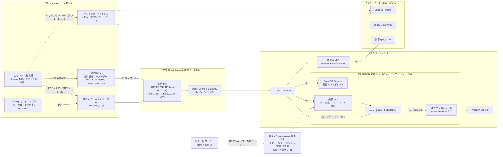
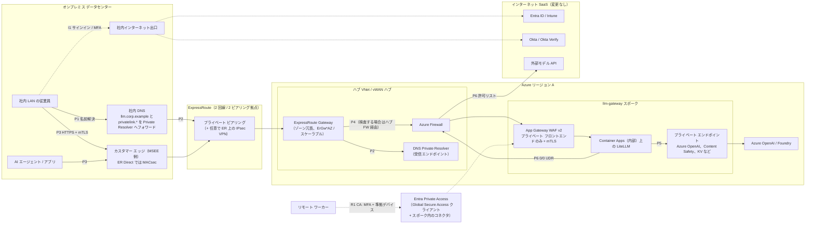
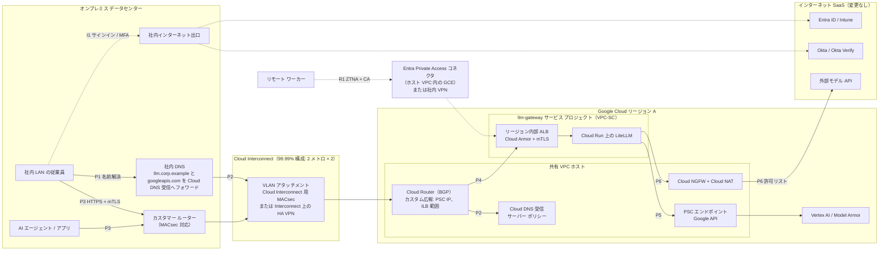
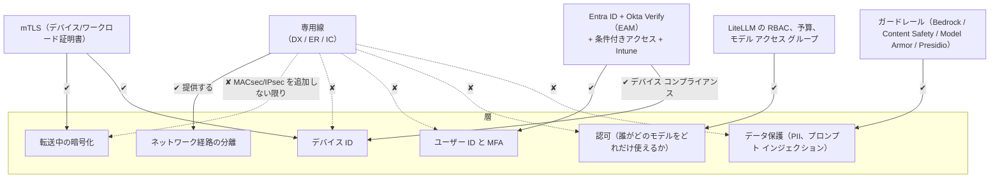
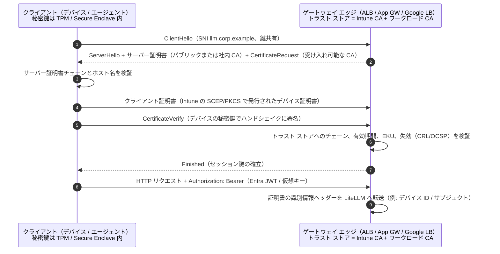

# 8. ステップ 4: 閉域接続（専用線）オプション

**提案内容:** 経営層は、ゲートウェイと AI エージェントのトラフィックを、他の社内トラフィックと同じく既設の ExpressRoute、Direct Connect、Cloud Interconnect 回線に載せることを求めている。これは、サイト間 VPN、mTLS、Intune デバイス ID で保護したインターネット経由のアクセスを置き換えるものである。

**結論:** 実施すべきだが、**置き換えではなく追加の層として** 実施する。専用線をオンプレミスのユーザーとエージェントの *既定の経路* とし、可能な範囲でゲートウェイを *内部専用* にする。ステップ 2 の設計にある ID、デバイス、暗号化の制御はすべて維持する。

## 8.1 全設計に共通する変更点

| 要素 | ステップ 2 のベースライン（インターネット ゼロトラスト） | ステップ 4 の閉域オプション |
|---|---|---|
| ゲートウェイの受信 | パブリック LB + WAF + mTLS、および VPN 経由のプライベート フロントエンド | **内部 LB のみ**（内部 ALB / App Gateway のプライベート フロントエンド / リージョン内部 ALB）。パブリック リスナーは削除するか、リモート ワーカー向け ZTNA コネクタ用にのみ残す。 |
| オンプレミス → クラウドの経路 | インターネット経由のサイト間 IPsec VPN | DX / ER / Interconnect の閉域ルーティング（BGP）。任意で **MACsec** または **回線上の IPsec** を追加 |
| DNS | `llm.corp.example` のパブリック DNS | スプリット ホライズン: オンプレミスのリゾルバーが `llm.corp.example` とクラウドの Private Link ゾーンをクラウドの受信リゾルバーにフォワードする |
| モデル エンドポイント | ゲートウェイ VPC からのプライベート エンドポイント（すでに閉域） | 変更なし。ゲートウェイは引き続き PrivateLink、プライベート エンドポイント、PSC 経由でモデルを呼び出す。オンプレミスのクライアントはモデルを直接呼び出さないため、すべての利用が計量される。 |
| Entra / Okta / Intune | インターネット（SaaS） | **引き続きインターネット（SaaS）。** 変更なし。8.5 を参照。 |
| 外部モデル プロバイダー | クラウドの送信ファイアウォール → インターネット | 変更なし: クラウドの送信ファイアウォール → インターネット。オンプレミスのインターネット出口へ折り返すことも可能だが推奨しない。 |
| リモート ワーカー | インターネット → パブリックの WAF/mTLS エッジ | ZTNA（Entra Private Access）または社内 VPN → DC → 専用線。8.6 を参照。 |

## 8.2 AWS: Direct Connect オーバーレイ

**考慮事項（AWS）:**

| 項目 | 内容 |
|---|---|
| DX が保護するもの / しないもの | DX はインターネットにルーティングされない閉域回線である。既定ではトラフィックを **暗号化せず**、ユーザーやデバイスを **認証しない**。暗号化の選択肢は、[専用接続での MACsec](https://docs.aws.amazon.com/directconnect/latest/UserGuide/MACsec.html)（対応拠点で 10/100/400 Gbps）または TGW で終端する [Direct Connect 上の Private IP VPN](https://docs.aws.amazon.com/vpn/latest/s2svpn/private-ip-dx.html) である。いずれにしても TLS 1.2 以上と mTLS をエンドツーエンドで維持する。 |
| PaaS/モデル エンドポイントへの閉域ルーティング | DX トランジット VIF → DX Gateway → TGW → ゲートウェイ VPC。Bedrock には **LiteLLM** だけが [インターフェイス VPC エンドポイント](https://docs.aws.amazon.com/bedrock/latest/userguide/vpc-interface-endpoints.html) 経由でアクセスする。オンプレミスのクライアントは Bedrock の DNS を必要としない。オンプレミスの DNS は `llm.corp.example`（Route 53 プライベート ホストゾーン）を [Route 53 Resolver の受信エンドポイント](https://docs.aws.amazon.com/Route53/latest/DeveloperGuide/resolver-forwarding-inbound-queries.html) にフォワードする。**パブリック VIF** は避ける。AWS のパブリック エンドポイントに到達できるが、VPC エンドポイント ポリシーを迂回してしまう。 |
| 引き続きインターネットを使うトラフィック | (a) ユーザーのデバイスから社内インターネット出口を経由する、Entra ID、Okta へのサインインと MFA、Okta Verify のプッシュ。(b) Network Firewall を経由する LiteLLM → Entra のトークン エンドポイント、JWKS、Graph。(c) FQDN 許可リスト付きの Network Firewall を経由する LiteLLM → 外部モデル プロバイダー。IP 許可リストに対応するプロバイダーには固定の NAT EIP を登録する。 |
| リモート / ハイブリッド ワーカー | DX の経路上にはいない。選択肢は、VPC 内にコネクタを置く **Entra Private Access**（アプリごとに CA + 準拠デバイス）、既存の社内 VPN で DC に入ってから DX を通る方式（折り返しによるレイテンシ）、またはリモート ユーザー専用にステップ 2 のパブリック mTLS エッジを残す方式である。Entra SAML 付きの [AWS Client VPN](https://docs.aws.amazon.com/vpn/latest/clientvpn-admin/what-is.html) も使えるが、Intune コンプライアンスは評価しない。 |
| 帯域、レイテンシ、冗長性、コスト | LLM トラフィックは低帯域（テキスト）だが、長時間のストリーミング接続が多い。モデルの推論時間（秒単位）が支配的で、DX のレイテンシ上の利点（ミリ秒単位）は相対的に小さい。99.99% には [最大回復性モデル](https://docs.aws.amazon.com/directconnect/latest/UserGuide/resiliency_toolkit.html)（2 拠点 × 2 接続）を使う。回線が既設なら追加費用は小さい。DX のデータ送信料、TGW のアタッチメントと処理料、Resolver エンドポイント、更新する場合は MACsec 対応ポートである。 |
| 運用の複雑さ / 障害パターン | BGP の経路撤回や経路漏洩、DX と VPN バックアップ間の非対称ルーティング、**DNS フォワーディングの障害**（クライアントがパブリック DNS にフォールバックしてクローズド フェイルする。これは望ましい挙動）、DX 上の IPsec での MTU 問題、ゲートウェイを他のスポークに公開してしまう TGW ルート テーブルの誤り、MACsec キー（CKN/CAK）のローテーション。DX の CloudWatch メトリクス、TGW フロー ログ、オンプレミスからの合成監視で監視する。 |

## 8.3 Azure: ExpressRoute オーバーレイ

**考慮事項（Azure）:**

| 項目 | 内容 |
|---|---|
| ER が保護するもの / しないもの | ER プライベート ピアリングは接続プロバイダーを経由する閉域の L3 接続である。既定では **暗号化されず**、ユーザーやデバイスも識別しない。暗号化の選択肢は、[ExpressRoute Direct での MACsec](https://learn.microsoft.com/azure/expressroute/expressroute-howto-macsec)（ポート ペアのみ。プロバイダー回線は対象外）または [ExpressRoute プライベート ピアリング上のサイト間 VPN](https://learn.microsoft.com/azure/vpn-gateway/site-to-site-vpn-private-peering) である。 |
| PaaS/モデル エンドポイントへの閉域ルーティング | **プライベート ピアリング上のプライベート エンドポイント** を使う。PaaS のパブリック エンドポイントへの到達に Microsoft ピアリングは使わない。ルーティングが複雑になり、プライベート エンドポイントの制御を迂回するためである。オンプレミスの DNS は、使用するすべての `privatelink.*` ゾーンを **DNS Private Resolver の受信エンドポイント** に条件付きフォワードする必要がある（[プライベート エンドポイントのオンプレミス DNS](https://learn.microsoft.com/azure/private-link/private-endpoint-dns-integration)）。ゾーンの漏れが最もよくある障害である。 |
| 引き続きインターネットを使うトラフィック | デバイスからの Entra ID、Okta、Intune へのサインインとチェックイン。Microsoft は M365 と Entra のトラフィックの大半にインターネットを推奨しており、M365 向けの ER Microsoft ピアリングには承認が必要である（[Microsoft 365 向け ExpressRoute](https://learn.microsoft.com/microsoft-365/enterprise/azure-expressroute)）。LiteLLM → Entra のトークンと Graph、および外部モデル プロバイダーへの通信は Azure Firewall を経由する。 |
| リモート / ハイブリッド ワーカー | **Entra Private Access**（Global Secure Access クライアント）が最も自然な選択である。同じ CA ポリシーで準拠デバイスを必須にでき、コネクタはスポーク内に置いて App Gateway のプライベート フロントエンドを対象にする。DC への折り返しは不要。代替は、Entra 認証付きの Azure VPN Gateway P2S または社内 VPN である。 |
| 帯域、レイテンシ、冗長性、コスト | **ER ゲートウェイの SKU** は総スループットとフロー数で選ぶ。長時間の SSE ストリームが多いと接続数の上限を消費する。[FastPath](https://learn.microsoft.com/azure/expressroute/about-fastpath) はデータ経路でゲートウェイをバイパスするが、Private Link との組み合わせの制限を確認すること。冗長性には 2 つのピアリング拠点に 2 回線を使う（[ER の回復性設計](https://learn.microsoft.com/azure/expressroute/design-architecture-for-resiliency)）。コストは、回線（従量制または無制限）、ゲートウェイの時間課金、プライベート エンドポイントの GB 単位課金、ハブで検査する場合はファイアウォールの処理料である。 |
| 運用の複雑さ / 障害パターン | プライベート DNS ゾーンの乱立と構成ずれ。ハブのファイアウォール検査を追加したときの非対称ルーティング（UDR で双方向をカバーする必要がある）。ER 回線のメンテナンス時間帯。ゲートウェイ SKU の飽和。Key Vault での MACsec CAK/CKN のローテーション。BGP コミュニティやルート フィルターの誤り。Connection Monitor、ER のメトリクス、Sentinel 上の Firewall ログで監視する。 |

## 8.4 GCP: Cloud Interconnect オーバーレイ

**考慮事項（GCP）:**

| 項目 | 内容 |
|---|---|
| Interconnect が保護するもの / しないもの | Dedicated Interconnect と Partner Interconnect は、VPC への閉域の L2/L3 接続を提供する。既定では **暗号化されず**、ユーザーやデバイスの ID も持たない。暗号化の選択肢は、[Cloud Interconnect 用 MACsec](https://cloud.google.com/network-connectivity/docs/interconnect/concepts/macsec-overview) または [Cloud Interconnect 上の HA VPN](https://cloud.google.com/network-connectivity/docs/interconnect/concepts/ha-vpn-interconnect)（IPsec）である。 |
| PaaS/モデル エンドポイントへの閉域ルーティング | オンプレミスのクライアントが到達するのは **内部 ALB** だけである。LiteLLM は **Google API 用 PSC** 経由で Vertex AI と Model Armor にアクセスする。Cloud Router では内部 LB のサブネットを **カスタム広報** する必要がある。オンプレミスのツールが Google API を直接呼び出す場合は PSC の IP も広報する。オンプレミスの DNS は **Cloud DNS の受信サーバー ポリシー** にフォワードする（[オンプレミスからの Vertex PSC](https://cloud.google.com/vertex-ai/docs/general/vertex-psc-gen-ai)、[オンプレミス向けの限定公開の Google アクセス](https://cloud.google.com/vpc/docs/configure-private-google-access-hybrid)）。オンプレミスのツールが Vertex を直接呼び出す場合は、VPC-SC の上り（ingress）ルールでオンプレミスのアクセスレベルを許可する必要がある。トラフィックが常に LiteLLM を経由するなら不要である。 |
| 引き続きインターネットを使うトラフィック | Entra、Okta、Intune（デバイス ↔ SaaS）。LiteLLM → Entra と Graph。Cloud NGFW の FQDN ルールと Cloud NAT の静的 IP を経由する LiteLLM → 外部プロバイダー。 |
| リモート / ハイブリッド ワーカー | ホスト VPC の GCE に置く Entra Private Access コネクタ（CA + 準拠デバイス）、社内 VPN、または Intune シグナルを使う **UI 専用** アクセスとしての Chrome Enterprise Premium + IAP。 |
| 帯域、レイテンシ、冗長性、コスト | [99.99% 構成](https://cloud.google.com/network-connectivity/docs/interconnect/tutorials/dedicated-creating-9999-availability)（4 接続、2 メトロ、2 つの Cloud Router）を使う。VLAN アタッチメントの容量と Cloud Router の経路数の上限に注意する。Interconnect 経由の送信はインターネット送信より安いが、LLM のトラフィック量は小さいため、アタッチメントとポートの固定費が支配的になる。 |
| 運用の複雑さ / 障害パターン | カスタム経路広報の漏れ（最もよくある問題）。オンプレミスと Cloud DNS 間の DNS フォワーディングのループ。403 に見える VPC-SC の拒否。MACsec キーのローテーション。Partner Interconnect のプロバイダー障害。Interconnect のメトリクス、Network Intelligence Center の接続テスト、VPC-SC のドライラン ログで監視する。 |

## 8.5 閉域接続で解決 *できない* こと（全クラウド共通）

経営層に伝えるべき要点:

- **閉域回線は経路であり、ID ではない。** 社内ネットワーク上、またはゲートウェイへルーティングされているいずれかの VPC、VNet、プロジェクト上で侵害されたホストがあれば、ゲートウェイに到達できる。リクエストごとのユーザー、デバイス、ワークロードの認証がなければ、閉域回線は信頼ゾーンを *広げて* しまう。
- **専用回線は既定では暗号化されていない。** ポリシーでリンク暗号化が必要なら、MACsec（ポートの種類が対応している場合）または回線上の IPsec を有効にする。いずれの場合も、ゲートウェイまでエンドツーエンドで TLS 1.2 以上 / 1.3 を維持する。TLS はプロバイダーだけでなく、経路上の内部関係者からも保護するためである。
- **SaaS の ID 基盤はインターネットに残る。** Entra ID、Okta Verify のプッシュ、Intune のチェックインは SaaS である。専用線はこれらを運ばず、専用線の障害はこれらに影響しない。一方、DC の *インターネット* 障害は、回線が正常でもサインインを止めてしまう。社内インターネット出口は冗長化する必要がある。
- **外部モデル プロバイダーはインターネットに残る。** OpenAI や Anthropic API などのプロバイダーには、クラウドの送信ファイアウォールからアクセスする。プロバイダーが自社クラウドで閉域接続を提供している場合（例: プロバイダーの PrivateLink 提供や、Bedrock/Vertex 上の Claude、Azure 上の OpenAI モデルといったクラウド ホスト版）は、そちらを優先する。

## 8.6 リモート ワーカーとハイブリッド ワーカー

| 選択肢 | デバイス信頼 | ユーザー体験 | 推奨 |
|---|---|---|---|
| 各クラウドの VPC/VNet にコネクタを置く **Entra Private Access**（Global Secure Access） | アプリ セグメントごとの Entra CA + Intune コンプライアンス（[Private Access](https://learn.microsoft.com/entra/global-secure-access/concept-private-access)） | 透過的、アプリ単位、フル トンネルなし | **推奨**: どこでも同じポリシー エンジンを使え、3 クラウドすべてで機能する |
| 社内のフル トンネル VPN → DC → 専用線 | VPN のポスチャ チェック（ベンダー依存） | 折り返しによるレイテンシと VPN 容量の計画が必要 | 短期的には許容 |
| リモート ユーザー専用にステップ 2 のパブリック エッジ（WAF + mTLS + CA）を残す | エッジでの Intune デバイス証明書 + CA | 直接接続でレイテンシが最も低い | 許容。リモート ユーザー向けに意図的に残す「インターネット ゼロトラスト」経路である。 |

## 8.7 mTLS の解説

**仕組み（TLS 1.3、簡略版）:**

| | mTLS が保護するもの | mTLS が保護 **しない** もの / 制限 |
|---|---|---|
| **認証** | *相互* 認証: クライアントは信頼された CA が発行した証明書に結び付いた秘密鍵を持っていることを証明し（デバイスまたはワークロードの ID）、サーバーはクライアントに自身の ID を証明する | **ユーザー認証や認可ではない。** 有効なデバイス証明書は、*どのユーザー* か、*どのモデルや予算* を使えるかについては何も示さない。Entra JWT、仮想キー、LiteLLM の RBAC は引き続き必要である。 |
| **暗号化** | クライアントと TLS 終端点の間の転送中の機密性と完全性、前方秘匿性（TLS 1.3） | 保護されるのは **終端点**（LB）までである。LB → バックエンドの区間には別途 TLS が必要。社内の **TLS 検査プロキシ** は mTLS を壊すため、`llm.corp.example` を検査対象から除外する。 |
| **証明書のライフサイクル** | 自動化できる: デバイスには Intune の SCEP/PKCS プロファイル、ワークロードには Private CA / Key Vault / CAS | 発行、更新、CA のローテーションは運用作業になる。期限切れの証明書は障害の原因になるため、有効期限を監視し、自動更新付きで 30〜90 日の有効期間にする。 |
| **失効** | 対応していればエッジで CRL/OCSP をチェックする（ALB は CRL に対応。App Gateway と Google LB の対応状況はリージョンごとに確認） | 失効は反映が遅いか、対応していないことが多い。CRL より短命な証明書のほうが確実である。Intune でコンプライアンスを失っても、自動化しない限り証明書は自動的に失効しない。 |
| **鍵の保護** | TPM や Secure Enclave に結び付いたエクスポート不可の鍵（Intune で TPM KSP を必須にできる） | ソフトウェアに保存された鍵は、管理外のマシンにコピーされうる。 |
| **ヘッダーの信頼** | エッジが証明書の属性を LiteLLM に渡す | バックエンドはこれらのヘッダーを LB からのもの **だけ** 受け入れる必要がある。クライアントが送ってきた同名ヘッダーは除去する。 |

**mTLS と専用線の比較:**

| 特性 | 専用線（DX / ER / IC） | mTLS |
|---|---|---|
| 層 | L1〜L3 の経路 | L4〜L7 のセッション |
| 認証するもの | なし（せいぜい BGP ピア） | 各クライアント デバイスまたはワークロード、およびサーバー |
| 暗号化 | しない（MACsec または IPsec を追加しない限り） | する（TLS 終端点までエンドツーエンド） |
| インターネットへの露出 / DDoS からの保護 | する（パブリック エンドポイントがない） | しない（エンドポイントがパブリックでもよく、WAF/DDoS 対策は引き続き必要） |
| 侵害された内部ホストからの保護 | しない | 部分的にする。攻撃者は有効な証明書と鍵も必要になる。 |
| リモート ワーカーへの対応 | しない（VPN/ZTNA が必要） | する |
| 帯域とレイテンシの確定性、SLA | ある | ない（経由する経路に依存） |
| 主な運用負荷 | 回線、BGP、DNS フォワーディング、プロバイダーの SLA | PKI、証明書のライフサイクル、失効、プロキシの除外設定 |

両者は **補完関係** にある。専用線は *露出* を減らし、mTLS は *暗号学的な ID と暗号化* を提供する。

## 8.8 推奨するゼロトラストの構成（両者の組み合わせ）

| 層 | 制御（全クラウド共通） |
|---|---|
| **ユーザー ID** | UI と API には Entra ID の OIDC/JWT。MFA には **EAM** 経由の Okta Verify（管理者はフィッシング耐性のある方式）。短いトークン有効期間。SCIM によるプロビジョニング解除。 |
| **デバイス** | トークン発行時の **条件付きアクセス** による Intune コンプライアンスの適用 **と**、ゲートウェイのエッジでの **mTLS** による、Intune 発行・TPM 結合の **デバイス証明書** の確認。 |
| **ワークロード** | エージェントは Entra ワークロード ID（フェデレーション資格情報）と **mTLS ワークロード証明書** で認証する。サービス アカウント用の仮想キーは例外としてのみ使い、有効期限、予算、IP 制限を付ける。 |
| **ネットワーク** | オンプレミスのユーザーとエージェントから **内部専用** ゲートウェイへは **専用線を既定** とする。リモート ユーザーには **Entra Private Access**。パブリック エッジは削除するか、WAF + mTLS + CA 付きでのみ残す。モデルにはプライベート エンドポイント経由でのみアクセスする。送信は許可リスト化する。 |
| **転送の暗号化** | LB → LiteLLM → モデルを含め、エンドツーエンドで TLS 1.2 以上（1.3 を推奨）。データ分類でリンク層の暗号化が必要なら、**回線上の MACsec または IPsec**。 |
| **認可と利用量** | 組織、チーム、ユーザー、キーごとの LiteLLM の RBAC、モデル アクセス グループ、予算、TPM/RPM。外側の上限としてクラウドのクォータ。 |
| **データ** | すべてのリクエストにガードレール（PII、プロンプト インジェクション）。既定はメタデータのみのログ記録。CMK による暗号化。不変の監査ログ。 |
| **検知と対応** | Entra のサインイン ログ、WAF、ファイアウォール、LiteLLM の監査と利用額の異常を Sentinel または SIEM で監視する。ユーザーのオフボーディング時やデバイスの非準拠時にキーを自動で失効させる。 |

> **経営層への結論:** ゲートウェイのトラフィックを ExpressRoute、Direct Connect、Interconnect 経由にすることは、露出の削減と予測可能な接続性の点で良い選択である。ただし、ユーザー MFA、デバイス コンプライアンス、mTLS、暗号化の代わりには **ならない**。閉域経路の設計は、ID、デバイス、mTLS の制御の代わりとしてではなく、それらと一緒に承認すること。

---

[← 前へ: ステップ 3: 比較](06-comparison.md) · [目次](../../README.md) · [次へ →: 参照リンク](08-references.md)
