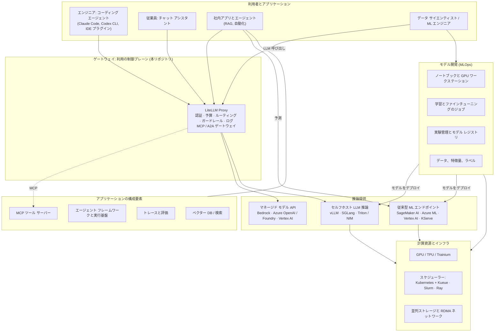

# 10. 付録: AI 運用の全体像（背景解説）

> **対象範囲:** ゲートウェイ設計の一部ではなく、背景知識のための資料である。本リポジトリの他の章は、LLM ゲートウェイという 1 つのコンポーネントを設計している。本章は一歩引いて、企業が AI を導入するときに構築するほかの環境の中にゲートウェイを位置付ける。GPU クラスターや従来型の機械学習のように、LLM と無関係な環境も含む。本章が答える問いは 3 つである。「AI Ops」とは何を指すのか、どのような AI 環境があり誰が使うのか、そのうち LiteLLM が対応できるのはどれか。
>
> **ステータス:** 2026-11-13 に作成した概説資料。§2〜§8 と異なり、本章のベンダー情報（GPU の型番、インスタンス ファミリー、製品名、LiteLLM のエンドポイント一覧）は一般的な知識に基づいて書いており、最新の公式ドキュメントとの再確認は **行っていない**。ハードウェアの世代や製品名は毎年変わる。本章の内容を判断に使う前に、リンク先を確認すること。

---

## 10.1 要約

- **「AIOps」には 2 つの意味がある。** 業界で定着した用語（Gartner の用語）としての AIOps は *IT 運用のための AI*、つまり機械学習でアラートを相関分析し障害を検知することを指す。当社が構築しているのは逆方向の *AI のための運用* である。これを「AIOps」と呼ぶと、ベンダーとの会話や検索で別の製品にたどり着く。「AI プラットフォーム」「LLM ゲートウェイ」「LLMOps」と呼ぶこと（[§10.2](#102-aiops-という言葉の-2-つの意味)）。
- **MLOps と LLMOps は管理する資産が違う。** MLOps は自社で学習させるモデルのライフサイクル（データ、学習、評価、デプロイ、ドリフト監視、再学習）である。LLMOps は、主に借りて使う基盤モデルの上に作るシステムのライフサイクル（プロンプト、モデル選択、検索、ガードレール、評価、トークン コスト）である（[§10.4](#104-mlops-と-llmops-の違い-モデルを学習しなくなると何が変わるか)）。多くの企業はまず LLMOps が必要になり、MLOps が必要になるのは予測モデルやファインチューニング済みモデルを自社で持つ場合に限られる。
- **AI 環境はおよそ 12 種類ある。** 上はコーディング エージェントから下は GPU クラスターまである（[§10.6](#106-ai-環境の一覧と詳細)）。利用者も、コストの単位（トークンか GPU 時間か）も、たいていは担当組織も異なる。
- **LLM ゲートウェイは、モデルの *利用* を制御する。** モデルにプロンプトを送る環境はすべてゲートウェイを通すべきである。一方、ゲートウェイはモデルを *作る* ための基盤ではない。学習、ノートブック、GPU スケジューリング、実験管理、従来型 ML の推論提供は別の基盤が担う。
- **LiteLLM はチャット以外にも対応する**（[§10.8](#108-litellm-の対応範囲)）。埋め込み、リランク、画像、音声、バッチ、マネージド ファインチューニング ジョブ、ベクター ストア、ツール向けの MCP ゲートウェイ、エージェント向けの A2A ゲートウェイ、プロバイダー固有 API へのパススルーがある。いずれも新しいデータ経路であり、それぞれが [§2.5](01-common-design.md#25-日本国内データ所在全設計に適用) の日本国内所在ルールを満たす必要がある。
- **GPU が設計に入ってくるのは、モデルをセルフホストする場合だけである。** 所在要件のため、安定した大量利用でのコストのため、あるいは日本国内で処理できるクラウドがないモデルのためにセルフホストする場合、GPU 推論クラスターは LiteLLM のバックエンドの 1 つになり、そのコストはゲートウェイの予算とタグで配賦する。
- **共通化すべきなのはツールより基盤である。** ゲートウェイ、GPU 基盤、MLOps 基盤のすべてで、同じ ID（Entra ID）、同じコスト配賦タグ、同じ日本国内限定ポリシー、同じログ パイプラインを使う。そうすればトークンの利用額と GPU の利用額を 1 つの AI コスト レポートにまとめられる。

## 10.2 AIOps という言葉の 2 つの意味

| | AIOps: IT 運用 **のための** AI | AI 運用: AI **のための** 運用 |
|---|---|---|
| 方向 | AI が IT の運用を助ける | IT が AI を運用する |
| 由来 | 2010 年代半ばの Gartner の用語 | MLOps、LLMOps、GenAIOps、AgentOps の総称 |
| 主な仕事 | アラートの相関分析、メトリクスとログの異常検知、根本原因の提示、復旧の自動化 | 人とアプリケーションに、統制されたコスト効率のよいモデル利用を提供する。モデルを構築、デプロイ、監視する |
| 製品の例 | Datadog Watchdog、Dynatrace Davis AI、Splunk ITSI、PagerDuty AIOps、BigPanda | LiteLLM などの AI ゲートウェイ、Langfuse、MLflow、SageMaker AI、Azure Machine Learning、Vertex AI、vLLM、Kubeflow |
| 本リポジトリとの関係 | 利用者の 1 つ。社内の SRE エージェントはゲートウェイ経由でモデルを呼び出せる | ゲートウェイはその一部である |

社内文書やベンダーとの会話では、当社が構築しているものを「AIOps」と呼ばないこと。全体は **AI プラットフォーム**、本コンポーネントは **LLM ゲートウェイ**、実践の名前としては **LLMOps / MLOps** を使う。

## 10.3 「Ops」用語の整理

これらの用語は意味が重なっており、ベンダーの使い方も緩い。重要なのは、それぞれがどのライフサイクルを扱うかである。

| 用語 | 運用する対象 | 主な関心事 | 主な担当者 |
|---|---|---|---|
| DevOps | アプリケーション コード | 変更を安全かつ頻繁にリリースする: CI/CD、Infrastructure as Code、監視 | エンジニアリング全体 |
| DataOps | データ パイプライン | データの品質、鮮度、リネージ | データ エンジニア |
| **MLOps** | 自社で学習させるモデル | 再現可能な学習、データとモデルのバージョン管理、デプロイ、ドリフト監視、再学習 | データ サイエンティスト、ML エンジニア |
| **LLMOps**（Microsoft は **GenAIOps** と呼ぶ） | 基盤モデルの上に作るアプリケーション | プロンプト、モデル選択、検索拡張（RAG）、評価、ガードレール、トークン コスト、レイテンシー | アプリケーション エンジニア、プラットフォーム チーム |
| AgentOps | ツールを呼び出して行動するエージェント | ツールの権限（MCP）、複数ステップの実行のトレース、サンドボックス、人による承認、暴走ループとコスト | アプリケーション エンジニア、セキュリティ |
| FinOps for AI | AI の支出 | トークンと GPU のコスト配賦、予算、コミットメント（プロビジョンド スループット、GPU の予約） | 財務、プラットフォーム チーム |
| AIOps | IT 運用（AI を道具として使う） | アラート ノイズ、障害検知、根本原因 | SRE、IT 運用 |
| AI プラットフォーム エンジニアリング | 上記すべての下にある共通基盤 | GPU、スケジューラー、ゲートウェイ、ID、ネットワーク、データ所在 | プラットフォーム／インフラ チーム |

## 10.4 MLOps と LLMOps の違い: モデルを学習しなくなると何が変わるか

| | MLOps（モデルを自社で学習する） | LLMOps（基盤モデルを使う） |
|---|---|---|
| バージョン管理する対象 | 学習データ、学習コード、モデルの重み | プロンプト、モデル ID とバージョン、検索設定、ツール、ガードレール設定 |
| 代表的なモデル | 勾配ブースティング木、需要予測、レコメンド、画像・音声モデル、自社でファインチューニングした LLM | Claude、GPT、Gemini、オープン ウェイト LLM、埋め込みモデル |
| 主なコスト | 学習の GPU／CPU 時間と、推論提供のインフラ | リクエストごとのトークン。セルフホストなら GPU 時間 |
| テストの方法 | 評価用に取り分けたデータでの指標（正解率、AUC、RMSE） | ゴールデン セットによる評価、LLM-as-judge、人によるレビュー、レッド チーミング。出力が自由形式なので、正解が 1 つに決まることは少ない |
| 本番での失敗 | データ ドリフト: 世の中が変わりモデルが古くなる | ハルシネーション、プロンプト インジェクション、データ漏えい、コストの急増、プロバイダーのモデル変更による品質低下 |
| リリースのきっかけ | 新しいデータ、新しいモデル構造 | 新しいモデル バージョン、プロンプトの変更、新しいツール |
| 中心となるツール | ノートブック、学習パイプライン、特徴量ストア、実験管理、モデル レジストリ、推論提供 | ゲートウェイ、プロンプト管理、トレース、評価、ベクター データベース、ガードレール |

要点: **MLOps の資産はモデルそのものであり、LLMOps の資産は借りたモデルの周囲に作るシステムである。** バージョン管理、評価、監視という MLOps の規律はそのまま必要だが、対象はプロンプトと設定になる。また、プロバイダーが新しいバージョンを出すと、足元のモデルが変わりうる。

両者が交わるのが **ファインチューニング** である。ファインチューニングした LLM は MLOps のモデルと同じように学習し（[E7](#1067-e7-モデルの学習とファインチューニング)）、その後はほかの LLM と同じようにゲートウェイの背後で提供・統制する。

## 10.5 AI プラットフォームの階層

図を上から下へ読むと *利用* の流れになる。プロンプトはツールからゲートウェイを通ってモデルに届く。下から上へ読むと *生産* の流れになる。GPU でモデルを学習し、モデルを推論基盤にデプロイし、ゲートウェイがそれを公開する。



| 階層 | 役割 | コストの単位 | 主な担当 |
|---|---|---|---|
| 利用者とアプリケーション | コーディング、チャット、アプリ、エージェント、実験 | 消費したトークン | 各プロダクト チーム |
| ゲートウェイ | すべてのモデル呼び出しを認証、制限、ルーティング、記録する | 小さい: CPU コンテナー、Postgres、Redis | プラットフォーム チーム（本リポジトリ） |
| アプリケーションの構成要素 | 検索、エージェントのオーケストレーション、評価、ツール | コンポーネントごとのストレージと計算資源 | アプリケーション チーム。共通部分はプラットフォーム チーム |
| 推論提供 | 推論リクエストに応答する | トークン（マネージド API）または GPU 時間（セルフホスト） | クラウド事業者。セルフホストならプラットフォーム チーム |
| モデル開発 | 新しいモデルや調整したモデルを作る | GPU 時間、ストレージ | ML チーム |
| 計算資源とインフラ | アクセラレーター、スケジューリング、ストレージ、ネットワークを提供する | GPU 時間、予約、電力 | インフラ チーム |

## 10.6 AI 環境の一覧と詳細

| # | 環境 | 主な利用者 | コストの単位 | LiteLLM の役割 |
|---|---|---|---|---|
| E1 | AI 支援開発（バイブ コーディング） | 全エンジニア | トークン | ✅ 中核 |
| E2 | ナレッジ ワーク向けチャット アシスタント | 全従業員 | トークン、または SaaS のシート | ✅ セルフホストのチャット UI · ❌ SaaS スイート |
| E3 | LLM アプリケーション（RAG、抽出、要約） | アプリケーション チーム | トークンとベクター DB | ✅ モデルと埋め込みの呼び出し |
| E4 | エージェントとエージェント実行基盤 | アプリケーション チーム、運用 | トークンとツール呼び出し | ✅ モデル呼び出し、MCP ゲートウェイ、A2A ゲートウェイ |
| E5 | セルフホストのモデル推論 | プラットフォーム チーム | GPU 時間 | ✅ バックエンドとして |
| E6 | 従来型・予測型の ML | データ サイエンティスト | CPU／GPU 時間 | ❌ |
| E7 | モデルの学習とファインチューニング | ML エンジニア | GPU 時間 | 🟡 マネージド ファインチューニングのジョブのみ |
| E8 | GPU ノートブックとワークステーション | データ サイエンティスト、研究者 | GPU 時間 | 🟡 そこからの LLM 呼び出しのみ |
| E9 | GPU 計算基盤 | インフラ チーム | GPU 時間、電力 | ❌ |
| E10 | マネージド AI サービス（音声、OCR、翻訳、画像認識） | アプリケーション チーム | 分、ページ、呼び出し単位 | 🟡 一部のエンドポイント、またはパススルー |
| E11 | メディア生成（画像、動画、音声） | デザイン、マーケティング、アプリケーション | 画像単位または秒単位 | 🟡 画像生成、一部の動画 |
| E12 | AIOps（IT 運用のための AI） | SRE、IT 運用 | ライセンス | 🟡 社内エージェントのみ |

### 10.6.1 E1: AI 支援開発（バイブ コーディング）

- **概要:** コードベースを読み、コマンドを実行し、変更を書き込むコーディング エージェントと IDE アシスタント。「バイブ コーディング」はその極端な使い方で、エンジニアが意図を伝え、コードの大半をエージェントが書く。本ゲートウェイが存在する主な理由である。
- **ツール:** Claude Code と Codex CLI（当社のサポート対象クライアント、[§2.3.4](01-common-design.md#234-コーディング-エージェントのクライアント)）、Cline、Continue、Roo Code などの IDE プラグイン、GitHub Copilot や Cursor などの商用製品。
- **必要なもの:** フロンティア級の品質のモデル、長いコンテキスト（1 リクエストで 10 万トークンを超えることも多い）、ストリーミング、低レイテンシー、MCP ツール、ユーザーごとの予算、エージェントが実行するコマンドの安全な実行場所。
- **ゲートウェイとの関係:** 中核である。ただし注意点が 1 つある。SaaS のコーディング製品の中には、独自のキーやエンドポイントを設定しても、ベンダー自身のバックエンドを経由してプロンプトを送るものがある。その場合ゲートウェイはその通信を見ることも制御することもできず、[§2.5](01-common-design.md#25-日本国内データ所在全設計に適用) のルール 5 が適用される。承認する前にツールごとに確認すること。
- **ゲートウェイの対象外:** エージェントが書いたコードのレビューと、エージェントが実行するコマンドのサンドボックス化。どちらも引き続き開発プロセスとエンドポイント側の制御である。

### 10.6.2 E2: ナレッジ ワーク向けチャット アシスタント

- **概要:** 全従業員向けの ChatGPT 型アシスタント。文章の下書き、要約、翻訳、文書に関する質問に使う。
- **ツール:** Open WebUI や LibreChat などのセルフホストのチャット UI。Microsoft 365 Copilot、ChatGPT Enterprise、Claude Enterprise、Gemini for Google Workspace などの SaaS スイート。
- **ゲートウェイとの関係:** セルフホストの UI は LiteLLM をモデルのバックエンドとして使う。UI が利用者ごとの ID を渡すようにし、利用額が UI の単一キーではなく個人ごとに配賦されるようにすること（クライアントによる配賦への影響は [§2.4](01-common-design.md#24-litellm-テナント-モデル全クラウド共通) を参照）。SaaS スイートは独自のモデルを呼び出し、ゲートウェイを完全に迂回する。契約とテナント設定で統制し、データの保存場所を所在ルールと照らし合わせること。

### 10.6.3 E3: LLM アプリケーション（RAG と社内アプリ）

- **概要:** LLM を使って製品や社内ツールを作るチーム。社内文書の検索（検索拡張生成、RAG）、帳票からの項目抽出、分類、要約パイプラインなど。
- **構成要素:** 埋め込みモデルとベクター データベース（pgvector、OpenSearch、Azure AI Search、Vertex AI Vector Search、Qdrant）、文書の解析と OCR、リランカー、フレームワーク（LangChain / LangGraph、LlamaIndex、プロバイダーの SDK）、トレースと評価（Langfuse、MLflow、Arize Phoenix、LangSmith）、プロンプト管理。
- **ゲートウェイとの関係:** モデル呼び出し（チャット、埋め込み、リランク、バッチ）には強く対応する。LiteLLM は文書を保存せず、ベクター データベースも動かさないが、プロバイダーが管理するベクター ストアへの中継はできる。ロギング コールバックで、ゲートウェイのトレースを日本国内でホストするトレース ツールに送れる。

### 10.6.4 E4: エージェントとエージェント実行基盤

- **概要:** 計画を立て、ツールを呼び出し、ある程度自律的に行動するソフトウェア。チケット振り分けボット、運用エージェント、データ分析エージェントなど。コーディング エージェント（E1）もその一種である。
- **ツール:** SDK（Claude Agent SDK、OpenAI Agents SDK、LangGraph、Google ADK）、マネージド実行基盤（Amazon Bedrock AgentCore、Azure の Foundry Agent Service、Vertex AI Agent Engine）、プロトコル（**MCP**: エージェント ↔ ツール、**A2A**: エージェント ↔ エージェント）、コード実行用のサンドボックス。
- **必要なもの:** エージェント自身の ID（人のキーではなくワークロード ID）、最小権限のツール、危険な操作の承認ステップ、多数の呼び出しにまたがるトレース、ループ回数と利用額の上限。
- **ゲートウェイとの関係:** モデル呼び出しは、エージェントごとのキーと予算で LiteLLM を通す。LiteLLM の MCP ゲートウェイは MCP ツール サーバーの単一の登録先かつアクセス制御点になり、A2A ゲートウェイはエージェントの前段に立てる。LiteLLM はエージェントやサンドボックスを *実行* しない。

### 10.6.5 E5: セルフホストのモデル推論

- **概要:** 当社が管理する GPU でオープン ウェイト モデルを動かす。例として gpt-oss、Llama、Qwen、Mistral、日本語モデルの LLM-jp、Swallow、PLaMo、Sarashina などがある（ライセンスはモデルごとに異なる）。
- **理由:** 所在要件（日本国内の自社管理インフラで処理する）、エアギャップ環境や厳しく制限されたデータ、GPU のほうがトークンより安くなる安定した大量利用、日本国内で処理できるクラウドがない必須モデル、大規模な埋め込みや分類。
- **ツール:** 推論サーバー: vLLM、SGLang、NVIDIA Triton と TensorRT-LLM、NVIDIA NIM、Hugging Face TGI。Kubernetes 上: KServe、llm-d、Ray Serve。マネージド ホスティング: SageMaker AI エンドポイント、Azure ML オンライン エンドポイント、Vertex AI エンドポイント、Bedrock Custom Model Import。ノート PC 上: Ollama、llama.cpp、LM Studio。
- **トレードオフ:** キャパシティ計画、遊休 GPU のコスト、アップグレード、品質評価を当社が担うことになる。コーディング エージェントはモデルの品質と長いコンテキストに大きく依存するため、E1 では [§2.5](01-common-design.md#25-日本国内データ所在全設計に適用) のマネージド フロンティア モデルが引き続き既定になることが多い。セルフホスト モデルが向くのは、より狭い用途である。
- **ゲートウェイとの関係:** 強く対応する。vLLM、SGLang、Ollama、NIM は OpenAI 互換 API を公開しており、LiteLLM はほかのデプロイと同じようにルーティングできる。LiteLLM は GPU のスケーリング、スケジューリング、監視をせず、GPU のコストも知らないので、カスタム価格を設定すること（[§10.8.5](#1085-セルフホスト-モデルの価格設定)）。

### 10.6.6 E6: 従来型・予測型の ML

- **概要:** 自社データで学習し、数値やラベルを予測するモデル。需要予測、解約予測、不正検知、レコメンド、異常検知、外観検査、自社分野向けに調整した音声認識など。多くの人が MLOps と聞いて思い浮かべるのはこれである。
- **ライフサイクル:** データ収集 → 特徴量作成 → 学習 → 評価 → 登録 → デプロイ → ドリフト監視 → 再学習。
- **ツール:** クラウド基盤: Amazon SageMaker AI、Azure Machine Learning、Vertex AI、Databricks。OSS: MLflow（実験管理とモデル レジストリ）、Kubeflow Pipelines、Feast（特徴量ストア）、Evidently（ドリフト監視）、scikit-learn、XGBoost、PyTorch。
- **ゲートウェイとの関係:** なし。これらのモデルはプロンプトで使うものではなく、アプリケーションが構造化データを入力して呼び出す。ML 基盤自身のエンドポイントで提供する。共有するのは基盤（GPU、ID、所在、コスト タグ）だけである。

### 10.6.7 E7: モデルの学習とファインチューニング

- **概要:** モデルの重みを変えること。社内データによる LLM のファインチューニング（LoRA またはフル ファインチューニング）、継続事前学習、小型モデルへの蒸留、深層学習モデルのゼロからの学習。
- **2 つの方法:**
  - **マネージド ファインチューニング API**（Bedrock のカスタム モデル、Azure OpenAI のファインチューニング、Vertex AI のチューニング）: データをアップロードすると、プロバイダーが学習とホスティングを行う。
  - **GPU 上での自社管理の学習:** FSDP や DeepSpeed を使う PyTorch、Hugging Face TRL と PEFT、Axolotl、Unsloth、NVIDIA NeMo。SageMaker HyperPod、Azure ML、Vertex AI の学習機能、または自社の Kubernetes や Slurm クラスターで実行する。
- **現実的な見方:** モデルに社内知識を与える（「社内文書を覚えさせる」）なら、たいていはファインチューニングより検索（E3）のほうがよい。ファインチューニングが効くのは、文体、出力形式、狭い分類タスク、小型モデルに 1 つの仕事を上手にこなさせる場合である。ファインチューニングしたモデルはすべて、評価、バージョン管理、保護、提供が必要な新しい成果物になる。
- **データ所在:** 学習データはプロンプトや社内データに由来するので、[A-11](00-overview.md#1-前提条件) のプロンプトと同じに扱う。マネージド ファインチューニングの各サービスが、どこで学習しどこにモデルを保存するかを確認すること。
- **ゲートウェイとの関係:** 一部のみ。LiteLLM のファインチューニング エンドポイントは、ジョブの作成をマネージド ファインチューニング API に転送するだけで、学習はプロバイダー側で行われる。デプロイ後のモデルは、ほかのモデルと同じようにゲートウェイ経由で提供する。自社管理の学習は LiteLLM の範囲外である。

### 10.6.8 E8: GPU ノートブックとワークステーション

- **概要:** データ サイエンティストが GPU を使ってデータを探索し、試作し、モデルを試すための対話型環境。
- **ツール:** Kubernetes 上の JupyterHub、GPU VM 上の VS Code リモートや開発コンテナー、Amazon SageMaker Studio、Azure ML コンピューティング インスタンス、Vertex AI Workbench と Colab Enterprise、Databricks のノートブック、RTX クラスの GPU を積んだワークステーションや NVIDIA DGX Spark などのデスクサイド機。
- **運用上の課題:** 最大の無駄は遊休 GPU なので、自動停止を強制する。ノートブックは本番データを取り込むことが多いので、データ アクセスとシークレットにはアプリケーションと同じ制御が必要である。チームごとのクォータと、CUDA のバージョンがそろったイメージも必要になる。
- **ゲートウェイとの関係:** ノートブックからの LLM 呼び出しは、利用者自身の資格情報でゲートウェイを通すべきである。そうすれば実験のプロンプトもほかと同じように統制される。GPU の利用時間は LiteLLM からは一切見えない。

### 10.6.9 E9: GPU 計算基盤

E5〜E8 の下にある基盤層。[§10.7](#107-gpu-環境の詳細) を参照。

### 10.6.10 E10: マネージド AI サービス（LLM 以外の API）

- **概要:** API として呼び出す学習済み AI サービス。音声認識、音声合成、翻訳、OCR と文書からの抽出、画像解析。
- **ツール:** AWS（Transcribe、Polly、Translate、Textract、Rekognition）、Azure AI サービス（Speech、Translator、Document Intelligence、Vision）、Google Cloud（Speech-to-Text、Text-to-Speech、Translation、Document AI、Vision AI）。
- **傾向:** マルチモーダル LLM がこれらの仕事（スキャンした請求書の読み取り、文書の翻訳）を直接こなすことが増えており、その場合は E3 としてゲートウェイを通ることになる。
- **ゲートウェイとの関係:** 一部のみ。LiteLLM は OpenAI 形式の音声エンドポイントと、連携しているプロバイダーの OCR に対応する。クラウド ネイティブの AI サービスの多くは、クラウドの IAM で直接呼び出すか、LiteLLM のパススルー経路を使う。日本での提供状況はサービスごとに異なるので、それぞれ [§2.5](01-common-design.md#25-日本国内データ所在全設計に適用) と照らし合わせること。

### 10.6.11 E11: メディア生成

- **概要:** 画像、動画、音声の生成（例: OpenAI の画像モデル、Imagen、Veo、Amazon Nova Canvas と Reel、Stable Diffusion）。
- **ゲートウェイとの関係:** LiteLLM には画像の生成と編集のエンドポイントがあり、一部のプロバイダーでは動画生成にも対応する。メディア モデルはテキスト モデルより提供リージョンが狭いことが多いので、最初に確認するのはデータ所在である。

### 10.6.12 E12: AIOps（IT 運用のための AI）

- **概要:** IT の運用を助ける AI（[§10.2](#102-aiops-という言葉の-2-つの意味)）。監視・インシデント管理ツールの AIOps 機能や、アラートとログを読んで対処を提案する社内の SRE エージェント。
- **ゲートウェイとの関係:** 社内エージェントは E4 と同じくゲートウェイの利用者である。SaaS の AIOps 機能はテレメトリをベンダーに送る。そのログにプロンプトなど [A-11](00-overview.md#1-前提条件) の対象データが含まれるなら、所在ルールはそれにも適用される。

## 10.7 GPU 環境の詳細

### 10.7.1 最初に問うべきは GPU メモリ

モデルを実用的な速度で動かすには、アクセラレーターのメモリ（HBM）に載る必要がある。以下はフレームワークのオーバーヘッドを無視した目安である。

| 作業 | 必要メモリ（目安） | 80 億パラメーター（8B）モデル | 700 億パラメーター（70B）モデル |
|---|---|---|---|
| 推論、16 ビットの重み | パラメーター数 × 約 2 バイト + KV キャッシュ | 約 16 GB + キャッシュ: 24〜48 GB の GPU 1 枚 | 約 140 GB + キャッシュ: 80 GB の GPU 2 枚、または 141 GB 以上の GPU 1 枚（キャッシュの余裕は小さい） |
| 推論、4 ビット量子化 | パラメーター数 × 約 0.5〜0.6 バイト + KV キャッシュ | 約 5 GB: ノート PC や小型 GPU | 約 40 GB: 48〜80 GB の GPU 1 枚 |
| LoRA ファインチューニング（16 ビットのベース） | ベースの重み、小さなアダプター、アクティベーション | 24〜48 GB の GPU 1 枚 | 80 GB の GPU 複数枚 |
| QLoRA ファインチューニング（4 ビットのベース） | 量子化したベース、アダプター、アクティベーション | 16〜24 GB の GPU 1 枚 | 48〜80 GB の GPU 1 枚 |
| フル ファインチューニング（混合精度、Adam） | パラメーター数 × 約 16 バイト + アクティベーション | 約 130 GB: シャーディングして 80 GB の GPU 2〜4 枚 | 約 1.1 TB: 8 GPU ノードを複数台 |
| ゼロからの事前学習 | 数千〜数百万 GPU 時間 | 当社の対象外 | 当社の対象外 |

**KV キャッシュ** は、処理中の各リクエストのコンテキストを保持するメモリである。コンテキスト長 × 同時リクエスト数に比例して増える。コーディング エージェントは非常に長いコンテキストを送るため、自社 GPU で提供するには重みだけから想像するよりはるかに多くのメモリが必要になる。

### 10.7.2 アクセラレーターの選択肢

| 分類 | 例 | デバイスあたりのメモリ（概数） | 主な用途 |
|---|---|---|---|
| 入門クラスの推論・開発用 | NVIDIA L4、A10G | 24 GB | 小型モデル、埋め込み、ノートブック、画像処理 |
| ミッドレンジ | NVIDIA L40S、RTX PRO 6000 Blackwell | 48〜96 GB | 中規模の推論、LoRA ファインチューニング、グラフィックス |
| データセンター向けの学習・大規模推論 | NVIDIA A100、H100、H200、B200、B300、GB200 / GB300 NVL72 ラック システム | 40〜80 GB（A100）、80 GB（H100）、141 GB（H200）、約 180 GB（B200）、約 288 GB（B300） | 大規模モデルの推論、ファインチューニング、学習 |
| AMD | Instinct MI300X、MI325X、MI355X | 192 / 256 / 288 GB | ROCm ソフトウェア スタックでの大規模モデルの推論と学習 |
| クラウド独自チップ | AWS Trainium と Inferentia、Google TPU | 製品による | そのクラウド上でのみ学習・推論に使う。フレームワーク側の対応が必要（AWS Neuron SDK、JAX/XLA） |

ほとんどのツールは NVIDIA の CUDA エコシステムを前提にしている。ほかのチップは処理量あたりで安いことがあるが、必要なフレームワークとモデルが動くことを先に確認すること。世代はおよそ 1 年で入れ替わり、旧世代は安く、入手しやすくなる。

### 10.7.3 GPU の調達先

| 調達先 | 例 | 長所 | 短所と日本での注意点 |
|---|---|---|---|
| ハイパースケーラーの VM | AWS EC2 の G・P ファミリー（g6、g6e、p5、p5e/p5en、p6）、Azure の NC・ND シリーズ、GCP の G2、A3、A4 と TPU | アカウント、ネットワーク、IAM、所在の制御をゲートウェイと共通化できる | 大型 GPU は不足しがち。東京と大阪は米国リージョンより GPU の種類が少なく、既定のクォータも小さく、多くの場合キャパシティの予約が必要 |
| ハイパースケーラーのマネージド ML | SageMaker AI（HyperPod を含む）、Azure Machine Learning、Vertex AI | 運用の手間が少ない: マネージドのジョブ、エンドポイント、ノートブック | 単価が高い。下にあるキャパシティの制約は同じ |
| 国内 GPU クラウド | さくらインターネット（高火力）、KDDI、ソフトバンク、GMO GPU クラウド、ハイレゾ。研究用途なら ABCI 3.0（産総研） | 既定でデータが日本国内にあり、国内契約で、H100/H200 クラスの大規模な GPU を持つ | ID とネットワークの連携が別途必要。サービスの成熟度は事業者によって異なる |
| GPU 特化型クラウド（「ネオクラウド」） | CoreWeave、Lambda、Nebius、Crusoe | 価格、新しい GPU の早期提供 | まず日本国内にキャパシティがあるかを確認すること |
| オンプレミス | NVIDIA DGX / HGX、OEM の GPU サーバー | 完全な制御、購入後のコストが予測しやすい | 電力と冷却（8 GPU の H100 サーバーで約 10 kW、液冷の GB200 NVL72 ラックで 100 kW を大きく超える）、納期、運用要員 |

**キャパシティの買い方:** オンデマンド、予約またはコミットメント、学習ジョブ 1 回分の短期予約（例: AWS EC2 Capacity Blocks for ML、Google Cloud Dynamic Workload Scheduler）、チェックポイントから再開できるジョブ向けのスポット／プリエンプティブル インスタンス。

### 10.7.4 GPU のソフトウェア スタック

| 層 | 役割 | 例 |
|---|---|---|
| ドライバーとランタイム | OS とコンテナーから GPU を使えるようにする | NVIDIA ドライバー、CUDA、NVIDIA Container Toolkit、AMD ROCm |
| クラスター統合 | GPU を Kubernetes に公開し、ヘルス チェックとメトリクスを提供する | NVIDIA GPU Operator、デバイス プラグイン、DCGM Exporter |
| 共有 | 1 枚の GPU を複数のワークロードで分け合う | MIG（A100/H100 クラスでのハードウェア分割）、タイム スライシング、MPS、Kubernetes の Dynamic Resource Allocation |
| キューとクォータ | 誰がいつ GPU を使うかを決め、チーム間で公平に配分する | Kueue、Volcano、NVIDIA Run:ai、Slurm、Ray |
| 分散学習・分散推論 | 1 つのモデルを複数の GPU とノードに分割する | PyTorch FSDP、DeepSpeed、Megatron-LM、NCCL、vLLM と SGLang のテンソル並列・パイプライン並列 |
| ネットワークとストレージ | データを供給し、GPU 間を十分な速さで同期する | InfiniBand または RoCE、AWS EFA、GPUDirect、Lustre ファイル システム（FSx for Lustre、Azure Managed Lustre、Google Cloud Managed Lustre）、チェックポイント用のオブジェクト ストレージ |

### 10.7.5 共有 GPU 基盤の運用でよく起きる問題

- **遊休 GPU。** 共有クラスターの利用率は低くなりがちである。DCGM のメトリクスで測定し、遊休ノートブックを自動停止し、GPU を人ごとに確保するのではなくバッチ処理をキューに入れる。
- **公平性。** クォータがなければ、最初に来たチームがすべてを使う。チームごとのクォータと未使用分の貸し借りができるキューを使う。
- **コスト配賦。** Kubernetes の名前空間ラベル（OpenCost、Kubecost）やクラウドのリソース タグから、チームごとの GPU 時間を配賦する。`cost-center` と `project` の値は LiteLLM のタグと同じものを使う。
- **キャパシティ。** 大型 GPU は数か月前から計画が必要である。よくある形は、予約した基本量に、ピーク時のオンデマンドや短期予約を加えるものである。
- **ハードウェア障害。** GPU は CPU より故障しやすい（メモリ エラー、インターコネクトの障害、過熱）。ノードのヘルス チェックを行い、長時間の学習ジョブではチェックポイントを取る。
- **バージョンの不整合。** ドライバー、CUDA、フレームワーク、コンテナー イメージのバージョンは互いに合っている必要がある。イメージごとに固定し、意図してアップグレードする。
- **セキュリティ。** モデルの重みと学習データは機密資産である。信頼できないモデルは `safetensors` 形式でのみ読み込み、コードを実行しうる pickle ベースの形式は使わない。コンテナー イメージもスキャンする。
- **データ所在。** 学習データ、チェックポイント、ジョブのログには、ゲートウェイのログと同じ日本国内限定ルールが適用される。同じクラウド ポリシー（SCP、Azure Policy、組織のポリシー）を GPU と ML のサービスにも適用する。

## 10.8 LiteLLM の対応範囲

### 10.8.1 2 つの製品

LiteLLM は 2 つの部分からなるオープンソース プロジェクトである（[LiteLLM ドキュメント](https://docs.litellm.ai/docs/)）。

- **Python SDK:** 100 以上の LLM を 1 つの `completion()` インターフェイスで呼び出せるライブラリ。リトライ、フォールバック、負荷分散のための Router を含む。開発者が自分のコードに組み込んで使う。
- **Proxy（AI ゲートウェイ）:** セルフホストする OpenAI 互換サーバー。仮想キー、予算、ログ、ガードレール、キャッシュ、Admin UI を備える。**本リポジトリが設計しているのは Proxy である。** 通常の CPU コンテナーで動き、GPU は不要である。

### 10.8.2 Proxy の API

すべてのエンドポイントがすべてのプロバイダーで使えるわけではなく、対応はプロバイダーごとに異なる。各パスは `/v1/` 配下でも提供される。固定する LiteLLM のバージョンについて、[対応エンドポイント](https://docs.litellm.ai/docs/supported_endpoints) のページで確認すること。

| 分類 | エンドポイント | 用途 | 注記 |
|---|---|---|---|
| チャット（OpenAI 形式） | `/chat/completions`（旧形式の `/completions`） | ほとんどの SDK、IDE プラグイン、チャット UI | 各プロバイダー固有の API に変換される |
| Anthropic Messages | `/v1/messages` | Claude Code | [§2.3.4](01-common-design.md#234-コーディング-エージェントのクライアント) を参照 |
| OpenAI Responses | `/responses` | Codex CLI、OpenAI SDK の新しい機能 | バックエンドが OpenAI 以外の場合は、モデルごとに動作を確認する |
| 埋め込み | `/embeddings` | RAG、検索、クラスタリング | |
| リランク | `/rerank` | 検索結果の並べ替え | Cohere 形式の API |
| 画像 | `/images/generations`、`/images/edits` | 画像生成 | |
| 音声 | `/audio/transcriptions`、`/audio/speech` | 音声認識、音声合成 | |
| リアルタイム | `/realtime` | 低レイテンシーの音声 | 対応プロバイダーは少ない |
| モデレーション | `/moderations` | コンテンツの分類 | |
| バッチとファイル | `/batches`、`/files` | 大量のオフライン処理を低価格で | Azure の Batch は Global デプロイ タイプであり、[§2.5](01-common-design.md#25-日本国内データ所在全設計に適用) により禁止 |
| ファインチューニング | `/fine_tuning/jobs` | マネージド ファインチューニング ジョブの投入 | 学習はプロバイダー側で行われる |
| ベクター ストア | `/vector_stores` とその検索 | プロバイダーが管理するナレッジ ベースの検索 | LiteLLM はベクター データベースではない |
| OCR、動画、Web 検索 | 新しいエンドポイント群 | 文書の解析、動画生成、エージェント向けの検索ツール | 対応プロバイダーは少ない。多くは外部 SaaS を呼ぶため、たいてい [§2.5](01-common-design.md#25-日本国内データ所在全設計に適用) に反する |
| MCP ゲートウェイ | `/mcp` | MCP ツール サーバーへの統制された単一の入口 | キーやチームごとのツール アクセス（[MCP](https://docs.litellm.ai/docs/mcp)） |
| A2A エージェント ゲートウェイ | エージェント用エンドポイント | A2A プロトコルを話すエージェントの前段 | 新しい機能 |
| パススルー | `/bedrock/…`、`/vertex_ai/…`、`/azure/…`、`/anthropic/…`、`/openai/…` と独自のルート | LiteLLM が変換しないプロバイダー固有の API（例: Bedrock Agents や Knowledge Bases） | 認証とログは引き続き適用される。利用額の記録方法はルートごとに確認する |

### 10.8.3 LiteLLM が呼び出せるバックエンド

| 分類 | 例 | 本設計での扱い |
|---|---|---|
| ハイパースケーラーのモデル サービス | Amazon Bedrock、Azure OpenAI / Foundry Models、Vertex AI、SageMaker AI エンドポイント | 日本国内で処理される場合に許可（[§2.5](01-common-design.md#25-日本国内データ所在全設計に適用)） |
| モデル ベンダーの公開 API | OpenAI、Anthropic、Google AI Studio、Mistral、Cohere、xAI、DeepSeek | プロバイダーが日本国内での処理を約束しない限り禁止（[A-7](00-overview.md#1-前提条件)） |
| 推論プラットフォーム | Groq、Together AI、Fireworks AI、OpenRouter、Databricks | 公開 API と同じルール |
| セルフホストのサーバー | vLLM、SGLang、Ollama、NVIDIA NIM、Triton、Hugging Face TGI、任意の OpenAI 互換サーバー | 日本国内でホストする場合に許可（E5） |

### 10.8.4 全エンドポイント共通のプラットフォーム機能

仮想キー、組織／チーム／ユーザーの階層、予算、TPM/RPM 制限、モデル アクセス グループ、利用額の記録、フォールバックと負荷分散を伴うルーティング、キャッシュ、ガードレール、ロギング コールバック（例: Langfuse、MLflow、OpenTelemetry、Prometheus、S3）、Admin UI、エンタープライズ版の SSO と SCIM。本リポジトリでの使い方は [§2.4](01-common-design.md#24-litellm-テナント-モデル全クラウド共通) を参照。

### 10.8.5 セルフホスト モデルの価格設定

セルフホスト モデルには定価がないため、LiteLLM は自力では価格を計算できない。デプロイに [カスタム価格](https://docs.litellm.ai/docs/proxy/custom_pricing) を設定する。

```
トークン単価 ≈ (GPU 1 枚あたりの時間単価 × GPU の枚数) ÷ (目標利用率で計測した 1 時間あたりのトークン数)
```

利用率が変わったら計測し直すこと。そうしないと予算がずれていく。価格のないデプロイはエラーにならず、その予算は決して上限に達しない点にも注意する（英語版 [§2.4](../en/01-common-design.md#24-litellm-tenancy-model-same-on-all-clouds) の behavior 3 と同じ注意点）。

### 10.8.6 環境ごとの対応範囲

| 環境 | LiteLLM が対応すること | LiteLLM が対応しないこと |
|---|---|---|
| E1 AI 支援開発 | モデルへのアクセス、認証、予算、ルーティング、ログ、MCP ツール | エージェントが実行するコマンドのサンドボックス化、ベンダーのバックエンドを呼ぶ SaaS ツール |
| E2 チャット アシスタント | セルフホストのチャット UI のバックエンド | UI そのもの、SaaS スイート |
| E3 LLM アプリケーション | チャット、埋め込み、リランク、バッチ、プロバイダーのベクター ストア、トレース用コールバック | ベクター データベース、文書処理パイプライン、評価用データセット |
| E4 エージェント | エージェントごとのモデル呼び出し、MCP ゲートウェイ、A2A ゲートウェイ | エージェントの実行、サンドボックス、ワークフローの状態管理 |
| E5 セルフホスト推論 | ルーティング、認証、予算、ほかのバックエンドへのフェイルオーバー | モデルの実行、GPU のスケーリング、GPU の監視 |
| E6 従来型 ML | — | すべて: 学習、特徴量ストア、レジストリ、予測エンドポイント |
| E7 学習とファインチューニング | マネージド ファインチューニング ジョブの投入、結果のモデルの提供 | 自社管理の学習、データセット、実験管理 |
| E8 GPU ノートブック | ノートブックからの LLM 呼び出し | ノートブックのホスティング、GPU の割り当て、遊休時の停止 |
| E9 GPU 基盤 | — | すべて |
| E10 マネージド AI サービス | OpenAI 形式の音声と OCR のエンドポイント、パススルー経路 | 直接呼び出すクラウド ネイティブ AI API の大半 |
| E11 メディア生成 | 画像生成、一部の動画生成 | 生成物の保管、ライセンスの確認 |
| E12 AIOps | 社内 SRE エージェントのモデル アクセス | 商用 AIOps の機能 |

### 10.8.7 チャット以外の機能のデータ所在チェックリスト

上の各エンドポイントは、それぞれが新しいデータ経路である。有効化する前に [§2.5](01-common-design.md#25-日本国内データ所在全設計に適用) を適用する。

- **バッチ:** Azure の Batch は Global タイプなので禁止。ほかのプロバイダーのバッチがどこで実行されるかも確認する。
- **Web 検索、OCR、メディアのエンドポイント** は、たいてい外部 SaaS を呼び出す。プロバイダーが日本国内で処理しない限り禁止する。
- **ベクター ストア:** データはプロバイダーのストアに置かれるので、そのリージョンを確認する。
- **MCP サーバー** はどこにでもデータを送れる。審査済みのサーバーだけを登録し、それを動かすホストの送信制御も維持する。
- **ファインチューニング:** 学習データと、できあがったモデルの両方が日本国内にとどまる必要がある。
- **パススルー経路:** 所在を決めるのは LiteLLM ではなく、転送先 API のリージョンである。

## 10.9 本ゲートウェイへの示唆

1. **位置付け。** ゲートウェイは、すべてのプロンプト通信（E1〜E5、E8、社内の E12 エージェント）の利用を制御するプレーンである。モデルへの唯一の承認経路とし、ほかの経路はセキュア Web ゲートウェイで遮断する（[§2.5](01-common-design.md#25-日本国内データ所在全設計に適用) のルール 5）。
2. **次に追加する可能性が高いもの（おおよその順）:** RAG チーム向けの埋め込みとリランク（E3）、コーディング エージェントのツールを統制する MCP ゲートウェイ（E1、E4）、自動化向けのエージェントごとのキーと予算（E4）。セルフホストのバックエンド（E5）は、そのきっかけが生じた場合に限る。
3. **セルフホストのきっかけ。** 必須のモデルに日本国内で処理する選択肢がない。安定した利用量で GPU がトークンより明確に安くなる。自社管理のインフラから出してはならないデータ区分がある。埋め込みや分類を非常に大規模に行う。
4. **共通の基盤。** すべての基盤（ノートブック、GPU クラスター、MLOps ツール）で Entra ID を使う。LiteLLM のタグ、クラウドのタグ、Kubernetes のラベルで同じタグ体系（`cost-center`、`project`、`env`）を使う。日本国内限定のクラウド ポリシーを GPU と ML のサービスにも広げる。すべてのログを日本国内の 1 つのパイプラインに送る。
5. **範囲を分けておく。** LiteLLM を学習やノートブック管理にまで広げない。マネージド API の前段に GPU スケジューラーを置かない。[§10.5](#105-ai-プラットフォームの階層) の各階層には、それぞれの担当がいる。
6. **1 つの AI コスト レポート。** コスト センターごとの AI 総コスト = トークン（LiteLLM の配賦をクラウド請求と突合したもの、[§2.4](01-common-design.md#24-litellm-テナント-モデル全クラウド共通)）+ GPU 時間（クラウド請求または OpenCost）+ SaaS のシート（Copilot、ChatGPT Enterprise など）。

## 10.10 どの環境が必要か

| やりたいこと | 環境 | ゲートウェイを通るか |
|---|---|---|
| ターミナルや IDE で Claude を使う | E1 | 通る |
| 文書についてアシスタントに質問する | E2 | セルフホストの UI なら通る。SaaS スイートなら通らない |
| 社内 Wiki を検索するボットを作る | E3 | 通る: モデルと埋め込みの呼び出し |
| ツールを使うエージェントで業務を自動化する | E4 | 通る。MCP ゲートウェイも使う |
| オープン ウェイトや日本語のモデルを自社 GPU で動かす | E5 + E9 | 通る（バックエンドとして） |
| 表形式データから需要予測や不正検知をする | E6 | 通らない |
| モデルに自社の形式を守らせる、チケットを分類させる | まずプロンプトと検索、次に E7 | 通る（調整済みモデルのデプロイ後） |
| データ サイエンティストに GPU ノートブックを提供する | E8 + E9 | そこからの LLM 呼び出しは通る |
| 会議の文字起こしや請求書の読み取りをする | E10、または E3 経由のマルチモーダル LLM | 一部 |
| 監視のアラート ノイズを減らす | E12 | 社内エージェントのみ |

## 10.11 参考資料

**概念:** [MLOps: 機械学習における継続的デリバリーと自動化のパイプライン（Google Cloud）](https://cloud.google.com/architecture/mlops-continuous-delivery-and-automation-pipelines-in-machine-learning) · [AIOps の定義（Gartner 用語集）](https://www.gartner.com/en/information-technology/glossary/aiops-artificial-intelligence-operations)

**LiteLLM:** [ドキュメント トップ](https://docs.litellm.ai/docs/) · [対応エンドポイント](https://docs.litellm.ai/docs/supported_endpoints) · [プロバイダー](https://docs.litellm.ai/docs/providers) · [vLLM プロバイダー](https://docs.litellm.ai/docs/providers/vllm) · [MCP ゲートウェイ](https://docs.litellm.ai/docs/mcp) · [ファインチューニング](https://docs.litellm.ai/docs/fine_tuning) · [パススルー エンドポイント](https://docs.litellm.ai/docs/pass_through/intro) · [カスタム価格](https://docs.litellm.ai/docs/proxy/custom_pricing)

**クラウドの ML 基盤:** [Amazon SageMaker AI](https://aws.amazon.com/sagemaker-ai/) · [SageMaker HyperPod](https://docs.aws.amazon.com/sagemaker/latest/dg/sagemaker-hyperpod.html) · [Azure Machine Learning](https://learn.microsoft.com/azure/machine-learning/) · [Vertex AI](https://cloud.google.com/vertex-ai/docs)

**GPU キャパシティ:** [EC2 インスタンス タイプ](https://aws.amazon.com/ec2/instance-types/) · [EC2 Capacity Blocks for ML](https://aws.amazon.com/ec2/capacityblocks/) · [Azure VM サイズ](https://learn.microsoft.com/azure/virtual-machines/sizes/overview) · [Google Cloud の GPU](https://cloud.google.com/compute/docs/gpus) · [Cloud TPU](https://cloud.google.com/tpu/docs) · [ABCI](https://abci.ai/) · [さくらインターネット 高火力](https://www.sakura.ad.jp/koukaryoku/)

**GPU のソフトウェアとスケジューリング:** [NVIDIA GPU Operator](https://docs.nvidia.com/datacenter/cloud-native/gpu-operator/latest/) · [Kueue](https://kueue.sigs.k8s.io/) · [Slurm](https://slurm.schedmd.com/)

**推論サーバー:** [vLLM](https://docs.vllm.ai/) · [SGLang](https://docs.sglang.ai/) · [KServe](https://kserve.github.io/website/) · [llm-d](https://github.com/llm-d/llm-d) · [Ollama](https://ollama.com/)

**MLOps・LLMOps ツール:** [MLflow](https://mlflow.org/docs/latest/) · [Kubeflow](https://www.kubeflow.org/docs/) · [Feast](https://feast.dev/) · [Langfuse](https://langfuse.com/docs)

**プロトコル:** [Model Context Protocol](https://modelcontextprotocol.io/) · [Agent2Agent（A2A）](https://a2a-protocol.org/)

---

[← 前へ: 参照リンク](08-references.md) · [目次](../../README.md)
