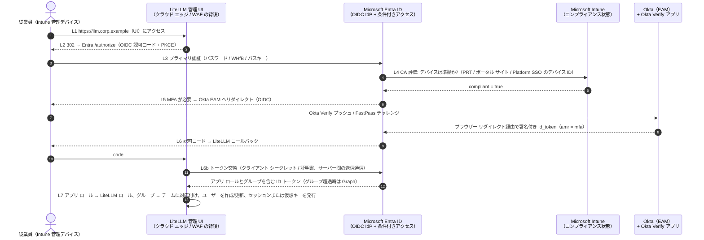
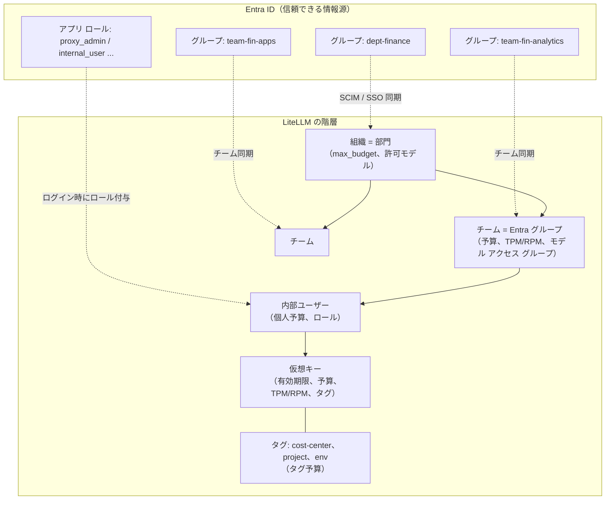
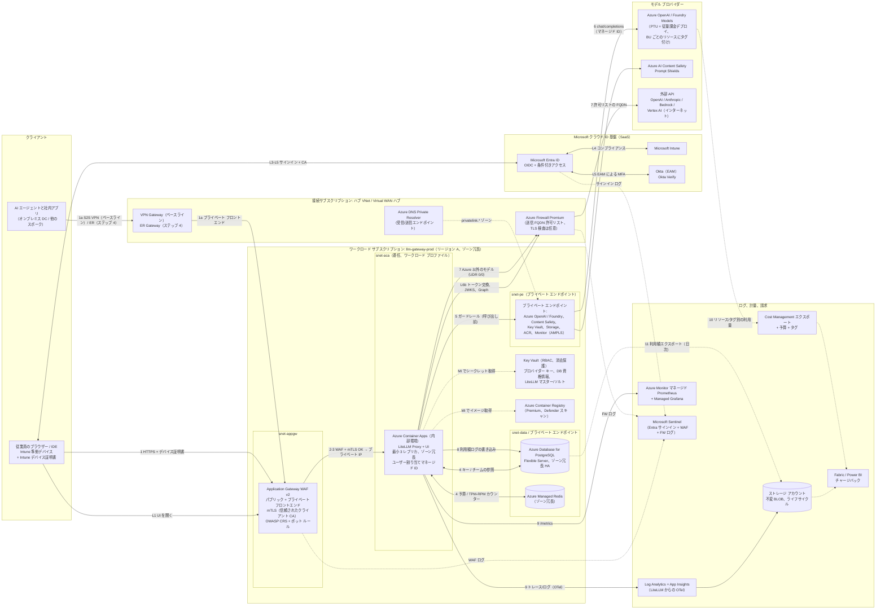
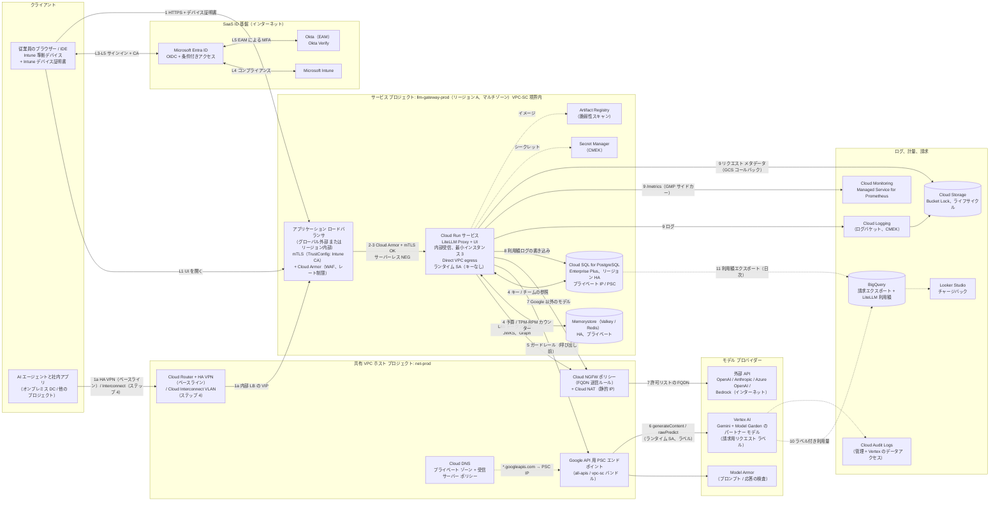
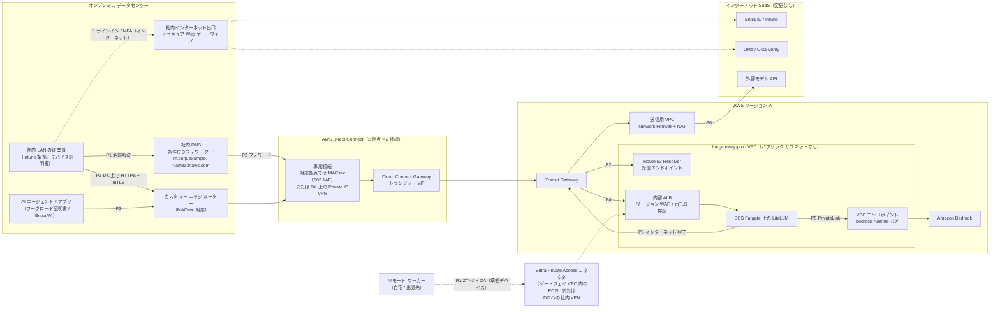
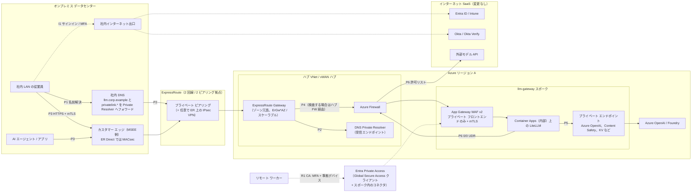
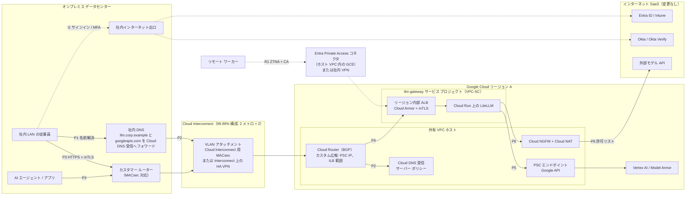
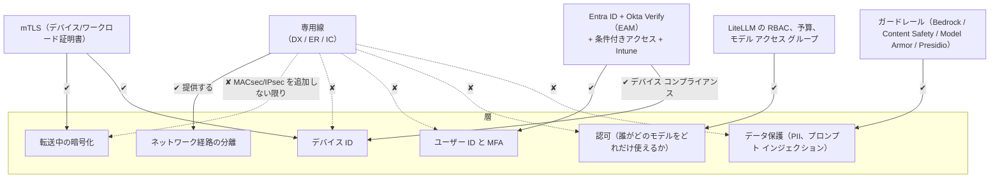
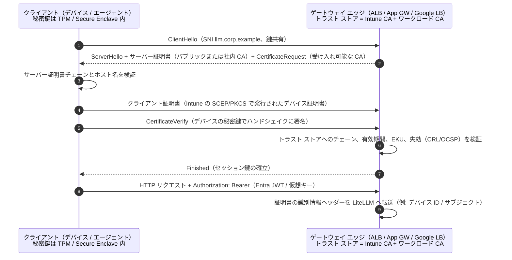

# マルチクラウド LLM ゲートウェイ アーキテクチャ比較（AWS / Azure / GCP）

> **対象範囲:** 本書はアーキテクチャのみを扱う（実装コードは含まない）。**LiteLLM Proxy** を基盤とする社内 LLM ゲートウェイ プラットフォームを説明する。このプラットフォームは、ユーザー・チーム管理、コスト配賦、トークン制御を提供する。各設計は当社の環境に合わせている。ID 基盤は **Microsoft Entra ID**、MFA は **Okta Verify**、デバイス信頼は **Microsoft Intune**、閉域接続は既設の **ExpressRoute / Direct Connect / Cloud Interconnect** である。
>
> **ステータス:** アーキテクチャ レビュー用ドラフト（2026-10-30 時点）。ベンダーの機能は変化が速い。ベンダー固有の記述にはすべて公式ドキュメントへのリンクを付けているので、最終決定の前にリンク先を再確認すること。
>
> **翻訳について:** 本書は英語版 [`../llm-gateway-architecture-comparison.md`](../llm-gateway-architecture-comparison.md) の日本語訳である。内容に差異がある場合は英語版を正とする。サービス名・機能名・設定キーは原則として英語表記のままとしている。

---

## 目次

0. [エグゼクティブ サマリー](#0-エグゼクティブ-サマリー)
1. [前提条件](#1-前提条件)
2. [共通設計: ID、MFA、デバイス信頼、LiteLLM テナント モデル](#2-共通設計3-クラウド共通)
3. [ステップ 1: 公式リファレンス アーキテクチャ](#3-ステップ-1-公式リファレンス-アーキテクチャ)
4. [ステップ 2a: AWS 設計](#4-ステップ-2a-aws-設計)
5. [ステップ 2b: Azure 設計](#5-ステップ-2b-azure-設計)
6. [ステップ 2c: GCP 設計](#6-ステップ-2c-gcp-設計)
7. [ステップ 3: 比較と推奨](#7-ステップ-3-比較と推奨)
8. [ステップ 4: 閉域接続（専用線）オプション](#8-ステップ-4-閉域接続専用線オプション)
9. [付録: 参照リンク一覧](#9-付録-参照リンク一覧)

---

## 0. エグゼクティブ サマリー

- **どのクラウドでも LiteLLM が制御点になる。** LiteLLM は仮想キー、組織／チーム／ユーザー／キーの階層、予算、TPM/RPM 制限、モデル アクセス グループ、利用額ログを管理する。その周囲のクラウド ネイティブ サービスが、LiteLLM にない機能を補う。具体的には、エッジと WAF、プライベート ネットワーク、マネージド Postgres と Redis、シークレット、ガードレール、ログ、請求の突合である。
- **ID の構成は 3 クラウドで同一である。** Entra ID を LiteLLM の唯一の OIDC/SAML IdP とする。Okta Verify は Entra ID の **外部認証方法（External Authentication Method, EAM）** として接続するため、単一の条件付きアクセス エンジンが MFA と **Intune デバイス コンプライアンス** の両方を評価する。クラウド間で異なるのは、各クラウドのコントロール プレーンを Entra ID とどうフェデレーションするかだけである。
- **仮想キーはベアラー シークレットである。** Entra の条件付きアクセス、つまり Intune コンプライアンスが確認されるのはユーザーが *サインインするとき* だけである。LiteLLM の仮想キーが *使われるとき* に再確認する仕組みはない。本設計では次の 3 つの制御でこのギャップを埋める。(a) 対話型クライアントと開発者クライアントには Entra 発行の JWT（LiteLLM の OIDC/JWT 認証）を使う。(b) エッジで **Intune 配布のデバイス証明書による mTLS** を使うか、ステップ 4 の専用線経路を使う。(c) サービス アカウントには短いキー有効期限とキー単位のネットワーク制限を組み合わせる。
- **推奨（詳細は §7）:** Bedrock のネイティブ モデル利用が決め手であれば、プライマリ ゲートウェイは **AWS** に置く。AWS リポジトリの公式ガイダンスは当社の要件に最も近く、3 つのうち唯一 LiteLLM を基盤としている。モデル構成の大半が Azure OpenAI / Foundry モデルで、ID とデバイス信頼の統合作業を最小にしたいなら **Azure** を選ぶ。いずれの場合も LiteLLM はどこでも同じ方式（コンテナー、Postgres、Redis）でデプロイする。そうすればゲートウェイの可搬性が保たれ、他クラウドのモデルも LiteLLM のバックエンドとして利用できる。
- **専用線（ステップ 4）:** ExpressRoute、Direct Connect、Interconnect は、オンプレミスのユーザーと AI エージェントの *既定の経路* として使う。閉域経路はトラフィックを分離するだけである。それ自体はユーザーもデバイスも認証せず、何も暗号化しない。その上で Entra/Okta/Intune と TLS（ワークロードには mTLS）を維持し、ポリシーでリンク暗号化が必要なら回線上に MACsec または IPsec を追加する。リモート ワーカーには引き続きインターネット経路が必要で、ゼロトラスト ネットワーク アクセス（ZTNA）と条件付きアクセスで構成する。

---

## 1. 前提条件

当社環境の詳細が不明な点について、本設計は以下を前提とする。各前提には **[A-n]** の番号を付け、本書全体で参照する。

| ID | 前提 | 重要な理由／確認方法 |
|---|---|---|
| A-1 | Entra ID が全従業員の正規の IdP であり、すべてのユーザーがクラウド同期済みの UPN とグループ メンバーシップを持つ（オンプレミス AD からの同期、またはクラウド専用）。 | OIDC クレームと LiteLLM のチーム同期を左右する。 |
| A-2 | Okta は **MFA プロバイダーとしてのみ** 使用する（Okta Verify のプッシュ、TOTP、または FastPass）。M365 のプライマリ フェデレーション IdP では **ない**。採用パターン: **Entra ID 外部認証方法（EAM）**（§2.1 参照）。 | 実際には M365 ドメインが *Okta にフェデレーション* されている場合は、§2.1.2 の代替パターンを使う。 |
| A-3 | Entra ID P1/P2 ライセンス（条件付きアクセス、グループ クレーム、アプリ ロール）がある。Intune が Windows と macOS、必要に応じて iOS/Android のデバイス コンプライアンスを適用している。 | 「準拠デバイスを必須にする」条件付きアクセスには P1 以上が必要。 |
| A-4 | ユーザーは Intune 管理デバイスのブラウザーから LiteLLM 管理 UI にアクセスする。API クライアントには IDE プラグイン、SDK、社内アプリ、そして **オンプレミス DC またはクラウドで稼働する AI エージェント** が含まれる。 | クライアント種別ごとの認証方式を決める（§2.3）。 |
| A-5 | 各クラウドでプライマリ リージョン 1 つとウォーム スタンバイの DR リージョンを使う。データ所在地は単一の地域（例: 日本または EU）に限定する。 | リージョンの選択で利用可能なモデルが限られる。リージョンごとのモデル提供状況を確認すること。 |
| A-6 | **LiteLLM Enterprise ライセンス** を購入する。現行ドキュメントでは、6 ユーザー以上の SSO、OIDC/JWT 認証、SCIM、監査ログ、一部のガードレール・ログ連携がエンタープライズ機能である。 | ライセンスがない場合、6 ユーザー以上の SSO と JWT 認証は使えない。[LiteLLM Enterprise](https://docs.litellm.ai/docs/enterprise) と [Admin UI SSO](https://docs.litellm.ai/docs/proxy/admin_ui_sso) を参照。 |
| A-7 | 外部モデル プロバイダー（例: OpenAI、Anthropic API、Mistral）には、当社リージョンで閉域接続の選択肢がないため、送信許可リストを経由してインターネットで接続する。 | 送信（egress）設計とステップ 4 に影響する。 |
| A-8 | 既設の ExpressRoute、Direct Connect、Interconnect 回線は、ランディング ゾーンのスポークと接続済みのハブ／トランジット ネットワークで終端している。いずれも 2 拠点に 2 回線以上ある。 | ステップ 4 の可用性の主張に影響する。ネットワーク チームに確認すること。 |
| A-9 | サイジング検討用の想定規模: 従業員約 5,000 人、ピーク時の同時ユーザー約 300 人、ゲートウェイ経由で約 50〜200 RPS（ストリーミング応答あり）。 | コスト要因の議論にのみ使う。価格は提示しない。 |
| A-10 | 既定では、プロンプトと応答の **内容** は保存 *しない*。メタデータ（ユーザー、チーム、モデル、トークン数、コスト、レイテンシ、ガードレール判定）のみを記録する。内容のログ記録は、コンプライアンス用途に限りチーム単位のオプトインとする。 | プライバシーと保持期間の設計を左右する（§4.7、§5.7、§6.7）。 |

---

## 2. 共通設計（3 クラウド共通）

### 2.1 Okta Verify と Entra ID の統合パターン

Entra ID を中心とした環境で Okta MFA を組み合わせる方法は 3 つある。

| パターン | 仕組み | 長所 | 短所 |
|---|---|---|---|
| **2.1.1 Entra ID 外部認証方法（EAM）: ✅ 採用** | Entra ID が IdP のままとなる。Okta は Entra に *外部認証方法* として登録する。条件付きアクセス ポリシーで MFA が要求されると、Entra は OIDC 交換でユーザーを Okta にリダイレクトする。Okta が **Okta Verify** のチャレンジを行い、署名付き id_token を返す。Entra はこれを MFA を満たしたものとして受け入れる。 | 単一のポリシー エンジン（Entra 条件付きアクセス）が MFA、**Intune コンプライアンス**、場所、リスクをまとめて評価する。アプリ（LiteLLM、AWS、GCP）は Entra だけを信頼すればよい。 | EAM はインライン登録に対応しないため、ユーザーは事前に Okta Verify へ登録しておく必要がある。2 つのディレクトリ間でユーザーを対応付ける必要がある（Entra オブジェクト ID ↔ Okta ユーザー）。自テナントのクラウドで EAM が GA かどうかを確認すること。 |
| 2.1.2 Okta へのフェデレーション + `federatedIdpMfaBehavior` | M365 ドメインを Okta にフェデレーション（WS-Fed/SAML）する。Okta がプライマリ認証と Okta Verify を行い、MFA クレームを送る。Entra 側でこれを受け入れるよう設定する（`acceptIfMfaDoneByFederatedIdp` / `enforceMfaByFederatedIdp`）。 | Okta がすでに M365 の IdP である場合に使える。 | ポリシーが 2 つのエンジンに分散する。Intune コンプライアンスは引き続き Entra 条件付きアクセスでしか評価されない。ドメイン フェデレーションの変更は影響範囲が大きい。 |
| 2.1.3 条件付きアクセスの「カスタム コントロール」 | サードパーティ MFA 用のレガシーな仕組み。 | 新規設計での利点はない。 | Microsoft は EAM を後継と位置付けている。使用しないこと。 |

**採用パターン: EAM（2.1.1）、[A-2] に基づく。** Okta 側の手順は [Configure Okta as an external authentication method for Microsoft Entra ID](https://help.okta.com/oie/en-us/content/topics/apps/configure-okta-as-microsoft-entra-id-eam.htm)、Microsoft 側の手順は [Manage an external authentication method in Microsoft Entra ID](https://learn.microsoft.com/entra/identity/authentication/how-to-authentication-external-method-manage) を参照。フェデレーションの代替案については [federatedIdpMfaBehavior (internalDomainFederation)](https://learn.microsoft.com/graph/api/resources/internaldomainfederation) と [Satisfy Entra MFA with MFA claims from a federated IdP](https://learn.microsoft.com/entra/identity/authentication/how-to-mfa-expected-inbound-assertions) を参照。Okta は、`eam_amr_unsatisfiable` や `AADSTS50012620` エラーなど、EAM の既知の障害パターンを公開している。[Okta EAM integration failures](https://support.okta.com/help/s/article/entra-id-external-authentication-method-eam-integration-failures-with-okta) を参照。

**ゲートウェイ用の条件付きアクセス ポリシー セット**（ゲートウェイ環境ごとに Entra アプリ登録を 1 つ作成する。例: `litellm-prod`）:

| CA ポリシー | 対象 | 付与制御 |
|---|---|---|
| CA-GW-01 | 全ユーザー → `litellm-prod`（Web/UI と API の両方の audience） | MFA を必須にする（Okta EAM で充足）**かつ** 準拠としてマークされたデバイスを必須にする（[CA における Intune コンプライアンス](https://learn.microsoft.com/entra/identity/conditional-access/policy-all-users-device-compliance)） |
| CA-GW-02 | 管理者ロール保持者（`proxy_admin`） | MFA と準拠デバイスを必須にし、サインイン頻度を 4〜8 時間とし、可能な場合はフィッシング耐性のある MFA を使う（Okta FastPass、または Entra の認証方法としての Windows Hello for Business） |
| CA-GW-03 | ワークロード ID（ゲートウェイを呼び出すサービス プリンシパル） | ワークロード ID 向け条件付きアクセスで、ネームド ロケーション（クラウドの送信 IP、オンプレミスの NAT）に制限する（Workload ID プレミアム ライセンスが必要） |
| CA-GW-04 | `litellm-prod` に対するレガシー認証とデバイス コード フローのブロック | ブロック |

### 2.2 共通ログイン フロー（シーケンス）

3 つのクラウドの図はいずれも、このシーケンスを **ステップ L1〜L7** として参照する。

補足:

- ステップ L3〜L6 は **ユーザーのデバイスと SaaS エンドポイント（`login.microsoftonline.com`、`*.okta.com`）の間** で行われ、ゲートウェイのネットワークは一切通らない。これはステップ 4 で重要になる。意図的にそう経路設定しない限り、閉域回線はこのトラフィックを運ばない。
- ゲートウェイに関わるのは L1、L2、L6、L6b だけである。L6b（バックチャネルのトークン交換）とチーム同期用の Graph 呼び出しは、ゲートウェイ サブネットからインターネットへの送信通信なので、送信許可リストに含める必要がある。
- LiteLLM は、Microsoft SSO 連携、汎用 OIDC、SAML 2.0 による Entra SSO に対応している。[Admin UI SSO](https://docs.litellm.ai/docs/proxy/admin_ui_sso)、[Microsoft SSO とチーム同期のチュートリアル](https://docs.litellm.ai/docs/tutorials/msft_sso)、[SAML SSO](https://docs.litellm.ai/docs/proxy/saml_sso) を参照。

### 2.3 LiteLLM API トラフィックの認証方式

| クライアント種別 | LiteLLM への認証 | デバイス信頼の適用方法 | 補足 |
|---|---|---|---|
| 管理 UI（ブラウザー） | Entra OIDC SSO（L1〜L7） | サインイン時の条件付きアクセス CA-GW-01/02 | ロールは Entra の **アプリ ロール**（`proxy_admin`、`proxy_admin_viewer`、`internal_user`、`internal_user_viewer`）から取得する。[MSFT SSO チュートリアル](https://docs.litellm.ai/docs/tutorials/msft_sso) と [Entra アプリ ロール](https://learn.microsoft.com/entra/identity-platform/howto-add-app-roles-in-apps) を参照。 |
| 開発者 / IDE / チャット フロントエンド（例: Open WebUI） | **推奨:** Entra アクセス トークン（JWT）を LiteLLM の [OIDC/JWT 認証](https://docs.litellm.ai/docs/proxy/token_auth) で検証する（チームは `groups` クレームから `team_ids_jwt_field` / エイリアス マッピングで決定）。**代替:** 有効期限 30〜90 日の個人用仮想キー。 | トークン発行時の CA と短いトークン有効期間（約 60〜90 分）。仮想キーの場合は、エッジでの **Intune 発行デバイス証明書による mTLS**、または閉域経路のみ（ステップ 4）とする。 | JWT は仮想キーと同等の制御（予算、TPM/RPM）に対応付けられる。[JWT → キー マッピング](https://docs.litellm.ai/docs/proxy/jwt_key_mapping) を参照。 |
| 社内アプリ / AI エージェント（ワークロード） | 方式 1: Entra **ワークロード ID**。クライアント資格情報の JWT、または AWS/GCP/K8s からのフェデレーション資格情報を LiteLLM の JWT 認証で検証する。方式 2: チーム単位の **サービス アカウント用仮想キー** を呼び出し元のシークレット ストアに保管し、ローテーションする。 | ネットワーク制限（閉域経路、セキュリティ グループ、送信元 IP 許可リスト）と mTLS ワークロード証明書 | 長期間有効なシークレットをなくせるため、方式 1 を推奨する。 |
| CI / 自動化（キー管理 API） | シークレット マネージャーにのみ保管した管理者用仮想キー、または管理者スコープの JWT | 閉域経路のみ | LiteLLM の管理 API（`/key/generate`、`/team/new`）を IaC とパイプライン経由で使う。本番環境で UI からの場当たり的な変更はしない。 |

**mTLS 用の Intune デバイス証明書。** Intune は管理デバイスに SCEP/PKCS クライアント証明書を配布できる（[Intune 証明書プロファイル](https://learn.microsoft.com/intune/fundamentals/certificates/overview)）。クラウドのエッジ（AWS ALB、Azure Application Gateway、Google Cloud Load Balancing）には、発行元 CA を含むトラスト ストアを設定する。こうするとエッジは管理デバイスからの接続だけを受け付けるため、仮想キーを使う API 呼び出しに *デバイス ID* を結び付けられる。デバイスが非準拠になったら証明書を失効させるか、証明書の有効期間を短くして、Intune が準拠デバイスにのみ再発行するようにする。

### 2.4 LiteLLM テナント モデル（全クラウド共通）

| 要件 | LiteLLM の機能（ドキュメント） |
|---|---|
| オンボーディング / オフボーディング | 初回ログイン時の SSO 自動プロビジョニングと、Entra からの **SCIM** によるプロビジョニング解除（[SCIM](https://docs.litellm.ai/docs/tutorials/scim_litellm)）。プロビジョニング解除されたユーザーのキーがブロックまたは削除されるかを使用中の LiteLLM バージョンで確認し、されない場合はオフボーディング ジョブを追加する。 |
| ロール | Entra アプリ ロール → LiteLLM ロール。複数ある場合は最上位のロールが優先される（[MSFT SSO](https://docs.litellm.ai/docs/tutorials/msft_sso)） |
| 仮想 API キー | [仮想キー](https://docs.litellm.ai/docs/proxy/virtual_keys): キーごとの `max_budget`、`budget_duration`、`tpm_limit`、`rpm_limit`、`models`、`expires`、`metadata.tags` |
| チーム予算 / クォータ | [チーム予算](https://docs.litellm.ai/docs/proxy/team_budgets)、[ユーザー/チームのレート制限と予算](https://docs.litellm.ai/docs/proxy/users) |
| 部門 / プロジェクトのチャージバック | 組織またはタグと [タグ予算](https://docs.litellm.ai/docs/proxy/tag_budgets)、[利用額トラッキング](https://docs.litellm.ai/docs/proxy/cost_tracking)（キー、ユーザー、チーム、タグ、モデルごとの利用額） |
| モデル アクセス ポリシー | [モデル アクセス グループ](https://docs.litellm.ai/docs/proxy/model_access): 例として `tier-standard`（小型モデル）と `tier-premium`（フロンティア モデル）をチームごとに付与する |
| メトリクス | [Prometheus メトリクス](https://docs.litellm.ai/docs/proxy/prometheus): チームとキーごとの利用額、トークン数、残予算、レイテンシ、失敗数 |
| ガードレール | 呼び出し前後のガードレール: [Bedrock Guardrails](https://docs.litellm.ai/docs/proxy/guardrails/bedrock)、[Azure Content Safety / Prompt Shields](https://docs.litellm.ai/docs/proxy/guardrails/azure_content_guardrail)、[Google Model Armor](https://docs.litellm.ai/docs/proxy/guardrails/model_armor)、[Presidio による PII マスキング](https://docs.litellm.ai/docs/proxy/guardrails/pii_masking_v2) |
| 本番環境の堅牢化 | [LiteLLM 本番運用のベスト プラクティス](https://docs.litellm.ai/docs/proxy/prod): インスタンス間のレート制限と予算のための Redis、大規模時の利用額ログ用 DB の分離、ワーカー数 |

**設計上考慮すべき 2 つの重要な挙動:**

1. **LiteLLM の利用額は *推定値* である。** LiteLLM はモデル価格表、または当社が設定したモデル別のカスタム価格からコストを計算する。この値はクラウドの請求額と一致しないことがある。企業割引、プロビジョニング スループット（PTU）や確約利用の価格、キャッシュ トークンの価格、税金がいずれもずれの原因になる。そのため本設計では **LiteLLM を配賦キー**（誰が何を使ったか）、**クラウド請求をコストの正**（実際にいくら払ったか）として扱い、毎月両者を突合する（§4.5、§5.5、§6.5）。
2. **予算とレート制限は Redis と Postgres の状態に基づいて適用される。** Redis が利用できなくなると、LiteLLM の複数インスタンス間の制限が機能低下する。各設計ではゾーン冗長のマネージド Redis を使い、Redis エラーでアラートを出す。

---

## 3. ステップ 1: 公式リファレンス アーキテクチャ

### 3.1 AWS

| リファレンス | リンク | 概要 | LiteLLM との関係 |
|---|---|---|---|
| **Guidance for Multi-Provider Generative AI Gateway on AWS** *（ベースライン）* | [GitHub リポジトリ](https://github.com/aws-solutions-library-samples/guidance-for-multi-provider-generative-ai-gateway-on-aws) · [ソリューション ページ](https://aws.amazon.com/solutions/guidance/multi-provider-generative-ai-gateway-on-aws) · [実装ガイド](https://aws-solutions-library-samples.github.io/ai-ml/guidance-for-multi-provider-generative-ai-gateway-on-aws.html) | **LiteLLM** を **ECS Fargate または EKS**（どちらか一方）上に Terraform でデプロイする。**ALB** の背後に置き、必要に応じて **CloudFront + WAF**、ACM 証明書付きの Route 53 を前段に置く。**RDS**（キー、チーム、予算、利用額）、**ElastiCache Redis OSS**（設定配布とキャッシュ）、**Secrets Manager**、**KMS**、**ECR**、**S3**（ログ）、**CloudWatch** を使う。ネイティブな Bedrock 機能（Bedrock Managed Prompts、チャット履歴）用のミドルウェアと、**Okta OAuth 2.0 JWT 認証** を追加している。公開方式として 4 つのシナリオを記載しており、その中に **「Private VPC only」**（`PUBLIC_LOAD_BALANCER=false`、VPN、**Direct Connect**、ピアリング、TGW 経由でアクセス）がある。サンプルのインフラ費用は約 USD 378/月（ECS）または約 USD 385/月（EKS）で、モデル利用料は含まない。 | **これ自体が LiteLLM である。** このトポロジーをそのまま採用し、3 点を変更する。OIDC IdP を Okta ではなく Entra にする、内部 ALB と DX の閉域経路を使う、追加の制御（Network Firewall による送信制御、Bedrock VPC エンドポイント、mTLS）を入れる。 |
| アプリケーション推論プロファイルによる Amazon Bedrock のコスト配賦 | [Bedrock ユーザー ガイド: アプリケーション推論プロファイル](https://docs.aws.amazon.com/bedrock/latest/userguide/inference-profiles-create.html) · [AWS Architecture Blog](https://aws.amazon.com/blogs/architecture/track-generative-ai-costs-with-amazon-bedrock-inference-profiles/) · [What's New（2024 年 11 月）](https://aws.amazon.com/about-aws/whats-new/2024/11/amazon-bedrock-cost-allocation-tags-inference-profiles) | 部門またはチームごとに **アプリケーション推論プロファイル** にタグを付け、ベース モデル ID の代わりにその ARN で呼び出す。タグは Cost Explorer と CUR 2.0 に反映される。2026 年 4 月以降、Bedrock は IAM プリンシパル単位でもコストを配賦できる（[What's New、2026 年 4 月](https://aws.amazon.com/about-aws/whats-new/2026/04/bedrock-iam-cost-allocation)）。 | LiteLLM のモデル定義は推論プロファイルの ARN を指せるので、LiteLLM のチームやモデル グループをタグ付きプロファイルに対応付けられる。これにより Bedrock の利用額を請求レベルの精度でチャージバックできる。 |
| Bedrock の閉域アクセスとガードレール | [Bedrock インターフェイス VPC エンドポイント](https://docs.aws.amazon.com/bedrock/latest/userguide/vpc-interface-endpoints.html) · [Bedrock Guardrails](https://docs.aws.amazon.com/bedrock/latest/userguide/guardrails.html) | `bedrock-runtime` 用の PrivateLink エンドポイントと、コンテンツ フィルター、PII、拒否トピックのためのガードレール。 | LiteLLM は VPC エンドポイント経由で Bedrock を呼び出す。Bedrock Guardrails との連携はネイティブで提供されている（[LiteLLM ドキュメント](https://docs.litellm.ai/docs/proxy/guardrails/bedrock)）。 |

### 3.2 Azure

| リファレンス | リンク | 概要 | LiteLLM との関係 |
|---|---|---|---|
| **Azure API Management の AI ゲートウェイ** | [AI ゲートウェイ機能](https://learn.microsoft.com/azure/api-management/genai-gateway-capabilities) | APIM に組み込まれた GenAI ポリシーで、別製品ではなく APIM の拡張である。`llm-token-limit`（[ドキュメント](https://learn.microsoft.com/azure/api-management/llm-token-limit-policy)）、`llm-emit-token-metric`（[ドキュメント](https://learn.microsoft.com/azure/api-management/llm-emit-token-metric-policy)）、セマンティック キャッシュ（RediSearch 対応の Azure Managed Redis が必要）、バックエンド間の負荷分散とサーキット ブレーカー、コンテンツ セーフティを含む。 | LiteLLM のトークン制限やルーティングと **機能が重複する**。APIM のポリシーは APIM サブスクリプション単位であり、LiteLLM のユーザー／チーム／予算モデルとは単位が異なる。組み合わせ方は表の後に示す。 |
| **Azure Architecture Center: 複数の Azure OpenAI デプロイの前段に置くゲートウェイ** | [マルチバックエンド ゲートウェイ ガイド](https://learn.microsoft.com/azure/architecture/ai-ml/guide/generative-ai-gateway-multiple-models) · [ゲートウェイ ガイド（概要）](https://learn.microsoft.com/azure/architecture/ai-ml/guide/generative-ai-gateway) | 多数の Azure OpenAI インスタンスやリージョンの前段に置くゲートウェイの設計ガイダンス。負荷分散、PTU と従量課金の間のフェイルオーバー、チャージバックを扱う。APIM と *カスタム コードのゲートウェイ* の両方を明示的に対象としている。 | このガイダンスの用語では LiteLLM は「カスタム／サードパーティ ゲートウェイ」に当たり、内容がそのまま当てはまる。バックエンドへの ID ベース認証、PTU のスピルオーバー、利用者ごとの計量などである。 |
| **APIM ランディング ゾーン アクセラレーター（GenAI ゲートウェイ シナリオ）** と **AI Hub Gateway ソリューション アクセラレーター** | [Azure/apim-landing-zone-accelerator](https://github.com/Azure/apim-landing-zone-accelerator) · [Azure-Samples/ai-hub-gateway-solution-accelerator](https://github.com/Azure-Samples/ai-hub-gateway-solution-accelerator) · [Azure-Samples/AI-Gateway ラボ](https://github.com/Azure-Samples/AI-Gateway) | デプロイ可能な Bicep/azd サンプル。**Application Gateway WAF の背後に APIM（内部 VNet モード）** を置き、Azure OpenAI へのプライベート エンドポイント、バックエンドへのマネージド ID、Application Insights と Log Analytics へのトークン メトリクス送信を構成する。 | この **ネットワーク構成**（App Gateway WAF → 内部サービス → プライベート エンドポイント → Azure Firewall による送信）を再利用し、APIM の代わりに、または APIM の背後に LiteLLM を置く。 |
| **Microsoft Foundry チャットのベースライン リファレンス アーキテクチャ** | [Architecture Center](https://learn.microsoft.com/azure/architecture/ai-ml/architecture/baseline-microsoft-foundry-chat) · [Azure-Samples/microsoft-foundry-baseline](https://github.com/Azure-Samples/microsoft-foundry-baseline) | エンタープライズ向けベースライン。App Gateway WAF による受信、すべての PaaS サービスへのプライベート エンドポイント、Azure Firewall による送信制御、ゾーン冗長。 | LiteLLM ワークロードのスポークが従う、ランディング ゾーンのネットワークとセキュリティのベースラインになる。 |
| GenAI ゲートウェイ プレイブック（APIM ベースのリファレンス） | [Microsoft Learn AI プレイブック](https://learn.microsoft.com/ai/playbook/technology-guidance/generative-ai/dev-starters/genai-gateway/reference-architectures/apim-based) | ハイブリッド環境向けの APIM リファレンス。オンプレミス LLM 用に **セルフホステッド APIM ゲートウェイ** を使う。 | オンプレミスのモデルも前段で扱う場合に関係する。LiteLLM はオンプレミスの OpenAI 互換エンドポイントを ExpressRoute 経由で直接呼び出せる。 |

**Azure で APIM と LiteLLM を組み合わせる方法:**

1. **LiteLLM のみ（既定として推奨）。** LiteLLM がプライベート エンドポイント経由、マネージド ID で Azure OpenAI と Foundry モデルを呼び出す。トークン計上の仕組みが 2 つになるのを避けられる。
2. **LiteLLM → APIM → Azure OpenAI。** APIM を *バックエンド* プールの管理役として使う。中央のプラットフォーム チームがすでに APIM を運用し、多数の利用者で Azure OpenAI の PTU を共有している場合に使う。この場合、LiteLLM は独自の `llm-token-limit` を持つ APIM の一利用者になる。
3. **APIM → LiteLLM。** APIM を開発者ポータルでの公開やプロダクト管理のためのエンタープライズ API の玄関口として使う。APIM がすでに全社の API 標準である場合に限る。レイテンシとコストが増え、ポリシーも重複する。

### 3.3 Google Cloud

| リファレンス | リンク | 概要 | LiteLLM との関係 |
|---|---|---|---|
| **AI ゲートウェイとしての Apigee** | [Apigee AI ソリューション ページ](https://cloud.google.com/solutions/apigee-ai) · [Google Cloud ブログ: Apigee for AI](https://cloud.google.com/blog/products/api-management/using-apigee-api-management-for-ai) | Google は Apigee を AI ゲートウェイと位置付けている。トークン ポリシー、セマンティック キャッシュ、ルーティングとサーキット ブレーカー、ログ、Model Armor との連携を備える。 | APIM と同様に LiteLLM と機能が重複する。組み合わせ方は Azure と同じで、LiteLLM のみ（既定）、LiteLLM → Apigee、Apigee → LiteLLM のいずれかである。 |
| Apigee の AI トークン ポリシー | [LLMTokenQuota ポリシー](https://cloud.google.com/apigee/docs/api-platform/reference/policies/llm-token-quota-policy) · [PromptTokenLimit ポリシー](https://cloud.google.com/apigee/docs/api-platform/reference/policies/prompt-token-limit-policy) · [AI トークン ポリシーの使用（チュートリアル）](https://cloud.google.com/apigee/docs/api-platform/tutorials/using-ai-token-policies) · [セマンティック キャッシュ ポリシー](https://cloud.google.com/apigee/docs/api-platform/tutorials/using-semantic-caching-policies) | API プロダクト、デベロッパー、アプリごとのトークン クォータ。プロンプト トークンのスパイク防止。Vertex AI の埋め込みと Vector Search を使うセマンティック キャッシュ。いずれも拡張ポリシーで、追加費用がかかる場合がある。 | LiteLLM の TPM/予算制御に相当するが、単位は Entra のユーザーやチームではなく、Apigee のプロダクトとアプリである。 |
| **apigee-samples（LLM）** | [GoogleCloudPlatform/apigee-samples](https://github.com/GoogleCloudPlatform/apigee-samples) | 公式サンプル: `llm-token-limits`、`llm-semantic-cache(-v2)`、`llm-routing`、`llm-circuit-breaking`、`llm-logging`、`llm-security-v2`（Model Armor）。 | 有用なパターンを含む。例えば 429 応答時に Vertex AI のリージョンをサーキット ブレークする方法などである。LiteLLM はルーターのフォールバックとクールダウンで同じ機能をネイティブに提供する。 |
| Architecture Center: 生成 AI | [生成 AI アーキテクチャの概要](https://cloud.google.com/architecture/genai-overview) · [GKE Inference Gateway](https://cloud.google.com/kubernetes-engine/docs/concepts/about-gke-inference-gateway) | Google Cloud 上の GenAI のリファレンス アーキテクチャ。GKE Inference Gateway は GKE 上の **セルフホスト** モデル向けである（モデルを考慮した負荷分散、Model Armor）。 | オープンウェイト モデルをセルフホストする場合にのみ関係する。LiteLLM はそれらを OpenAI 互換のバックエンドとしてルーティングする。 |
| Vertex AI の閉域アクセスとガードレール | [オンプレミスから PSC で Vertex AI の生成 AI にアクセス](https://cloud.google.com/vertex-ai/docs/general/vertex-psc-gen-ai) · [Model Armor の概要](https://cloud.google.com/model-armor/overview) · [請求用カスタム メタデータ ラベル](https://cloud.google.com/vertex-ai/generative-ai/docs/multimodal/add-labels-to-api-calls) | Google API 向けの Private Service Connect、プロンプトと応答のファイアウォール（Model Armor）、Gemini とパートナー モデルの呼び出しへの **リクエスト単位の請求ラベル**（従量課金のみ）。 | LiteLLM は PSC 経由で Vertex を呼び出し、Model Armor ガードレールを使い、請求レベルのチャージバックのためにチーム ラベルを付与する（§6.5）。 |

> **所見:** **LiteLLM を基盤とした** 公式ガイダンスを公開しているのは AWS だけである。Microsoft と Google が公開しているゲートウェイのリファレンスは、いずれも **自社の API 管理製品**（APIM、Apigee）を基盤としている。この 2 クラウドについては、公式リファレンスから *ネットワーク、ID、セキュリティのベースライン* を取り入れ、ゲートウェイの位置に LiteLLM を置く。

---

## 4. ステップ 2a: AWS 設計

**ベースライン:** AWS ガイダンス リポジトリを基に、コンピューティングには ECS Fargate を使う（リポジトリは ECS と EKS のどちらにも対応）。本セクションでは、ゲートウェイを **インターネットに面したゼロトラスト エッジ**（リージョン WAF + mTLS 付き ALB）で公開する。ステップ 4（§8.2）では、閉域の Direct Connect 経路をオーバーレイとして追加する。

### 4.1 アーキテクチャ図（AWS）

```mermaid
flowchart LR
    %% ---------- クライアント ----------
    subgraph CLIENTS["クライアント"]
        direction TB
        U["従業員のブラウザー / IDE<br/>Intune 準拠デバイス<br/>+ Intune デバイス証明書"]
        AGT["AI エージェントと社内アプリ<br/>（オンプレミス DC / 他の VPC）"]
    end

    %% ---------- SaaS ID ----------
    subgraph IDP["SaaS ID 基盤（インターネット）"]
        direction TB
        ENTRA["Microsoft Entra ID<br/>OIDC + 条件付きアクセス"]
        INTUNE["Microsoft Intune<br/>デバイス コンプライアンス"]
        OKTA["Okta（EAM）<br/>Okta Verify"]
    end

    %% ---------- AWS エッジ ----------
    subgraph EDGE["AWS エッジ"]
        direction TB
        R53["Route 53<br/>llm.corp.example"]
        CF["AWS WAF（ALB 上のリージョン Web ACL）<br/>+ Shield Standard<br/>（CloudFront は任意、4.3 ステップ 3 参照）"]
    end

    %% ---------- ワークロード アカウント ----------
    subgraph ACCT["AWS ワークロード アカウント: llm-gateway-prod（リージョン A、3 AZ）"]
        direction TB
        subgraph PUB["パブリック サブネット"]
            ALB["ALB（HTTPS、TLS 1.2+）<br/>mTLS 検証（トラスト ストア）<br/>ACM 証明書、リージョン WAF"]
        end
        subgraph APP["プライベート アプリ サブネット"]
            ECS["ECS Fargate サービス<br/>LiteLLM Proxy + UI<br/>（+ Bedrock ミドルウェア）<br/>3 AZ にタスクを分散"]
        end
        subgraph DATA["プライベート データ サブネット"]
            AUR[("Aurora PostgreSQL<br/>マルチ AZ<br/>キー、チーム、予算、利用額")]
            REDIS[("ElastiCache Valkey/Redis<br/>マルチ AZ<br/>レート制限・予算カウンター、キャッシュ")]
        end
        subgraph EP["エンドポイント サブネット（PrivateLink）"]
            VPCE["インターフェイス エンドポイント:<br/>bedrock-runtime、bedrock、<br/>secretsmanager、kms、logs、sts、<br/>ecr.api/dkr、sagemaker.runtime<br/>+ S3 ゲートウェイ エンドポイント"]
        end
        SM["Secrets Manager<br/>プロバイダー API キー、DB 資格情報、<br/>LiteLLM マスター/ソルト キー"]
        KMS["AWS KMS（CMK）"]
        ECR["Amazon ECR<br/>LiteLLM イメージ（スキャン済み）"]
    end

    %% ---------- 送信 ----------
    subgraph NET["ネットワーク アカウント（共有）"]
        direction TB
        TGW["Transit Gateway"]
        NFW["送信用 VPC:<br/>AWS Network Firewall<br/>（FQDN 許可リスト）+ NAT GW"]
    end

    %% ---------- モデル ----------
    subgraph MODELS["モデル プロバイダー"]
        direction TB
        BR["Amazon Bedrock<br/>（部門/チームごとにタグ付けした<br/>アプリケーション推論プロファイル）<br/>+ Bedrock Guardrails"]
        SMK["SageMaker AI エンドポイント<br/>（セルフホスト モデル）"]
        EXT["外部 API<br/>OpenAI / Anthropic / Azure OpenAI /<br/>Vertex AI（インターネット）"]
    end

    %% ---------- 可観測性と請求 ----------
    subgraph OBS["ログ、計量、請求"]
        direction TB
        CW["CloudWatch Logs とメトリクス<br/>+ Managed Prometheus/Grafana"]
        S3L[("S3 ログ バケット<br/>（Object Lock、ライフサイクル）")]
        CT["CloudTrail（組織の証跡）<br/>+ Bedrock 呼び出しログ（オプトイン）"]
        CUR["CUR 2.0 + Cost Explorer<br/>+ AWS Budgets"]
        ATH["Athena / Quick Sight<br/>チャージバック ダッシュボード"]
    end

    %% ---------- ログイン フロー ----------
    U -->|"L1 UI を開く"| R53
    U <-->|"L3-L5 サインイン + CA"| ENTRA
    ENTRA <-->|"L4 コンプライアンス"| INTUNE
    ENTRA <-->|"L5 EAM による MFA"| OKTA
    ECS -->|"L6b トークン交換、JWKS、Graph<br/>（送信許可リスト経由）"| NFW

    %% ---------- API フロー ----------
    U -->|"1 HTTPS + デバイス証明書"| R53
    R53 -->|"2 名前解決"| CF
    CF -->|"3 WAF マネージド + レート ルール"| ALB
    AGT -->|"1a S2S VPN / mTLS ワークロード証明書"| ALB
    ALB -->|"4 mTLS OK → 転送"| ECS
    ECS <-->|"5 認証、予算、TPM/RPM チェック"| REDIS
    ECS <-->|"5 キー / チーム / 予算の参照"| AUR
    ECS -->|"6 ガードレール（呼び出し前）"| VPCE
    VPCE -->|"7 InvokeModel / Converse<br/>（IAM タスク ロール）"| BR
    VPCE -->|"7"| SMK
    ECS -->|"8 AWS 以外のモデル"| TGW
    TGW --> NFW
    NFW -->|"8 許可リストの FQDN"| EXT
    ECS -->|"9 利用額ログの書き込み"| AUR
    ECS -->|"10 ログとメトリクス"| CW
    ECS -->|"10 リクエスト メタデータ ログ"| S3L
    CW --> S3L
    BR -.->|"11 タグ付き利用量"| CUR
    AUR -.->|"12 利用額エクスポート（日次）"| S3L
    S3L -.-> ATH
    CUR -.-> ATH

    %% ---------- 補助 ----------
    ECS -.->|"タスク起動時にシークレット取得"| SM
    SM -.-> KMS
    ECS -.->|"イメージ取得"| ECR
```

> **図の表記**（AWS ガイダンスの図のスタイルに合わせている）: 実線の矢印は番号付きステップのリクエスト経路、点線の矢印は補助・非同期・バッチのフローを表す。**L ステップ** はログイン フロー（§2.2）、**数字のステップ** は API リクエスト フロー（§4.3）である。

### 4.2 コンポーネント表（AWS）

| # | AWS サービス | 本設計での役割 | Azure の相当サービス | GCP の相当サービス |
|---|---|---|---|---|
| 1 | [Route 53](https://docs.aws.amazon.com/Route53/latest/DeveloperGuide/Welcome.html)（パブリック + プライベート ホストゾーン、Resolver エンドポイント） | `llm.corp.example` の DNS と、オンプレミス クライアント向けのスプリット ホライズン名前解決 | Azure DNS + DNS Private Resolver | Cloud DNS（+ 受信サーバー ポリシー） |
| 2 | [CloudFront](https://docs.aws.amazon.com/AmazonCloudFront/latest/DeveloperGuide/Introduction.html) + [AWS WAF](https://docs.aws.amazon.com/waf/latest/developerguide/waf-chapter.html) + Shield Standard | エッジ TLS、DDoS 対策、マネージド ルール グループ、レートベース ルール、地域/IP 制限 | Front Door + WAF（または App Gateway WAF のみ） | グローバル外部 ALB 上の Cloud Armor |
| 3 | [Application Load Balancer](https://docs.aws.amazon.com/elasticloadbalancing/latest/application/introduction.html)（[mTLS 検証モード](https://docs.aws.amazon.com/elasticloadbalancing/latest/application/mutual-authentication.html)） | LiteLLM への L7 ルーティング、トラスト ストアによる Intune デバイス証明書とワークロード証明書の検証 | Application Gateway v2（mTLS） | 外部/内部アプリケーション LB（mTLS） |
| 4 | [ECS on Fargate](https://docs.aws.amazon.com/AmazonECS/latest/developerguide/AWS_Fargate.html)（代替: EKS） | LiteLLM Proxy、UI、Bedrock ミドルウェアを実行する。ステートレスで自動スケール。 | Azure Container Apps（代替: AKS） | Cloud Run（代替: GKE Autopilot） |
| 5 | [Aurora PostgreSQL](https://docs.aws.amazon.com/AmazonRDS/latest/AuroraUserGuide/Aurora.AuroraPostgreSQL.html) マルチ AZ（リポジトリは RDS を使用） | LiteLLM DB: ユーザー、チーム、キー、予算、利用額ログ | Azure Database for PostgreSQL Flexible Server（ゾーン冗長 HA） | Cloud SQL for PostgreSQL（HA）/ AlloyDB |
| 6 | [ElastiCache（Valkey/Redis OSS）](https://docs.aws.amazon.com/AmazonElastiCache/latest/dg/WhatIs.html) マルチ AZ | タスク間で共有する TPM/RPM 制限と予算のカウンター、応答キャッシュ | Azure Managed Redis | Memorystore for Valkey / Redis Cluster |
| 7 | [Amazon Bedrock](https://docs.aws.amazon.com/bedrock/latest/userguide/what-is-bedrock.html)（+ [アプリケーション推論プロファイル](https://docs.aws.amazon.com/bedrock/latest/userguide/inference-profiles-create.html)） | ネイティブの基盤モデル（Anthropic Claude、Amazon Nova、Llama、Mistral など）と、チャージバック用のタグ付きプロファイル | Azure OpenAI / Foundry Models | Vertex AI（Gemini + Model Garden のパートナー モデル） |
| 8 | [Bedrock Guardrails](https://docs.aws.amazon.com/bedrock/latest/userguide/guardrails.html) | コンテンツ フィルター、PII の秘匿化、拒否トピック、プロンプト攻撃の検出。LiteLLM から呼び出す | Azure AI Content Safety / Prompt Shields | Model Armor |
| 9 | [SageMaker AI](https://docs.aws.amazon.com/sagemaker/latest/dg/whatis.html) | 任意: セルフホストまたはファインチューニング済みモデル | Foundry マネージド コンピューティング / AML オンライン エンドポイント | Vertex AI エンドポイント / GKE |
| 10 | [VPC インターフェイス エンドポイント（PrivateLink）](https://docs.aws.amazon.com/bedrock/latest/userguide/vpc-interface-endpoints.html) | Bedrock と AWS API への閉域アクセス（エンドポイント ポリシー付き） | プライベート エンドポイント（Private Link） | Private Service Connect（Google API） |
| 11 | [Transit Gateway](https://docs.aws.amazon.com/vpc/latest/tgw/what-is-transit-gateway.html) + [Direct Connect Gateway](https://docs.aws.amazon.com/directconnect/latest/UserGuide/direct-connect-gateways-intro.html) | オンプレミス、ゲートウェイ VPC、送信用 VPC 間のハブ ルーティング | Virtual WAN / ハブ VNet + ER Gateway | NCC / 共有 VPC + Cloud Router |
| 12 | [AWS Network Firewall](https://docs.aws.amazon.com/network-firewall/latest/developerguide/what-is-aws-network-firewall.html) + NAT Gateway | FQDN/SNI 許可リスト（モデル API、Entra、Okta、Graph）による集中送信制御 | Azure Firewall（FQDN ルール） | Secure Web Proxy / Cloud NGFW + Cloud NAT |
| 13 | [Secrets Manager](https://docs.aws.amazon.com/secretsmanager/latest/userguide/intro.html) + [KMS](https://docs.aws.amazon.com/kms/latest/developerguide/overview.html) | プロバイダー キー、DB 資格情報、LiteLLM のマスター キーとソルト キー。CMK による暗号化 | Key Vault（シークレット + キー、HSM） | Secret Manager + Cloud KMS（CMEK） |
| 14 | [ECR](https://docs.aws.amazon.com/AmazonECR/latest/userguide/what-is-ecr.html)（拡張スキャン） | バージョン固定・スキャン済みの LiteLLM イメージ | Azure Container Registry（Defender スキャン） | Artifact Registry（+ Artifact Analysis） |
| 15 | [CloudWatch](https://docs.aws.amazon.com/AmazonCloudWatch/latest/monitoring/WhatIsCloudWatch.html)、[Managed Prometheus](https://docs.aws.amazon.com/prometheus/latest/userguide/what-is-Amazon-Managed-Service-Prometheus.html) / Grafana | ログ、LiteLLM の Prometheus メトリクス、アラーム | Azure Monitor / Log Analytics / App Insights / Managed Prometheus & Grafana | Cloud Logging / Cloud Monitoring（Managed Service for Prometheus） |
| 16 | [S3](https://docs.aws.amazon.com/AmazonS3/latest/userguide/Welcome.html)（+ [Object Lock](https://docs.aws.amazon.com/AmazonS3/latest/userguide/object-lock.html)） | リクエスト メタデータ ログ、利用額エクスポート、監査アーカイブ | ストレージ アカウント（不変 BLOB） | Cloud Storage（Bucket Lock） |
| 17 | [CloudTrail](https://docs.aws.amazon.com/awscloudtrail/latest/userguide/cloudtrail-user-guide.html) + [Bedrock モデル呼び出しログ](https://docs.aws.amazon.com/bedrock/latest/userguide/model-invocation-logging.html) | コントロール プレーンの監査。規制対象チーム向けの任意の内容ログ | アクティビティ ログ + 診断設定 | Cloud Audit Logs（管理 + データアクセス） |
| 18 | [CUR 2.0](https://docs.aws.amazon.com/cur/latest/userguide/what-is-cur.html)、[コスト配分タグ](https://docs.aws.amazon.com/awsaccountbilling/latest/aboutv2/cost-alloc-tags.html)、[AWS Budgets](https://docs.aws.amazon.com/cost-management/latest/userguide/budgets-managing-costs.html) | 請求の正、タグベースの配賦、最終防衛線としての予算アラーム | Cost Management エクスポート、タグ、予算 | BigQuery への請求エクスポート、ラベル、予算 |
| 19 | [Athena](https://docs.aws.amazon.com/athena/latest/ug/what-is.html) + [Amazon Quick Sight](https://docs.aws.amazon.com/quick/latest/userguide/what-is.html) | LiteLLM の利用額と CUR を結合してチャージバック/ショーバックを作成 | Fabric / Power BI | BigQuery + Looker Studio |
| 20 | [IAM Identity Center ↔ Entra ID](https://docs.aws.amazon.com/singlesignon/latest/userguide/idp-microsoft-entra.html) | Entra SSO + SCIM による運用者の AWS コンソール/CLI アクセス | ネイティブ（Entra） | Workforce Identity Federation |
| 21 | [AWS Private CA](https://docs.aws.amazon.com/privateca/latest/userguide/PcaWelcome.html)（任意） | ワークロード mTLS 証明書（エージェント ↔ ALB）の発行 CA | Key Vault 証明書 / パートナー CA | Certificate Authority Service |

### 4.3 リクエスト フローの説明（AWS）

**ログイン（L1〜L7）は §2.2 のとおり。** UI は同じ LiteLLM サービスが提供する。LiteLLM は Entra に OIDC Web アプリとして登録し、リダイレクト URI は `https://llm.corp.example/sso/callback` とする。バックチャネルのトークン交換（L6b）と Microsoft Graph のグループ/チーム同期は Network Firewall を通って送信される。Network Firewall では `login.microsoftonline.com` と `graph.microsoft.com` を許可する。

**API リクエスト:**

1. **クライアント → DNS/エッジ。** Intune 準拠のノート PC 上の IDE、SDK、チャット UI が、`Authorization: Bearer <Entra JWT | 仮想キー>` を付けて `https://llm.corp.example/v1/chat/completions` を呼び出す。クライアントは **Intune 発行のデバイス証明書** を提示する。オンプレミス DC の AI エージェント（1a）は、このベースラインでは既設のサイト間 VPN を、ステップ 4 では Direct Connect を使い、**ワークロード証明書** を提示する。
2. **Route 53** が ALB の名前を解決する。
3. **AWS WAF（ALB に関連付けたリージョン Web ACL）** が AWS マネージド ルール（Core、Known Bad Inputs、IP レピュテーション）、送信元 IP ごとのレートベース ルール、ボディ サイズ制限、事業展開国への地域制限を適用する。**設計判断:** 本設計はリポジトリ既定の CloudFront シナリオではなく、シナリオ 3（ALB 直接 + リージョン WAF）を採用する。理由は 2 つある。デバイス証明書の **mTLS は ALB で終端する必要がある**。CloudFront を置くと CloudFront が先にクライアントの TLS セッションを終端するため、ALB からデバイス証明書が見えなくなる。また、LLM トラフィックは CDN キャッシュの恩恵を受けない。将来グローバル ユーザー向けに CloudFront が必要になった場合は、まずその時点で自アカウントが CloudFront のビューアー mTLS に対応しているかを確認する。対応していなければ、デバイス証明書の確認はクライアント側（ZTNA）に移す必要があり、ALB を守るのはリポジトリの `X-CloudFront-Secret` オリジン検証ヘッダーだけになる。
4. **ALB** はクライアント証明書チェーンをトラスト ストア（Intune の SCEP/PKCS CA とワークロード CA を含む）で検証する。S3 上の CRL による失効確認も行う。`X-Amzn-Mtls-Clientcert-*` ヘッダーを転送し、3 AZ の ECS タスクで構成される LiteLLM ターゲット グループにルーティングする。
5. **LiteLLM の認証・認可。** LiteLLM は、仮想キー（Aurora でのハッシュ照合 + Redis キャッシュ）か Entra JWT（Entra JWKS による署名検証と `aud`、`iss`、有効期限の確認）のいずれかを検証する。ユーザー、チーム、組織を特定したうえで、モデル アクセス グループ、キー・ユーザー・チームの **予算**、Redis カウンターによる **TPM/RPM 制限** を確認する。制限超過のリクエストには `429`、予算超過には予算超過エラー付きの `400`/`429` を返す。
6. **ガードレール（呼び出し前）。** LiteLLM は VPC エンドポイント経由で **Bedrock Guardrails（ApplyGuardrail）** を呼び出し、PII の秘匿化、拒否トピック、プロンプト攻撃のチェックを行う。ローカルでの PII マスキング用に、任意で Presidio をサイドカーとして動かす。
7. **ネイティブ モデル。** LiteLLM は ECS の **タスク IAM ロール**（[タスク ロール](https://docs.aws.amazon.com/AmazonECS/latest/developerguide/task-iam-roles.html)）を使い、静的キーなしで **インターフェイス VPC エンドポイント** 経由で `bedrock-runtime` を呼び出す。モデル ID には **チームのアプリケーション推論プロファイル ARN** を使うため、Bedrock の利用量に `CostCenter`/`Team` タグが付く。エンドポイント ポリシーで、承認済みのモデルとプロファイルの ARN だけを許可する。
8. **外部モデル。** OpenAI、Anthropic API、Azure OpenAI、Vertex AI へのトラフィックは、ECS → TGW → **送信用 VPC（Network Firewall の FQDN 許可リスト）→ NAT → インターネット** の順に流れる。プロバイダーの API キーは **Secrets Manager** から取得する。
9. **応答と計量。** LiteLLM は応答をストリーミングし、設定されていれば呼び出し後のガードレールを実行する。そのうえで、ユーザー、チーム、キー、タグ、モデル、プロンプト/補完トークン数、コスト、レイテンシを含む **利用額ログ** 行を Aurora に書き込む。予算カウンターは Redis で更新され、非同期で Postgres に永続化される。
10. **ログとメトリクス。** コンテナーの標準出力（JSON）は **CloudWatch Logs** に送られる。LiteLLM の Prometheus `/metrics` エンドポイントは **Amazon Managed Prometheus** がスクレイプし、Grafana のダッシュボードで可視化する。LiteLLM の **S3 ログ コールバック** は、[A-10] に従い内容を含まないリクエスト メタデータを S3 ログ バケットに書き込む（[LiteLLM のログ](https://docs.litellm.ai/docs/proxy/logging)）。
11. **請求。** Bedrock の利用量は推論プロファイルのタグ付きで **CUR 2.0** に表示される。外部プロバイダーの請求書は別途届く。
12. **チャージバック。** 日次ジョブで LiteLLM の利用額（チーム、タグ、モデル別）を S3 にエクスポートする。**Athena** でこれを CUR と結合し、**Quick Sight** で部門ごとのショーバックを公開する。月末の精算では、実際の請求額を LiteLLM で計測した利用量に比例して配賦する。

### 4.4 ID とアクセス（AWS）

| 項目 | 設計 |
|---|---|
| LiteLLM UI への SSO | Entra **OIDC** アプリ（`litellm-prod`）を LiteLLM の Microsoft SSO 設定（`MICROSOFT_CLIENT_ID`、`MICROSOFT_CLIENT_SECRET`、`MICROSOFT_TENANT`）で使う。クライアント シークレットは Secrets Manager に保管する。使用中の LiteLLM バージョンが対応していれば証明書資格情報を優先し、そうでなければシークレットを 90〜180 日ごとにローテーションする。代替として SAML 2.0 も使える（[LiteLLM SAML](https://docs.litellm.ai/docs/proxy/saml_sso)）。 |
| API への SSO / 認証 | Entra を発行者とする LiteLLM の **JWT 認証**。クライアントは MSAL で `api://litellm-prod/.default` のトークンを取得する。`team_ids_jwt_field: groups`（またはアプリ ロール）でトークンを LiteLLM チームに対応付ける（[JWT 認証](https://docs.litellm.ai/docs/proxy/token_auth)）。仮想キーは有効期限必須の代替手段とする。 |
| グループとロールの対応付け | Entra の **アプリ ロール** を LiteLLM のグローバル ロール（`proxy_admin`、`proxy_admin_viewer`、`internal_user`、`internal_user_viewer`）に対応付ける。`llm-team-*` で始まる Entra の **セキュリティ グループ** は、ログイン時のチーム同期で LiteLLM チームに対応付ける（[MSFT SSO チュートリアル](https://docs.litellm.ai/docs/tutorials/msft_sso)）。プロビジョニング解除は **SCIM** で行う（[SCIM](https://docs.litellm.ai/docs/tutorials/scim_litellm)）。トークンには *割り当て済み* のグループだけを含め、200 グループ超過の問題を避ける。 |
| Intune コンプライアンス | Entra のサインイン時とトークン発行時に CA-GW-01 で適用し、**さらにエッジでも** Intune デバイス証明書による ALB mTLS で適用する。AWS Verified Access は *使わない*。そのデバイス信頼プロバイダーは Jamf、CrowdStrike、JumpCloud であり、Intune ではないためである（[Verified Access のデバイス信頼](https://docs.aws.amazon.com/verified-access/latest/ug/device-trust.html)）。 |
| サービス間認証 | ECS タスク ロール → Bedrock、Secrets Manager、KMS、S3 を、最小権限ポリシーと VPC エンドポイント ポリシーで構成する。Aurora には **IAM DB 認証** か、ローテーションされる Secrets Manager の資格情報を使う。エージェント → LiteLLM には Entra ワークロード ID の JWT を使う。AWS 上で動くエージェントには、Entra のフェデレーション資格情報と組み合わせた [IAM ロール](https://docs.aws.amazon.com/IAM/latest/UserGuide/id_roles.html) を使うか、呼び出し元の Secrets Manager に置いたチーム用サービス アカウント仮想キーと AWS Private CA 発行の mTLS ワークロード証明書を組み合わせる。 |
| 運用者 | IAM Identity Center を Entra と SCIM でフェデレーションする（[ガイド](https://docs.aws.amazon.com/singlesignon/latest/userguide/idp-microsoft-entra.html)）。緊急用（break-glass）の IAM ユーザーは金庫で保管する。Fargate タスクへの対話型アクセスは行わず、本番環境では ECS Exec を無効にする。 |

### 4.5 コスト配賦とトークン制御（AWS）

| 制御 | LiteLLM 層（リアルタイムの適用） | AWS 層（請求の正 / 最終防衛線） |
|---|---|---|
| 部門別チャージバック | 部門ごとの LiteLLM **組織**、またはすべてのキーとチームへの `dept:<code>` タグ | 部門ごとに Bedrock の **アプリケーション推論プロファイル** を作成し、`CostCenter=<code>` タグを付ける。LiteLLM のモデル エイリアス（例: `claude-sonnet`）は、チームごとのモデル リストまたはデプロイ エイリアスを使い、呼び出し元チーム固有のプロファイル ARN に解決する。コスト配分タグを有効化する（有効化はさかのぼって適用されない）。 |
| チーム / プロジェクト | チーム予算（`max_budget`、`budget_duration: 30d`）、TPM/RPM、`metadata.tags: [project:x]` | 運用負荷が増えるため、推論プロファイルをチームごとに作るのは利用量に見合う場合だけにする。それ以外は、LiteLLM の利用額 × CUR の合計額で配賦する。 |
| ユーザー単位 | ユーザー予算と、個人キーの既定予算、キーの有効期限 | IAM プリンシパル単位のコスト配賦（2026 年 4 月）は *AWS プリンシパル* が対象である。すべての呼び出しは単一のタスク ロールで届くため、エンド ユーザーは識別できない。したがって、ユーザー単位の正確な値は LiteLLM から取得する。 |
| トークン制御 | キー、ユーザー、チームごとの TPM/RPM、モデルごとの `max_tokens` 上限、モデル アクセス グループ、[タグ予算](https://docs.litellm.ai/docs/proxy/tag_budgets) | Bedrock の **サービス クォータ**（リージョンごと・モデルごとの TPM/RPM）が上限になる。バースト容量にはクロスリージョン推論プロファイルを使う。プロビジョニング スループットは必要な場合のみ使う。 |
| アラート | LiteLLM の予算アラート（Slack/メールの Webhook）、`remaining_budget` に対する Prometheus アラート | ゲートウェイ アカウントと `CostCenter` タグごとに 80/100% のしきい値で **AWS Budgets** を設定し、SNS で通知する |
| レポート | LiteLLM UI の使用状況タブ、`/spend/*` API | CUR 2.0 → Athena → Quick Sight。`team_id`/タグと日付で LiteLLM の利用額エクスポートと結合する |

### 4.6 ネットワーク（AWS）

- **アカウントと VPC:** `network-prod` アカウントが Transit Gateway、DX Gateway、検査/送信用 VPC を所有する。`llm-gateway-prod` アカウントには、3 AZ にまたがる VPC `10.60.0.0/20` を 1 つ置く。
  - `public`（/26 ×3）: ALB。インターネット エッジを有効にする場合のみ。閉域専用の構成（ステップ 4）ではこのサブネット自体を作らない。
  - `app`（/24 ×3）: Fargate タスク。
  - `data`（/26 ×3）: Aurora と ElastiCache。
  - `endpoints`（/26 ×3）: `bedrock-runtime`、`bedrock`、`bedrock-agent-runtime`（使う場合）、`sagemaker.runtime`、`secretsmanager`、`kms`、`logs`、`monitoring`、`sts`、`ecr.api`、`ecr.dkr`、`elasticloadbalancing` のインターフェイス エンドポイントと、**S3 ゲートウェイ エンドポイント**。エンドポイントではプライベート DNS を有効にする。オンプレミスの DNS からは Route 53 Resolver の受信エンドポイントで名前解決できるようにする（[Resolver](https://docs.aws.amazon.com/Route53/latest/DeveloperGuide/resolver.html)）。
- **セキュリティ グループ:** ALB の SG は CloudFront またはオンプレミスのプレフィックスからの 443 のみ許可する。タスクの SG は ALB の SG からの 4000 のみ許可する。データの SG はタスクの SG からの 5432/6379 のみ許可する。エンドポイントの SG はタスクの SG からの 443 を許可する。
- **送信:** アプリ サブネットから IGW へのルートは置かない。デフォルト ルートは TGW 経由で **検査用 VPC** に向け、**Network Firewall** のステートフル ルールで TLS SNI を許可リスト化する。対象は `api.openai.com`、`api.anthropic.com`、`*.openai.azure.com`（使う場合）、`*-aiplatform.googleapis.com`（使う場合）、`login.microsoftonline.com`、`graph.microsoft.com`、そして LiteLLM が Okta を呼び出す場合に限り `*.okta.com`（通常は呼び出さない）である。それ以外はすべて拒否してログに記録する。
- **受信経路:** (a) インターネット: リージョン WAF → mTLS 付き ALB。(b) オンプレミス: ベースラインではサイト間 VPN、ステップ 4 では **Direct Connect** で TGW → ALB。(b) のみにする場合は ALB を *internal* に設定する。これはリポジトリの「Private VPC only」シナリオに当たる。

### 4.7 データとログ（AWS）

| データ | 保存先 | 保護 | 保持期間（案） |
|---|---|---|---|
| LiteLLM 設定 DB（ユーザー、チーム、ハッシュ化したキー、予算） | Aurora PostgreSQL、マルチ AZ、CMK で暗号化、PITR 有効 | SG による分離、IAM 認証、TLS 必須（`rds.force_ssl`） | プラットフォームの存続期間。PITR 35 日。日次スナップショットを DR リージョンにコピー |
| 利用額ログ（リクエストごと） | Aurora（`LiteLLM_SpendLogs`）。大量の場合は別 DB またはパーティショニング（[LiteLLM 本番ガイド](https://docs.litellm.ai/docs/proxy/prod)） | 同上 | Postgres で 90 日間ホット保持。日次で S3 に Parquet でエクスポートし、財務用に 7 年保持 [前提] |
| レート制限カウンターとキャッシュ | ElastiCache Valkey/Redis、マルチ AZ、転送時・保存時の暗号化、AUTH/RBAC | SG による分離 | 一時的 |
| リクエスト メタデータ ログ | S3（LiteLLM の S3 コールバック）→ Athena | SSE-KMS、VPC エンドポイントに限定したバケット ポリシー、Object Lock（ガバナンス） | 1 年ホット、その後 7 年まで Glacier |
| プロンプト/応答の内容（オプトインしたチームのみ） | Bedrock モデル呼び出しログ → 専用 S3 バケット、またはチーム単位のフラグ付き LiteLLM コールバック | 専用の KMS キーとアクセス ロール、Macie によるスキャン | 各チームの法的要件による（既定 30 日） |
| 管理監査（誰がキーや予算を変更したか） | LiteLLM 監査ログ（エンタープライズ）→ S3、CloudTrail 組織証跡 | ログ アーカイブ アカウントの不変バケット | 7 年 |
| インフラのログ | CloudWatch Logs（ALB アクセス ログ、WAF ログ、Network Firewall のフロー/アラート ログ、VPC フロー ログ） | KMS、SIEM へのクロスアカウント サブスクリプション | CloudWatch で 90 日、S3 で 1〜7 年 |

### 4.8 セキュリティ制御（AWS）

- **WAF:** AWS マネージド ルール（Core、Known Bad Inputs、Amazon IP レピュテーション、Anonymous IP リスト）、レートベース ルール、リクエスト ボディのサイズ制限（例: マルチモーダルを考慮して 2〜5 MB）、地域一致の許可リスト。`/ui`、`/sso`、`/key/*` の管理パスには、より厳格な別ルール セットを適用する。
- **mTLS:** ALB の [相互認証の検証モード](https://docs.aws.amazon.com/elasticloadbalancing/latest/application/mutual-authentication.html)。トラスト ストアには Intune の発行 CA と AWS Private CA を含め、CRL は S3 に公開する。
- **シークレット:** Secrets Manager で DB 資格情報を自動ローテーションする。プロバイダー キーは、プロバイダー別のローテーション Lambda または手動の手順書で 90 日ごとにローテーションする。LiteLLM の `LITELLM_MASTER_KEY` と `LITELLM_SALT_KEY` は ECS のシークレットとしてのみ注入する。**ソルト キーは保存済みのプロバイダー資格情報の暗号化に使われるため、再暗号化の計画なしにローテーションしてはならない。**
- **暗号化:** すべての通信で TLS 1.2 以上（ALB のセキュリティ ポリシー `ELBSecurityPolicy-TLS13-1-2-2021-06`）。Aurora、ElastiCache、S3、CloudWatch Logs、Secrets Manager は KMS CMK で暗号化する。
- **ガードレール / PII:** 外部モデルを含むすべてのモデルについて、ApplyGuardrail で Bedrock Guardrails を呼び出し前後の既定ガードレールとする。VPC 内での処理が必要なチームの PII マスキングには Presidio を使う。LiteLLM のガードレールはチームまたはキー単位で設定する。
- **サプライ チェーン:** LiteLLM イメージのダイジェストを固定し、ECR にミラーする。ECR の拡張スキャン（Inspector）を実行し、dev → staging → prod の順にイメージを昇格させる。
- **検出:** GuardDuty（ECS ランタイム モニタリングを含む）、Security Hub、Config ルール、IAM Access Analyzer。

### 4.9 スケーラビリティと HA（AWS）

- **コンピューティング:** ECS Fargate サービスで 3 AZ に最低 3 タスクを分散する。CPU（約 60%）と ALB の `RequestCountPerTarget` によるターゲット追跡の自動スケーリングを使う。Uvicorn のワーカー数は vCPU 数に合わせる。長時間のストリーミング応答のため、ALB のアイドル タイムアウトは 300〜600 秒以上にする。
- **代替:** プラットフォーム チームがすでに EKS を運用している場合は EKS（Karpenter、HPA、PodDisruptionBudget）。リポジトリはどちらにも対応するが、1 回のデプロイで両方は使えない。
- **データ層:** UI と分析用のリーダーを持つ Aurora マルチ AZ。自動フェイルオーバー付きの ElastiCache マルチ AZ。
- **モデル容量:** Bedrock のクロスリージョン推論プロファイルでリージョン単位のスロットリングを吸収する。残りは LiteLLM ルーターの **フォールバック**（例: Bedrock Claude → Anthropic API、Bedrock リージョン A → リージョン B）と 429/5xx 時の `cooldown` で処理する。
- **DR:** 同じ Terraform からデプロイするリージョン B のウォーム スタンバイ。Aurora Global Database（RPO 約 1 秒）と Route 53 のフェイルオーバー レコードを使う。Redis はコールドで再構築するため、レート制限カウンターは一時的にリセットされるが、予算は Postgres に残る。RTO は 30〜60 分。

---

## 5. ステップ 2b: Azure 設計

**ベースライン:** Microsoft Foundry チャットのベースラインと APIM ランディング ゾーン アクセラレーターの *ネットワーク構成*（App Gateway WAF → 内部ワークロード → プライベート エンドポイント → Azure Firewall による送信）を基に、ゲートウェイとして APIM の代わりに **Azure Container Apps（内部環境）上の LiteLLM** を置く。ステップ 4（§8.3）では ExpressRoute のオーバーレイを追加する。

### 5.1 アーキテクチャ図（Azure）

### 5.2 コンポーネント表（Azure）

| # | Azure サービス | 役割 | AWS の相当サービス | GCP の相当サービス |
|---|---|---|---|---|
| 1 | [Application Gateway WAF v2](https://learn.microsoft.com/azure/web-application-firewall/ag/ag-overview)（[相互認証](https://learn.microsoft.com/azure/application-gateway/mutual-authentication-overview)） | リージョン L7 受信、OWASP CRS/DRS、ボット対策、クライアント証明書の検証（Intune CA）、パブリック + プライベート フロントエンド | ALB + AWS WAF（mTLS） | 外部/内部アプリケーション LB + Cloud Armor（mTLS） |
| 2 | [Azure Container Apps](https://learn.microsoft.com/azure/container-apps/overview)（内部環境、[ゾーン冗長](https://learn.microsoft.com/azure/reliability/reliability-container-apps)） | LiteLLM Proxy + UI。代替: ワークロード ID を使う [AKS](https://learn.microsoft.com/azure/aks/what-is-aks) | ECS Fargate / EKS | Cloud Run / GKE |
| 3 | [Azure Database for PostgreSQL Flexible Server](https://learn.microsoft.com/azure/postgresql/flexible-server/overview)（[ゾーン冗長 HA](https://learn.microsoft.com/azure/postgresql/high-availability/concepts-high-availability)） | LiteLLM DB | Aurora PostgreSQL | Cloud SQL / AlloyDB |
| 4 | [Azure Managed Redis](https://learn.microsoft.com/azure/redis/overview) | レート制限と予算のカウンター、キャッシュ | ElastiCache | Memorystore |
| 5 | [Azure OpenAI in Foundry Models](https://learn.microsoft.com/azure/foundry/foundry-models/concepts/models-sold-directly-by-azure) | ネイティブ モデル（GPT ファミリーと、パートナー モデルやオープン モデルなどの Foundry Models）。PTU と従量課金のデプロイ。 | Bedrock | Vertex AI |
| 6 | [Azure AI Content Safety](https://learn.microsoft.com/azure/ai-services/content-safety/overview) / [Prompt Shields](https://learn.microsoft.com/azure/ai-services/content-safety/concepts/jailbreak-detection) | コンテンツ フィルタリングとジェイルブレイク検出。LiteLLM から呼び出す。Azure OpenAI 組み込みのコンテンツ フィルターに追加して使う。 | Bedrock Guardrails | Model Armor |
| 7 | [プライベート エンドポイント](https://learn.microsoft.com/azure/private-link/private-endpoint-overview) + [プライベート DNS ゾーン](https://learn.microsoft.com/azure/private-link/private-endpoint-dns) | Azure OpenAI（`privatelink.openai.azure.com`）、Key Vault、Storage、ACR、Redis、PostgreSQL、Monitor（AMPLS）への閉域アクセス | VPC インターフェイス エンドポイント | Private Service Connect |
| 8 | [Azure DNS Private Resolver](https://learn.microsoft.com/azure/dns/dns-private-resolver-overview) | オンプレミス → Azure プライベート ゾーンの名前解決（受信エンドポイント） | Route 53 Resolver | Cloud DNS 受信ポリシー |
| 9 | [Azure Firewall Premium](https://learn.microsoft.com/azure/firewall/overview)（ハブ） | 送信 FQDN 許可リスト、脅威インテリジェンス、任意の TLS 検査 | Network Firewall + NAT GW | Secure Web Proxy / Cloud NGFW + Cloud NAT |
| 10 | [Virtual WAN](https://learn.microsoft.com/azure/virtual-wan/virtual-wan-about) またはハブ＆スポーク + [ExpressRoute Gateway](https://learn.microsoft.com/azure/expressroute/expressroute-about-virtual-network-gateways) / [VPN Gateway](https://learn.microsoft.com/azure/vpn-gateway/vpn-gateway-about-vpngateways) | ハイブリッド ルーティング | TGW + DX Gateway / VPN | NCC + Cloud Router / HA VPN |
| 11 | [Key Vault](https://learn.microsoft.com/azure/key-vault/general/overview) | シークレット、CMK（必要に応じて Managed HSM） | Secrets Manager + KMS | Secret Manager + Cloud KMS |
| 12 | [Azure Container Registry](https://learn.microsoft.com/azure/container-registry/container-registry-intro) Premium | プライベート イメージ レジストリ、geo レプリケーション、Defender スキャン | ECR | Artifact Registry |
| 13 | [Azure Monitor](https://learn.microsoft.com/azure/azure-monitor/overview): Log Analytics、[App Insights（OpenTelemetry）](https://learn.microsoft.com/azure/azure-monitor/app/opentelemetry-overview)、[マネージド Prometheus](https://learn.microsoft.com/azure/azure-monitor/metrics/prometheus-metrics-overview)、Managed Grafana | ログ、トレース、メトリクス、ダッシュボード | CloudWatch + AMP/AMG | Cloud Logging/Monitoring |
| 14 | [不変ポリシー付きストレージ アカウント](https://learn.microsoft.com/azure/storage/blobs/immutable-storage-overview) | ログ アーカイブ、利用額エクスポート | S3 + Object Lock | GCS + Bucket Lock |
| 15 | [Microsoft Sentinel](https://learn.microsoft.com/azure/sentinel/overview) | Entra サインイン、WAF、Firewall、LiteLLM 監査を相関分析する SIEM | Security Lake / サードパーティ SIEM | Google SecOps |
| 16 | [Cost Management](https://learn.microsoft.com/azure/cost-management-billing/costs/overview-cost-management)（エクスポート、予算）+ [リソース タグ](https://learn.microsoft.com/azure/azure-resource-manager/management/tag-resources) | 請求の正、予算アラート | CUR + Budgets | 請求エクスポート + Budgets |
| 17 | [Defender for Cloud](https://learn.microsoft.com/azure/defender-for-cloud/defender-for-cloud-introduction)（AI 脅威保護を含む） | ポスチャ管理、コンテナーと AI ワークロードの脅威検出 | GuardDuty + Security Hub | Security Command Center |
| 18 | （任意）[API Management AI ゲートウェイ](https://learn.microsoft.com/azure/api-management/genai-gateway-capabilities) | 共有 Azure OpenAI PTU のバックエンド プール（§3.2 のパターン 2） | 該当なし | Apigee |
| 19 | （リモート ユーザー）[Entra Global Secure Access: Private Access](https://learn.microsoft.com/entra/global-secure-access/concept-private-access) | CA と準拠デバイスで制御する、プライベート フロントエンドへの ZTNA | Verified Access / Client VPN | Chrome Enterprise Premium / IAP |

### 5.3 リクエスト フローの説明（Azure）

**ログイン（L1〜L7）は §2.2 のとおり。** Azure では、LiteLLM のアプリ登録、条件付きアクセス、Intune がすべて同じ Microsoft テナント内にあるため、ID 統合の作業量は 3 クラウドの中で最も少ない。L6b と Graph のチーム同期は **Azure Firewall** を通って送信される。Firewall には `login.microsoftonline.com` と `graph.microsoft.com` の FQDN ルール、または `AzureActiveDirectory` サービス タグが必要である。

**API リクエスト:**

1. **クライアント → 受信。** ノート PC は `llm.corp.example` を、App Gateway の **パブリック** フロントエンド（インターネット上のユーザー）か **プライベート** フロントエンド（ベースラインでは VPN、ステップ 4 では ExpressRoute を経由するオンプレミスのユーザーとエージェント）に解決する。クライアントは Intune デバイス証明書を、エージェントはワークロード証明書を提示する。
2. **App Gateway WAF** が Microsoft Default Rule Set と Bot Manager、カスタムのレート制限、地域フィルター、ボディ サイズ制限を適用する。
3. **App Gateway mTLS** が、アップロード済みの信頼されたクライアント CA（Intune の SCEP/PKCS CA）でクライアント証明書チェーンを検証する。証明書のフィールドはサーバー変数としてバックエンドに渡せる。その後、トラフィックは HTTPS で **内部 Container Apps 環境** のプライベート IP に送られる。
4. **LiteLLM の認証・認可** は AWS（§4.3 ステップ 5）と同様に動作する。Redis には **Azure Managed Redis**、DB には **PostgreSQL Flexible Server** を使い、どちらもプライベート エンドポイントまたは VNet 統合で接続する。
5. **ガードレール。** LiteLLM はプライベート エンドポイント経由で **Azure AI Content Safety / Prompt Shields** を呼び出す（[LiteLLM の Azure コンテンツ ガードレール](https://docs.litellm.ai/docs/proxy/guardrails/azure_content_guardrail)）。Azure でホストされるモデルには Azure OpenAI 組み込みのコンテンツ フィルターも適用される。
6. **ネイティブ モデル。** LiteLLM はプライベート エンドポイント経由で Azure OpenAI のデプロイを呼び出し、**Container App のマネージド ID による Entra ID 認証** を使う（[LiteLLM の Azure プロバイダー](https://docs.litellm.ai/docs/providers/azure)、ロールは *Cognitive Services OpenAI User*）。Azure OpenAI リソースのパブリック ネットワーク アクセスは無効にする（[Azure AI サービスのネットワーク](https://learn.microsoft.com/azure/ai-services/cognitive-services-virtual-networks)）。LiteLLM ルーターは、[マルチバックエンド ゲートウェイ ガイド](https://learn.microsoft.com/azure/architecture/ai-ml/guide/generative-ai-gateway-multiple-models) の推奨どおり、デプロイやリージョンをまたいで PTU 優先・従量課金へのスピルオーバーの負荷分散を行う。
7. **外部モデル。** ユーザー定義ルートで 0.0.0.0/0 を Azure Firewall に送る。Firewall はモデルの FQDN だけを許可し、SNAT してインターネットに出す。
8. **計量。** 利用額ログ行を PostgreSQL に書き込み、Redis のカウンターを更新する。
9. **可観測性。** LiteLLM の OpenTelemetry コールバックがトレースを App Insights に送る。Prometheus の `/metrics` エンドポイントは Azure Monitor マネージド Prometheus がスクレイプする（ACA では OTel コレクターのサイドカー経由、AKS ではネイティブ）。コンテナー ログは Log Analytics に送られる。
10. **請求。** Azure OpenAI の利用量は、タグ付きで **リソース単位** に Cost Management に表示される。
11. **チャージバック。** LiteLLM の利用額を日次でストレージにエクスポートする。Fabric または Power BI でこれを Cost Management のエクスポートと結合し、共有の PTU と従量課金のコストを計測したトークン数でチームに配賦する。

### 5.4 ID とアクセス（Azure）

| 項目 | 設計 |
|---|---|
| LiteLLM UI への SSO | LiteLLM の Microsoft SSO 設定を使った Entra OIDC アプリ登録。クライアント シークレットは Key Vault に保管し、マネージド ID 経由で ACA のシークレットとして参照する。 |
| API 認証 | LiteLLM で検証する Entra JWT（AWS と同じ）。Azure では、Azure 内の *ワークロード* の呼び出し元が **マネージド ID** で `api://litellm-prod` の Entra トークンを取得するため、シークレットが一切不要になる。 |
| グループとロールの対応付け | Entra アプリ ロール → LiteLLM ロール。`llm-team-*` グループ → LiteLLM チーム（チーム同期）。プロビジョニング解除は SCIM。**エンタープライズ アプリへのグループ割り当て** と「割り当てられたグループのみ」のトークン クレームを使う。 |
| Intune コンプライアンス | **ネイティブ**: CA-GW-01 で `litellm-prod` アプリに準拠デバイスを必須にする。さらに、App Gateway で mTLS デバイス証明書により適用し、リモート ユーザーには **Entra Private Access** で適用する（Private Access アプリを対象に準拠デバイスを必須とする CA ポリシー）。3 クラウドの中で Intune との統合が最も緊密である。 |
| サービス間認証 | ACA のユーザー割り当てマネージド ID → Azure OpenAI、Content Safety、Key Vault、Storage、ACR を、最小権限ロールの RBAC で構成する。PostgreSQL は Key Vault のパスワードを使う。PostgreSQL の Entra 認証も可能だが、LiteLLM の DB クライアントがトークン更新に対応している必要があるため、採用前に確認すること。AKS を選ぶ場合は [AKS ワークロード ID](https://learn.microsoft.com/azure/aks/workload-identity-overview) を使う。 |
| 運用者 | PIM で資格付与する Azure RBAC ロール。常時の Owner 権限は持たない。Azure Policy でプライベート エンドポイントとパブリック アクセスの無効化を強制する。 |

### 5.5 コスト配賦とトークン制御（Azure）

| 制御 | LiteLLM 層 | Azure 層 |
|---|---|---|
| 部門別チャージバック | 部門ごとの LiteLLM 組織、または `dept:` タグ | **方式 A（既定）:** 共有の Azure OpenAI リソース（リージョンごとに 1 つ）を使い、LiteLLM の利用額でコストを配賦する。**方式 B（利用額の大きい BU）:** BU ごとに専用の Azure OpenAI リソースを作り、`CostCenter` タグを付ける。LiteLLM はその BU のチームをそのリソースのデプロイに対応付ける。Azure の請求はリクエスト単位 *ではなく* リソースまたはデプロイ単位なので、リクエスト単位の帰属は LiteLLM または APIM のメトリクスから得る必要がある。 |
| チーム / プロジェクト | チーム予算、タグ、TPM/RPM | [コスト配賦ルール](https://learn.microsoft.com/azure/cost-management-billing/costs/allocate-costs) で共有リソースのコストを再配分できる。APIM を使う場合（パターン 2）は、任意でチーム ディメンション付きの APIM `llm-emit-token-metric` を使う。 |
| トークン制御 | TPM/RPM、予算、モデル アクセス グループ、`max_tokens` | Azure OpenAI の **デプロイ TPM クォータ** と **PTU** 容量が上限になる。LiteLLM の制限の合計は、リージョンごとのデプロイ クォータ以下にする。 |
| アラート | LiteLLM の予算アラート、Prometheus アラート | サブスクリプション、リソース グループ、タグごとにアクション グループ付きの [Cost Management 予算](https://learn.microsoft.com/azure/cost-management-billing/costs/tutorial-acm-create-budgets) |
| レポート | LiteLLM の UI と API | ストレージへのコスト エクスポート → LiteLLM の利用額と結合した Fabric/Power BI |

### 5.6 ネットワーク（Azure）

- **トポロジー:** Azure ランディング ゾーンのハブ＆スポークまたは Virtual WAN。スポーク VNet は `10.70.0.0/21` でゾーン冗長とする。
  - `snet-appgw`（/24）: App Gateway v2（専用）。
  - `snet-aca`（ワークロード プロファイル環境用に /23、`Microsoft.App/environments` に委任）。
  - `snet-pe`（/26）: プライベート エンドポイント。
  - `snet-data`（/27、委任）: VNet 統合モードの PostgreSQL Flexible Server、またはプライベート エンドポイント経由の PostgreSQL。
- **プライベート エンドポイントと DNS:** プライベート DNS ゾーン（`privatelink.openai.azure.com`、`privatelink.cognitiveservices.azure.com`、`privatelink.vaultcore.azure.net`、`privatelink.blob.core.windows.net`、`privatelink.azurecr.io`、`privatelink.redis.azure.net`、`privatelink.postgres.database.azure.com`、`privatelink.monitor.azure.com` など）をハブにリンクする。オンプレミスの DNS は、これらのゾーンを **DNS Private Resolver の受信エンドポイント** に条件付きフォワードする（[プライベート エンドポイントの DNS](https://learn.microsoft.com/azure/private-link/private-endpoint-dns-integration)）。
- **NSG:** `snet-appgw` はインターネット（パブリックの場合）、オンプレミスのプレフィックス、`GatewayManager` からの 443 を許可する。`snet-aca` は `snet-appgw` からのみ許可する。プライベート エンドポイントのサブネットは `snet-aca` からのみ許可する。
- **送信:** UDR で 0.0.0.0/0 をハブの Azure Firewall に向ける。アプリケーション ルールでモデルの FQDN と Entra、Graph を許可リスト化する。TLS 検査や IDPS が必要なら Firewall **Premium** を使う。Firewall サブネットの NAT Gateway で、プロバイダーの許可リスト用に固定の SNAT IP を確保する。
- **受信経路:** パブリック フロントエンド（インターネット、ゼロトラスト）とプライベート フロントエンド（VPN/ExpressRoute）。閉域専用の構成では、パブリック IP のリスナーを削除する。

### 5.7 データとログ（Azure）

| データ | 保存先 | 保護 | 保持期間 |
|---|---|---|---|
| LiteLLM DB | PostgreSQL Flexible Server、ゾーン冗長 HA、CMK、geo 冗長バックアップ | プライベート アクセスのみ、TLS 強制 | PITR 最大 35 日。ペア リージョンへの geo バックアップ |
| 利用額ログ | 同じ DB（大規模時は別サーバー）→ 日次でストレージに Parquet でエクスポート | 同上 | 90 日ホット、不変 BLOB で 7 年 [前提] |
| カウンター/キャッシュ | Azure Managed Redis（TLS、Entra またはアクセス キー認証、プライベート エンドポイント） | | 一時的 |
| リクエスト メタデータ、トレース | Log Analytics（App Insights） | ワークスペース RBAC、AMPLS の Private Link、必要に応じて専用クラスターによる CMK | 対話型 90 日、アーカイブ層で 2〜7 年 |
| プロンプト/応答の内容（オプトイン） | 専用キーを持つ専用ストレージ コンテナー。Azure OpenAI の保存済み補完は意図的に有効にした場合のみ | 個別の RBAC、Purview によるスキャン | ポリシーによる |
| 管理監査 | LiteLLM 監査ログ → Log Analytics、Azure アクティビティ ログ、Entra の監査ログとサインイン ログ → Sentinel | 不変エクスポート | 7 年 |

### 5.8 セキュリティ制御（Azure）

- **WAF:** 防止モードの App Gateway WAF v2。Microsoft DRS 2.x、Bot Manager、カスタムのレート制限ルール、管理パスへのより厳格なポリシー。Front Door は使わない。App Gateway の mTLS チェックより前に TLS を終端してしまうためで、AWS の CloudFront と同じ問題である。
- **mTLS:** Intune CA（デバイス）と社内 CA（ワークロード）による App Gateway の相互認証。使用する App Gateway の SKU とリージョンで対応していれば CRL/OCSP チェックを有効にし、対応していなければ短命な証明書を使う。
- **シークレットとキー:** Key Vault（RBAC モデル、消去保護、プライベート エンドポイント）。PostgreSQL、Storage、Azure OpenAI では、対応している範囲で CMK を使う。
- **ガードレール / PII:** Azure OpenAI 既定のコンテンツ フィルターとデプロイごとのカスタム フィルター ポリシー、LiteLLM の呼び出し前 **Prompt Shields** と Content Safety。PII マスキングには Presidio。Azure OpenAI 向けに Defender for Cloud の AI 脅威保護。
- **ポリシー:** Azure Policy イニシアチブで、Cognitive Services、Key Vault、Storage、PostgreSQL のパブリック ネットワーク アクセスを拒否し、プライベート エンドポイント、診断設定、タグを必須にする。

### 5.9 スケーラビリティと HA（Azure）

- **コンピューティング:** 専用ワークロード プロファイル上の Container Apps を、ゾーン冗長、最小 3・最大 N レプリカで構成する。同時リクエスト数に基づく KEDA の HTTP スケーリングを使う。長時間のストリーミング応答のため、受信タイムアウトを長くし、App Gateway の要求タイムアウトは 300 秒以上にする。サイドカー、カスタム受信、既存の AKS 運用が必要なら **AKS** が代替となる。
- **データ:** PostgreSQL のゾーン冗長 HA（別 AZ に同期スタンバイ）。ゾーン冗長の Azure Managed Redis。マルチリージョンにはアクティブ geo レプリケーションが使える。
- **モデル:** LiteLLM ルーターで 2 つ以上のリージョンの Azure OpenAI デプロイをまたぐ（データ所在地の要件が許せばデータゾーンまたはグローバルのデプロイ タイプ）。PTU 優先・従量課金へのスピルオーバーとし、送信経由で Bedrock や Vertex へフォールバックする。
- **DR:** 同じ Bicep/Terraform からデプロイするセカンダリ リージョンのスポーク。PostgreSQL の geo リストアまたは読み取りレプリカの昇格。App Gateway 間は Traffic Manager または DNS でフェイルオーバーする。RTO は 30〜60 分。

---

## 6. ステップ 2c: GCP 設計

> **名称に関する注記:** Google のドキュメントでは現在、Vertex AI のモデル機能とエージェント機能が **Gemini Enterprise Agent Platform** という名称で紹介されている（[モデルの概要](https://cloud.google.com/gemini-enterprise-agent-platform/models)）。本書では、API（`aiplatform.googleapis.com`）と LiteLLM の `vertex_ai/` プロバイダー プレフィックスが変わっていないため「Vertex AI」の名称を使う。実装前に名称とエンドポイントを再確認すること。

**ベースライン:** Google Cloud のセキュリティ基盤（共有 VPC、VPC Service Controls、Private Service Connect）を基に、**Cloud Armor と mTLS 付きの Google Cloud アプリケーション ロードバランサ** の背後に **Cloud Run 上の LiteLLM** を置く。Apigee は任意（§3.3）。ステップ 4（§8.4）では Cloud Interconnect のオーバーレイを追加する。

### 6.1 アーキテクチャ図（GCP）

### 6.2 コンポーネント表（GCP）

| # | GCP サービス | 役割 | AWS の相当サービス | Azure の相当サービス |
|---|---|---|---|---|
| 1 | [Cloud Load Balancing: アプリケーション LB](https://cloud.google.com/load-balancing/docs/application-load-balancer)（[mTLS](https://cloud.google.com/load-balancing/docs/mtls)） | L7 受信、TrustConfig（Intune CA）によるクライアント証明書の検証 | ALB（mTLS） | App Gateway（mTLS） |
| 2 | [Cloud Armor](https://cloud.google.com/armor/docs/cloud-armor-overview) | WAF（事前構成済み OWASP ルール）、レート制限、地域/IP ルール、Adaptive Protection | AWS WAF + Shield | App Gateway WAF |
| 3 | [Cloud Run](https://cloud.google.com/run/docs/overview/what-is-cloud-run)（[受信制御](https://cloud.google.com/run/docs/securing/ingress)、[Direct VPC egress](https://cloud.google.com/run/docs/configuring/vpc-direct-vpc)）。代替: [GKE Autopilot](https://cloud.google.com/kubernetes-engine/docs/concepts/autopilot-overview) | LiteLLM Proxy + UI | ECS Fargate / EKS | Container Apps / AKS |
| 4 | [Cloud SQL for PostgreSQL](https://cloud.google.com/sql/docs/postgres)（[HA](https://cloud.google.com/sql/docs/postgres/high-availability)）。代替: AlloyDB | LiteLLM DB | Aurora PostgreSQL | PostgreSQL Flexible Server |
| 5 | [Memorystore for Valkey](https://cloud.google.com/memorystore/docs/valkey) / [Redis](https://cloud.google.com/memorystore/docs/redis) | レート制限と予算のカウンター、キャッシュ | ElastiCache | Azure Managed Redis |
| 6 | [Vertex AI の生成 AI（ドキュメントは現在 *Gemini Enterprise Agent Platform* の名称）](https://cloud.google.com/gemini-enterprise-agent-platform/models) | Gemini と、Model Garden 経由のパートナー モデル（例: Vertex 上の Anthropic Claude、Llama、Mistral） | Bedrock | Azure OpenAI / Foundry |
| 7 | [Model Armor](https://cloud.google.com/model-armor/overview) | プロンプト インジェクション、ジェイルブレイク、機密データ（SDP）、悪意のある URL の検査 | Bedrock Guardrails | Content Safety / Prompt Shields |
| 8 | [Google API 用 Private Service Connect](https://cloud.google.com/vpc/docs/private-service-connect) | `*.googleapis.com`（Vertex AI、Secret Manager、GCS、Logging）用のプライベート VIP | VPC インターフェイス エンドポイント | プライベート エンドポイント |
| 9 | [VPC Service Controls](https://cloud.google.com/vpc-service-controls/docs/overview) | Vertex AI、GCS、BigQuery、Secret Manager、Cloud SQL の API を囲むデータ流出防止の境界 | （SCP + エンドポイント ポリシー） | （プライベート エンドポイント + Azure Policy、NSP） |
| 10 | [共有 VPC](https://cloud.google.com/vpc/docs/shared-vpc) + [Cloud Router](https://cloud.google.com/network-connectivity/docs/router/concepts/overview) + [HA VPN](https://cloud.google.com/network-connectivity/docs/vpn/concepts/overview) / [Cloud Interconnect](https://cloud.google.com/network-connectivity/docs/interconnect/concepts/overview) | ハイブリッド ルーティング | TGW + VPN / DX | vWAN/ハブ + VPN/ER |
| 11 | [Cloud DNS](https://cloud.google.com/dns/docs/overview)（[受信サーバー ポリシー](https://cloud.google.com/dns/docs/server-policies-overview)） | オンプレミスからのプライベート ゾーンと PSC の名前解決 | Route 53 Resolver | DNS Private Resolver |
| 12 | [Cloud NGFW](https://cloud.google.com/firewall/docs/about-firewalls)（[FQDN オブジェクト](https://cloud.google.com/firewall/docs/fqdn-objects-overview)）+ [Cloud NAT](https://cloud.google.com/nat/docs/overview)。代替: [Secure Web Proxy](https://cloud.google.com/secure-web-proxy/docs/overview) | 送信の許可リストと静的な送信 IP | Network Firewall + NAT | Azure Firewall |
| 13 | [Secret Manager](https://cloud.google.com/secret-manager/docs/overview) + [Cloud KMS / CMEK](https://cloud.google.com/kms/docs/cmek) | シークレットとキー | Secrets Manager + KMS | Key Vault |
| 14 | [Artifact Registry](https://cloud.google.com/artifact-registry/docs/overview) | イメージ、脆弱性スキャン | ECR | ACR |
| 15 | [Cloud Logging](https://cloud.google.com/logging/docs/overview)、[Cloud Monitoring / Managed Service for Prometheus](https://cloud.google.com/stackdriver/docs/managed-prometheus)（[Cloud Run サイドカー](https://cloud.google.com/stackdriver/docs/managed-prometheus/cloudrun-sidecar)） | ログとメトリクス | CloudWatch / AMP | Azure Monitor |
| 16 | [Cloud Audit Logs](https://cloud.google.com/logging/docs/audit) | 管理アクティビティ + データアクセス ログ（Vertex AI で有効化） | CloudTrail | アクティビティ ログ |
| 17 | [BigQuery への Cloud Billing エクスポート](https://cloud.google.com/billing/docs/how-to/export-data-bigquery) + [Vertex AI リクエスト ラベル](https://cloud.google.com/vertex-ai/generative-ai/docs/multimodal/add-labels-to-api-calls) + [予算](https://cloud.google.com/billing/docs/how-to/budgets) | リクエスト単位のラベル粒度を持つ請求の正 | CUR + 推論プロファイル | Cost Management |
| 18 | [Workforce Identity Federation（Entra）](https://cloud.google.com/iam/docs/workforce-sign-in-microsoft-entra-id) | Entra による運用者のコンソール/CLI SSO | IAM Identity Center | （ネイティブ） |
| 19 | （任意）[Chrome Enterprise Premium + Intune コネクタ](https://cloud.google.com/chrome-enterprise-premium/docs/intune-overview) と [IAP](https://cloud.google.com/iap/docs/concepts-overview) | Intune のコンプライアンス シグナルを使った、管理 UI へのコンテキストアウェア アクセス | Verified Access（Intune 非対応） | Entra Private Access |
| 20 | [Certificate Authority Service](https://cloud.google.com/certificate-authority-service/docs/ca-service-overview) | ワークロード mTLS 証明書 | AWS Private CA | Key Vault 証明書 / パートナー CA |

### 6.3 リクエスト フローの説明（GCP）

**ログイン（L1〜L7）は §2.2 のとおり。** ここでの LiteLLM はクラウドに依存せず、同じ Entra OIDC アプリを使う。L6b と Graph の呼び出しは Cloud NAT から送信され、Cloud NGFW の FQDN ルールで `login.microsoftonline.com` と `graph.microsoft.com` を許可する。

**API リクエスト:**

1. **クライアント → LB。** インターネット上のユーザーは **グローバル外部アプリケーション LB** にアクセスする。オンプレミスのユーザーとエージェントは、HA VPN（ベースライン）または Interconnect（ステップ 4）経由で **リージョン内部アプリケーション LB** の VIP にアクセスする。いずれもデバイス証明書またはワークロード証明書を提示する。
2. **Cloud Armor** が事前構成済みの WAF ルール（SQLi、XSS、LFI/RFI）、クライアントごとのレート制限（`rate_based_ban`）、地域/IP ルールを適用する。
3. **mTLS。** LB は Intune CA を含む **TrustConfig** でクライアント証明書を検証し（[LB の mTLS](https://cloud.google.com/load-balancing/docs/mtls)）、サーバーレス NEG 経由で **Cloud Run** に転送する。Cloud Run の受信設定は *内部と Cloud Load Balancing* にして、サービスに直接アクセスできないようにする。
4. **LiteLLM の認証・認可。** 他のクラウドと同じ。Cloud Run は **Direct VPC egress** で Memorystore と Cloud SQL のプライベート IP に接続する。Cloud SQL へは Cloud SQL Auth Proxy サイドカーか、TLS 付きのプライベート IP で接続する。
5. **ガードレール。** LiteLLM の **Model Armor** ガードレールが PSC エンドポイント経由で呼び出し前と呼び出し後に実行される（[LiteLLM の Model Armor](https://docs.litellm.ai/docs/proxy/guardrails/model_armor)）。
6. **ネイティブ モデル。** LiteLLM は **VPC-SC 境界** の内側で **Google API 用 PSC** 経由で Vertex AI（`vertex_ai/gemini-*`、`vertex_ai/claude-*`）を呼び出す。認証は ADC による Cloud Run の **ランタイム サービス アカウント** で行い、キーは使わない。**リクエスト ラベル**（`team`、`cost_center`、`project`）を付与することで、Gemini（`generateContent`）とパートナー モデル（`rawPredict`）の利用量がラベル別に請求エクスポートに表示される。ラベルが転送されるのは **従量課金（PayGo）** の場合のみで、プロビジョニング スループットでは無視される。使用中の LiteLLM バージョンがリクエスト メタデータから Vertex の `labels` を転送するかを確認すること。転送しない場合は、LiteLLM の呼び出し前フックかチームごとのモデル エイリアスでラベルを付与する。
7. **外部モデル。** Cloud NGFW の送信ルールでプロバイダーの FQDN を許可リスト化し、それ以外はすべて拒否する。Cloud NAT で静的な送信 IP を確保する。
8. **計量。** 利用額ログ行を Cloud SQL に書き込み、Memorystore のカウンターを更新する。
9. **可観測性。** コンテナー ログは Cloud Logging に送られる。Prometheus メトリクスは Cloud Run サイドカー経由で Managed Service for Prometheus に送られる。LiteLLM の **GCS バケット コールバック** がリクエスト メタデータを Cloud Storage に書き込む（[LiteLLM のログ](https://docs.litellm.ai/docs/proxy/logging)）。
10. **請求。** Cloud Billing の **BigQuery への詳細エクスポート** に、チームごとのラベル付きで Vertex の利用量が出力される。
11. **チャージバック。** LiteLLM の利用額を日次で BigQuery にエクスポートし、ラベルと日付で請求エクスポートと結合する。結果は Looker Studio のダッシュボードで示す。モデル サービスについてリクエスト単位の請求ラベルがネイティブに存在するのは **GCP だけ** なので、Vertex の突合が最も正確になる。

### 6.4 ID とアクセス（GCP）

| 項目 | 設計 |
|---|---|
| LiteLLM UI への SSO | Entra OIDC アプリ（他のクラウドと同じ）。任意の追加層として、UI バックエンドに **IAP** を置き、Entra との **Workforce Identity Federation**（[WIF を使った IAP](https://cloud.google.com/iap/docs/use-workforce-identity-federation)）と **Chrome Enterprise Premium の Intune** アクセスレベル（[Intune アクセスレベルの作成](https://cloud.google.com/chrome-enterprise-premium/docs/create-access-levels-intune)）を使う。API クライアントは IAP トークンを簡単に取得できないため、API 経路には IAP を置かない。 |
| API 認証 | LiteLLM で検証する Entra JWT。GCP 上で動くエージェントは逆方向の **Workload Identity Federation** を使う。Entra のフェデレーション資格情報が Google のサービス アカウント トークンを信頼することで、GCP のワークロードが `api://litellm-prod` の Entra トークンを取得できる。 |
| グループとロールの対応付け | 他のクラウドと同じ（Entra アプリ ロール、チーム同期、SCIM）。 |
| Intune コンプライアンス | サインイン時の Entra CA（CA-GW-01）と、Intune デバイス証明書による LB の mTLS。任意で、IAP で保護した UI パスに Chrome Enterprise Premium の Intune シグナルを使う（CEP ライセンスが必要）。 |
| サービス間認証 | 専用の Cloud Run ランタイム SA に `roles/aiplatform.user`、`roles/modelarmor.user`、`roles/secretmanager.secretAccessor`、`roles/cloudsql.client` を付与する。SA キーは使わず、組織ポリシー `iam.disableServiceAccountKeyCreation` で強制する。Auth Proxy（`--auto-iam-authn`）を使えば Cloud SQL の **IAM データベース認証** も可能である。 |
| 運用者 | Entra との Workforce Identity Federation。フォルダまたはプロジェクト レベルで Entra グループ → IAM ロールをバインドする。 |

### 6.5 コスト配賦とトークン制御（GCP）

| 制御 | LiteLLM 層 | GCP 層 |
|---|---|---|
| 部門別チャージバック | LiteLLM 組織または `dept:` タグ | Vertex の **リクエスト ラベル** `cost_center=<code>` → 請求エクスポート（従量課金のみ）。インフラ費用にはゲートウェイ プロジェクトのプロジェクト ラベル。 |
| チーム / プロジェクト | チーム予算、タグ | ラベル `team=<id>`、`project=<id>`。ラベルのカーディナリティは低く抑え、リクエスト ID やユーザー ID をラベルに入れてはならない。 |
| ユーザー単位 | LiteLLM のユーザー利用額（唯一の情報源。請求ラベルにユーザー ID を入れるべきではない） | 該当なし |
| トークン制御 | TPM/RPM、予算、モデル アクセス グループ | モデル・リージョンごとの Vertex AI **クォータ**、必要に応じてプロビジョニング スループット。Apigee を使う場合は任意で Apigee の `LLMTokenQuota`。 |
| アラート | LiteLLM のアラート、Prometheus アラート | [Cloud Billing の予算](https://cloud.google.com/billing/docs/how-to/budgets) → Pub/Sub → 通知。予算はラベルで絞り込める。 |
| レポート | LiteLLM の UI と API | BigQuery（請求エクスポート + LiteLLM 利用額）→ Looker Studio |

### 6.6 ネットワーク（GCP）

- **プロジェクト:** `net-prod`（共有 VPC ホスト: Cloud Router、VPN/Interconnect アタッチメント、Cloud DNS、PSC エンドポイント、ファイアウォール ポリシー、Cloud NAT）と `llm-gateway-prod`（サービス プロジェクト: Cloud Run、Cloud SQL、Memorystore、LB、Secret Manager）。後者は、BigQuery とログ用 GCS のプロジェクトも含む **VPC-SC 境界** の内側に置く。
- **サブネット（リージョン A）:** Direct VPC egress 用の `snet-run`（/24）、リージョン内部/外部 LB のプロキシ用の `snet-proxy-only`（/23）、Cloud SQL と Memorystore 用の PSA 範囲（/20）、またはそれらのサービスへの PSC ベースの接続。
- **Google API 用 PSC:** `all-apis` バンドル用、または VPC-SC 対応 API に限定する `vpc-sc` 用のグローバル内部 IP（例: `10.80.255.10`）。`googleapis.com`（と `REGION-aiplatform.googleapis.com`）の Cloud DNS プライベート ゾーンで PSC の IP に対応付ける。オンプレミスのリゾルバーは、これらのゾーンを Cloud DNS の **受信サーバー ポリシー** の IP にフォワードする（[オンプレミスからの Vertex PSC](https://cloud.google.com/vertex-ai/docs/general/vertex-psc-gen-ai)）。
- **ファイアウォール:** 階層型ファイアウォール ポリシー。Cloud Run への受信は LB 経由なので、`snet-run` への受信ルールは不要である。`snet-run` からの送信は、PSA 範囲、PSC の IP、モデル プロバイダーと Entra の FQDN オブジェクトだけを許可し、それ以外は拒否してログに記録する。
- **受信経路:** グローバル外部 ALB（インターネット、ゼロトラスト）とリージョン内部 ALB（VPN/Interconnect）。閉域専用の構成では外部 LB を削除する。

### 6.7 データとログ（GCP）

| データ | 保存先 | 保護 | 保持期間 |
|---|---|---|---|
| LiteLLM DB | Cloud SQL PostgreSQL Enterprise Plus、リージョン HA、CMEK、PITR | プライベート IP のみ、IAM DB 認証、SSL 必須 | PITR 7〜35 日。DR 用にクロスリージョン リードレプリカ |
| 利用額ログ | Cloud SQL → 日次で BigQuery（パーティション分割）にエクスポート | 同上 | SQL で 90 日ホット、BigQuery/GCS で 7 年 [前提] |
| カウンター/キャッシュ | Memorystore（転送時暗号化、AUTH/IAM） | プライベート | 一時的 |
| リクエスト メタデータ | LiteLLM GCS コールバック → Cloud Storage（Bucket Lock）→ BigQuery 外部テーブル | CMEK、VPC-SC | Standard で 1 年、その後 7 年まで Archive クラス |
| プロンプト/応答の内容（オプトイン） | 別バケット、または特定モデル向けの Vertex AI のリクエスト・レスポンス ロギング → BigQuery | 別の CMEK キー、SDP（DLP）によるスキャン | ポリシーによる |
| 管理監査 | LiteLLM 監査ログ → Cloud Logging。Cloud Audit Logs（`aiplatform.googleapis.com` の **データアクセス** を有効化）→ ロックしたログバケットと SIEM | ロックしたログバケット | 7 年 |

### 6.8 セキュリティ制御（GCP）

- **WAF:** 感度レベル 1〜2 の Cloud Armor 事前構成済み WAF ルール（LLM のペイロードにはコードや SQL に似たテキストが多く誤検知が起きやすいため調整する）、レート制限、Adaptive Protection、管理パスへのより厳格なポリシー。
- **mTLS:** TrustConfig（Intune CA とワークロード用の CAS）を使った LB の mTLS。クライアント検証モードは `REJECT_INVALID`。
- **データ流出の制御:** VPC-SC 境界。Vertex AI、GCS、BigQuery、Secret Manager には境界内からのみアクセスできる。
- **シークレットとキー:** CMEK 付きの Secret Manager、Cloud KMS のキー ローテーション。
- **ガードレール / PII:** 外部モデルを含む **すべての** モデルに LiteLLM が Model Armor テンプレート（プロンプト インジェクション、ジェイルブレイク、SDP による検査/匿名化、悪意のある URL）を適用する。Gemini には Vertex の安全フィルターも適用される。Presidio は任意。
- **ポスチャ:** Security Command Center（ライセンスがあれば AI Protection を含む）、Cloud Run 向けの Binary Authorization、Artifact Analysis によるスキャン、組織ポリシー（外部 IP なし、SA キーなし、リージョン制限）。

### 6.9 スケーラビリティと HA（GCP）

- **コンピューティング:** Cloud Run の最小インスタンスを 3 以上にする（コールド スタートを避け、Redis の接続プールを保つ）。利用額ログのバッチ処理や予算リセットなどのバックグラウンド処理のため、インスタンス ベースの課金（「CPU を常に割り当てる」）を使う。同時実行数はインスタンスあたり約 50〜80、長時間のストリーム用にリクエスト タイムアウトは 60 分とする。サイドカー、Presidio、GKE Inference Gateway 上のセルフホスト モデルが必要なら **GKE Autopilot** が代替となる。
- **データ:** 別ゾーンに同期スタンバイを持つ Cloud SQL のリージョン HA。別ゾーンにレプリカを持つ Memorystore の HA。
- **モデル:** データ所在地の要件が許せば、LiteLLM ルーターで Vertex のリージョンとグローバル エンドポイントをまたぎ、送信経由で Bedrock や Azure OpenAI へフォールバックする。
- **DR:** 同じ Terraform からデプロイするリージョン B の Cloud Run。Cloud SQL のクロスリージョン レプリカの昇格。グローバル外部 LB は 2 リージョンのサーバーレス NEG 間で自動的にフェイルオーバーし、内部クライアントは DNS でフェイルオーバーする。RTO は 15〜45 分。

---

## 7. ステップ 3: 比較と推奨

### 7.1 横並び比較

評価: ●●● = 最も強い / 作業量が最も少ない、●○○ = 最も弱い / 作業量が最も多い。評価は *当社* 環境における 3 つの設計間の相対評価であり、一般的なランキングではない。

| 観点 | AWS | Azure | GCP |
|---|---|---|---|
| ***本パターン* に対する公式リファレンスの成熟度** | ●●● AWS の公式ガイダンス リポジトリが **LiteLLM** そのものをデプロイする（Terraform、ECS/EKS、Private VPC シナリオ、Okta JWT） | ●●○ 成熟した *APIM* の AI ゲートウェイ リファレンスとランディング ゾーン アクセラレーターがある。LiteLLM に置き換える必要がある。 | ●●○ 成熟した *Apigee* の AI ゲートウェイ ポリシーとサンプルがある。LiteLLM に置き換える必要がある。 |
| **マネージド サービスの成熟度（周辺サービス）** | ●●● Aurora、ElastiCache、ALB mTLS、Network Firewall、PrivateLink はいずれも GA で、知見も豊富 | ●●● PostgreSQL Flexible、Managed Redis、App Gateway mTLS、Azure Firewall、Private Link は GA。Container Apps は成熟しているが AKS より柔軟性に劣る。 | ●●● Cloud SQL、Memorystore、LB mTLS、Cloud Armor、PSC、VPC-SC は GA。Cloud Run は運用負荷が非常に小さい。 |
| **運用負荷（ゲートウェイの運用）** | ●●○ ECS Fargate は運用負荷が小さい。ネットワークの構成要素が多い（TGW + 検査用 VPC + サービスごとのエンドポイント）。 | ●●○ ACA は運用負荷が小さい。ハブのファイアウォールとプライベート DNS ゾーンの乱立には、ランディング ゾーンの規律が必要。 | ●●● Cloud Run、全 Google API を 1 つでカバーする PSC エンドポイント、VPC-SC により、管理対象が最も小さい。 |
| **ネイティブ モデルへのアクセス** | **Bedrock**: Anthropic Claude（AWS のファーストパーティ）、Amazon Nova、Llama、Mistral、DeepSeek、Cohere など。クロスリージョン推論。Guardrails。 | **Azure OpenAI / Foundry**: OpenAI の GPT と推論モデル（Azure のファーストパーティ）と、Foundry カタログのモデル（パートナー、オープン）。PTU。組み込みのコンテンツ フィルター。 | **Vertex AI**: Gemini（ファーストパーティ）と、Model Garden のパートナー モデル（Claude、Llama、Mistral など）。プロビジョニング スループット。 |
| **Entra ID との ID 統合** | ●●○ LiteLLM ↔ Entra はクラウドに依存しない。AWS 運用者の SSO は IAM Identity Center + SCIM。AWS Verified Access に Intune をネイティブに扱うデバイス信頼プロバイダーがないため、mTLS を使う。 | ●●● 同一テナント: CA、Intune、マネージド ID、Entra Private Access、Sentinel。統合の継ぎ目が最も少ない。 | ●●○ LiteLLM ↔ Entra はクラウドに依存しない。運用者は Workforce Identity Federation。Intune シグナルは Chrome Enterprise Premium（追加ライセンス）経由で利用可能。 |
| **ネットワークの複雑さ** | ●●○ サービスごとのインターフェイス エンドポイントと Resolver ルールが多い。TGW 経由の Network Firewall ルーティング。リポジトリに既製の Private VPC シナリオがある。 | ●●○ リンクとフォワードが必要なプライベート DNS ゾーンが約 10 個。Firewall の UDR。ACA サブネットのサイジング。ExpressRoute プライベート ピアリングは Microsoft 中心のネットワーク チームにはなじみがある。 | ●●● 1 つの PSC エンドポイントで全 Google API をカバー。共有 VPC。VPC-SC はポリシー設計の手間が増えるが、ルーティングは複雑にならない。 |
| **コスト要因（インフラ。モデル利用料が支配的）** | Fargate の vCPU/GB 時間、Aurora のインスタンス + I/O、ElastiCache のノード、**インターフェイス エンドポイント（AZ 時間 + GB 単位）**、**Network Firewall エンドポイント + NAT の GB 単位**、DX ポート時間とデータ送信、CloudWatch の取り込み。リポジトリのサンプルは堅牢化前で約 USD 380/月。Network Firewall とエンドポイントでそれ以上が加算されうる。 | ACA の専用ワークロード プロファイル、PostgreSQL HA（コンピューティング 2 倍）、Managed Redis、**App Gateway WAF v2 の容量ユニット**、**Azure Firewall Premium**（固定の時間課金 + GB 単位）、プライベート エンドポイント（時間 + GB 単位）、ER 回線 + ゲートウェイ、**Log Analytics の取り込み**（最大の想定外コストになりやすい）。 | Cloud Run（インスタンス ベース、最小インスタンスあり）、Cloud SQL Enterprise Plus HA、Memorystore、LB の転送ルール + データ、Cloud Armor（ポリシー + リクエスト、Enterprise は任意）、Cloud NGFW、Interconnect の VLAN アタッチメント + 送信、Cloud Logging の取り込み。Apigee を追加する場合は大きな固定費になる。 |
| **モデルのコスト配賦の精度** | ●●○ 部門/チームごとのタグ付きアプリケーション推論プロファイル（粒度が粗く、管理するプロファイルが増える）+ LiteLLM | ●○○ 請求はリソース単位のみ。チーム単位には LiteLLM（または APIM のメトリクス）か BU ごとのリソースが必要。 | ●●● Vertex のリクエスト単位の請求ラベル（従量課金）+ LiteLLM |
| **ベンダー ロックイン** | 低〜中: LiteLLM、Postgres、Redis は可搬性がある。ロックインは Bedrock 固有の機能（Guardrails、推論プロファイル）とミドルウェアから生じる。 | 低〜中: 可搬性は同様。Azure OpenAI のデプロイと PTU の概念、Content Safety は Azure 固有。 | 低〜中: 可搬性は同様。VPC-SC、Model Armor、ラベルは GCP 固有。 |
| **既存環境との適合性** | DX は設置済み。Claude on Bedrock が主要なモデル ファミリーなら有力。 | ER、M365、Entra、Intune、Sentinel は導入済み。ID、セキュリティ運用、調達（MACC）の面で最も適合性が高い。 | Interconnect は設置済み。Gemini が主要モデル、または BigQuery が財務分析基盤なら最も有力。 |

### 7.2 推奨

1. **クラウド間で可搬性のある LiteLLM ゲートウェイ プラットフォームの設計を 1 つ作る。** コンテナー + PostgreSQL + Redis、Entra OIDC/JWT、§2.4 の LiteLLM テナント モデル、クラウドごとの IaC モジュールで構成する。**プライマリのホスティング クラウドを 1 つ** 選び、他クラウドのモデルには送信経由で LiteLLM のバックエンドとしてアクセスする。将来的にはクラウド間の閉域接続も検討できる。
2. **プライマリのホスティング クラウドは主要なモデル ファミリーで選び、決め手がなければ ID で決める。**
   - 利用の大半が **Anthropic Claude** になる場合、または事業部門が **本番までの最短経路** を求める場合は **AWS** を選ぶ。公式ガイダンスが LiteLLM *そのもの* なので、設計とセキュリティ レビューの期間を短縮できる。§4 の変更を適用する。OIDC IdP を Okta ではなく Entra にする、CloudFront 既定構成の代わりにリージョン WAF + ALB mTLS を使う、Network Firewall による送信制御、Bedrock VPC エンドポイント、推論プロファイルのタグ付けである。
   - 利用の大半が **OpenAI モデル** で、セキュリティ チームが **単一の Microsoft コントロール プレーン**（CA + Intune + Private Access + Sentinel）を重視する場合は **Azure** を選ぶ。出発点となる LiteLLM のリファレンスがないため設計作業はやや増えるが、ID とデバイス信頼の統合作業は最も少ない。
   - Gemini が主要モデルの場合、または財務部門が BigQuery で **請求ラベル レベルのチャージバック** を求める場合は **GCP** を選ぶ。運用負荷も最も小さい。
3. **既定では API 管理製品を重ねない。** LiteLLM の前段に APIM や Apigee を置くと、トークン計上が重複する。LiteLLM 以外の利用者との PTU 共有プールや、全社 API ポータルの義務化など、特定の要件がある場合にのみ追加する。
4. **LiteLLM の利用額を配賦キー、クラウド請求をコストの正として扱う。** どのクラウドでも月次の突合ジョブを実行する。

### 7.3 主なトレードオフ

| トレードオフ | 影響 |
|---|---|
| 単一のポリシー点としての LiteLLM か、クラウド ネイティブのゲートウェイ（APIM/Apigee）か | LiteLLM なら、すべてのプロバイダーにまたがる単一のユーザー/チーム/予算モデルが得られる。オープンソースだが、エンタープライズ機能にはライセンスが必要。パッチ適用とスケーリングは当社チームの責任となるため、バージョンを固定し、LiteLLM のセキュリティ アドバイザリを追跡する。 |
| 仮想キー（シンプル）か Entra JWT（ゼロトラスト）か | 仮想キーは開発者にとって扱いやすいが、使用時にデバイス チェックのないベアラー シークレットである。JWT はトークン有効期間ごとに条件付きアクセスを再適用するが、クライアントに MSAL が必要。JWT を既定とし、仮想キーは有効期限付きで、mTLS または閉域経路の背後でのみ発行する。 |
| 単一クラウドでのホスティングか、マルチクラウドのアクティブ/アクティブか | マルチクラウドのホスティングはプロバイダー障害への耐性を得られるが、運用が 2 倍になり、クラウド間で予算の整合性を保つ必要がある（Postgres の共有は現実的でない）。単一クラウドでの HA と、第 2 クラウドでのコールド スタンバイ IaC を推奨する。 |
| 内容のログ記録かプライバシーか | プロンプトを記録すると不正利用の調査や品質改善に役立つが、機密データの保存先が生まれる。既定はメタデータのみ [A-10] とし、チーム単位のオプトインで、専用のキーと保持期間を設ける。 |
| マネージドのサーバーレス コンテナーか Kubernetes か | Fargate、ACA、Cloud Run は運用を最小化する。サイドカー（Presidio）、カスタム受信、セルフホスト モデルには Kubernetes が必要になる。 |

---

## 8. ステップ 4: 閉域接続（専用線）オプション

**提案内容:** 経営層は、ゲートウェイと AI エージェントのトラフィックを、他の社内トラフィックと同じく既設の ExpressRoute、Direct Connect、Cloud Interconnect 回線に載せることを求めている。これは、サイト間 VPN、mTLS、Intune デバイス ID で保護したインターネット経由のアクセスを置き換えるものである。

**結論:** 実施すべきだが、**置き換えではなく追加の層として** 実施する。専用線をオンプレミスのユーザーとエージェントの *既定の経路* とし、可能な範囲でゲートウェイを *内部専用* にする。ステップ 2 の設計にある ID、デバイス、暗号化の制御はすべて維持する。

### 8.1 全設計に共通する変更点

| 要素 | ステップ 2 のベースライン（インターネット ゼロトラスト） | ステップ 4 の閉域オプション |
|---|---|---|
| ゲートウェイの受信 | パブリック LB + WAF + mTLS、および VPN 経由のプライベート フロントエンド | **内部 LB のみ**（内部 ALB / App Gateway のプライベート フロントエンド / リージョン内部 ALB）。パブリック リスナーは削除するか、リモート ワーカー向け ZTNA コネクタ用にのみ残す。 |
| オンプレミス → クラウドの経路 | インターネット経由のサイト間 IPsec VPN | DX / ER / Interconnect の閉域ルーティング（BGP）。任意で **MACsec** または **回線上の IPsec** を追加 |
| DNS | `llm.corp.example` のパブリック DNS | スプリット ホライズン: オンプレミスのリゾルバーが `llm.corp.example` とクラウドの Private Link ゾーンをクラウドの受信リゾルバーにフォワードする |
| モデル エンドポイント | ゲートウェイ VPC からのプライベート エンドポイント（すでに閉域） | 変更なし。ゲートウェイは引き続き PrivateLink、プライベート エンドポイント、PSC 経由でモデルを呼び出す。オンプレミスのクライアントはモデルを直接呼び出さないため、すべての利用が計量される。 |
| Entra / Okta / Intune | インターネット（SaaS） | **引き続きインターネット（SaaS）。** 変更なし。8.5 を参照。 |
| 外部モデル プロバイダー | クラウドの送信ファイアウォール → インターネット | 変更なし: クラウドの送信ファイアウォール → インターネット。オンプレミスのインターネット出口へ折り返すことも可能だが推奨しない。 |
| リモート ワーカー | インターネット → パブリックの WAF/mTLS エッジ | ZTNA（Entra Private Access）または社内 VPN → DC → 専用線。8.6 を参照。 |

### 8.2 AWS: Direct Connect オーバーレイ

**考慮事項（AWS）:**

| 項目 | 内容 |
|---|---|
| DX が保護するもの / しないもの | DX はインターネットにルーティングされない閉域回線である。既定ではトラフィックを **暗号化せず**、ユーザーやデバイスを **認証しない**。暗号化の選択肢は、[専用接続での MACsec](https://docs.aws.amazon.com/directconnect/latest/UserGuide/MACsec.html)（対応拠点で 10/100/400 Gbps）または TGW で終端する [Direct Connect 上の Private IP VPN](https://docs.aws.amazon.com/vpn/latest/s2svpn/private-ip-dx.html) である。いずれにしても TLS 1.2 以上と mTLS をエンドツーエンドで維持する。 |
| PaaS/モデル エンドポイントへの閉域ルーティング | DX トランジット VIF → DX Gateway → TGW → ゲートウェイ VPC。Bedrock には **LiteLLM** だけが [インターフェイス VPC エンドポイント](https://docs.aws.amazon.com/bedrock/latest/userguide/vpc-interface-endpoints.html) 経由でアクセスする。オンプレミスのクライアントは Bedrock の DNS を必要としない。オンプレミスの DNS は `llm.corp.example`（Route 53 プライベート ホストゾーン）を [Route 53 Resolver の受信エンドポイント](https://docs.aws.amazon.com/Route53/latest/DeveloperGuide/resolver-forwarding-inbound-queries.html) にフォワードする。**パブリック VIF** は避ける。AWS のパブリック エンドポイントに到達できるが、VPC エンドポイント ポリシーを迂回してしまう。 |
| 引き続きインターネットを使うトラフィック | (a) ユーザーのデバイスから社内インターネット出口を経由する、Entra ID、Okta へのサインインと MFA、Okta Verify のプッシュ。(b) Network Firewall を経由する LiteLLM → Entra のトークン エンドポイント、JWKS、Graph。(c) FQDN 許可リスト付きの Network Firewall を経由する LiteLLM → 外部モデル プロバイダー。IP 許可リストに対応するプロバイダーには固定の NAT EIP を登録する。 |
| リモート / ハイブリッド ワーカー | DX の経路上にはいない。選択肢は、VPC 内にコネクタを置く **Entra Private Access**（アプリごとに CA + 準拠デバイス）、既存の社内 VPN で DC に入ってから DX を通る方式（折り返しによるレイテンシ）、またはリモート ユーザー専用にステップ 2 のパブリック mTLS エッジを残す方式である。Entra SAML 付きの [AWS Client VPN](https://docs.aws.amazon.com/vpn/latest/clientvpn-admin/what-is.html) も使えるが、Intune コンプライアンスは評価しない。 |
| 帯域、レイテンシ、冗長性、コスト | LLM トラフィックは低帯域（テキスト）だが、長時間のストリーミング接続が多い。モデルの推論時間（秒単位）が支配的で、DX のレイテンシ上の利点（ミリ秒単位）は相対的に小さい。99.99% には [最大回復性モデル](https://docs.aws.amazon.com/directconnect/latest/UserGuide/resiliency_toolkit.html)（2 拠点 × 2 接続）を使う。回線が既設なら追加費用は小さい。DX のデータ送信料、TGW のアタッチメントと処理料、Resolver エンドポイント、更新する場合は MACsec 対応ポートである。 |
| 運用の複雑さ / 障害パターン | BGP の経路撤回や経路漏洩、DX と VPN バックアップ間の非対称ルーティング、**DNS フォワーディングの障害**（クライアントがパブリック DNS にフォールバックしてクローズド フェイルする。これは望ましい挙動）、DX 上の IPsec での MTU 問題、ゲートウェイを他のスポークに公開してしまう TGW ルート テーブルの誤り、MACsec キー（CKN/CAK）のローテーション。DX の CloudWatch メトリクス、TGW フロー ログ、オンプレミスからの合成監視で監視する。 |

### 8.3 Azure: ExpressRoute オーバーレイ

**考慮事項（Azure）:**

| 項目 | 内容 |
|---|---|
| ER が保護するもの / しないもの | ER プライベート ピアリングは接続プロバイダーを経由する閉域の L3 接続である。既定では **暗号化されず**、ユーザーやデバイスも識別しない。暗号化の選択肢は、[ExpressRoute Direct での MACsec](https://learn.microsoft.com/azure/expressroute/expressroute-howto-macsec)（ポート ペアのみ。プロバイダー回線は対象外）または [ExpressRoute プライベート ピアリング上のサイト間 VPN](https://learn.microsoft.com/azure/vpn-gateway/site-to-site-vpn-private-peering) である。 |
| PaaS/モデル エンドポイントへの閉域ルーティング | **プライベート ピアリング上のプライベート エンドポイント** を使う。PaaS のパブリック エンドポイントへの到達に Microsoft ピアリングは使わない。ルーティングが複雑になり、プライベート エンドポイントの制御を迂回するためである。オンプレミスの DNS は、使用するすべての `privatelink.*` ゾーンを **DNS Private Resolver の受信エンドポイント** に条件付きフォワードする必要がある（[プライベート エンドポイントのオンプレミス DNS](https://learn.microsoft.com/azure/private-link/private-endpoint-dns-integration)）。ゾーンの漏れが最もよくある障害である。 |
| 引き続きインターネットを使うトラフィック | デバイスからの Entra ID、Okta、Intune へのサインインとチェックイン。Microsoft は M365 と Entra のトラフィックの大半にインターネットを推奨しており、M365 向けの ER Microsoft ピアリングには承認が必要である（[Microsoft 365 向け ExpressRoute](https://learn.microsoft.com/microsoft-365/enterprise/azure-expressroute)）。LiteLLM → Entra のトークンと Graph、および外部モデル プロバイダーへの通信は Azure Firewall を経由する。 |
| リモート / ハイブリッド ワーカー | **Entra Private Access**（Global Secure Access クライアント）が最も自然な選択である。同じ CA ポリシーで準拠デバイスを必須にでき、コネクタはスポーク内に置いて App Gateway のプライベート フロントエンドを対象にする。DC への折り返しは不要。代替は、Entra 認証付きの Azure VPN Gateway P2S または社内 VPN である。 |
| 帯域、レイテンシ、冗長性、コスト | **ER ゲートウェイの SKU** は総スループットとフロー数で選ぶ。長時間の SSE ストリームが多いと接続数の上限を消費する。[FastPath](https://learn.microsoft.com/azure/expressroute/about-fastpath) はデータ経路でゲートウェイをバイパスするが、Private Link との組み合わせの制限を確認すること。冗長性には 2 つのピアリング拠点に 2 回線を使う（[ER の回復性設計](https://learn.microsoft.com/azure/expressroute/design-architecture-for-resiliency)）。コストは、回線（従量制または無制限）、ゲートウェイの時間課金、プライベート エンドポイントの GB 単位課金、ハブで検査する場合はファイアウォールの処理料である。 |
| 運用の複雑さ / 障害パターン | プライベート DNS ゾーンの乱立と構成ずれ。ハブのファイアウォール検査を追加したときの非対称ルーティング（UDR で双方向をカバーする必要がある）。ER 回線のメンテナンス時間帯。ゲートウェイ SKU の飽和。Key Vault での MACsec CAK/CKN のローテーション。BGP コミュニティやルート フィルターの誤り。Connection Monitor、ER のメトリクス、Sentinel 上の Firewall ログで監視する。 |

### 8.4 GCP: Cloud Interconnect オーバーレイ

**考慮事項（GCP）:**

| 項目 | 内容 |
|---|---|
| Interconnect が保護するもの / しないもの | Dedicated Interconnect と Partner Interconnect は、VPC への閉域の L2/L3 接続を提供する。既定では **暗号化されず**、ユーザーやデバイスの ID も持たない。暗号化の選択肢は、[Cloud Interconnect 用 MACsec](https://cloud.google.com/network-connectivity/docs/interconnect/concepts/macsec-overview) または [Cloud Interconnect 上の HA VPN](https://cloud.google.com/network-connectivity/docs/interconnect/concepts/ha-vpn-interconnect)（IPsec）である。 |
| PaaS/モデル エンドポイントへの閉域ルーティング | オンプレミスのクライアントが到達するのは **内部 ALB** だけである。LiteLLM は **Google API 用 PSC** 経由で Vertex AI と Model Armor にアクセスする。Cloud Router では内部 LB のサブネットを **カスタム広報** する必要がある。オンプレミスのツールが Google API を直接呼び出す場合は PSC の IP も広報する。オンプレミスの DNS は **Cloud DNS の受信サーバー ポリシー** にフォワードする（[オンプレミスからの Vertex PSC](https://cloud.google.com/vertex-ai/docs/general/vertex-psc-gen-ai)、[オンプレミス向けの限定公開の Google アクセス](https://cloud.google.com/vpc/docs/configure-private-google-access-hybrid)）。オンプレミスのツールが Vertex を直接呼び出す場合は、VPC-SC の上り（ingress）ルールでオンプレミスのアクセスレベルを許可する必要がある。トラフィックが常に LiteLLM を経由するなら不要である。 |
| 引き続きインターネットを使うトラフィック | Entra、Okta、Intune（デバイス ↔ SaaS）。LiteLLM → Entra と Graph。Cloud NGFW の FQDN ルールと Cloud NAT の静的 IP を経由する LiteLLM → 外部プロバイダー。 |
| リモート / ハイブリッド ワーカー | ホスト VPC の GCE に置く Entra Private Access コネクタ（CA + 準拠デバイス）、社内 VPN、または Intune シグナルを使う **UI 専用** アクセスとしての Chrome Enterprise Premium + IAP。 |
| 帯域、レイテンシ、冗長性、コスト | [99.99% 構成](https://cloud.google.com/network-connectivity/docs/interconnect/tutorials/dedicated-creating-9999-availability)（4 接続、2 メトロ、2 つの Cloud Router）を使う。VLAN アタッチメントの容量と Cloud Router の経路数の上限に注意する。Interconnect 経由の送信はインターネット送信より安いが、LLM のトラフィック量は小さいため、アタッチメントとポートの固定費が支配的になる。 |
| 運用の複雑さ / 障害パターン | カスタム経路広報の漏れ（最もよくある問題）。オンプレミスと Cloud DNS 間の DNS フォワーディングのループ。403 に見える VPC-SC の拒否。MACsec キーのローテーション。Partner Interconnect のプロバイダー障害。Interconnect のメトリクス、Network Intelligence Center の接続テスト、VPC-SC のドライラン ログで監視する。 |

### 8.5 閉域接続で解決 *できない* こと（全クラウド共通）

経営層に伝えるべき要点:

- **閉域回線は経路であり、ID ではない。** 社内ネットワーク上、またはゲートウェイへルーティングされているいずれかの VPC、VNet、プロジェクト上で侵害されたホストがあれば、ゲートウェイに到達できる。リクエストごとのユーザー、デバイス、ワークロードの認証がなければ、閉域回線は信頼ゾーンを *広げて* しまう。
- **専用回線は既定では暗号化されていない。** ポリシーでリンク暗号化が必要なら、MACsec（ポートの種類が対応している場合）または回線上の IPsec を有効にする。いずれの場合も、ゲートウェイまでエンドツーエンドで TLS 1.2 以上 / 1.3 を維持する。TLS はプロバイダーだけでなく、経路上の内部関係者からも保護するためである。
- **SaaS の ID 基盤はインターネットに残る。** Entra ID、Okta Verify のプッシュ、Intune のチェックインは SaaS である。専用線はこれらを運ばず、専用線の障害はこれらに影響しない。一方、DC の *インターネット* 障害は、回線が正常でもサインインを止めてしまう。社内インターネット出口は冗長化する必要がある。
- **外部モデル プロバイダーはインターネットに残る。** OpenAI や Anthropic API などのプロバイダーには、クラウドの送信ファイアウォールからアクセスする。プロバイダーが自社クラウドで閉域接続を提供している場合（例: プロバイダーの PrivateLink 提供や、Bedrock/Vertex 上の Claude、Azure 上の OpenAI モデルといったクラウド ホスト版）は、そちらを優先する。

### 8.6 リモート ワーカーとハイブリッド ワーカー

| 選択肢 | デバイス信頼 | ユーザー体験 | 推奨 |
|---|---|---|---|
| 各クラウドの VPC/VNet にコネクタを置く **Entra Private Access**（Global Secure Access） | アプリ セグメントごとの Entra CA + Intune コンプライアンス（[Private Access](https://learn.microsoft.com/entra/global-secure-access/concept-private-access)） | 透過的、アプリ単位、フル トンネルなし | **推奨**: どこでも同じポリシー エンジンを使え、3 クラウドすべてで機能する |
| 社内のフル トンネル VPN → DC → 専用線 | VPN のポスチャ チェック（ベンダー依存） | 折り返しによるレイテンシと VPN 容量の計画が必要 | 短期的には許容 |
| リモート ユーザー専用にステップ 2 のパブリック エッジ（WAF + mTLS + CA）を残す | エッジでの Intune デバイス証明書 + CA | 直接接続でレイテンシが最も低い | 許容。リモート ユーザー向けに意図的に残す「インターネット ゼロトラスト」経路である。 |

### 8.7 mTLS の解説

**仕組み（TLS 1.3、簡略版）:**

| | mTLS が保護するもの | mTLS が保護 **しない** もの / 制限 |
|---|---|---|
| **認証** | *相互* 認証: クライアントは信頼された CA が発行した証明書に結び付いた秘密鍵を持っていることを証明し（デバイスまたはワークロードの ID）、サーバーはクライアントに自身の ID を証明する | **ユーザー認証や認可ではない。** 有効なデバイス証明書は、*どのユーザー* か、*どのモデルや予算* を使えるかについては何も示さない。Entra JWT、仮想キー、LiteLLM の RBAC は引き続き必要である。 |
| **暗号化** | クライアントと TLS 終端点の間の転送中の機密性と完全性、前方秘匿性（TLS 1.3） | 保護されるのは **終端点**（LB）までである。LB → バックエンドの区間には別途 TLS が必要。社内の **TLS 検査プロキシ** は mTLS を壊すため、`llm.corp.example` を検査対象から除外する。 |
| **証明書のライフサイクル** | 自動化できる: デバイスには Intune の SCEP/PKCS プロファイル、ワークロードには Private CA / Key Vault / CAS | 発行、更新、CA のローテーションは運用作業になる。期限切れの証明書は障害の原因になるため、有効期限を監視し、自動更新付きで 30〜90 日の有効期間にする。 |
| **失効** | 対応していればエッジで CRL/OCSP をチェックする（ALB は CRL に対応。App Gateway と Google LB の対応状況はリージョンごとに確認） | 失効は反映が遅いか、対応していないことが多い。CRL より短命な証明書のほうが確実である。Intune でコンプライアンスを失っても、自動化しない限り証明書は自動的に失効しない。 |
| **鍵の保護** | TPM や Secure Enclave に結び付いたエクスポート不可の鍵（Intune で TPM KSP を必須にできる） | ソフトウェアに保存された鍵は、管理外のマシンにコピーされうる。 |
| **ヘッダーの信頼** | エッジが証明書の属性を LiteLLM に渡す | バックエンドはこれらのヘッダーを LB からのもの **だけ** 受け入れる必要がある。クライアントが送ってきた同名ヘッダーは除去する。 |

**mTLS と専用線の比較:**

| 特性 | 専用線（DX / ER / IC） | mTLS |
|---|---|---|
| 層 | L1〜L3 の経路 | L4〜L7 のセッション |
| 認証するもの | なし（せいぜい BGP ピア） | 各クライアント デバイスまたはワークロード、およびサーバー |
| 暗号化 | しない（MACsec または IPsec を追加しない限り） | する（TLS 終端点までエンドツーエンド） |
| インターネットへの露出 / DDoS からの保護 | する（パブリック エンドポイントがない） | しない（エンドポイントがパブリックでもよく、WAF/DDoS 対策は引き続き必要） |
| 侵害された内部ホストからの保護 | しない | 部分的にする。攻撃者は有効な証明書と鍵も必要になる。 |
| リモート ワーカーへの対応 | しない（VPN/ZTNA が必要） | する |
| 帯域とレイテンシの確定性、SLA | ある | ない（経由する経路に依存） |
| 主な運用負荷 | 回線、BGP、DNS フォワーディング、プロバイダーの SLA | PKI、証明書のライフサイクル、失効、プロキシの除外設定 |

両者は **補完関係** にある。専用線は *露出* を減らし、mTLS は *暗号学的な ID と暗号化* を提供する。

### 8.8 推奨するゼロトラストの構成（両者の組み合わせ）

| 層 | 制御（全クラウド共通） |
|---|---|
| **ユーザー ID** | UI と API には Entra ID の OIDC/JWT。MFA には **EAM** 経由の Okta Verify（管理者はフィッシング耐性のある方式）。短いトークン有効期間。SCIM によるプロビジョニング解除。 |
| **デバイス** | トークン発行時の **条件付きアクセス** による Intune コンプライアンスの適用 **と**、ゲートウェイのエッジでの **mTLS** による、Intune 発行・TPM 結合の **デバイス証明書** の確認。 |
| **ワークロード** | エージェントは Entra ワークロード ID（フェデレーション資格情報）と **mTLS ワークロード証明書** で認証する。サービス アカウント用の仮想キーは例外としてのみ使い、有効期限、予算、IP 制限を付ける。 |
| **ネットワーク** | オンプレミスのユーザーとエージェントから **内部専用** ゲートウェイへは **専用線を既定** とする。リモート ユーザーには **Entra Private Access**。パブリック エッジは削除するか、WAF + mTLS + CA 付きでのみ残す。モデルにはプライベート エンドポイント経由でのみアクセスする。送信は許可リスト化する。 |
| **転送の暗号化** | LB → LiteLLM → モデルを含め、エンドツーエンドで TLS 1.2 以上（1.3 を推奨）。データ分類でリンク層の暗号化が必要なら、**回線上の MACsec または IPsec**。 |
| **認可と利用量** | 組織、チーム、ユーザー、キーごとの LiteLLM の RBAC、モデル アクセス グループ、予算、TPM/RPM。外側の上限としてクラウドのクォータ。 |
| **データ** | すべてのリクエストにガードレール（PII、プロンプト インジェクション）。既定はメタデータのみのログ記録。CMK による暗号化。不変の監査ログ。 |
| **検知と対応** | Entra のサインイン ログ、WAF、ファイアウォール、LiteLLM の監査と利用額の異常を Sentinel または SIEM で監視する。ユーザーのオフボーディング時やデバイスの非準拠時にキーを自動で失効させる。 |

> **経営層への結論:** ゲートウェイのトラフィックを ExpressRoute、Direct Connect、Interconnect 経由にすることは、露出の削減と予測可能な接続性の点で良い選択である。ただし、ユーザー MFA、デバイス コンプライアンス、mTLS、暗号化の代わりには **ならない**。閉域経路の設計は、ID、デバイス、mTLS の制御の代わりとしてではなく、それらと一緒に承認すること。

---

## 9. 付録: 参照リンク一覧

**AWS:** [マルチプロバイダー GenAI ゲートウェイ ガイダンス（リポジトリ）](https://github.com/aws-solutions-library-samples/guidance-for-multi-provider-generative-ai-gateway-on-aws) · [Bedrock VPC エンドポイント](https://docs.aws.amazon.com/bedrock/latest/userguide/vpc-interface-endpoints.html) · [Bedrock アプリケーション推論プロファイル](https://docs.aws.amazon.com/bedrock/latest/userguide/inference-profiles-create.html) · [Bedrock Guardrails](https://docs.aws.amazon.com/bedrock/latest/userguide/guardrails.html) · [ALB mTLS](https://docs.aws.amazon.com/elasticloadbalancing/latest/application/mutual-authentication.html) · [Direct Connect MACsec](https://docs.aws.amazon.com/directconnect/latest/UserGuide/MACsec.html) · [DX 上の Private IP VPN](https://docs.aws.amazon.com/vpn/latest/s2svpn/private-ip-dx.html) · [DX 回復性ツールキット](https://docs.aws.amazon.com/directconnect/latest/UserGuide/resiliency_toolkit.html) · [Route 53 Resolver](https://docs.aws.amazon.com/Route53/latest/DeveloperGuide/resolver.html) · [Verified Access のデバイス信頼](https://docs.aws.amazon.com/verified-access/latest/ug/device-trust.html) · [IAM Identity Center + Entra](https://docs.aws.amazon.com/singlesignon/latest/userguide/idp-microsoft-entra.html)

**Azure / Microsoft:** [APIM AI ゲートウェイ](https://learn.microsoft.com/azure/api-management/genai-gateway-capabilities) · [マルチバックエンド ゲートウェイ ガイド](https://learn.microsoft.com/azure/architecture/ai-ml/guide/generative-ai-gateway-multiple-models) · [APIM ランディング ゾーン アクセラレーター](https://github.com/Azure/apim-landing-zone-accelerator) · [AI Hub Gateway アクセラレーター](https://github.com/Azure-Samples/ai-hub-gateway-solution-accelerator) · [Foundry チャット ベースライン](https://learn.microsoft.com/azure/architecture/ai-ml/architecture/baseline-microsoft-foundry-chat) · [App Gateway mTLS](https://learn.microsoft.com/azure/application-gateway/mutual-authentication-overview) · [ExpressRoute MACsec](https://learn.microsoft.com/azure/expressroute/expressroute-howto-macsec) · [ER プライベート ピアリング上の VPN](https://learn.microsoft.com/azure/vpn-gateway/site-to-site-vpn-private-peering) · [プライベート エンドポイントの DNS 統合](https://learn.microsoft.com/azure/private-link/private-endpoint-dns-integration) · [Entra EAM](https://learn.microsoft.com/entra/identity/authentication/how-to-authentication-external-method-manage) · [CA: 準拠デバイスを必須にする](https://learn.microsoft.com/entra/identity/conditional-access/policy-all-users-device-compliance) · [Intune 証明書](https://learn.microsoft.com/intune/fundamentals/certificates/overview) · [Entra Private Access](https://learn.microsoft.com/entra/global-secure-access/concept-private-access)

**Google Cloud:** [Apigee AI](https://cloud.google.com/solutions/apigee-ai) · [LLMTokenQuota](https://cloud.google.com/apigee/docs/api-platform/reference/policies/llm-token-quota-policy) · [apigee-samples](https://github.com/GoogleCloudPlatform/apigee-samples) · [生成 AI アーキテクチャの概要](https://cloud.google.com/architecture/genai-overview) · [オンプレミスからの Vertex PSC](https://cloud.google.com/vertex-ai/docs/general/vertex-psc-gen-ai) · [Vertex リクエスト ラベル](https://cloud.google.com/vertex-ai/generative-ai/docs/multimodal/add-labels-to-api-calls) · [Model Armor](https://cloud.google.com/model-armor/overview) · [LB mTLS](https://cloud.google.com/load-balancing/docs/mtls) · [Interconnect MACsec](https://cloud.google.com/network-connectivity/docs/interconnect/concepts/macsec-overview) · [Interconnect 上の HA VPN](https://cloud.google.com/network-connectivity/docs/interconnect/concepts/ha-vpn-interconnect) · [Workforce Identity Federation + Entra](https://cloud.google.com/iam/docs/workforce-sign-in-microsoft-entra-id) · [Chrome Enterprise Premium + Intune](https://cloud.google.com/chrome-enterprise-premium/docs/intune-overview)

**LiteLLM:** [Proxy ドキュメント](https://docs.litellm.ai/docs/simple_proxy) · [Admin UI SSO](https://docs.litellm.ai/docs/proxy/admin_ui_sso) · [Microsoft SSO とチーム同期](https://docs.litellm.ai/docs/tutorials/msft_sso) · [SCIM](https://docs.litellm.ai/docs/tutorials/scim_litellm) · [JWT 認証](https://docs.litellm.ai/docs/proxy/token_auth) · [仮想キー](https://docs.litellm.ai/docs/proxy/virtual_keys) · [チーム予算](https://docs.litellm.ai/docs/proxy/team_budgets) · [タグ予算](https://docs.litellm.ai/docs/proxy/tag_budgets) · [コスト トラッキング](https://docs.litellm.ai/docs/proxy/cost_tracking) · [モデル アクセス](https://docs.litellm.ai/docs/proxy/model_access) · [Prometheus](https://docs.litellm.ai/docs/proxy/prometheus) · [ログ](https://docs.litellm.ai/docs/proxy/logging) · [ガードレール プロバイダー](https://docs.litellm.ai/docs/guardrail_providers) · [本番運用](https://docs.litellm.ai/docs/proxy/prod) · [エンタープライズ](https://docs.litellm.ai/docs/enterprise)

**Okta:** [Entra EAM としての Okta](https://help.okta.com/oie/en-us/content/topics/apps/configure-okta-as-microsoft-entra-id-eam.htm) · [Okta EAM 連携ページ](https://www.okta.com/integrations/microsoft-entra-id-external-authentication-methods/)
