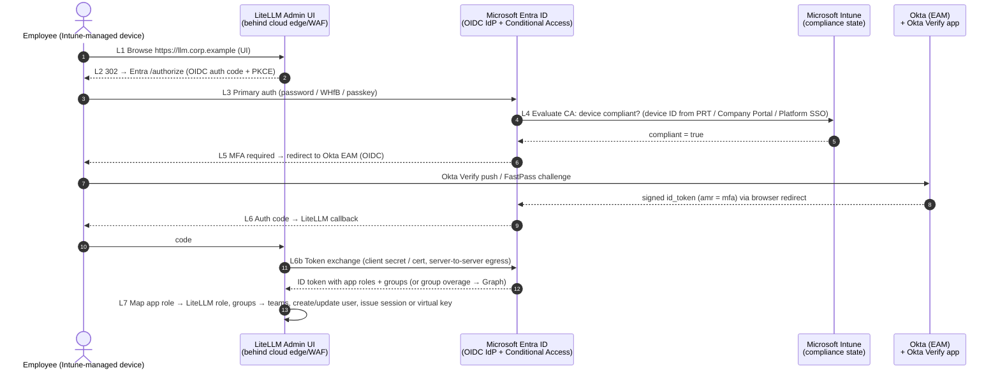
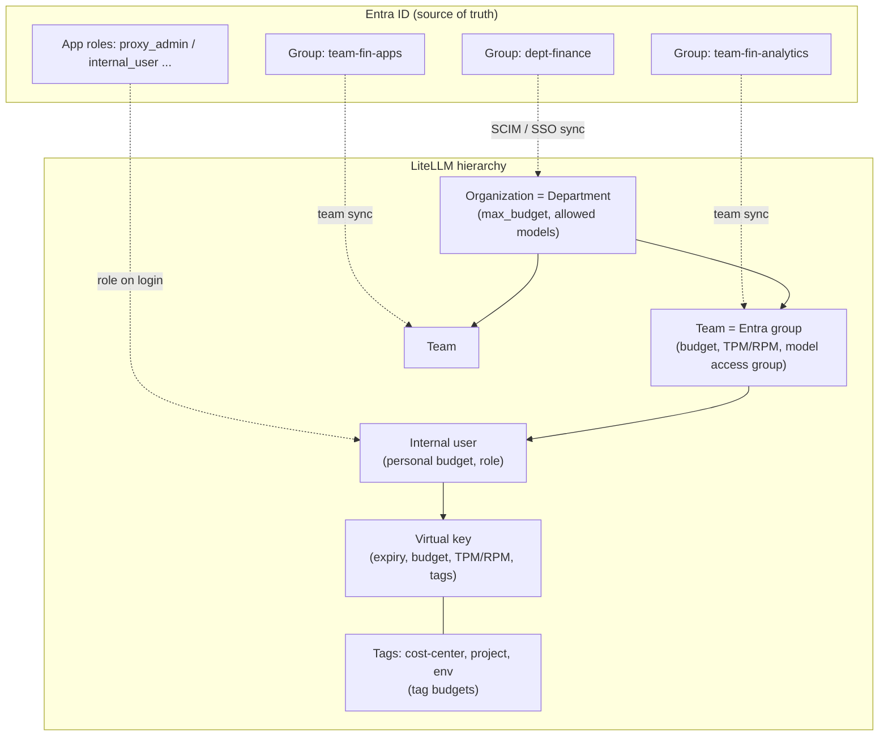
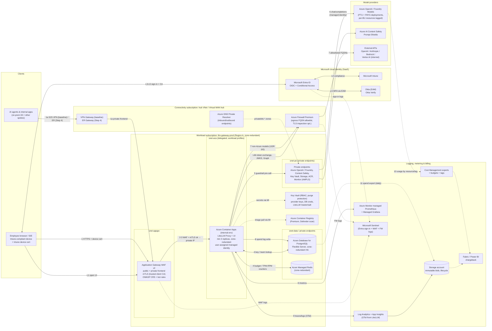
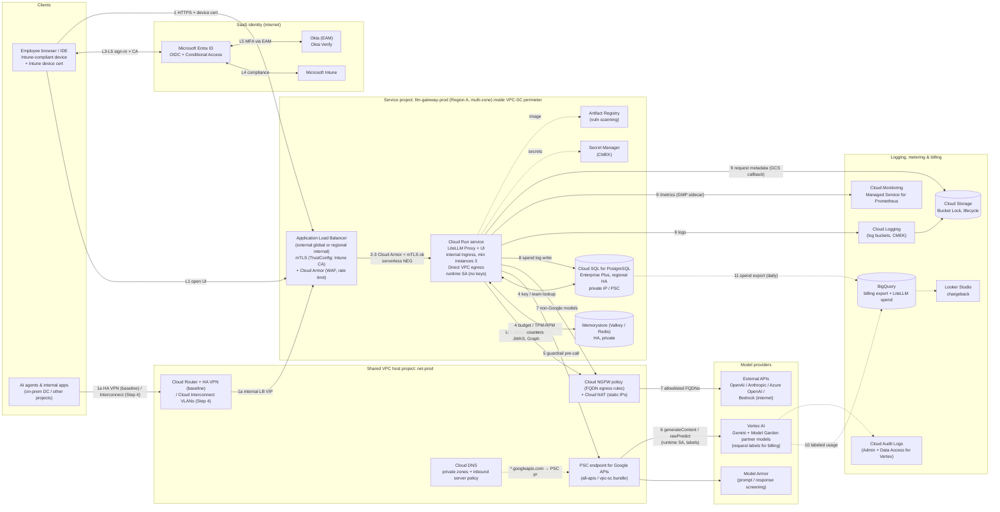
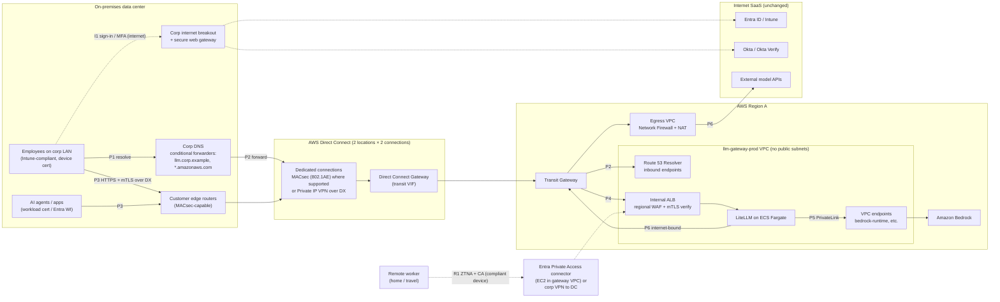
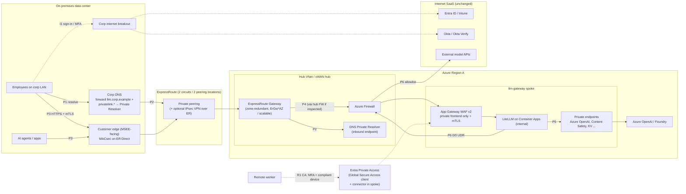
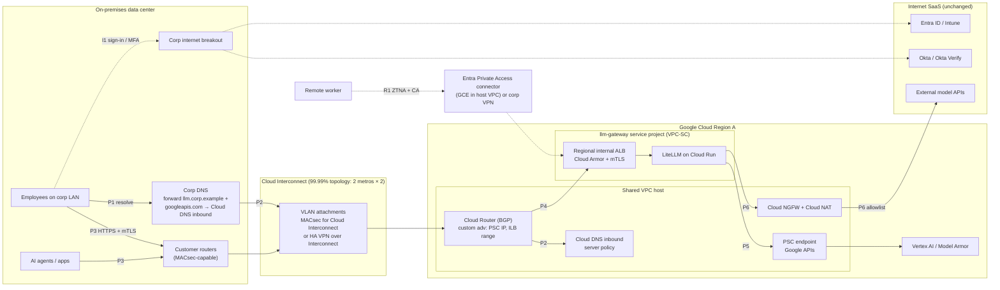
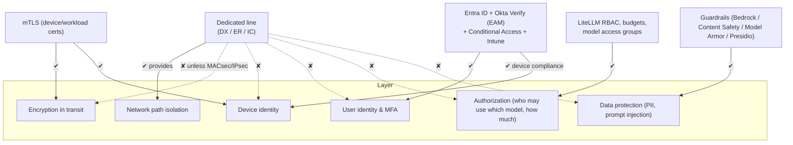
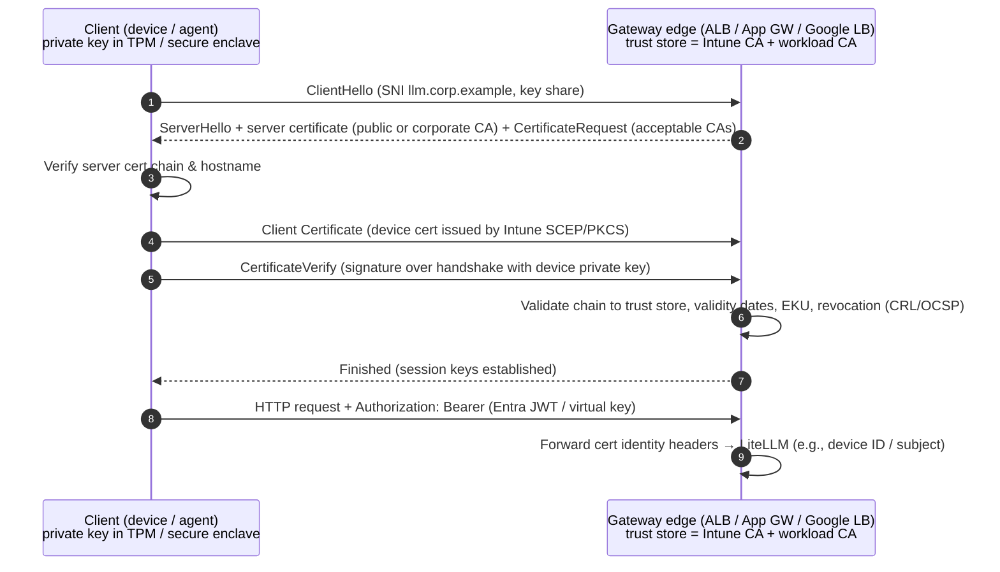

# Multi-Cloud LLM Gateway Architecture Comparison (AWS / Azure / GCP)

> **Scope:** This document covers architecture only (no implementation code). It describes an internal LLM gateway platform built on **LiteLLM Proxy**. The platform provides user and team management, cost allocation, and token controls. Each design is built for our environment: **Microsoft Entra ID** for identity, **Okta Verify** for MFA, **Microsoft Intune** for device trust, and existing **ExpressRoute / Direct Connect / Cloud Interconnect** links.
>
> **Status:** Draft for architecture review, as of 2026-10-30. Vendor features change quickly. Every vendor claim links to official documentation, and you should check those links again before you make a final decision.

---

## Table of contents

0. [Executive summary](#0-executive-summary)
1. [Assumptions](#1-assumptions)
2. [Common design: identity, MFA, device trust, and LiteLLM tenancy model](#2-common-design-shared-by-all-three-clouds)
3. [Step 1: Official reference architectures](#3-step-1-official-reference-architectures)
4. [Step 2a: AWS design](#4-step-2a-aws-design)
5. [Step 2b: Azure design](#5-step-2b-azure-design)
6. [Step 2c: GCP design](#6-step-2c-gcp-design)
7. [Step 3: Comparison and recommendation](#7-step-3-comparison-and-recommendation)
8. [Step 4: Private connectivity (dedicated line) option](#8-step-4-private-connectivity-dedicated-line-option)
9. [Appendix: reference link index](#9-appendix-reference-link-index)

---

## 0. Executive summary

- **LiteLLM is the control point on every cloud.** It owns virtual keys, the org/team/user/key hierarchy, budgets, TPM/RPM limits, model access groups, and spend logs. The cloud-native services around it supply what LiteLLM lacks: an edge and WAF, private networking, managed Postgres and Redis, secrets, guardrails, logging, and billing reconciliation.
- **Identity is the same on all three clouds.** Entra ID is the only OIDC/SAML IdP for LiteLLM. Okta Verify is attached to Entra ID as an **External Authentication Method (EAM)**, so a single Conditional Access engine evaluates both MFA and **Intune device compliance**. The clouds differ only in how their own control planes federate with Entra ID.
- **Virtual keys are bearer secrets.** Entra Conditional Access, and therefore Intune compliance, is checked only when a user *signs in*. Nothing re-checks it when someone *uses* a LiteLLM virtual key. The designs close this gap with three controls: (a) Entra-issued JWTs (LiteLLM OIDC/JWT auth) for interactive and developer clients, (b) **mTLS with Intune-deployed device certificates** at the edge, or the dedicated-line path from Step 4, and (c) short key lifetimes plus per-key network scoping for service accounts.
- **Recommendation (detail in §7):** If the deciding factor is native model access to Bedrock, put the primary gateway on **AWS**. The official guidance in the AWS repository is the closest match to what we need, and it is the only one of the three built on LiteLLM. If the model mix is mostly Azure OpenAI or Foundry models and you want the least identity and device-trust integration work, choose **Azure**. In either case, deploy LiteLLM the same way everywhere (containers, Postgres, Redis), so the gateway stays portable and other clouds' models can be reached as LiteLLM backends.
- **Dedicated lines (Step 4):** Use ExpressRoute, Direct Connect, and Interconnect as the *default path* for on-premises users and AI agents. A private path only isolates traffic. It does not authenticate users or devices, and it does not encrypt anything by itself. Keep Entra/Okta/Intune and TLS (mTLS for workloads) on top of it, and add MACsec or IPsec over the circuit if your policy requires link encryption. Remote workers still need an internet path, built on zero-trust network access (ZTNA) and Conditional Access.

---

## 1. Assumptions

Where our environment details are unknown, these designs assume the following. Each one is marked **[A-n]** and referenced throughout the document.

| ID | Assumption | Why it matters / how to validate |
|---|---|---|
| A-1 | Entra ID is the authoritative IdP for all employees, and every user has a cloud-synced UPN and group membership (synced from on-premises AD or cloud-only). | Drives OIDC claims and LiteLLM team sync. |
| A-2 | Okta is used **only as the MFA provider** (Okta Verify push, TOTP, or FastPass). It is **not** the primary federation IdP for M365. Pattern chosen: **Entra ID External Authentication Methods (EAM)** (see §2.1). | If our M365 domains are actually *federated to Okta*, use the alternative pattern in §2.1.2. |
| A-3 | Entra ID P1/P2 licensing is in place (Conditional Access, group claims, app roles). Intune enforces device compliance for Windows and macOS, and for iOS/Android where needed. | Conditional Access with "require compliant device" needs P1 or higher. |
| A-4 | Users reach the LiteLLM admin UI from a browser on an Intune-managed device. API clients include IDE plugins, SDKs, internal apps, and **AI agents hosted in the on-premises DC or in the cloud**. | Determines the authentication mode per client type (§2.3). |
| A-5 | One primary region per cloud plus a warm-standby DR region. Data residency is limited to a single geography (for example Japan or the EU). | Region choice limits which models are available. Check model availability per region. |
| A-6 | We buy a **LiteLLM Enterprise license**. In current docs, SSO for more than 5 users, OIDC/JWT auth, SCIM, audit logs, and some guardrail and logging integrations are enterprise features. | Without the license, SSO for more than 5 users and JWT auth are unavailable. See [LiteLLM Enterprise](https://docs.litellm.ai/docs/enterprise) and [Admin UI SSO](https://docs.litellm.ai/docs/proxy/admin_ui_sso). |
| A-7 | External model providers (for example OpenAI, Anthropic API, Mistral) are reached over the internet through an egress allowlist, because they have no private connectivity option in our region. | Affects egress design and Step 4. |
| A-8 | The existing ExpressRoute, Direct Connect, and Interconnect circuits terminate in a hub/transit network that is already peered with landing-zone spokes. Each has at least 2 circuits at 2 locations. | Affects HA claims in Step 4. Validate with the network team. |
| A-9 | Expected scale for sizing discussions: about 5,000 employees, about 300 concurrent users at peak, and roughly 50–200 RPS through the gateway with streaming responses. | Used only to discuss cost drivers. No pricing is quoted. |
| A-10 | By default, prompt and response **content** is *not* stored. Only metadata (user, team, model, tokens, cost, latency, guardrail verdict) is logged. Content logging is a per-team opt-in for compliance use cases. | Drives the privacy and retention design (§4.7, §5.7, §6.7). |

---

## 2. Common design (shared by all three clouds)

### 2.1 Okta Verify + Entra ID: integration patterns

There are three ways to combine Okta MFA with an Entra ID–centric estate:

| Pattern | How it works | Pros | Cons |
|---|---|---|---|
| **2.1.1 Entra ID External Authentication Methods (EAM): ✅ assumed** | Entra ID remains the IdP. Okta is registered in Entra as an *external authentication method*. When a Conditional Access policy requires MFA, Entra redirects the user to Okta through an OIDC exchange. Okta performs the **Okta Verify** challenge and returns a signed id_token, which Entra accepts as satisfying MFA. | One policy engine (Entra Conditional Access) evaluates MFA, **Intune compliance**, location, and risk together. Apps (LiteLLM, AWS, GCP) trust only Entra. | Users must be enrolled in Okta Verify beforehand, because EAM does not support inline enrollment. Users must be mapped between the two directories (Entra object ID ↔ Okta user). Check whether EAM is GA in your tenant cloud. |
| 2.1.2 Federation to Okta + `federatedIdpMfaBehavior` | The M365 domain is federated to Okta (WS-Fed/SAML). Okta performs primary authentication plus Okta Verify, then sends an MFA claim. Entra is configured to accept it (`acceptIfMfaDoneByFederatedIdp` / `enforceMfaByFederatedIdp`). | Works if Okta is already the M365 IdP. | Splits policy across two engines. Intune compliance is still evaluated only by Entra Conditional Access. Domain federation is a larger blast radius to change. |
| 2.1.3 Conditional Access "custom controls" | Legacy mechanism for third-party MFA. | None for a new design. | Microsoft positions EAM as the replacement. Do not use. |

**Assumed pattern: EAM (2.1.1), per [A-2].** Okta's guide is [Configure Okta as an external authentication method for Microsoft Entra ID](https://help.okta.com/oie/en-us/content/topics/apps/configure-okta-as-microsoft-entra-id-eam.htm). Microsoft's guide is [Manage an external authentication method in Microsoft Entra ID](https://learn.microsoft.com/entra/identity/authentication/how-to-authentication-external-method-manage). For the federation alternative, see [federatedIdpMfaBehavior (internalDomainFederation)](https://learn.microsoft.com/graph/api/resources/internaldomainfederation) and [Satisfy Entra MFA with MFA claims from a federated IdP](https://learn.microsoft.com/entra/identity/authentication/how-to-mfa-expected-inbound-assertions). Okta documents known EAM failure modes, including the `eam_amr_unsatisfiable` and `AADSTS50012620` errors: see [Okta EAM integration failures](https://support.okta.com/help/s/article/entra-id-external-authentication-method-eam-integration-failures-with-okta).

**Conditional Access policy set for the gateway** (one Entra app registration per gateway environment, for example `litellm-prod`):

| CA policy | Target | Grant controls |
|---|---|---|
| CA-GW-01 | All users → `litellm-prod` (web/UI + API audience) | Require MFA, satisfied by Okta EAM, **and** require a device marked compliant ([Intune compliance in CA](https://learn.microsoft.com/entra/identity/conditional-access/policy-all-users-device-compliance)) |
| CA-GW-02 | Admin role holders (`proxy_admin`) | Require MFA plus a compliant device, sign-in frequency of 4–8 h, phishing-resistant MFA where available (Okta FastPass, or Windows Hello for Business as an Entra method) |
| CA-GW-03 | Workload identities (service principals that call the gateway) | Restrict to named locations (cloud egress IPs, on-premises NAT) using Conditional Access for workload identities (requires the Workload ID premium license) |
| CA-GW-04 | Block legacy authentication and device-code flow for `litellm-prod` | Block |

### 2.2 Common login flow (sequence)

All three cloud diagrams reference this sequence as **steps L1–L7**.

Notes:

- Steps L3–L6 happen **between the user's device and SaaS endpoints** (`login.microsoftonline.com`, `*.okta.com`), never through the gateway network. This is important for Step 4: private circuits do not carry this traffic unless you deliberately route it that way.
- Only L1, L2, L6, and L6b touch the gateway. L6b, the back-channel token exchange, and the Graph calls for team sync are outbound internet calls from the gateway subnet, so they must be on the egress allowlist.
- LiteLLM supports Entra SSO through its Microsoft SSO integration, generic OIDC, and SAML 2.0. See [Admin UI SSO](https://docs.litellm.ai/docs/proxy/admin_ui_sso), [Microsoft SSO and team sync tutorial](https://docs.litellm.ai/docs/tutorials/msft_sso), and [SAML SSO](https://docs.litellm.ai/docs/proxy/saml_sso).

### 2.3 Authentication modes for LiteLLM API traffic

| Client type | Auth to LiteLLM | How device trust is enforced | Notes |
|---|---|---|---|
| Admin UI (browser) | Entra OIDC SSO (L1–L7) | Conditional Access CA-GW-01/02 at sign-in | Roles come from Entra **app roles** (`proxy_admin`, `proxy_admin_viewer`, `internal_user`, `internal_user_viewer`). See the [MSFT SSO tutorial](https://docs.litellm.ai/docs/tutorials/msft_sso) and [Entra app roles](https://learn.microsoft.com/entra/identity-platform/howto-add-app-roles-in-apps). |
| Developer / IDE / chat front-end (for example Open WebUI) | **Preferred:** Entra access token (JWT), validated by LiteLLM [OIDC/JWT auth](https://docs.litellm.ai/docs/proxy/token_auth) (team from the `groups` claim via `team_ids_jwt_field` / alias mapping). **Fallback:** personal virtual key with a 30–90 day expiry. | CA at token issuance, with a short token lifetime (≈60–90 min). For virtual keys, use **mTLS with an Intune-issued device certificate** at the edge, or the private path only (Step 4). | JWTs can be mapped to virtual-key-equivalent controls (budgets, TPM/RPM). See [JWT → key mapping](https://docs.litellm.ai/docs/proxy/jwt_key_mapping). |
| Internal app / AI agent (workload) | Option 1: Entra **workload identity**. The client-credentials JWT, or a federated credential from AWS/GCP/K8s, is validated by LiteLLM JWT auth. Option 2: a team-scoped **service-account virtual key** stored in the caller's secret store and rotated. | Network scoping (private path, security groups, source IP allowlist) plus mTLS workload certificates | Prefer Option 1, because it removes long-lived secrets. |
| CI/automation (key management API) | Admin virtual key held only in a secrets manager, or JWT with an admin scope | Private path only | Use the LiteLLM management APIs (`/key/generate`, `/team/new`) through IaC and pipelines. Do not use ad-hoc UI changes in production. |

**Intune device certificates for mTLS.** Intune can deploy SCEP/PKCS client certificates to managed devices ([Intune certificate profiles](https://learn.microsoft.com/intune/fundamentals/certificates/overview)). The cloud edge (AWS ALB, Azure Application Gateway, Google Cloud Load Balancing) is configured with a trust store that contains the issuing CA. The edge then accepts only connections from managed devices, which binds *device identity* to API calls that use virtual keys. When a device falls out of compliance, revoke its certificate, or set short certificate validity and have Intune reissue only to compliant devices.

### 2.4 LiteLLM tenancy model (same on all clouds)

| Need | LiteLLM feature (docs) |
|---|---|
| Onboarding / offboarding | SSO auto-provisioning on first login, plus **SCIM** from Entra for deprovisioning ([SCIM](https://docs.litellm.ai/docs/tutorials/scim_litellm)). Verify in your LiteLLM version that a deprovisioned user's keys are blocked or deleted, and add an offboarding job if they are not. |
| Roles | Entra app roles → LiteLLM roles, with highest role winning ([MSFT SSO](https://docs.litellm.ai/docs/tutorials/msft_sso)) |
| Virtual API keys | [Virtual keys](https://docs.litellm.ai/docs/proxy/virtual_keys): per-key `max_budget`, `budget_duration`, `tpm_limit`, `rpm_limit`, `models`, `expires`, `metadata.tags` |
| Team budgets / quotas | [Team budgets](https://docs.litellm.ai/docs/proxy/team_budgets), [user/team rate limits & budgets](https://docs.litellm.ai/docs/proxy/users) |
| Department / project chargeback | Orgs or tags with [tag budgets](https://docs.litellm.ai/docs/proxy/tag_budgets) and [spend tracking](https://docs.litellm.ai/docs/proxy/cost_tracking) (spend per key, user, team, tag, and model) |
| Model access policies | [Model access groups](https://docs.litellm.ai/docs/proxy/model_access): for example, `tier-standard` (small models) and `tier-premium` (frontier models) granted per team |
| Metrics | [Prometheus metrics](https://docs.litellm.ai/docs/proxy/prometheus): spend, tokens, remaining budget, latency, and failures by team and key |
| Guardrails | Pre/post-call guardrails: [Bedrock Guardrails](https://docs.litellm.ai/docs/proxy/guardrails/bedrock), [Azure Content Safety / Prompt Shields](https://docs.litellm.ai/docs/proxy/guardrails/azure_content_guardrail), [Google Model Armor](https://docs.litellm.ai/docs/proxy/guardrails/model_armor), [Presidio PII masking](https://docs.litellm.ai/docs/proxy/guardrails/pii_masking_v2) |
| Production hardening | [LiteLLM production best practices](https://docs.litellm.ai/docs/proxy/prod): Redis for cross-instance rate limits and budgets, separate DB for spend logs at scale, worker count |

**Two important behaviours to design around:**

1. **LiteLLM spend is an *estimate*.** LiteLLM computes cost from its model price map, or from custom per-model pricing that we configure. It can differ from the cloud invoice: enterprise discounts, provisioned throughput (PTU) and committed-use pricing, cached-token pricing, and taxes all cause drift. The designs therefore treat **LiteLLM as the allocation key** (who used what), and **cloud billing as the cost truth** (what we paid), and reconcile the two monthly (§4.5, §5.5, §6.5).
2. **Budgets and rate limits are enforced from Redis and Postgres state.** If Redis is unavailable, LiteLLM's multi-instance limits degrade. Each design uses a zone-redundant managed Redis and alerts on Redis errors.

---

## 3. Step 1: Official reference architectures

### 3.1 AWS

| Reference | Link | Summary | Relationship to LiteLLM |
|---|---|---|---|
| **Guidance for Multi-Provider Generative AI Gateway on AWS** *(baseline)* | [GitHub repo](https://github.com/aws-solutions-library-samples/guidance-for-multi-provider-generative-ai-gateway-on-aws) · [Solution page](https://aws.amazon.com/solutions/guidance/multi-provider-generative-ai-gateway-on-aws) · [Implementation guide](https://aws-solutions-library-samples.github.io/ai-ml/guidance-for-multi-provider-generative-ai-gateway-on-aws.html) | Terraform deployment of **LiteLLM** on **ECS Fargate or EKS** (one or the other) behind **ALB**, optionally fronted by **CloudFront + WAF** and Route 53 with ACM certificates. Uses **RDS** (keys, teams, budgets, spend), **ElastiCache Redis OSS** (settings distribution and caching), **Secrets Manager**, **KMS**, **ECR**, **S3** (logs), and **CloudWatch**. Adds a middleware for native Bedrock features (Bedrock Managed Prompts, chat history) and **Okta OAuth 2.0 JWT auth**. Documents four exposure scenarios, including **"Private VPC only"** (`PUBLIC_LOAD_BALANCER=false`, reached via VPN, **Direct Connect**, peering, or TGW). Sample infrastructure cost is about USD 378/month (ECS) or USD 385/month (EKS), excluding model usage. | **It is LiteLLM.** We adopt its topology directly and change three things: Entra (not Okta) as the OIDC IdP, an internal ALB plus private DX path, and extra controls (Network Firewall egress, Bedrock VPC endpoints, mTLS). |
| Amazon Bedrock cost allocation with application inference profiles | [Bedrock user guide: application inference profiles](https://docs.aws.amazon.com/bedrock/latest/userguide/inference-profiles-create.html) · [AWS Architecture Blog](https://aws.amazon.com/blogs/architecture/track-generative-ai-costs-with-amazon-bedrock-inference-profiles/) · [What's New (Nov 2024)](https://aws.amazon.com/about-aws/whats-new/2024/11/amazon-bedrock-cost-allocation-tags-inference-profiles) | Tag an **application inference profile** per department or team, and call it by ARN instead of the base model ID. The tags then flow into Cost Explorer and CUR 2.0. Since April 2026, Bedrock can also allocate cost by IAM principal ([What's New, Apr 2026](https://aws.amazon.com/about-aws/whats-new/2026/04/bedrock-iam-cost-allocation)). | LiteLLM model entries can point at inference-profile ARNs, so each LiteLLM team or model group maps to a tagged profile. That gives billing-grade chargeback for Bedrock spend. |
| Bedrock private access & guardrails | [Bedrock interface VPC endpoints](https://docs.aws.amazon.com/bedrock/latest/userguide/vpc-interface-endpoints.html) · [Bedrock Guardrails](https://docs.aws.amazon.com/bedrock/latest/userguide/guardrails.html) | PrivateLink endpoints for `bedrock-runtime`, plus guardrails for content filtering, PII, and denied topics. | LiteLLM calls Bedrock through the VPC endpoint, and the Bedrock Guardrails integration is native ([LiteLLM docs](https://docs.litellm.ai/docs/proxy/guardrails/bedrock)). |

### 3.2 Azure

| Reference | Link | Summary | Relationship to LiteLLM |
|---|---|---|---|
| **AI gateway in Azure API Management** | [AI gateway capabilities](https://learn.microsoft.com/azure/api-management/genai-gateway-capabilities) | APIM's built-in GenAI policies are an extension of APIM, not a separate product. They include `llm-token-limit` ([doc](https://learn.microsoft.com/azure/api-management/llm-token-limit-policy)), `llm-emit-token-metric` ([doc](https://learn.microsoft.com/azure/api-management/llm-emit-token-metric-policy)), semantic caching (requires Azure Managed Redis with RediSearch), load balancing and circuit breaking across backends, and content safety. | **Overlaps** with LiteLLM's token limits and routing. APIM's policies are keyed on APIM subscriptions, not on LiteLLM's user/team/budget model. Combination options are listed after this table. |
| **Azure Architecture Center: gateway in front of multiple Azure OpenAI deployments** | [Multi-backend gateway guide](https://learn.microsoft.com/azure/architecture/ai-ml/guide/generative-ai-gateway-multiple-models) · [Gateway guide (overview)](https://learn.microsoft.com/azure/architecture/ai-ml/guide/generative-ai-gateway) | Design guidance for a gateway in front of many Azure OpenAI instances or regions: load balancing, failover between PTU and PAYG, and chargeback. It explicitly covers both APIM and *custom-code gateways*. | LiteLLM is a "custom/third-party gateway" in this guidance's terms, and the guidance applies directly: identity-based auth to backends, PTU spillover, and per-consumer metering. |
| **APIM landing zone accelerator (GenAI gateway scenario)** and **AI Hub Gateway solution accelerator** | [Azure/apim-landing-zone-accelerator](https://github.com/Azure/apim-landing-zone-accelerator) · [Azure-Samples/ai-hub-gateway-solution-accelerator](https://github.com/Azure-Samples/ai-hub-gateway-solution-accelerator) · [Azure-Samples/AI-Gateway labs](https://github.com/Azure-Samples/AI-Gateway) | Deployable Bicep/azd samples: **APIM (internal VNet mode) behind Application Gateway WAF**, private endpoints for Azure OpenAI, managed identity to backends, and token metrics to Application Insights and Log Analytics. | We reuse the **network shape** (App Gateway WAF → internal service → private endpoints → Azure Firewall egress) with LiteLLM in place of, or behind, APIM. |
| **Baseline Microsoft Foundry chat reference architecture** | [Architecture Center](https://learn.microsoft.com/azure/architecture/ai-ml/architecture/baseline-microsoft-foundry-chat) · [Azure-Samples/microsoft-foundry-baseline](https://github.com/Azure-Samples/microsoft-foundry-baseline) | Enterprise baseline: App Gateway WAF ingress, private endpoints for every PaaS service, Azure Firewall for egress, and zone redundancy. | Provides the landing-zone network and security baseline that our LiteLLM workload spoke follows. |
| GenAI gateway playbook (APIM-based reference) | [Microsoft Learn AI playbook](https://learn.microsoft.com/ai/playbook/technology-guidance/generative-ai/dev-starters/genai-gateway/reference-architectures/apim-based) | APIM reference for hybrid estates, using a **self-hosted APIM gateway** for on-premises LLMs. | Relevant if we also front on-premises models. LiteLLM can call on-premises OpenAI-compatible endpoints directly over ExpressRoute. |

**Ways to combine APIM with LiteLLM on Azure:**

1. **LiteLLM only (recommended default).** LiteLLM calls Azure OpenAI and Foundry models through private endpoints with managed identity. This avoids two token-accounting systems.
2. **LiteLLM → APIM → Azure OpenAI.** APIM acts as a *backend* pool manager. Use this if a central platform team already runs APIM for Azure OpenAI PTU sharing across many consumers. LiteLLM is then one APIM subscriber with its own `llm-token-limit`.
3. **APIM → LiteLLM.** APIM acts as the enterprise API front door for developer-portal publishing and products. Use this only if APIM is already the corporate API standard. It adds latency and cost, and duplicates policy.

### 3.3 Google Cloud

| Reference | Link | Summary | Relationship to LiteLLM |
|---|---|---|---|
| **Apigee as an AI gateway** | [Apigee AI solutions page](https://cloud.google.com/solutions/apigee-ai) · [Google Cloud blog: Apigee for AI](https://cloud.google.com/blog/products/api-management/using-apigee-api-management-for-ai) | Google positions Apigee as the AI gateway, with token policies, semantic caching, routing and circuit breaking, logging, and Model Armor integration. | Overlaps with LiteLLM, like APIM. The combination options mirror Azure: LiteLLM only (default), LiteLLM → Apigee, or Apigee → LiteLLM. |
| Apigee AI token policies | [LLMTokenQuota policy](https://cloud.google.com/apigee/docs/api-platform/reference/policies/llm-token-quota-policy) · [PromptTokenLimit policy](https://cloud.google.com/apigee/docs/api-platform/reference/policies/prompt-token-limit-policy) · [Using AI token policies (tutorial)](https://cloud.google.com/apigee/docs/api-platform/tutorials/using-ai-token-policies) · [Semantic caching policies](https://cloud.google.com/apigee/docs/api-platform/tutorials/using-semantic-caching-policies) | Token quotas per API product, developer, or app. Prompt-token spike protection. Semantic cache built on Vertex AI embeddings and Vector Search. These are extensible policies and may carry extra cost. | Equivalent to LiteLLM's TPM/budget controls, but keyed on Apigee products and apps, not on Entra users and teams. |
| **apigee-samples (LLM)** | [GoogleCloudPlatform/apigee-samples](https://github.com/GoogleCloudPlatform/apigee-samples) | Official samples: `llm-token-limits`, `llm-semantic-cache(-v2)`, `llm-routing`, `llm-circuit-breaking`, `llm-logging`, `llm-security-v2` (Model Armor). | Useful patterns, for example circuit-breaking a Vertex AI region on 429 responses. LiteLLM provides the same functions natively through router fallbacks and cooldowns. |
| Architecture Center: generative AI | [Generative AI architecture overview](https://cloud.google.com/architecture/genai-overview) · [GKE Inference Gateway](https://cloud.google.com/kubernetes-engine/docs/concepts/about-gke-inference-gateway) | Reference architectures for GenAI on Google Cloud. GKE Inference Gateway is for **self-hosted** models on GKE (model-aware load balancing, Model Armor). | Relevant only if we self-host open-weight models. LiteLLM routes to them as an OpenAI-compatible backend. |
| Vertex AI private access & guardrails | [PSC to Generative AI on Vertex AI from on-prem](https://cloud.google.com/vertex-ai/docs/general/vertex-psc-gen-ai) · [Model Armor overview](https://cloud.google.com/model-armor/overview) · [Custom metadata labels for billing](https://cloud.google.com/vertex-ai/generative-ai/docs/multimodal/add-labels-to-api-calls) | Private Service Connect for Google APIs, a prompt and response firewall (Model Armor), and **per-request billing labels** on Gemini and partner-model calls (PayGo only). | LiteLLM calls Vertex through PSC, uses its Model Armor guardrail, and attaches team labels for billing-grade chargeback (§6.5). |

> **Observation:** Only AWS publishes an official guidance built **on LiteLLM**. Microsoft and Google publish gateway references built on their **own API-management products** (APIM, Apigee). For those two clouds, we take the *network, identity, and security baseline* from the official references and put LiteLLM in the gateway position.

---

## 4. Step 2a: AWS design

**Baseline:** the AWS guidance repository, with ECS Fargate compute (the repo supports either ECS or EKS). In this section the gateway is exposed through an **internet-facing zero-trust edge** (CloudFront + WAF + ALB with mTLS). Step 4 (§8.2) adds the private Direct Connect path as an overlay.

### 4.1 Architecture diagram (AWS)

```mermaid
flowchart LR
    %% ---------- Clients ----------
    subgraph CLIENTS["Clients"]
        direction TB
        U["Employee browser / IDE<br/>Intune-compliant device<br/>+ Intune device cert"]
        AGT["AI agents & internal apps<br/>(on-prem DC / other VPCs)"]
    end

    %% ---------- SaaS identity ----------
    subgraph IDP["SaaS identity (internet)"]
        direction TB
        ENTRA["Microsoft Entra ID<br/>OIDC + Conditional Access"]
        INTUNE["Microsoft Intune<br/>device compliance"]
        OKTA["Okta (EAM)<br/>Okta Verify"]
    end

    %% ---------- AWS edge ----------
    subgraph EDGE["AWS edge (global)"]
        direction TB
        R53["Route 53<br/>llm.corp.example"]
        CF["AWS WAF (regional web ACL on ALB)<br/>+ Shield Standard<br/>(CloudFront optional, see 4.3 step 3)"]
    end

    %% ---------- Workload account ----------
    subgraph ACCT["AWS workload account: llm-gateway-prod (Region A, 3 AZs)"]
        direction TB
        subgraph PUB["Public subnets"]
            ALB["ALB (HTTPS, TLS 1.2+)<br/>mTLS verify (trust store)<br/>ACM cert, regional WAF"]
        end
        subgraph APP["Private app subnets"]
            ECS["ECS Fargate service<br/>LiteLLM Proxy + UI<br/>(+ Bedrock middleware)<br/>tasks across 3 AZs"]
        end
        subgraph DATA["Private data subnets"]
            AUR[("Aurora PostgreSQL<br/>Multi-AZ<br/>keys, teams, budgets, spend")]
            REDIS[("ElastiCache Valkey/Redis<br/>Multi-AZ<br/>rate-limit & budget counters, cache")]
        end
        subgraph EP["Endpoint subnets (PrivateLink)"]
            VPCE["Interface endpoints:<br/>bedrock-runtime, bedrock,<br/>secretsmanager, kms, logs, sts,<br/>ecr.api/dkr, sagemaker.runtime<br/>+ S3 gateway endpoint"]
        end
        SM["Secrets Manager<br/>provider API keys, DB creds,<br/>LiteLLM master/salt key"]
        KMS["AWS KMS (CMKs)"]
        ECR["Amazon ECR<br/>LiteLLM images (scanned)"]
    end

    %% ---------- Egress ----------
    subgraph NET["Network account (shared)"]
        direction TB
        TGW["Transit Gateway"]
        NFW["Egress VPC:<br/>AWS Network Firewall<br/>(FQDN allowlist) + NAT GW"]
    end

    %% ---------- Models ----------
    subgraph MODELS["Model providers"]
        direction TB
        BR["Amazon Bedrock<br/>(app inference profiles<br/>tagged per dept/team)<br/>+ Bedrock Guardrails"]
        SMK["SageMaker AI endpoints<br/>(self-hosted models)"]
        EXT["External APIs<br/>OpenAI / Anthropic / Azure OpenAI /<br/>Vertex AI (internet)"]
    end

    %% ---------- Observability & billing ----------
    subgraph OBS["Logging, metering & billing"]
        direction TB
        CW["CloudWatch Logs & metrics<br/>+ Managed Prometheus/Grafana"]
        S3L[("S3 log bucket<br/>(Object Lock, lifecycle)")]
        CT["CloudTrail (org trail)<br/>+ Bedrock invocation logging (opt-in)"]
        CUR["CUR 2.0 + Cost Explorer<br/>+ AWS Budgets"]
        ATH["Athena / Quick Sight<br/>chargeback dashboard"]
    end

    %% ---------- Login flow ----------
    U -->|"L1 open UI"| R53
    U <-->|"L3-L5 sign-in + CA"| ENTRA
    ENTRA <-->|"L4 compliance"| INTUNE
    ENTRA <-->|"L5 MFA via EAM"| OKTA
    ECS -->|"L6b token exchange, JWKS, Graph<br/>(via egress allowlist)"| NFW

    %% ---------- API flow ----------
    U -->|"1 HTTPS + device cert"| R53
    R53 -->|"2 resolve"| CF
    CF -->|"3 WAF managed + rate rules"| ALB
    AGT -->|"1a S2S VPN / mTLS workload cert"| ALB
    ALB -->|"4 mTLS ok → forward"| ECS
    ECS <-->|"5 auth, budget, TPM/RPM check"| REDIS
    ECS <-->|"5 key / team / budget lookup"| AUR
    ECS -->|"6 guardrail pre-call"| VPCE
    VPCE -->|"7 InvokeModel / Converse<br/>(IAM task role)"| BR
    VPCE -->|"7"| SMK
    ECS -->|"8 non-AWS models"| TGW
    TGW --> NFW
    NFW -->|"8 allowlisted FQDNs"| EXT
    ECS -->|"9 spend log write"| AUR
    ECS -->|"10 logs & metrics"| CW
    ECS -->|"10 request metadata logs"| S3L
    CW --> S3L
    BR -.->|"11 tagged usage"| CUR
    AUR -.->|"12 spend export (daily)"| S3L
    S3L -.-> ATH
    CUR -.-> ATH

    %% ---------- Supporting ----------
    ECS -.->|"secrets at task start"| SM
    SM -.-> KMS
    ECS -.->|"image pull"| ECR
```

> **Diagram conventions** (matching the AWS guidance style): solid arrows show the request path with numbered steps, and dotted arrows show supporting, asynchronous, or batch flows. **L-steps** are the login flow (§2.2), and **numbered steps** are the API request flow (§4.3).

### 4.2 Component table (AWS)

| # | AWS service | Purpose in this design | Azure equivalent | GCP equivalent |
|---|---|---|---|---|
| 1 | [Route 53](https://docs.aws.amazon.com/Route53/latest/DeveloperGuide/Welcome.html) (public + private hosted zones, Resolver endpoints) | DNS for `llm.corp.example`, and split-horizon resolution for on-premises clients | Azure DNS + DNS Private Resolver | Cloud DNS (+ inbound server policy) |
| 2 | [CloudFront](https://docs.aws.amazon.com/AmazonCloudFront/latest/DeveloperGuide/Introduction.html) + [AWS WAF](https://docs.aws.amazon.com/waf/latest/developerguide/waf-chapter.html) + Shield Standard | Edge TLS, DDoS protection, managed rule groups, rate-based rules, geo/IP restrictions | Front Door + WAF (or App Gateway WAF only) | Cloud Armor on global external ALB |
| 3 | [Application Load Balancer](https://docs.aws.amazon.com/elasticloadbalancing/latest/application/introduction.html) with [mTLS verify mode](https://docs.aws.amazon.com/elasticloadbalancing/latest/application/mutual-authentication.html) | L7 routing to LiteLLM, validation of Intune device certs and workload certs against a trust store | Application Gateway v2 (mTLS) | External/Internal Application LB (mTLS) |
| 4 | [ECS on Fargate](https://docs.aws.amazon.com/AmazonECS/latest/developerguide/AWS_Fargate.html) (alt: EKS) | Runs LiteLLM Proxy, the UI, and the Bedrock middleware. Stateless, autoscaled. | Azure Container Apps (alt: AKS) | Cloud Run (alt: GKE Autopilot) |
| 5 | [Aurora PostgreSQL](https://docs.aws.amazon.com/AmazonRDS/latest/AuroraUserGuide/Aurora.AuroraPostgreSQL.html) Multi-AZ (the repo uses RDS) | LiteLLM DB: users, teams, keys, budgets, spend logs | Azure Database for PostgreSQL Flexible Server (zone-redundant HA) | Cloud SQL for PostgreSQL (HA) / AlloyDB |
| 6 | [ElastiCache (Valkey/Redis OSS)](https://docs.aws.amazon.com/AmazonElastiCache/latest/dg/WhatIs.html) Multi-AZ | Shared counters for TPM/RPM limits and budgets across tasks, plus response cache | Azure Managed Redis | Memorystore for Valkey / Redis Cluster |
| 7 | [Amazon Bedrock](https://docs.aws.amazon.com/bedrock/latest/userguide/what-is-bedrock.html) (+ [application inference profiles](https://docs.aws.amazon.com/bedrock/latest/userguide/inference-profiles-create.html)) | Native foundation models (Anthropic Claude, Amazon Nova, Llama, Mistral …), with tagged profiles for chargeback | Azure OpenAI / Foundry Models | Vertex AI (Gemini + Model Garden partner models) |
| 8 | [Bedrock Guardrails](https://docs.aws.amazon.com/bedrock/latest/userguide/guardrails.html) | Content filters, PII redaction, denied topics, prompt-attack detection, called from LiteLLM | Azure AI Content Safety / Prompt Shields | Model Armor |
| 9 | [SageMaker AI](https://docs.aws.amazon.com/sagemaker/latest/dg/whatis.html) | Optional self-hosted or fine-tuned models | Foundry managed compute / AML online endpoints | Vertex AI endpoints / GKE |
| 10 | [VPC interface endpoints (PrivateLink)](https://docs.aws.amazon.com/bedrock/latest/userguide/vpc-interface-endpoints.html) | Private access to Bedrock and AWS APIs, with endpoint policies | Private Endpoints (Private Link) | Private Service Connect (Google APIs) |
| 11 | [Transit Gateway](https://docs.aws.amazon.com/vpc/latest/tgw/what-is-transit-gateway.html) + [Direct Connect Gateway](https://docs.aws.amazon.com/directconnect/latest/UserGuide/direct-connect-gateways-intro.html) | Hub routing between on-premises, the gateway VPC, and the egress VPC | Virtual WAN / hub VNet + ER Gateway | NCC / Shared VPC + Cloud Router |
| 12 | [AWS Network Firewall](https://docs.aws.amazon.com/network-firewall/latest/developerguide/what-is-aws-network-firewall.html) + NAT Gateway | Centralized egress with an FQDN/SNI allowlist (model APIs, Entra, Okta, Graph) | Azure Firewall (FQDN rules) | Secure Web Proxy / Cloud NGFW + Cloud NAT |
| 13 | [Secrets Manager](https://docs.aws.amazon.com/secretsmanager/latest/userguide/intro.html) + [KMS](https://docs.aws.amazon.com/kms/latest/developerguide/overview.html) | Provider keys, DB credentials, LiteLLM master and salt keys; CMK encryption | Key Vault (secrets + keys, HSM) | Secret Manager + Cloud KMS (CMEK) |
| 14 | [ECR](https://docs.aws.amazon.com/AmazonECR/latest/userguide/what-is-ecr.html) (enhanced scanning) | Pinned, scanned LiteLLM images | Azure Container Registry (Defender scanning) | Artifact Registry (+ Artifact Analysis) |
| 15 | [CloudWatch](https://docs.aws.amazon.com/AmazonCloudWatch/latest/monitoring/WhatIsCloudWatch.html), [Managed Prometheus](https://docs.aws.amazon.com/prometheus/latest/userguide/what-is-Amazon-Managed-Service-Prometheus.html) / Grafana | Logs, LiteLLM Prometheus metrics, alarms | Azure Monitor / Log Analytics / App Insights / Managed Prometheus & Grafana | Cloud Logging / Cloud Monitoring (Managed Service for Prometheus) |
| 16 | [S3](https://docs.aws.amazon.com/AmazonS3/latest/userguide/Welcome.html) (+ [Object Lock](https://docs.aws.amazon.com/AmazonS3/latest/userguide/object-lock.html)) | Request-metadata logs, spend exports, audit archive | Storage account (immutable blob) | Cloud Storage (Bucket Lock) |
| 17 | [CloudTrail](https://docs.aws.amazon.com/awscloudtrail/latest/userguide/cloudtrail-user-guide.html) + [Bedrock model invocation logging](https://docs.aws.amazon.com/bedrock/latest/userguide/model-invocation-logging.html) | Control-plane audit; optional content logging for regulated teams | Activity Log + diagnostic settings | Cloud Audit Logs (Admin + Data Access) |
| 18 | [CUR 2.0](https://docs.aws.amazon.com/cur/latest/userguide/what-is-cur.html), [cost allocation tags](https://docs.aws.amazon.com/awsaccountbilling/latest/aboutv2/cost-alloc-tags.html), [AWS Budgets](https://docs.aws.amazon.com/cost-management/latest/userguide/budgets-managing-costs.html) | Billing truth, tag-based allocation, budget alarms as a backstop | Cost Management exports, tags, budgets | Billing export to BigQuery, labels, budgets |
| 19 | [Athena](https://docs.aws.amazon.com/athena/latest/ug/what-is.html) + [Amazon Quick Sight](https://docs.aws.amazon.com/quick/latest/userguide/what-is.html) | Joins LiteLLM spend with CUR for chargeback/showback | Fabric / Power BI | BigQuery + Looker Studio |
| 20 | [IAM Identity Center ↔ Entra ID](https://docs.aws.amazon.com/singlesignon/latest/userguide/idp-microsoft-entra.html) | Operator access to AWS consoles and CLIs via Entra SSO + SCIM | Native (Entra) | Workforce Identity Federation |
| 21 | [AWS Private CA](https://docs.aws.amazon.com/privateca/latest/userguide/PcaWelcome.html) (optional) | Issuing CA for workload mTLS certs (agents ↔ ALB) | Key Vault certificates / partner CA | Certificate Authority Service |

### 4.3 Request flow walkthrough (AWS)

**Login (L1–L7), as in §2.2.** The UI is served by the same LiteLLM service. LiteLLM is registered in Entra as an OIDC web app with redirect URI `https://llm.corp.example/sso/callback`. The back-channel token exchange (L6b) and the Microsoft Graph group/team sync leave through the Network Firewall, which allows `login.microsoftonline.com` and `graph.microsoft.com`.

**API request:**

1. **Client → DNS/edge.** An IDE, SDK, or chat UI on an Intune-compliant laptop calls `https://llm.corp.example/v1/chat/completions` with `Authorization: Bearer <Entra JWT | virtual key>`. The client presents its **Intune-issued device certificate**. AI agents in the on-premises DC (1a) use the existing site-to-site VPN in this baseline, or Direct Connect in Step 4, and present a **workload certificate**.
2. **Route 53** resolves the name to the ALB.
3. **AWS WAF (regional web ACL attached to the ALB)** applies AWS Managed Rules (Core, Known Bad Inputs, IP reputation), rate-based rules per source IP, a body-size limit, and a geo restriction to our operating countries. **Design decision:** this design departs from the repo's default CloudFront scenario and uses its scenario 3 (direct ALB + regional WAF), for two reasons. Device-certificate **mTLS must terminate on the ALB**: CloudFront would terminate the client TLS session first, so the ALB could not see the device certificate. Also, LLM traffic gains nothing from CDN caching. If CloudFront is needed later for global users, first check whether CloudFront viewer mTLS is supported in your account at that time; if it is not, device-certificate enforcement must move to the client side (ZTNA) and only the repo's `X-CloudFront-Secret` origin-verification header protects the ALB.
4. **ALB** verifies the client certificate chain against its trust store, which holds the Intune SCEP/PKCS CA and the workload CA. It also checks revocation using the CRL in S3. It forwards `X-Amzn-Mtls-Clientcert-*` headers and routes to the LiteLLM target group on ECS tasks in 3 AZs.
5. **LiteLLM authn/authz.** LiteLLM validates either the virtual key, by hash lookup in Aurora with a Redis cache, or the Entra JWT (signature via Entra JWKS, plus `aud`, `iss`, and expiry checks). It resolves the user, team, and org, then checks model access groups, key, user, and team **budgets**, and **TPM/RPM limits** using Redis counters. Requests over a limit get `429`, and requests over budget get `400`/`429` with a budget-exceeded error.
6. **Guardrails (pre-call).** LiteLLM calls **Bedrock Guardrails (ApplyGuardrail)** through the VPC endpoint for PII redaction, denied topics, and prompt-attack checks. Presidio runs as an optional sidecar for local PII masking.
7. **Native models.** LiteLLM calls `bedrock-runtime` through the **interface VPC endpoint**, using the ECS **task IAM role** ([task roles](https://docs.aws.amazon.com/AmazonECS/latest/developerguide/task-iam-roles.html)) with no static keys. The model ID is the **team's application inference profile ARN**, so Bedrock usage carries `CostCenter`/`Team` tags. The endpoint policy restricts the endpoint to approved model and profile ARNs.
8. **External models.** For OpenAI, the Anthropic API, Azure OpenAI, or Vertex AI, traffic goes ECS → TGW → **egress VPC (Network Firewall FQDN allowlist) → NAT → internet**. Provider API keys come from **Secrets Manager**.
9. **Response and metering.** LiteLLM streams the response, runs post-call guardrails if configured, and writes a **spend log** row to Aurora with user, team, key, tags, model, prompt and completion tokens, cost, and latency. Budget counters are updated in Redis and persisted to Postgres asynchronously.
10. **Logs and metrics.** Container stdout (JSON) goes to **CloudWatch Logs**. LiteLLM's Prometheus `/metrics` endpoint is scraped into **Amazon Managed Prometheus** with Grafana dashboards. The LiteLLM **S3 logging callback** writes request metadata, without content per [A-10], to the S3 log bucket ([LiteLLM logging](https://docs.litellm.ai/docs/proxy/logging)).
11. **Billing.** Bedrock usage appears in **CUR 2.0** with inference-profile tags. External-provider invoices arrive separately.
12. **Chargeback.** A daily job exports LiteLLM spend (by team, tag, and model) to S3. **Athena** joins it with CUR, and **Quick Sight** publishes showback per department. Month-end true-up: allocate the actual invoice amount in proportion to LiteLLM-measured usage.

### 4.4 Identity & access (AWS)

| Topic | Design |
|---|---|
| SSO to LiteLLM UI | Entra **OIDC** app (`litellm-prod`) using LiteLLM's Microsoft SSO settings (`MICROSOFT_CLIENT_ID`, `MICROSOFT_CLIENT_SECRET`, `MICROSOFT_TENANT`). The client secret is stored in Secrets Manager. Prefer a certificate credential if your LiteLLM version supports one; otherwise rotate the secret every 90–180 days. SAML 2.0 is an alternative ([LiteLLM SAML](https://docs.litellm.ai/docs/proxy/saml_sso)). |
| SSO / auth to API | LiteLLM **JWT auth** with Entra as the issuer. Clients obtain tokens for `api://litellm-prod/.default` through MSAL. `team_ids_jwt_field: groups` (or app roles) maps tokens to LiteLLM teams ([JWT auth](https://docs.litellm.ai/docs/proxy/token_auth)). Virtual keys are a fallback with mandatory expiry. |
| Group-to-role mapping | Entra **app roles** map to LiteLLM global roles (`proxy_admin`, `proxy_admin_viewer`, `internal_user`, `internal_user_viewer`). Entra **security groups** prefixed `llm-team-*` map to LiteLLM teams through team sync on login ([MSFT SSO tutorial](https://docs.litellm.ai/docs/tutorials/msft_sso)). **SCIM** handles deprovisioning ([SCIM](https://docs.litellm.ai/docs/tutorials/scim_litellm)). Only *assigned* groups are emitted in the token, which avoids the >200-group overage problem. |
| Intune compliance | Enforced by CA-GW-01 at Entra sign-in and token issuance, and **again at the edge** by ALB mTLS with Intune device certificates. AWS Verified Access is *not* used. Its device-trust providers are Jamf, CrowdStrike, and JumpCloud, not Intune ([Verified Access device trust](https://docs.aws.amazon.com/verified-access/latest/ug/device-trust.html)). |
| Service-to-service | ECS task role → Bedrock, Secrets Manager, KMS, and S3, using least-privilege policies plus VPC endpoint policies. Aurora uses **IAM DB authentication** or a rotated Secrets Manager credential. Agents → LiteLLM use Entra workload identity JWTs. For agents running in AWS, use [IAM roles](https://docs.aws.amazon.com/IAM/latest/UserGuide/id_roles.html) with Entra federated credentials, or a team service-account virtual key in the caller's Secrets Manager, combined with an mTLS workload cert from AWS Private CA. |
| Operators | IAM Identity Center federated to Entra with SCIM ([guide](https://docs.aws.amazon.com/singlesignon/latest/userguide/idp-microsoft-entra.html)). Break-glass IAM users are kept in a vault. No interactive access to Fargate tasks; ECS Exec is disabled in production. |

### 4.5 Cost allocation & token controls (AWS)

| Control | LiteLLM layer (real-time enforcement) | AWS layer (billing truth / backstop) |
|---|---|---|
| Department chargeback | LiteLLM **organization** per department, or the tag `dept:<code>` on every key and team | Bedrock **application inference profile** per department, tagged `CostCenter=<code>`. LiteLLM model aliases (for example `claude-sonnet`) resolve to the caller-team-specific profile ARN using per-team model lists or deployment aliases. Activate the cost allocation tags; activation is not retroactive. |
| Team / project | Team budget (`max_budget`, `budget_duration: 30d`), TPM/RPM, `metadata.tags: [project:x]` | Inference profiles per team only where volume justifies it, because they add operational overhead. Otherwise, allocation comes from LiteLLM spend × CUR total. |
| Per user | User budget and default personal-key budget; key expiry | IAM-principal cost allocation (April 2026) applies to *AWS principals*. All calls arrive as the single task role, so it does not identify end users. Per-user truth therefore comes from LiteLLM. |
| Token controls | TPM/RPM per key, user, and team; `max_tokens` caps per model; model access groups; [tag budgets](https://docs.litellm.ai/docs/proxy/tag_budgets) | Bedrock **service quotas** (TPM/RPM per model per region) set the upper bound. Use cross-region inference profiles for burst capacity. Use provisioned throughput only if needed. |
| Alerts | LiteLLM budget alerts (Slack/email webhooks); Prometheus alerts on `remaining_budget` | **AWS Budgets** on the gateway account and per `CostCenter` tag, at 80/100% thresholds, with SNS notifications |
| Reporting | LiteLLM UI usage tab, `/spend/*` APIs | CUR 2.0 → Athena → Quick Sight, joined to LiteLLM spend exports on `team_id`/tag and date |

### 4.6 Networking (AWS)

- **Accounts and VPCs:** a `network-prod` account owns the Transit Gateway, the DX Gateway, and the inspection/egress VPC. The `llm-gateway-prod` account has one VPC, `10.60.0.0/20`, across 3 AZs:
  - `public` (/26 ×3): ALB, only when the internet edge is enabled. Omit these subnets entirely in the private-only variant (Step 4).
  - `app` (/24 ×3): Fargate tasks.
  - `data` (/26 ×3): Aurora and ElastiCache.
  - `endpoints` (/26 ×3): interface endpoints for `bedrock-runtime`, `bedrock`, `bedrock-agent-runtime` (if used), `sagemaker.runtime`, `secretsmanager`, `kms`, `logs`, `monitoring`, `sts`, `ecr.api`, `ecr.dkr`, `elasticloadbalancing`, plus the **S3 gateway endpoint**. Private DNS is enabled on the endpoints. Route 53 Resolver inbound endpoints let on-premises DNS resolve them ([Resolver](https://docs.aws.amazon.com/Route53/latest/DeveloperGuide/resolver.html)).
- **Security groups:** ALB SG allows 443 from CloudFront or on-premises prefixes only. Tasks SG allows 4000 from the ALB SG only. Data SG allows 5432/6379 from the tasks SG only. Endpoints SG allows 443 from the tasks SG.
- **Egress:** there is no IGW route from the app subnets. The default route goes via TGW to the **inspection VPC** with **Network Firewall** stateful rules that allowlist TLS SNI for `api.openai.com`, `api.anthropic.com`, `*.openai.azure.com` (if used), `*-aiplatform.googleapis.com` (if used), `login.microsoftonline.com`, `graph.microsoft.com`, and `*.okta.com` only if LiteLLM calls Okta (it normally does not). Everything else is denied and logged.
- **Ingress paths:** (a) Internet: regional WAF → ALB with mTLS. (b) On-premises: site-to-site VPN in the baseline, or **Direct Connect** in Step 4, to TGW → ALB. With only (b), set the ALB to *internal*, which matches the repo's "Private VPC only" scenario.

### 4.7 Data & logging (AWS)

| Data | Store | Protection | Retention (proposed) |
|---|---|---|---|
| LiteLLM config DB (users, teams, keys as hashes, budgets) | Aurora PostgreSQL, Multi-AZ, encrypted with a CMK, PITR on | SG isolation, IAM auth, TLS required (`rds.force_ssl`) | Life of the platform; PITR 35 days; daily snapshot copied to the DR region |
| Spend logs (per request) | Aurora (`LiteLLM_SpendLogs`). At high volume, use a separate DB or partitioning, per [LiteLLM prod guide](https://docs.litellm.ai/docs/proxy/prod) | Same | 90 days hot in Postgres. Daily export to S3 Parquet, kept 7 years for finance [assumption]. |
| Rate-limit counters and cache | ElastiCache Valkey/Redis, Multi-AZ, encryption in transit and at rest, AUTH/RBAC | SG isolation | Ephemeral |
| Request metadata logs | S3 (LiteLLM S3 callback) → Athena | SSE-KMS, bucket policy restricted to VPC endpoint, Object Lock (governance) | 1 year hot, then Glacier until 7 years |
| Prompt/response content (opt-in teams only) | Bedrock model invocation logging → dedicated S3 bucket, or LiteLLM callback with a per-team flag | Separate KMS key and access role, Macie scanning | Per team's legal requirement (default 30 days) |
| Admin audit (who changed keys and budgets) | LiteLLM audit logs (enterprise) → S3; CloudTrail org trail | Immutable bucket in the log-archive account | 7 years |
| Infrastructure logs | CloudWatch Logs (ALB access logs, WAF logs, Network Firewall flow/alert logs, VPC Flow Logs) | KMS, cross-account subscription to the SIEM | 90 days in CloudWatch, 1–7 years in S3 |

### 4.8 Security controls (AWS)

- **WAF:** AWS Managed Rules (Core, Known Bad Inputs, Amazon IP reputation, Anonymous IP list), rate-based rules, a request-body size limit (for example 2–5 MB, sized for multimodal), a geo-match allowlist, and a separate stricter rule set on `/ui`, `/sso`, and `/key/*` admin paths.
- **mTLS:** ALB [mutual authentication verify mode](https://docs.aws.amazon.com/elasticloadbalancing/latest/application/mutual-authentication.html), with a trust store containing the Intune issuing CA and the AWS Private CA. CRLs are published to S3.
- **Secrets:** Secrets Manager with automatic rotation for the DB credential. Provider keys rotate on a 90-day schedule using a provider-specific rotation Lambda or a manual runbook. The LiteLLM `LITELLM_MASTER_KEY` and `LITELLM_SALT_KEY` are injected only as ECS secrets. **Never rotate the salt key without a re-encryption plan**, because it encrypts the stored provider credentials.
- **Encryption:** TLS 1.2+ everywhere (ALB security policy `ELBSecurityPolicy-TLS13-1-2-2021-06`). KMS CMKs for Aurora, ElastiCache, S3, CloudWatch Logs, and Secrets Manager.
- **Guardrails / PII:** Bedrock Guardrails as the default pre- and post-call guardrail for all models, including external ones, via ApplyGuardrail. Presidio handles PII masking for teams that need on-VPC processing. LiteLLM guardrails are configured per team or key.
- **Supply chain:** pin the LiteLLM image digest, mirror it to ECR, run ECR enhanced scanning (Inspector), and promote images through dev → staging → prod.
- **Detection:** GuardDuty (incl. ECS runtime monitoring), Security Hub, Config rules, and IAM Access Analyzer.

### 4.9 Scalability & HA (AWS)

- **Compute:** ECS Fargate service with at least 3 tasks spread across 3 AZs. Target-tracking autoscaling on CPU (~60%) and ALB `RequestCountPerTarget`. Set Uvicorn workers to vCPU count. Long-lived streaming responses need ALB idle timeout ≥ 300–600 s.
- **Alternative:** EKS (Karpenter, HPA, PodDisruptionBudgets) if the platform team already runs EKS. The repo supports either, but not both in one deployment.
- **Data tier:** Aurora Multi-AZ with a reader for the UI and analytics. ElastiCache Multi-AZ with automatic failover.
- **Model capacity:** Bedrock cross-region inference profiles absorb regional throttling. LiteLLM router **fallbacks** handle the rest (for example Bedrock Claude → Anthropic API, or Bedrock region A → region B) with `cooldown` on 429/5xx.
- **DR:** warm standby in Region B, deployed from the same Terraform. Aurora Global Database (RPO about 1 s) and a Route 53 failover record. Redis is rebuilt cold, which briefly resets rate-limit counters but keeps budgets in Postgres. RTO is 30–60 min.

---

## 5. Step 2b: Azure design

**Baseline:** the Microsoft Foundry chat baseline and the APIM landing zone accelerator *network shape* (App Gateway WAF → internal workload → private endpoints → Azure Firewall egress), with **LiteLLM on Azure Container Apps** (internal environment) in place of APIM as the gateway. Step 4 (§8.3) adds the ExpressRoute overlay.

### 5.1 Architecture diagram (Azure)

### 5.2 Component table (Azure)

| # | Azure service | Purpose | AWS equivalent | GCP equivalent |
|---|---|---|---|---|
| 1 | [Application Gateway WAF v2](https://learn.microsoft.com/azure/web-application-firewall/ag/ag-overview) with [mutual authentication](https://learn.microsoft.com/azure/application-gateway/mutual-authentication-overview) | Regional L7 ingress, OWASP CRS/DRS, bot protection, client-cert validation (Intune CA), public + private frontends | ALB + AWS WAF (mTLS) | External/Internal Application LB + Cloud Armor (mTLS) |
| 2 | [Azure Container Apps](https://learn.microsoft.com/azure/container-apps/overview) (internal environment, [zone redundancy](https://learn.microsoft.com/azure/reliability/reliability-container-apps)) | LiteLLM Proxy + UI. Alternative: [AKS](https://learn.microsoft.com/azure/aks/what-is-aks) with workload identity | ECS Fargate / EKS | Cloud Run / GKE |
| 3 | [Azure Database for PostgreSQL Flexible Server](https://learn.microsoft.com/azure/postgresql/flexible-server/overview) ([zone-redundant HA](https://learn.microsoft.com/azure/postgresql/high-availability/concepts-high-availability)) | LiteLLM DB | Aurora PostgreSQL | Cloud SQL / AlloyDB |
| 4 | [Azure Managed Redis](https://learn.microsoft.com/azure/redis/overview) | Rate-limit and budget counters, cache | ElastiCache | Memorystore |
| 5 | [Azure OpenAI in Foundry Models](https://learn.microsoft.com/azure/foundry/foundry-models/concepts/models-sold-directly-by-azure) | Native models (GPT family, plus Foundry Models such as partner and open models). PTU and PAYG deployments. | Bedrock | Vertex AI |
| 6 | [Azure AI Content Safety](https://learn.microsoft.com/azure/ai-services/content-safety/overview) / [Prompt Shields](https://learn.microsoft.com/azure/ai-services/content-safety/concepts/jailbreak-detection) | Content filtering and jailbreak detection, called from LiteLLM. This is in addition to the built-in Azure OpenAI content filters. | Bedrock Guardrails | Model Armor |
| 7 | [Private Endpoints](https://learn.microsoft.com/azure/private-link/private-endpoint-overview) + [Private DNS zones](https://learn.microsoft.com/azure/private-link/private-endpoint-dns) | Private access to Azure OpenAI (`privatelink.openai.azure.com`), Key Vault, Storage, ACR, Redis, PostgreSQL, Monitor (AMPLS) | VPC interface endpoints | Private Service Connect |
| 8 | [Azure DNS Private Resolver](https://learn.microsoft.com/azure/dns/dns-private-resolver-overview) | On-premises → Azure private zone resolution (inbound endpoint) | Route 53 Resolver | Cloud DNS inbound policy |
| 9 | [Azure Firewall Premium](https://learn.microsoft.com/azure/firewall/overview) (hub) | Egress FQDN allowlist, threat intel, optional TLS inspection | Network Firewall + NAT GW | Secure Web Proxy / Cloud NGFW + Cloud NAT |
| 10 | [Virtual WAN](https://learn.microsoft.com/azure/virtual-wan/virtual-wan-about) or hub-spoke + [ExpressRoute Gateway](https://learn.microsoft.com/azure/expressroute/expressroute-about-virtual-network-gateways) / [VPN Gateway](https://learn.microsoft.com/azure/vpn-gateway/vpn-gateway-about-vpngateways) | Hybrid routing | TGW + DX Gateway / VPN | NCC + Cloud Router / HA VPN |
| 11 | [Key Vault](https://learn.microsoft.com/azure/key-vault/general/overview) | Secrets, CMKs (Managed HSM if required) | Secrets Manager + KMS | Secret Manager + Cloud KMS |
| 12 | [Azure Container Registry](https://learn.microsoft.com/azure/container-registry/container-registry-intro) Premium | Private image registry, geo-replication, Defender scanning | ECR | Artifact Registry |
| 13 | [Azure Monitor](https://learn.microsoft.com/azure/azure-monitor/overview): Log Analytics, [App Insights (OpenTelemetry)](https://learn.microsoft.com/azure/azure-monitor/app/opentelemetry-overview), [managed Prometheus](https://learn.microsoft.com/azure/azure-monitor/metrics/prometheus-metrics-overview), Managed Grafana | Logs, traces, metrics, dashboards | CloudWatch + AMP/AMG | Cloud Logging/Monitoring |
| 14 | [Storage account with immutability policies](https://learn.microsoft.com/azure/storage/blobs/immutable-storage-overview) | Log archive, spend export | S3 + Object Lock | GCS + Bucket Lock |
| 15 | [Microsoft Sentinel](https://learn.microsoft.com/azure/sentinel/overview) | SIEM correlating Entra sign-ins, WAF, Firewall, and LiteLLM audit | Security Lake / 3rd-party SIEM | Google SecOps |
| 16 | [Cost Management](https://learn.microsoft.com/azure/cost-management-billing/costs/overview-cost-management) (exports, budgets) + [resource tags](https://learn.microsoft.com/azure/azure-resource-manager/management/tag-resources) | Billing truth, budget alerts | CUR + Budgets | Billing export + Budgets |
| 17 | [Defender for Cloud](https://learn.microsoft.com/azure/defender-for-cloud/defender-for-cloud-introduction) (incl. AI threat protection) | Posture, container and AI workload threat detection | GuardDuty + Security Hub | Security Command Center |
| 18 | (Optional) [API Management AI gateway](https://learn.microsoft.com/azure/api-management/genai-gateway-capabilities) | Backend pool for shared Azure OpenAI PTU (pattern 2 in §3.2) | n/a | Apigee |
| 19 | (Remote users) [Entra Global Secure Access: Private Access](https://learn.microsoft.com/entra/global-secure-access/concept-private-access) | ZTNA to the private frontend, gated by CA and a compliant device | Verified Access / Client VPN | Chrome Enterprise Premium / IAP |

### 5.3 Request flow walkthrough (Azure)

**Login (L1–L7)** follows §2.2. On Azure, the LiteLLM app registration, Conditional Access, and Intune all live in the same Microsoft tenant, so the identity integration effort is the lowest of the three clouds. L6b and the Graph team sync leave through **Azure Firewall**, which needs `login.microsoftonline.com` and `graph.microsoft.com` FQDN rules, or the `AzureActiveDirectory` service tag.

**API request:**

1. **Client → ingress.** Laptops resolve `llm.corp.example` to the App Gateway **public** frontend (internet users) or its **private** frontend (on-premises users and agents through VPN in the baseline, or ExpressRoute in Step 4). The client presents its Intune device certificate. Agents present a workload certificate.
2. **App Gateway WAF** applies the Microsoft Default Rule Set and Bot Manager, custom rate limits, a geo filter, and a body-size limit.
3. **App Gateway mTLS** validates the client chain against the uploaded trusted client CA (the Intune SCEP/PKCS CA). It can pass the certificate fields to the backend as server variables. Traffic then goes to the **internal Container Apps environment** on its private IP over HTTPS.
4. **LiteLLM authn/authz** works as on AWS (§4.3 step 5), with Redis on **Azure Managed Redis** and the DB on **PostgreSQL Flexible Server**, both reached via private endpoint or VNet integration.
5. **Guardrails.** LiteLLM calls **Azure AI Content Safety / Prompt Shields** through its private endpoint ([LiteLLM Azure content guardrail](https://docs.litellm.ai/docs/proxy/guardrails/azure_content_guardrail)). Azure OpenAI's built-in content filters also apply to Azure-hosted models.
6. **Native models.** LiteLLM calls Azure OpenAI deployments through the private endpoint, authenticating with **Entra ID via the Container App's managed identity** ([LiteLLM Azure provider](https://docs.litellm.ai/docs/providers/azure); role *Cognitive Services OpenAI User*). Public network access is disabled on the Azure OpenAI resources ([Azure AI services networking](https://learn.microsoft.com/azure/ai-services/cognitive-services-virtual-networks)). The LiteLLM router does PTU-first, PAYG-spillover load balancing across deployments and regions, as recommended in the [multi-backend gateway guide](https://learn.microsoft.com/azure/architecture/ai-ml/guide/generative-ai-gateway-multiple-models).
7. **External models.** A user-defined route sends 0.0.0.0/0 to Azure Firewall, which allows only the model FQDNs, then SNAT to the internet.
8. **Metering.** The spend log row is written to PostgreSQL, and the counters are updated in Redis.
9. **Observability.** LiteLLM's OpenTelemetry callback sends traces to App Insights. The Prometheus `/metrics` endpoint is scraped by Azure Monitor managed Prometheus (via an OTel collector sidecar in ACA, or natively on AKS). Container logs go to Log Analytics.
10. **Billing.** Azure OpenAI usage appears in Cost Management **per resource**, with its tags.
11. **Chargeback.** A daily LiteLLM spend export goes to Storage. Fabric or Power BI joins it with the Cost Management export and allocates shared PTU and PAYG cost to teams by measured tokens.

### 5.4 Identity & access (Azure)

| Topic | Design |
|---|---|
| SSO to LiteLLM UI | Entra OIDC app registration, using the LiteLLM Microsoft SSO settings. The client secret is kept in Key Vault and referenced as an ACA secret through the managed identity. |
| API auth | Entra JWTs validated by LiteLLM (same as AWS). On Azure, *workload* callers in Azure use **managed identities** to get Entra tokens for `api://litellm-prod`, so there are no secrets at all. |
| Group → role mapping | Entra app roles → LiteLLM roles. `llm-team-*` groups → LiteLLM teams (team sync). SCIM for deprovisioning. Use **group assignment to the enterprise app** with "assigned groups only" token claims. |
| Intune compliance | **Native**: CA-GW-01 requires a compliant device for the `litellm-prod` app. Also enforced at App Gateway with mTLS device certs, and by **Entra Private Access** for remote users, where a CA policy targets the Private Access app and requires a compliant device. Azure has the tightest Intune integration of the three. |
| Service-to-service | User-assigned managed identity for ACA → Azure OpenAI, Content Safety, Key Vault, Storage, and ACR, using RBAC with least-privilege roles. PostgreSQL uses a password from Key Vault. Entra auth for PostgreSQL is possible but needs token refresh support in LiteLLM's DB client, so verify before relying on it. Use [AKS workload identity](https://learn.microsoft.com/azure/aks/workload-identity-overview) if you choose AKS. |
| Operators | PIM-eligible Azure RBAC roles. No standing Owner access. Azure Policy enforces private endpoints and disabled public access. |

### 5.5 Cost allocation & token controls (Azure)

| Control | LiteLLM layer | Azure layer |
|---|---|---|
| Department chargeback | LiteLLM org per department, or a `dept:` tag | **Option A (default):** shared Azure OpenAI resources (one per region), with cost allocated from LiteLLM spend. **Option B (high-spend BUs):** a dedicated Azure OpenAI resource per BU, tagged `CostCenter`. LiteLLM maps that BU's teams to that resource's deployments. Azure billing is per resource or deployment, *not* per request, so per-request attribution must come from LiteLLM or APIM metrics. |
| Team / project | Team budgets, tags, TPM/RPM | [Cost allocation rules](https://learn.microsoft.com/azure/cost-management-billing/costs/allocate-costs) can redistribute shared-resource cost. Optional APIM `llm-emit-token-metric` with a team dimension if APIM is used (pattern 2). |
| Token controls | TPM/RPM, budgets, model access groups, `max_tokens` | Azure OpenAI **deployment TPM quotas** and **PTU** capacity are the hard ceiling. LiteLLM limits should total ≤ deployment quota per region. |
| Alerts | LiteLLM budget alerts, Prometheus alerts | [Cost Management budgets](https://learn.microsoft.com/azure/cost-management-billing/costs/tutorial-acm-create-budgets) with action groups per subscription, resource group, or tag |
| Reporting | LiteLLM UI and APIs | Cost exports to Storage → Fabric/Power BI joined with LiteLLM spend |

### 5.6 Networking (Azure)

- **Topology:** Azure landing zone hub-and-spoke or Virtual WAN. Spoke VNet `10.70.0.0/21`, zone-redundant:
  - `snet-appgw` (/24): App Gateway v2 (dedicated).
  - `snet-aca` (/23 for workload-profile environment, delegated `Microsoft.App/environments`).
  - `snet-pe` (/26): private endpoints.
  - `snet-data` (/27 delegated): PostgreSQL Flexible Server in VNet-integrated mode, or PostgreSQL via private endpoint.
- **Private endpoints and DNS:** Private DNS zones (`privatelink.openai.azure.com`, `privatelink.cognitiveservices.azure.com`, `privatelink.vaultcore.azure.net`, `privatelink.blob.core.windows.net`, `privatelink.azurecr.io`, `privatelink.redis.azure.net`, `privatelink.postgres.database.azure.com`, `privatelink.monitor.azure.com` …) are linked to the hub. On-premises DNS conditionally forwards these zones to the **DNS Private Resolver inbound endpoint** ([private endpoint DNS](https://learn.microsoft.com/azure/private-link/private-endpoint-dns-integration)).
- **NSGs:** `snet-appgw` allows 443 from the internet (if public), on-premises prefixes, and `GatewayManager`. `snet-aca` allows only from `snet-appgw`. The private-endpoint subnet allows only from `snet-aca`.
- **Egress:** UDR 0.0.0.0/0 → Azure Firewall in the hub. Application rules allowlist the model FQDNs plus Entra and Graph. Use Firewall **Premium** if TLS inspection or IDPS is required. NAT Gateway on the firewall subnet gives a stable SNAT IP for provider allowlists.
- **Ingress paths:** public frontend (internet, zero trust) and private frontend (VPN/ExpressRoute). In the private-only variant, delete the public IP listener.

### 5.7 Data & logging (Azure)

| Data | Store | Protection | Retention |
|---|---|---|---|
| LiteLLM DB | PostgreSQL Flexible Server, zone-redundant HA, CMK, geo-redundant backup | Private access only, TLS enforced | PITR up to 35 days; geo-backup to the paired region |
| Spend logs | Same DB (or a separate server at scale) → daily export to Storage (Parquet) | Same | 90 days hot, 7 years in immutable blob [assumption] |
| Counters/cache | Azure Managed Redis (TLS, Entra or access-key auth, private endpoint) | | Ephemeral |
| Request metadata, traces | Log Analytics (App Insights) | Workspace RBAC, AMPLS private link, CMK via dedicated cluster if required | 90 days interactive, 2–7 years archive tier |
| Prompt/response content (opt-in) | Dedicated storage container with its own key, or Azure OpenAI stored completions only if enabled deliberately | Separate RBAC, Purview scanning | Per policy |
| Admin audit | LiteLLM audit log → Log Analytics; Azure Activity Log; Entra audit and sign-in logs → Sentinel | Immutable export | 7 years |

### 5.8 Security controls (Azure)

- **WAF:** App Gateway WAF v2 in Prevention mode, with Microsoft DRS 2.x, Bot Manager, custom rate-limit rules, and a stricter policy on admin paths. Front Door is not used, because it would terminate TLS before the App Gateway mTLS check, the same issue as CloudFront on AWS.
- **mTLS:** App Gateway mutual authentication with the Intune CA (devices) and an internal CA (workloads). Enable CRL/OCSP checking if supported in your App Gateway SKU and region; otherwise use short-lived certificates.
- **Secrets & keys:** Key Vault (RBAC model, purge protection, private endpoint). CMKs for PostgreSQL, Storage, and Azure OpenAI where supported.
- **Guardrails / PII:** Azure OpenAI default content filters plus a custom filter policy per deployment, and LiteLLM pre-call **Prompt Shields** and Content Safety. Presidio for PII masking. Defender for Cloud AI threat protection for Azure OpenAI.
- **Policy:** Azure Policy initiatives deny public network access on Cognitive Services, Key Vault, Storage, and PostgreSQL, and require private endpoints, diagnostic settings, and tags.

### 5.9 Scalability & HA (Azure)

- **Compute:** Container Apps on a dedicated workload profile, zone-redundant, with min 3 and max N replicas. KEDA HTTP scaling on concurrent requests. Long streaming responses need a high ingress timeout; the App Gateway request timeout should be ≥ 300 s. **AKS** is the alternative if you need sidecars, custom ingress, or existing AKS operations.
- **Data:** PostgreSQL zone-redundant HA (synchronous standby in another AZ). Azure Managed Redis with zone redundancy; active geo-replication is available for multi-region.
- **Models:** LiteLLM router across Azure OpenAI deployments in ≥2 regions (data-zone or global deployment types where data residency allows), PTU-first with PAYG spillover and fallback to Bedrock or Vertex through egress.
- **DR:** secondary region spoke deployed from the same Bicep/Terraform. PostgreSQL geo-restore or a read replica promotion. Traffic Manager or DNS failover between App Gateways. RTO 30–60 min.

---

## 6. Step 2c: GCP design

> **Naming note:** Google's documentation now presents Vertex AI's model and agent capabilities under the **Gemini Enterprise Agent Platform** name ([models overview](https://cloud.google.com/gemini-enterprise-agent-platform/models)). This document keeps the name "Vertex AI" because the API surface (`aiplatform.googleapis.com`) and LiteLLM's `vertex_ai/` provider prefix are unchanged. Re-check names and endpoints before implementation.

**Baseline:** Google Cloud security foundations (Shared VPC, VPC Service Controls, Private Service Connect), with **LiteLLM on Cloud Run** behind a **Google Cloud Application Load Balancer with Cloud Armor and mTLS**. Apigee is optional (§3.3). Step 4 (§8.4) adds the Cloud Interconnect overlay.

### 6.1 Architecture diagram (GCP)

### 6.2 Component table (GCP)

| # | GCP service | Purpose | AWS equivalent | Azure equivalent |
|---|---|---|---|---|
| 1 | [Cloud Load Balancing: Application LB](https://cloud.google.com/load-balancing/docs/application-load-balancer) with [mTLS](https://cloud.google.com/load-balancing/docs/mtls) | L7 ingress, client-cert validation via TrustConfig (Intune CA) | ALB (mTLS) | App Gateway (mTLS) |
| 2 | [Cloud Armor](https://cloud.google.com/armor/docs/cloud-armor-overview) | WAF (preconfigured OWASP rules), rate limiting, geo/IP rules, Adaptive Protection | AWS WAF + Shield | App Gateway WAF |
| 3 | [Cloud Run](https://cloud.google.com/run/docs/overview/what-is-cloud-run) ([ingress controls](https://cloud.google.com/run/docs/securing/ingress), [Direct VPC egress](https://cloud.google.com/run/docs/configuring/vpc-direct-vpc)). Alternative: [GKE Autopilot](https://cloud.google.com/kubernetes-engine/docs/concepts/autopilot-overview) | LiteLLM Proxy + UI | ECS Fargate / EKS | Container Apps / AKS |
| 4 | [Cloud SQL for PostgreSQL](https://cloud.google.com/sql/docs/postgres) ([HA](https://cloud.google.com/sql/docs/postgres/high-availability)). Alternative: AlloyDB | LiteLLM DB | Aurora PostgreSQL | PostgreSQL Flexible Server |
| 5 | [Memorystore for Valkey](https://cloud.google.com/memorystore/docs/valkey) / [Redis](https://cloud.google.com/memorystore/docs/redis) | Rate-limit and budget counters, cache | ElastiCache | Azure Managed Redis |
| 6 | [Vertex AI generative AI (docs now branded *Gemini Enterprise Agent Platform*)](https://cloud.google.com/gemini-enterprise-agent-platform/models) | Gemini plus partner models (for example Anthropic Claude on Vertex, Llama, Mistral) through Model Garden | Bedrock | Azure OpenAI / Foundry |
| 7 | [Model Armor](https://cloud.google.com/model-armor/overview) | Prompt-injection, jailbreak, sensitive data (SDP), and malicious-URL screening | Bedrock Guardrails | Content Safety / Prompt Shields |
| 8 | [Private Service Connect for Google APIs](https://cloud.google.com/vpc/docs/private-service-connect) | Private VIP for `*.googleapis.com` (Vertex AI, Secret Manager, GCS, Logging) | VPC interface endpoints | Private Endpoints |
| 9 | [VPC Service Controls](https://cloud.google.com/vpc-service-controls/docs/overview) | Data-exfiltration perimeter around the Vertex AI, GCS, BigQuery, Secret Manager, and Cloud SQL APIs | (SCPs + endpoint policies) | (Private endpoints + Azure Policy, NSP) |
| 10 | [Shared VPC](https://cloud.google.com/vpc/docs/shared-vpc) + [Cloud Router](https://cloud.google.com/network-connectivity/docs/router/concepts/overview) + [HA VPN](https://cloud.google.com/network-connectivity/docs/vpn/concepts/overview) / [Cloud Interconnect](https://cloud.google.com/network-connectivity/docs/interconnect/concepts/overview) | Hybrid routing | TGW + VPN / DX | vWAN/hub + VPN/ER |
| 11 | [Cloud DNS](https://cloud.google.com/dns/docs/overview) ([inbound server policy](https://cloud.google.com/dns/docs/server-policies-overview)) | On-premises resolution of private zones and PSC | Route 53 Resolver | DNS Private Resolver |
| 12 | [Cloud NGFW](https://cloud.google.com/firewall/docs/about-firewalls) ([FQDN objects](https://cloud.google.com/firewall/docs/fqdn-objects-overview)) + [Cloud NAT](https://cloud.google.com/nat/docs/overview). Alternative: [Secure Web Proxy](https://cloud.google.com/secure-web-proxy/docs/overview) | Egress allowlist and static egress IPs | Network Firewall + NAT | Azure Firewall |
| 13 | [Secret Manager](https://cloud.google.com/secret-manager/docs/overview) + [Cloud KMS / CMEK](https://cloud.google.com/kms/docs/cmek) | Secrets and keys | Secrets Manager + KMS | Key Vault |
| 14 | [Artifact Registry](https://cloud.google.com/artifact-registry/docs/overview) | Images, vulnerability scanning | ECR | ACR |
| 15 | [Cloud Logging](https://cloud.google.com/logging/docs/overview), [Cloud Monitoring / Managed Service for Prometheus](https://cloud.google.com/stackdriver/docs/managed-prometheus) ([Cloud Run sidecar](https://cloud.google.com/stackdriver/docs/managed-prometheus/cloudrun-sidecar)) | Logs and metrics | CloudWatch / AMP | Azure Monitor |
| 16 | [Cloud Audit Logs](https://cloud.google.com/logging/docs/audit) | Admin Activity + Data Access logs (enable for Vertex AI) | CloudTrail | Activity Log |
| 17 | [Cloud Billing export to BigQuery](https://cloud.google.com/billing/docs/how-to/export-data-bigquery) + [Vertex AI request labels](https://cloud.google.com/vertex-ai/generative-ai/docs/multimodal/add-labels-to-api-calls) + [Budgets](https://cloud.google.com/billing/docs/how-to/budgets) | Billing truth with per-request label granularity | CUR + inference profiles | Cost Management |
| 18 | [Workforce Identity Federation (Entra)](https://cloud.google.com/iam/docs/workforce-sign-in-microsoft-entra-id) | Operator console/CLI SSO via Entra | IAM Identity Center | (native) |
| 19 | (Optional) [Chrome Enterprise Premium + Intune connector](https://cloud.google.com/chrome-enterprise-premium/docs/intune-overview) with [IAP](https://cloud.google.com/iap/docs/concepts-overview) | Context-aware access to the admin UI using Intune compliance signals | Verified Access (no Intune) | Entra Private Access |
| 20 | [Certificate Authority Service](https://cloud.google.com/certificate-authority-service/docs/ca-service-overview) | Workload mTLS certificates | AWS Private CA | Key Vault certs / partner CA |

### 6.3 Request flow walkthrough (GCP)

**Login (L1–L7)** follows §2.2. LiteLLM is cloud-agnostic here, using the same Entra OIDC app. L6b and the Graph calls egress through Cloud NAT, with Cloud NGFW FQDN rules for `login.microsoftonline.com` and `graph.microsoft.com`.

**API request:**

1. **Client → LB.** Internet users hit the **global external Application LB**. On-premises users and agents reach a **regional internal Application LB** VIP over HA VPN (baseline) or Interconnect (Step 4). Both present the device or workload certificate.
2. **Cloud Armor** applies preconfigured WAF rules (SQLi, XSS, LFI/RFI), per-client rate-limiting (`rate_based_ban`), and geo/IP rules.
3. **mTLS.** The LB validates the client certificate against a **TrustConfig** containing the Intune CA ([LB mTLS](https://cloud.google.com/load-balancing/docs/mtls)), then forwards to **Cloud Run** via a serverless NEG. Cloud Run ingress is set to *internal and Cloud Load Balancing*, so the service cannot be reached directly.
4. **LiteLLM authn/authz.** Same as the other clouds. Cloud Run uses **Direct VPC egress** to reach Memorystore and Cloud SQL private IPs. Cloud SQL is reached through the Cloud SQL Auth Proxy sidecar or a private IP with TLS.
5. **Guardrails.** The LiteLLM **Model Armor** guardrail runs pre-call and post-call ([LiteLLM Model Armor](https://docs.litellm.ai/docs/proxy/guardrails/model_armor)) through the PSC endpoint.
6. **Native models.** LiteLLM calls Vertex AI (`vertex_ai/gemini-*`, `vertex_ai/claude-*`) through **PSC for Google APIs**, inside the **VPC-SC perimeter**. It authenticates as the Cloud Run **runtime service account** through ADC, with no keys. It attaches **request labels** (`team`, `cost_center`, `project`) so that Gemini (`generateContent`) and partner-model (`rawPredict`) usage appears in the billing export by label. Labels are forwarded only for **PayGo** and are ignored for Provisioned Throughput. Confirm whether your LiteLLM version forwards Vertex `labels` from request metadata. If it does not, add them with a LiteLLM pre-call hook or a per-team model alias.
7. **External models.** Cloud NGFW egress rules allowlist the provider FQDNs and deny everything else. Cloud NAT provides static egress IPs.
8. **Metering.** Spend log row to Cloud SQL; counters in Memorystore.
9. **Observability.** Container logs go to Cloud Logging. Prometheus metrics go to Managed Service for Prometheus through the Cloud Run sidecar. The LiteLLM **GCS bucket callback** writes request metadata to Cloud Storage ([LiteLLM logging](https://docs.litellm.ai/docs/proxy/logging)).
10. **Billing.** Cloud Billing **detailed export to BigQuery**, with Vertex usage labeled per team.
11. **Chargeback.** A daily LiteLLM spend export goes to BigQuery and is joined with the billing export by label and date. Looker Studio dashboards show the result. GCP is the **only cloud where per-request billing labels exist natively** for the model service, so reconciliation for Vertex is the most precise.

### 6.4 Identity & access (GCP)

| Topic | Design |
|---|---|
| SSO to LiteLLM UI | Entra OIDC app (same as the other clouds). Optional extra layer: **IAP** on the UI backend with **Workforce Identity Federation** to Entra ([IAP with WIF](https://cloud.google.com/iap/docs/use-workforce-identity-federation)) and **Chrome Enterprise Premium Intune** access levels ([create Intune access levels](https://cloud.google.com/chrome-enterprise-premium/docs/create-access-levels-intune)). Do not put IAP on the API path, because API clients cannot easily get IAP tokens. |
| API auth | Entra JWT validated by LiteLLM. Agents running on GCP use **Workload Identity Federation** in the other direction: Entra federated credentials trust Google service account tokens, which lets a GCP workload get an Entra token for `api://litellm-prod`. |
| Group → role mapping | Same as the other clouds (Entra app roles, team sync, SCIM). |
| Intune compliance | Entra CA (CA-GW-01) at sign-in, plus LB mTLS with Intune device certificates. Optionally, Chrome Enterprise Premium Intune signals for IAP-protected UI paths, which require a CEP license. |
| Service-to-service | A dedicated Cloud Run runtime SA with `roles/aiplatform.user`, `roles/modelarmor.user`, `roles/secretmanager.secretAccessor`, and `roles/cloudsql.client`. No SA keys, enforced by the org policy `iam.disableServiceAccountKeyCreation`. Cloud SQL **IAM database authentication** is possible through the Auth Proxy (`--auto-iam-authn`). |
| Operators | Workforce Identity Federation with Entra. Entra group → IAM role bindings at folder or project level. |

### 6.5 Cost allocation & token controls (GCP)

| Control | LiteLLM layer | GCP layer |
|---|---|---|
| Department chargeback | LiteLLM org or `dept:` tag | Vertex **request labels** `cost_center=<code>` → billing export (PayGo only). Project-level labels on the gateway project for infrastructure cost. |
| Team / project | Team budgets, tags | Labels `team=<id>`, `project=<id>`. Keep label cardinality low, and never put per-request or user IDs in labels. |
| Per user | LiteLLM user spend (the only source; billing labels should not carry user IDs) | n/a |
| Token controls | TPM/RPM, budgets, model access groups | Vertex AI **quotas** per model and region, and Provisioned Throughput where needed. Optional Apigee `LLMTokenQuota` if Apigee is used. |
| Alerts | LiteLLM alerts, Prometheus alerting | [Cloud Billing budgets](https://cloud.google.com/billing/docs/how-to/budgets) → Pub/Sub → notification. Budgets can filter by label. |
| Reporting | LiteLLM UI and APIs | BigQuery (billing export + LiteLLM spend) → Looker Studio |

### 6.6 Networking (GCP)

- **Projects:** `net-prod` (Shared VPC host: Cloud Router, VPN/Interconnect attachments, Cloud DNS, PSC endpoint, firewall policies, Cloud NAT) and `llm-gateway-prod` (service project: Cloud Run, Cloud SQL, Memorystore, LB, Secret Manager) inside a **VPC-SC perimeter** that also includes the BigQuery and GCS logging projects.
- **Subnets (region A):** `snet-run` (/24) for Direct VPC egress; `snet-proxy-only` (/23) for regional internal/external LB proxies; a PSA range (/20) for Cloud SQL and Memorystore, or PSC-based connectivity for those services.
- **PSC for Google APIs:** a global internal IP (for example `10.80.255.10`) for the `all-apis` bundle, or `vpc-sc` to restrict to VPC-SC-supported APIs. Cloud DNS private zones for `googleapis.com` (and `REGION-aiplatform.googleapis.com`) map to the PSC IP. On-premises resolvers forward those zones to the Cloud DNS **inbound server policy** IPs ([Vertex PSC from on-prem](https://cloud.google.com/vertex-ai/docs/general/vertex-psc-gen-ai)).
- **Firewall:** hierarchical firewall policy. Ingress to `snet-run` is not needed for Cloud Run (ingress goes through the LB). Egress from `snet-run` is allowed to PSA ranges, the PSC IP, and FQDN objects for model providers and Entra; everything else is denied and logged.
- **Ingress paths:** global external ALB (internet zero trust) and regional internal ALB (VPN/Interconnect). In the private-only variant, delete the external LB.

### 6.7 Data & logging (GCP)

| Data | Store | Protection | Retention |
|---|---|---|---|
| LiteLLM DB | Cloud SQL PostgreSQL Enterprise Plus, regional HA, CMEK, PITR | Private IP only, IAM DB auth, SSL required | PITR 7–35 days; cross-region read replica for DR |
| Spend logs | Cloud SQL → daily export to BigQuery (partitioned) | Same | 90 days hot in SQL, 7 years in BigQuery/GCS [assumption] |
| Counters/cache | Memorystore (in-transit encryption, AUTH/IAM) | Private | Ephemeral |
| Request metadata | LiteLLM GCS callback → Cloud Storage (Bucket Lock) → BigQuery external table | CMEK, VPC-SC | 1 year standard, then Archive class to 7 years |
| Prompt/response content (opt-in) | Separate bucket; or Vertex AI request-response logging to BigQuery for specific models | Separate CMEK key, SDP (DLP) scanning | Per policy |
| Admin audit | LiteLLM audit logs → Cloud Logging; Cloud Audit Logs (enable **Data Access** for `aiplatform.googleapis.com`) → locked log bucket and SIEM | Locked log bucket | 7 years |

### 6.8 Security controls (GCP)

- **WAF:** Cloud Armor preconfigured WAF rules at sensitivity level 1–2 (tune for LLM payloads, which often contain code and SQL-like text that cause false positives), rate limiting, Adaptive Protection, and a stricter policy on admin paths.
- **mTLS:** LB mTLS with a TrustConfig (Intune CA plus CAS for workloads), and client validation mode `REJECT_INVALID`.
- **Exfiltration control:** a VPC-SC perimeter. Vertex AI, GCS, BigQuery, and Secret Manager are reachable only from inside it.
- **Secrets & keys:** Secret Manager with CMEK; Cloud KMS key rotation.
- **Guardrails / PII:** Model Armor templates (prompt injection, jailbreak, SDP inspect/de-identify, malicious URLs) applied by LiteLLM to **all** models, including external ones. Vertex safety filters apply to Gemini. Presidio is optional.
- **Posture:** Security Command Center (incl. AI Protection where licensed), Binary Authorization for Cloud Run, Artifact Analysis scanning, and org policies (no external IPs, no SA keys, restricted regions).

### 6.9 Scalability & HA (GCP)

- **Compute:** Cloud Run with min instances ≥ 3 (avoids cold starts and keeps Redis connection pools warm), instance-based billing ("CPU always allocated") for background tasks such as spend-log batching and budget resets, concurrency of about 50–80 per instance, and a 60-min request timeout for long streams. **GKE Autopilot** is the alternative if sidecars, Presidio, or a self-hosted model on GKE Inference Gateway are needed.
- **Data:** Cloud SQL regional HA with a synchronous standby in a second zone. Memorystore HA with a replica in another zone.
- **Models:** LiteLLM router across Vertex regions and the global endpoint where residency allows, with fallbacks to Bedrock and Azure OpenAI through egress.
- **DR:** Cloud Run in region B, deployed from the same Terraform. Cloud SQL cross-region replica promotion. The global external LB fails over automatically between serverless NEGs in two regions, and internal clients use DNS failover. RTO 15–45 min.

---

## 7. Step 3: Comparison and recommendation

### 7.1 Side-by-side comparison

Ratings: ●●● = strongest / lowest effort, ●○○ = weakest / highest effort. Ratings are relative to these three designs for *our* environment, not general rankings.

| Dimension | AWS | Azure | GCP |
|---|---|---|---|
| **Official reference maturity for *this* pattern** | ●●● An official AWS guidance repo deploys **LiteLLM** itself (Terraform, ECS/EKS, private-VPC scenario, Okta JWT) | ●●○ Mature *APIM* AI gateway references and landing-zone accelerators. LiteLLM must be substituted into them. | ●●○ Mature *Apigee* AI gateway policies and samples. LiteLLM must be substituted. |
| **Managed-service maturity (supporting services)** | ●●● Aurora, ElastiCache, ALB mTLS, Network Firewall, and PrivateLink are all GA and well understood | ●●● PostgreSQL Flexible, Managed Redis, App Gateway mTLS, Azure Firewall, and Private Link are GA. Container Apps is mature but less flexible than AKS. | ●●● Cloud SQL, Memorystore, LB mTLS, Cloud Armor, PSC, and VPC-SC are GA. Cloud Run is very low-ops. |
| **Operational effort (run the gateway)** | ●●○ ECS Fargate is low-ops. More moving parts in network (TGW + inspection VPC + endpoints per service). | ●●○ ACA is low-ops. Hub firewall and Private DNS zone sprawl need landing-zone discipline. | ●●● Cloud Run, a single PSC endpoint for all Google APIs, and VPC-SC make for the smallest surface area. |
| **Native model access** | **Bedrock**: Anthropic Claude (first-party on AWS), Amazon Nova, Llama, Mistral, DeepSeek, Cohere, and others. Cross-region inference. Guardrails. | **Azure OpenAI / Foundry**: OpenAI GPT and reasoning models (first-party on Azure), plus Foundry catalogue models (partner and open). PTU. Built-in content filters. | **Vertex AI**: Gemini (first-party), plus Model Garden partner models (Claude, Llama, Mistral …). Provisioned Throughput. |
| **Identity integration with Entra ID** | ●●○ LiteLLM ↔ Entra is cloud-agnostic. AWS operator SSO via IAM Identity Center + SCIM. No native Intune device-trust provider in AWS Verified Access, so use mTLS. | ●●● Same tenant: CA, Intune, managed identities, Entra Private Access, Sentinel. Fewest integration seams. | ●●○ LiteLLM ↔ Entra is cloud-agnostic. Operators via Workforce Identity Federation. Intune signals possible via Chrome Enterprise Premium (extra license). |
| **Networking complexity** | ●●○ Many per-service interface endpoints and Resolver rules. Network Firewall routing via TGW. Repo has a ready-made private-VPC scenario. | ●●○ ~10 private DNS zones to link and forward. Firewall UDRs. ACA subnet sizing. ExpressRoute private peering is familiar to Microsoft-centric network teams. | ●●● One PSC endpoint covers all Google APIs. Shared VPC. VPC-SC adds policy design effort but not routing complexity. |
| **Cost drivers (infra; model usage dominates)** | Fargate vCPU/GB-hours, Aurora instance + I/O, ElastiCache nodes, **interface endpoints (per AZ-hour + GB)**, **Network Firewall endpoints + NAT GB**, DX port-hours and DTO, CloudWatch ingestion. The repo's sample is about USD 380/month before hardening; Network Firewall and endpoints can add more than that. | ACA dedicated workload profile, PostgreSQL HA (2× compute), Managed Redis, **App Gateway WAF v2 capacity units**, **Azure Firewall Premium** (fixed hourly + GB), private endpoints (hourly + GB), ER circuit + gateway, **Log Analytics ingestion** (often the largest surprise). | Cloud Run (instance-based with min instances), Cloud SQL Enterprise Plus HA, Memorystore, LB forwarding rules + data, Cloud Armor (policy + requests; Enterprise optional), Cloud NGFW, Interconnect VLAN attachments + egress, Cloud Logging ingestion. Apigee, if added, is a large fixed cost. |
| **Model cost-allocation fidelity** | ●●○ Tagged application inference profiles per dept/team (coarse, extra profiles to manage) + LiteLLM | ●○○ Billing per resource only. Per-team needs LiteLLM (or APIM metrics), or a resource per BU. | ●●● Per-request billing labels on Vertex (PayGo) + LiteLLM |
| **Vendor lock-in** | Low–medium: LiteLLM, Postgres, and Redis are portable. Lock-in comes from Bedrock-specific features (Guardrails, inference profiles) and the middleware. | Low–medium: same portability. Azure OpenAI deployment and PTU constructs and Content Safety are Azure-specific. | Low–medium: same portability. VPC-SC, Model Armor, and labels are GCP-specific. |
| **Fit with our existing estate** | DX already in place. Strong if Claude-on-Bedrock is the primary model family. | ER, M365, Entra, Intune, and Sentinel already in place. Strongest identity, security-ops, and procurement fit (MACC). | Interconnect already in place. Strongest if Gemini is primary or BigQuery is the finance analytics platform. |

### 7.2 Recommendation

1. **Build one LiteLLM gateway platform design that is portable across clouds**: containers + PostgreSQL + Redis, Entra OIDC/JWT, the LiteLLM tenancy model in §2.4, and IaC modules per cloud. Pick **one primary hosting cloud** and reach the other clouds' models as LiteLLM backends over egress. Optionally, use private interconnects between clouds later.
2. **Primary hosting cloud: choose by primary model family, with identity as the tie-breaker.**
   - If most usage will be **Anthropic Claude**, or the business wants the **fastest path to production**, choose **AWS**. The official guidance *is* LiteLLM, which shortens design and security review. Apply the changes in §4: Entra instead of Okta as the OIDC IdP, regional WAF + ALB mTLS instead of the CloudFront default, Network Firewall egress, Bedrock VPC endpoints, and inference-profile tagging.
   - If most usage will be **OpenAI models** and the security team values **one Microsoft control plane** (CA + Intune + Private Access + Sentinel), choose **Azure**. Expect a little more design work, because there is no LiteLLM reference to start from. You get the lowest identity and device-trust integration effort.
   - Choose **GCP** if Gemini is primary or finance wants **billing-label-level chargeback** in BigQuery. It also has the lowest ops burden.
3. **Don't stack API managers by default.** APIM or Apigee in front of LiteLLM duplicates token accounting. Add them only for a specific need, such as shared PTU pooling across non-LiteLLM consumers, or a corporate API portal mandate.
4. **Treat LiteLLM spend as the allocation key and cloud billing as the cost truth.** Run a monthly reconciliation job on every cloud.

### 7.3 Key trade-offs

| Trade-off | Implication |
|---|---|
| LiteLLM as the single policy point vs. cloud-native gateway (APIM/Apigee) | LiteLLM gives one user/team/budget model across all providers. It is open source, and the enterprise features need a license. Our team owns patching and scaling, so pin versions and track LiteLLM security advisories. |
| Virtual keys (simple) vs. Entra JWT (zero-trust) | Virtual keys are easy for developers, but they are bearer secrets with no device check at use time. JWTs re-apply Conditional Access every token lifetime, but need MSAL in clients. Use JWT by default; issue virtual keys with expiry, and only behind mTLS or the private path. |
| Single cloud host vs. multi-cloud active/active | Multi-cloud hosting gives provider-outage resilience but doubles ops and needs cross-cloud budget consistency (shared Postgres is not practical). Prefer single-cloud HA plus a cold standby IaC on a second cloud. |
| Content logging vs. privacy | Logging prompts helps abuse investigation and quality work, but creates a sensitive data store. Default to metadata only [A-10], and allow opt-in per team with separate keys and retention. |
| Managed serverless containers vs. Kubernetes | Fargate, ACA, and Cloud Run minimize ops. Kubernetes is needed for sidecars (Presidio), custom ingress, or self-hosted models. |

---

## 8. Step 4: Private connectivity (dedicated line) option

**The proposal:** management wants gateway and AI-agent traffic to ride the existing ExpressRoute, Direct Connect, and Cloud Interconnect circuits, the same as other internal traffic. That would replace internet-based access secured by site-to-site VPN, mTLS, and Intune device identity.

**Summary position:** do it, but **as an additional layer, not a replacement.** Make the dedicated line the *default path* for on-premises users and agents. Make the gateway *internal-only* where possible. Keep every identity, device, and encryption control from the Step 2 designs.

### 8.1 What changes in every design

| Element | Step 2 baseline (internet zero trust) | Step 4 private option |
|---|---|---|
| Gateway ingress | Public LB + WAF + mTLS, plus a private frontend via VPN | **Internal LB only** (ALB internal / App Gateway private frontend / regional internal ALB). Public listener removed, or kept only for a remote-worker ZTNA connector. |
| On-premises → cloud path | Site-to-site IPsec VPN over the internet | DX / ER / Interconnect private routing (BGP), optionally with **MACsec** or **IPsec over the circuit** |
| DNS | Public DNS for `llm.corp.example` | Split-horizon: on-premises resolvers forward `llm.corp.example` and the cloud private-link zones to cloud inbound resolvers |
| Model endpoints | Private endpoints from the gateway VPC (already private) | Unchanged. The gateway still calls models through PrivateLink, Private Endpoint, or PSC. On-premises clients never call models directly, so all usage stays metered. |
| Entra / Okta / Intune | Internet (SaaS) | **Still internet (SaaS).** Unchanged. See 8.5. |
| External model providers | Cloud egress firewall → internet | Unchanged: cloud egress firewall → internet. Optionally hairpin to the on-premises internet breakout, which is not recommended. |
| Remote workers | Internet → public WAF/mTLS edge | ZTNA (Entra Private Access) or corporate VPN → DC → dedicated line. See 8.6. |

### 8.2 AWS: Direct Connect overlay

**Considerations (AWS):**

| Topic | Notes |
|---|---|
| What DX does and does not protect | DX is a private circuit that is not internet-routed. It **does not encrypt** traffic by default and **does not authenticate** users or devices. Encryption options are [MACsec on dedicated connections](https://docs.aws.amazon.com/directconnect/latest/UserGuide/MACsec.html) (10/100/400 Gbps at supported locations) or a [Private IP VPN over Direct Connect](https://docs.aws.amazon.com/vpn/latest/s2svpn/private-ip-dx.html) terminating on TGW. Keep TLS 1.2+ and mTLS end-to-end regardless. |
| Private routing to PaaS/model endpoints | DX transit VIF → DX Gateway → TGW → gateway VPC. Bedrock is reached only by **LiteLLM** through [interface VPC endpoints](https://docs.aws.amazon.com/bedrock/latest/userguide/vpc-interface-endpoints.html). On-premises clients do not need Bedrock DNS. On-premises DNS forwards `llm.corp.example` (a Route 53 private hosted zone) to [Route 53 Resolver inbound endpoints](https://docs.aws.amazon.com/Route53/latest/DeveloperGuide/resolver-forwarding-inbound-queries.html). Avoid a **public VIF**: it exposes AWS public endpoints but bypasses VPC endpoint policies. |
| Traffic that still uses the internet | (a) User sign-in and MFA to Entra ID, Okta, and Okta Verify push, from the user's device through the corporate internet breakout. (b) LiteLLM → Entra token endpoint, JWKS, and Graph, through Network Firewall. (c) LiteLLM → external model providers, through Network Firewall with an FQDN allowlist and a fixed NAT EIP that is registered with providers that support IP allowlisting. |
| Remote / hybrid workers | They are not on the DX path. Options: **Entra Private Access** with a connector in the VPC (CA + compliant device per app); the existing corporate VPN to the DC, then DX (hairpin latency); or keep the Step 2 public mTLS edge for remote users only. [AWS Client VPN](https://docs.aws.amazon.com/vpn/latest/clientvpn-admin/what-is.html) with Entra SAML is possible but does not evaluate Intune compliance. |
| Bandwidth / latency / redundancy / cost | LLM traffic is low-bandwidth (text) but uses many long-lived streaming connections. Model inference time (seconds) dominates DX's latency advantage (milliseconds). Use the [maximum resiliency model](https://docs.aws.amazon.com/directconnect/latest/UserGuide/resiliency_toolkit.html) (2 locations × 2 connections) for 99.99%. Incremental cost is small if circuits exist: DX data transfer out, TGW attachment and processing, Resolver endpoints, and MACsec-capable ports if upgrading. |
| Ops complexity / failure modes | BGP route withdrawal or leaks, asymmetric routing between DX and VPN backup, **DNS forwarding failure** (clients fall back to public DNS and fail closed, which is good), MTU issues with IPsec over DX, TGW route-table errors that expose the gateway to other spokes, and MACsec key (CKN/CAK) rotation. Monitor with DX CloudWatch metrics, TGW flow logs, and synthetic probes from on-premises. |

### 8.3 Azure: ExpressRoute overlay

**Considerations (Azure):**

| Topic | Notes |
|---|---|
| What ER does and does not protect | ER private peering is a private Layer 3 connection through a connectivity provider. It is **not encrypted** by default and does not identify users or devices. Encryption options are [MACsec on ExpressRoute Direct](https://learn.microsoft.com/azure/expressroute/expressroute-howto-macsec) (port pairs only, not provider circuits) or [site-to-site VPN over ExpressRoute private peering](https://learn.microsoft.com/azure/vpn-gateway/site-to-site-vpn-private-peering). |
| Private routing to PaaS/model endpoints | Use **private endpoints over private peering**. Don't use Microsoft peering to reach PaaS public endpoints, because it complicates routing and bypasses private endpoint controls. On-premises DNS must conditionally forward every `privatelink.*` zone in use to the **DNS Private Resolver inbound endpoint** ([on-premises DNS for private endpoints](https://learn.microsoft.com/azure/private-link/private-endpoint-dns-integration)). Missing zones are the most common failure. |
| Traffic that still uses the internet | Entra ID, Okta, and Intune sign-in and check-in from devices. Microsoft recommends the internet for most M365 and Entra traffic, and ER Microsoft peering for M365 needs authorization ([ExpressRoute for Microsoft 365](https://learn.microsoft.com/microsoft-365/enterprise/azure-expressroute)). LiteLLM → Entra token and Graph, and external model providers, go through Azure Firewall. |
| Remote / hybrid workers | **Entra Private Access** (Global Secure Access client) is the most natural fit. The same CA policy requires a compliant device, and the connector sits in the spoke and targets the App Gateway private frontend. No hairpin through the DC is needed. Alternative: Azure VPN Gateway P2S with Entra auth, or the corporate VPN. |
| Bandwidth / latency / redundancy / cost | Size the **ER gateway SKU** for aggregate throughput and flow count. Many long-lived SSE streams count against connection limits. [FastPath](https://learn.microsoft.com/azure/expressroute/about-fastpath) bypasses the gateway on the data path, but check its limitations with Private Link. For resiliency, use 2 circuits in 2 peering locations ([ER resiliency design](https://learn.microsoft.com/azure/expressroute/design-architecture-for-resiliency)). Cost: circuit (metered vs unlimited), gateway hours, private endpoint per-GB, and firewall processing if hub-inspected. |
| Ops complexity / failure modes | Private DNS zone sprawl and drift. Asymmetric routing when hub firewall inspection is added, so UDRs must cover both directions. ER circuit maintenance windows. Gateway SKU saturation. MACsec CAK/CKN rotation in Key Vault. BGP community and route-filter mistakes. Monitor with Connection Monitor, ER metrics, and Firewall logs in Sentinel. |

### 8.4 GCP: Cloud Interconnect overlay

**Considerations (GCP):**

| Topic | Notes |
|---|---|
| What Interconnect does and does not protect | Dedicated or Partner Interconnect gives private L2/L3 connectivity into the VPC. It is **not encrypted** by default and has no user or device identity. Encryption options are [MACsec for Cloud Interconnect](https://cloud.google.com/network-connectivity/docs/interconnect/concepts/macsec-overview) or [HA VPN over Cloud Interconnect](https://cloud.google.com/network-connectivity/docs/interconnect/concepts/ha-vpn-interconnect) (IPsec). |
| Private routing to PaaS/model endpoints | On-premises clients reach only the **internal ALB**. LiteLLM reaches Vertex AI and Model Armor through **PSC for Google APIs**. Cloud Router must **custom-advertise** the internal LB subnet, and the PSC IP if on-premises tools call Google APIs directly. On-premises DNS forwards to the **Cloud DNS inbound server policy** ([Vertex PSC from on-prem](https://cloud.google.com/vertex-ai/docs/general/vertex-psc-gen-ai), [private Google access for on-prem](https://cloud.google.com/vpc/docs/configure-private-google-access-hybrid)). VPC-SC ingress rules must allow the on-premises access level if on-premises tools call Vertex directly. That is not needed when traffic always goes through LiteLLM. |
| Traffic that still uses the internet | Entra, Okta, and Intune (device ↔ SaaS); LiteLLM → Entra and Graph; LiteLLM → external providers via Cloud NGFW FQDN rules and Cloud NAT static IPs. |
| Remote / hybrid workers | Entra Private Access connector on GCE in the host VPC (CA + compliant device), the corporate VPN, or Chrome Enterprise Premium + IAP for **UI-only** access with Intune signals. |
| Bandwidth / latency / redundancy / cost | Use the [99.99% topology](https://cloud.google.com/network-connectivity/docs/interconnect/tutorials/dedicated-creating-9999-availability) (4 connections, 2 metros, 2 Cloud Routers). VLAN attachment capacity and Cloud Router route limits apply. Egress over Interconnect is cheaper than internet egress, but LLM traffic volume is small, so fixed attachment and port costs dominate. |
| Ops complexity / failure modes | Missing custom route advertisements (the most common issue). DNS forwarding loops between on-premises and Cloud DNS. VPC-SC denials that look like 403s. MACsec key rotation. Partner Interconnect provider outages. Monitor with Interconnect metrics, Network Intelligence Center Connectivity Tests, and VPC-SC dry-run logs. |

### 8.5 What private connectivity does *not* solve (all clouds)

Key points to communicate to management:

- **A private line is a path, not an identity.** Any compromised host on the corporate network, or in any VPC, VNet, or project routed to the gateway, can reach it. Without per-request user, device, and workload authentication, a private line *widens* the trusted zone.
- **Dedicated circuits are not encrypted by default.** If our policy requires link encryption, enable MACsec (where the port type supports it) or IPsec over the circuit. In all cases, keep TLS 1.2+/1.3 end-to-end to the gateway, because TLS protects against insiders on the path, not just the provider.
- **SaaS identity stays on the internet.** Entra ID, Okta Verify push, and Intune check-ins are SaaS. The dedicated line does not carry them, and a dedicated-line outage does not affect them. An *internet* outage at the DC, however, breaks sign-in even while the circuits are up. The corporate breakout must be redundant.
- **External model providers stay on the internet.** OpenAI, the Anthropic API, and similar providers are reached from the cloud egress firewall. If a provider offers private connectivity in your cloud (for example a provider's PrivateLink offering or a cloud-hosted equivalent such as Claude on Bedrock or Vertex, or OpenAI models on Azure), prefer that.

### 8.6 Remote and hybrid workers

| Option | Device trust | User experience | Recommendation |
|---|---|---|---|
| **Entra Private Access** (Global Secure Access) with connectors in each cloud VPC/VNet | Entra CA + Intune compliance per app segment ([Private Access](https://learn.microsoft.com/entra/global-secure-access/concept-private-access)) | Transparent, per-app, no full tunnel | **Recommended**: same policy engine everywhere, and it works for all three clouds |
| Corporate full-tunnel VPN → DC → dedicated line | VPN posture checks (vendor-specific) | Hairpin latency, plus VPN capacity planning | Acceptable short-term |
| Keep the Step 2 public edge (WAF + mTLS + CA) for remote users only | Intune device cert at the edge + CA | Direct, lowest latency | Acceptable. This is the "internet zero trust" path, kept intentionally for remote users. |

### 8.7 mTLS explainer

**How it works (TLS 1.3, simplified):**

| | mTLS secures | mTLS does **not** secure / limitations |
|---|---|---|
| **Authentication** | *Mutual* authentication: the client proves possession of a private key bound to a certificate from a trusted CA (device or workload identity), and the server proves its identity to the client | It is **not user authentication or authorization**. A valid device cert says nothing about *which user* or *which models and budgets*. Entra JWT, virtual keys, and LiteLLM RBAC are still required. |
| **Encryption** | Confidentiality and integrity in transit between client and TLS terminator, with forward secrecy (TLS 1.3) | Only up to the **termination point** (LB). The LB → backend hop needs its own TLS. A corporate **TLS-inspecting proxy** breaks mTLS, so exempt `llm.corp.example` from inspection. |
| **Certificate lifecycle** | Automatable: Intune SCEP/PKCS profiles for devices; Private CA / Key Vault / CAS for workloads | Issuance, renewal, and CA rotation are operational work. Expired certs cause outages, so monitor expiry and use 30–90 day validity with auto-renewal. |
| **Revocation** | CRL/OCSP checks at the edge, where supported (ALB supports CRLs; check App Gateway and Google LB capabilities per region) | Revocation is often slow or unsupported. Short-lived certs are more reliable than CRLs. Compliance loss in Intune does not automatically revoke the cert unless that is automated. |
| **Key protection** | TPM- or Secure Enclave–bound non-exportable keys (Intune can require a TPM KSP) | Software-stored keys can be copied to an unmanaged machine. |
| **Header trust** | The edge passes cert attributes to LiteLLM | The backend must accept those headers **only** from the LB. Strip client-supplied copies. |

**mTLS vs. dedicated lines:**

| Property | Dedicated line (DX / ER / IC) | mTLS |
|---|---|---|
| Layer | L1–L3 path | L4–L7 session |
| Authenticates | Nothing (the BGP peer at most) | Each client device or workload, and the server |
| Encrypts | No (unless MACsec or IPsec added) | Yes, end-to-end to the TLS terminator |
| Protects against internet exposure / DDoS | Yes (no public endpoint) | No (endpoint may be public; WAF/DDoS still needed) |
| Protects against a compromised internal host | No | Partly. The attacker also needs a valid cert and key. |
| Works for remote workers | No (needs VPN/ZTNA) | Yes |
| Deterministic bandwidth/latency, SLA | Yes | No (rides whatever path) |
| Main operational burden | Circuits, BGP, DNS forwarding, provider SLAs | PKI, cert lifecycle, revocation, proxy exemptions |

They are **complementary**: the dedicated line reduces *exposure*, and mTLS provides *cryptographic identity and encryption*.

### 8.8 Recommended zero-trust posture (combining both)

| Layer | Control (all clouds) |
|---|---|
| **User identity** | Entra ID OIDC/JWT for UI and API. Okta Verify via **EAM** for MFA, phishing-resistant for admins. Short token lifetimes. SCIM deprovisioning. |
| **Device** | Intune compliance enforced by **Conditional Access** at token issuance, **and** an Intune-issued, TPM-bound **device certificate** checked by **mTLS** at the gateway edge. |
| **Workload** | Agents authenticate with Entra workload identity (federated credentials) plus **mTLS workload certificates**. Service-account virtual keys only as an exception, with expiry, budgets, and IP scoping. |
| **Network** | **Dedicated line is the default** for on-premises users and agents to an **internal-only** gateway. **Entra Private Access** for remote users. The public edge is either removed, or kept only with WAF + mTLS + CA. Models are reached only through private endpoints. Egress is allowlisted. |
| **Transport encryption** | TLS 1.2+ (prefer 1.3) end-to-end, including LB → LiteLLM → model. **MACsec or IPsec over the circuits** if data classification requires link-layer encryption. |
| **Authorization & usage** | LiteLLM RBAC, model access groups, budgets, and TPM/RPM per org, team, user, and key. Cloud quotas as the outer limit. |
| **Data** | Guardrails on every request (PII, prompt injection). Metadata-only logging by default. CMK encryption. Immutable audit. |
| **Detect & respond** | Entra sign-in logs, WAF, firewall, and LiteLLM audit/spend anomalies in Sentinel or the SIEM. Automated key revocation on user offboarding or device non-compliance. |

> **Bottom line for management:** routing gateway traffic over ExpressRoute, Direct Connect, and Interconnect is a good choice for exposure reduction and predictable connectivity. It is **not** a substitute for user MFA, device compliance, mTLS, or encryption. Approve the private-path design together with the identity, device, and mTLS controls, not instead of them.

---

## 9. Appendix: reference link index

**AWS:** [Multi-provider GenAI gateway guidance (repo)](https://github.com/aws-solutions-library-samples/guidance-for-multi-provider-generative-ai-gateway-on-aws) · [Bedrock VPC endpoints](https://docs.aws.amazon.com/bedrock/latest/userguide/vpc-interface-endpoints.html) · [Bedrock application inference profiles](https://docs.aws.amazon.com/bedrock/latest/userguide/inference-profiles-create.html) · [Bedrock Guardrails](https://docs.aws.amazon.com/bedrock/latest/userguide/guardrails.html) · [ALB mTLS](https://docs.aws.amazon.com/elasticloadbalancing/latest/application/mutual-authentication.html) · [Direct Connect MACsec](https://docs.aws.amazon.com/directconnect/latest/UserGuide/MACsec.html) · [Private IP VPN over DX](https://docs.aws.amazon.com/vpn/latest/s2svpn/private-ip-dx.html) · [DX resiliency toolkit](https://docs.aws.amazon.com/directconnect/latest/UserGuide/resiliency_toolkit.html) · [Route 53 Resolver](https://docs.aws.amazon.com/Route53/latest/DeveloperGuide/resolver.html) · [Verified Access device trust](https://docs.aws.amazon.com/verified-access/latest/ug/device-trust.html) · [IAM Identity Center + Entra](https://docs.aws.amazon.com/singlesignon/latest/userguide/idp-microsoft-entra.html)

**Azure / Microsoft:** [APIM AI gateway](https://learn.microsoft.com/azure/api-management/genai-gateway-capabilities) · [Multi-backend gateway guide](https://learn.microsoft.com/azure/architecture/ai-ml/guide/generative-ai-gateway-multiple-models) · [APIM landing zone accelerator](https://github.com/Azure/apim-landing-zone-accelerator) · [AI Hub Gateway accelerator](https://github.com/Azure-Samples/ai-hub-gateway-solution-accelerator) · [Foundry chat baseline](https://learn.microsoft.com/azure/architecture/ai-ml/architecture/baseline-microsoft-foundry-chat) · [App Gateway mTLS](https://learn.microsoft.com/azure/application-gateway/mutual-authentication-overview) · [ExpressRoute MACsec](https://learn.microsoft.com/azure/expressroute/expressroute-howto-macsec) · [VPN over ER private peering](https://learn.microsoft.com/azure/vpn-gateway/site-to-site-vpn-private-peering) · [Private endpoint DNS integration](https://learn.microsoft.com/azure/private-link/private-endpoint-dns-integration) · [Entra EAM](https://learn.microsoft.com/entra/identity/authentication/how-to-authentication-external-method-manage) · [CA: require compliant device](https://learn.microsoft.com/entra/identity/conditional-access/policy-all-users-device-compliance) · [Intune certificates](https://learn.microsoft.com/intune/fundamentals/certificates/overview) · [Entra Private Access](https://learn.microsoft.com/entra/global-secure-access/concept-private-access)

**Google Cloud:** [Apigee AI](https://cloud.google.com/solutions/apigee-ai) · [LLMTokenQuota](https://cloud.google.com/apigee/docs/api-platform/reference/policies/llm-token-quota-policy) · [apigee-samples](https://github.com/GoogleCloudPlatform/apigee-samples) · [GenAI architecture overview](https://cloud.google.com/architecture/genai-overview) · [Vertex PSC from on-prem](https://cloud.google.com/vertex-ai/docs/general/vertex-psc-gen-ai) · [Vertex request labels](https://cloud.google.com/vertex-ai/generative-ai/docs/multimodal/add-labels-to-api-calls) · [Model Armor](https://cloud.google.com/model-armor/overview) · [LB mTLS](https://cloud.google.com/load-balancing/docs/mtls) · [Interconnect MACsec](https://cloud.google.com/network-connectivity/docs/interconnect/concepts/macsec-overview) · [HA VPN over Interconnect](https://cloud.google.com/network-connectivity/docs/interconnect/concepts/ha-vpn-interconnect) · [Workforce Identity Federation + Entra](https://cloud.google.com/iam/docs/workforce-sign-in-microsoft-entra-id) · [Chrome Enterprise Premium + Intune](https://cloud.google.com/chrome-enterprise-premium/docs/intune-overview)

**LiteLLM:** [Proxy docs](https://docs.litellm.ai/docs/simple_proxy) · [Admin UI SSO](https://docs.litellm.ai/docs/proxy/admin_ui_sso) · [Microsoft SSO & team sync](https://docs.litellm.ai/docs/tutorials/msft_sso) · [SCIM](https://docs.litellm.ai/docs/tutorials/scim_litellm) · [JWT auth](https://docs.litellm.ai/docs/proxy/token_auth) · [Virtual keys](https://docs.litellm.ai/docs/proxy/virtual_keys) · [Team budgets](https://docs.litellm.ai/docs/proxy/team_budgets) · [Tag budgets](https://docs.litellm.ai/docs/proxy/tag_budgets) · [Cost tracking](https://docs.litellm.ai/docs/proxy/cost_tracking) · [Model access](https://docs.litellm.ai/docs/proxy/model_access) · [Prometheus](https://docs.litellm.ai/docs/proxy/prometheus) · [Logging](https://docs.litellm.ai/docs/proxy/logging) · [Guardrail providers](https://docs.litellm.ai/docs/guardrail_providers) · [Production](https://docs.litellm.ai/docs/proxy/prod) · [Enterprise](https://docs.litellm.ai/docs/enterprise)

**Okta:** [Okta as Entra EAM](https://help.okta.com/oie/en-us/content/topics/apps/configure-okta-as-microsoft-entra-id-eam.htm) · [Okta EAM integration page](https://www.okta.com/integrations/microsoft-entra-id-external-authentication-methods/)
